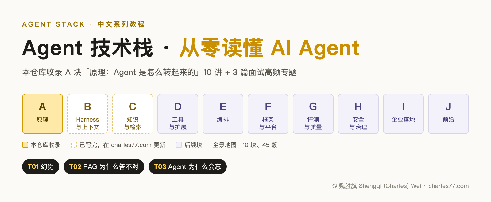
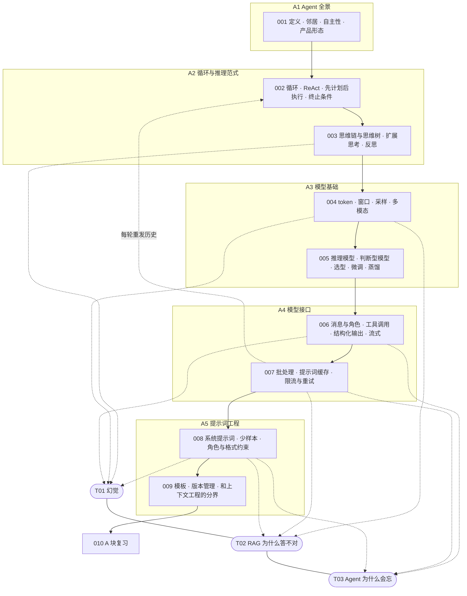
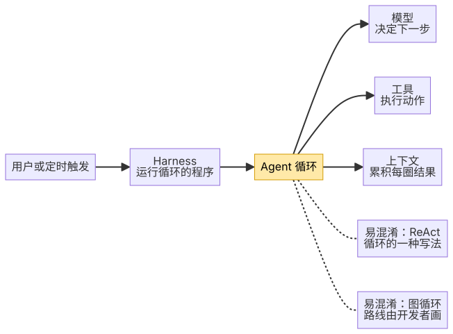
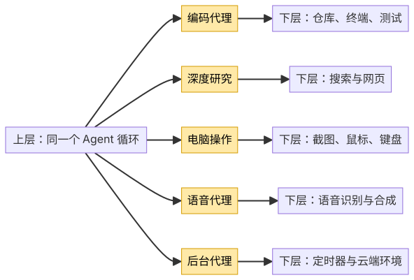
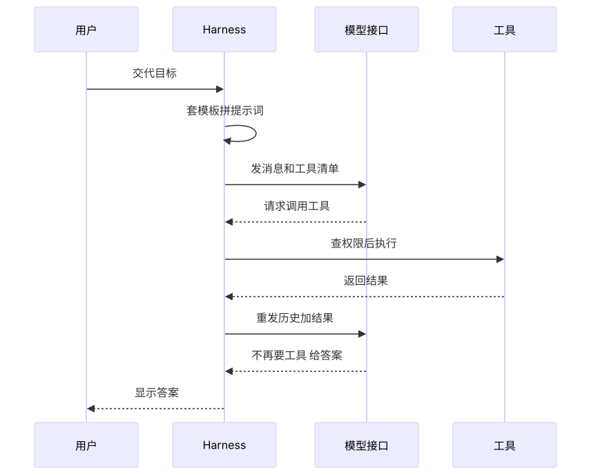
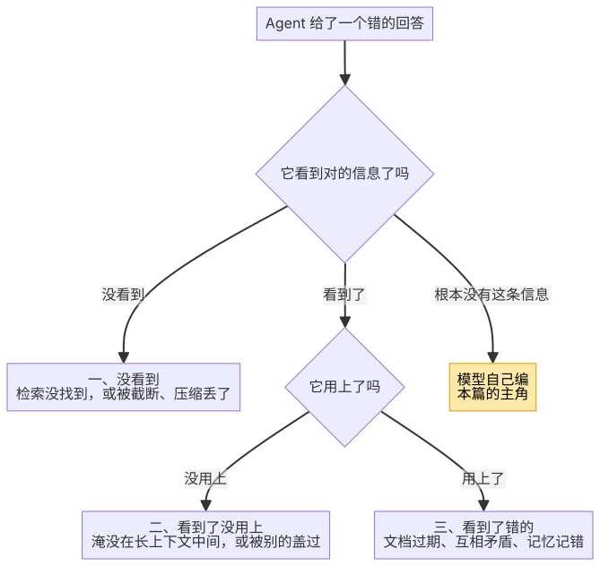

<div align="center">

# Agent 技术栈 · 从零读懂 AI Agent
<sub>Agent Stack Notes — a Chinese tutorial series on how AI agents work</sub>

一套从最顶层往下拆 AI Agent 的中文系列教程：本仓库收录第一块「原理：Agent 是怎么转起来的」10 讲，外加 3 篇面试高频专题。</br>
*A Chinese, diagram-heavy tutorial series on AI agents: Block A (10 lessons on the agent loop, models, APIs and prompting) plus 3 deep-dive topics on hallucination, RAG failures and memory loss.*




[从第 001 讲开始](lessons/001-agent-landscape.md) · [A 块复习](lessons/010-block-a-review.md) · [专题：幻觉](topics/T01-hallucination.md) · [作者主页](https://charles77.com)

</div>

> 2026 年几乎每个产品都自称 Agent，但一个按关键词回话术的客服机器人、一条串了五次模型调用的报表流程、一个能自己改三十个文件再跑测试的编码工具，成本和风险差了一个数量级。这个系列先给出一条判断标准：**下一步做什么，是模型在运行时决定的，还是人事先写死的**；再顺着一次请求的路径，把循环、模型、接口、提示词一层层拆开。每一讲都配流程图、三类岗位视角、可以直接复述的口述稿和带逐字范例的面试题。

## 目录

- [核心亮点](#核心亮点)
- [适合谁读](#适合谁读)
- [内容一览](#内容一览)
- [课程地图](#课程地图)
- [每一讲长什么样](#每一讲长什么样)
- [图表预览](#图表预览)
- [仓库结构](#仓库结构)
- [如何阅读](#如何阅读)
- [更多内容](#更多内容)
- [说明](#说明)

## 核心亮点

- **一张地图、从上往下讲**：整套系列是一张 10 块、45 簇的 Agent 技术栈地图（原理 → Harness 与上下文 → 知识与检索 → 工具 → 编排 → 框架 → 评测 → 安全 → 企业落地 → 前沿），每讲开头都有定位图，告诉你今天站在地图哪里。
- **105 张图**：13 篇笔记共嵌入 105 张 SVG 图（流程图、时序图和定位图），正文里的图下面都跟着一段「怎么读这张图」。
- **69 道面试题，每道带逐字范例**：A 块 9 讲各 5 道、A 块复习 7 道跨簇模拟面试、3 篇专题共 17 道；题目按「开发」「产品·商分」「金融科技·数据」三类岗位标注，来源写明是题库题、面经题还是自拟。
- **拿真实运行讲道理**：例如第 007 讲把一次 Claude Code 会话里 124 次接口回复的 `usage` 字段加总，缓存读取占全部输入的 92.7%，按 API 价换算，不缓存约 83 美元、有缓存约 16 美元。
- **可回溯的事实**：13 篇共列出 232 条参考来源，网页来源注明访问或核实日期；时效性说法在 2026-10-30 做过一轮全库刷新，A 块复习还逐张回访了九张卡片里最容易过时的断言。

## 适合谁读

- 想系统弄懂「Agent 到底是什么、怎么转起来」的开发者、产品经理和分析师，不想只背名词。
- 准备 AI 应用 / Agent 开发、AI 产品 / 商业分析、金融科技 / 数据这三类岗位，需要能讲清原理、能答追问的人。
- 已经在用 Claude Code、Codex 一类编码代理，想知道它们每一圈在请求里到底发了什么的人。

不需要机器学习背景。每个术语第一次出现时都随文括注英文全称和一句话解释，每讲末尾还有术语小词典。

## 内容一览

### A 块：原理 —— Agent 是怎么转起来的

| 编号 | 标题 | 一句话 | 链接 |
|---|---|---|---|
| 001 | Agent 全景 | 看任何 Agent 产品先问三件事：下一步谁决定、做之前问不问人、跑在什么环境里 | [阅读](lessons/001-agent-landscape.md) |
| 002 | Agent 循环与推理范式（上） | 看一个 Agent 怎么转先问三件事：每一圈谁在动手、下一步是现想的还是先计划好的、它凭什么停下来 | [阅读](lessons/002-agent-loop-and-reasoning-1.md) |
| 003 | Agent 循环与推理范式（下） | 让 Agent 想得更好有三个时间点：回答前把步骤写出来，回答前让模型自己多想，做完后拿外部事实回头查 | [阅读](lessons/003-agent-loop-and-reasoning-2.md) |
| 004 | 模型基础（上） | 读进去多少看 token，装得下多少看窗口，怎么挑字看采样，除了文字还能看什么看多模态；四个概念算的是同一本账 | [阅读](lessons/004-model-fundamentals-1.md) |
| 005 | 模型基础（下） | 该想多深看推理档位，该不该生成看判断型模型，该用哪一档看评测集，该改输入还是改模型按提示、检索、微调的顺序试 | [阅读](lessons/005-model-fundamentals-2.md) |
| 006 | 模型接口（上） | 怎么开口看消息和角色，怎么动手看工具调用，怎么拿到程序能直接用的结果看结构化输出，怎么让人边等边看看流式 | [阅读](lessons/006-model-api-1.md) |
| 007 | 模型接口（下） | 不着急的打包半价跑，重复的前缀只付零头，撞到上限时知道等多久、试几次、什么时候放弃 | [阅读](lessons/007-model-api-2.md) |
| 008 | 提示词工程（上） | 规则写在最稳的位置，做法用例子示范，身份和格式说成可以检查的要求 | [阅读](lessons/008-prompt-engineering-1.md) |
| 009 | 提示词工程（下） | 固定的写一次、变的填进去，每一版都能查、能比、能退回，提示词之外窗口里装什么交给上下文工程 | [阅读](lessons/009-prompt-engineering-2.md) |
| 010 | A 块复习：Agent 是怎么转起来的 | 看懂 A 块就是看懂一圈：下一步谁决定、这一圈装了多少 token、程序怎么发出去拿回来、发出去的指令怎么写和管 | [阅读](lessons/010-block-a-review.md) |

### 专题：答错与遗忘（面试高频）

三篇专题共用一条主线：**Agent 答错只有三种原因——没看到、看到了没用上、看到了错的。**

| 编号 | 标题 | 一句话 | 链接 |
|---|---|---|---|
| T01 | 专题：幻觉 | 幻觉分两类：和世界事实不符，和你给它的资料或指令不符，两类修法不同；Agent 还会编造工具、假装完成 | [阅读](topics/T01-hallucination.md) |
| T02 | 专题：RAG 为什么答不对 | 先问正确的资料进没进到模型眼前：没进去是检索的问题，进去了还答错是生成的问题 | [阅读](topics/T02-rag-failures.md) |
| T03 | 专题：Agent 为什么会忘 | 模型本身不记事，「它忘了」只有两种情况：该放的没放进去，或者放进去了但它没看见；记错比忘了更危险 | [阅读](topics/T03-memory-loss.md) |

## 课程地图

A 块按「一次请求的路径」排：先认出 Agent（A1），再看它怎么一圈圈转（A2），每一圈装了多少 token、模型怎么挑字（A3），程序怎么把请求发出去、拿回来（A4），发出去的指令怎么写、怎么管（A5），最后用一张复习卡把五簇串起来。三篇专题横跨多讲，虚线是专题里「和其他卡片的关系」一节列出的依赖。



## 每一讲长什么样

A 块每一讲（001–009）都是同一套结构，读熟一讲，后面都能按同样的顺序读：

1. **Bulletin 流程**：一行字讲完今天的讲解顺序，也是复述时的顺序。
2. **定位图**：今天在 10 块地图里的位置。
3. **本簇讲解**：每个概念固定八步——定义、场景、它解决什么问题、位置图、运行流程图、实例、常见误解与边界、其他家叫什么（Claude、OpenAI、Google 等各自的叫法与差异）。
4. **三岗视角**：同一组概念，在 AI 应用 / Agent 开发、AI 产品 / 商业分析、金融科技 / 数据三类岗位里分别怎么用、最容易踩什么坑。
5. **串联图**：和前后几讲怎么连。
6. **复述板块**：整簇两分钟版和每个概念三十秒版，附记忆钩子。
7. **面试题板块**：每题有来源说明、答题骨架、逐字范例、追问链和易错点。
8. **前沿快讯、昨日回顾与明日预告、术语小词典、Sources、更新日志**。

第 010 讲是整块复习：整块大串联图、14 组易混淆对照、整块五分钟口述、7 道跨簇模拟面试、20 道自测和九张卡片的事实回访。T01–T03 用简化写法：一句话结论、因果链、图、例子、易混淆点、面试题加逐字范例。

## 图表预览

<table>
<tr>
<td width="50%" align="center"><br><sub><b>002 · Agent 循环在哪</b>：Harness 运行循环，模型决定下一步，工具执行动作，上下文累积每一圈的结果</sub></td>
<td width="50%" align="center"><br><sub><b>001 · 产品形态</b>：同一个 Agent 循环放进不同环境，就成了编码代理、深度研究、电脑操作、语音代理和后台代理</sub></td>
</tr>
<tr>
<td width="50%" align="center"><br><sub><b>010 · 一次运行</b>：一个请求怎么穿过 A 块五簇，从交代目标到显示答案</sub></td>
<td width="50%" align="center"><br><sub><b>T01 · 答错的三种原因</b>：没看到、看到了没用上、看到了错的，三篇专题共用的排查顺序</sub></td>
</tr>
</table>

## 仓库结构

```text
Agent-Stack-Notes/
├── README.md
├── LICENSE                     CC BY-NC 4.0
├── assets/
│   └── cover.png               封面：10 块全景地图
├── lessons/                    A 块 10 讲
│   ├── 001-agent-landscape.md
│   ├── 002-agent-loop-and-reasoning-1.md
│   ├── 003-agent-loop-and-reasoning-2.md
│   ├── 004-model-fundamentals-1.md
│   ├── 005-model-fundamentals-2.md
│   ├── 006-model-api-1.md
│   ├── 007-model-api-2.md
│   ├── 008-prompt-engineering-1.md
│   ├── 009-prompt-engineering-2.md
│   └── 010-block-a-review.md
├── topics/                     面试高频专题
│   ├── T01-hallucination.md
│   ├── T02-rag-failures.md
│   └── T03-memory-loss.md
└── figures/                    105 张 SVG 流程图与定位图（001-fig01.svg …）
```

## 如何阅读

- **第一次读**：按 001 → 010 顺序读。先看 Bulletin 流程和每张图下面的「怎么读这张图」，再读正文。
- **备考**：先读 010 的易混淆对照表和模拟面试，答不上来的再回到对应那一讲；三篇专题适合考前集中过一遍。
- **只想查一个概念**：每讲末尾的术语小词典和文中的「其他家叫什么」小节最省时间。
- 直接在 GitHub 网页上读即可，图是 SVG，会随正文渲染；也可以克隆下来用任何 Markdown 阅读器打开。

## 更多内容

这里只收录了系列的第一块。后续的 **B 块 Harness 与上下文**（Harness、权限与会话、上下文工程、压缩与记忆丢失、记忆体系）和 **C 块知识与检索**（RAG 基础与进阶、向量库与知识库、RAG 评测与排查）已经写完，D 块（工具设计、MCP……）正在更新，都会发布在作者主页 **[charles77.com](https://charles77.com)**。

## 说明

- 每一讲由作者设计地图、大纲和写作规范，由 Claude（Anthropic 的模型）按规范撰写并联网核实。文中拿 Claude 和 OpenAI、Google 对比的地方已注明利益相关，并单独写出 Claude 这边的短板。
- 文中的产品、版本、价格、接口行为都带核实日期：001–009 事实核实截至 2026-10-30，010 截至 2026-10-21，T01–T03 截至 2026-10-20。AI 产品变化很快，使用前请以官方文档为准。
- 文中的「本机实物」例子来自作者自己电脑上的 Claude Code 配置与会话统计，只做计数和结构展示，没有抄录会话内容。
- 场景里的研报助手、券商、银行等都是教学用的示意例子，token 数标明「示意」的为估算值，单价取自官方价目表。

---
<sub>© 2026 魏胜旗 Shengqi (Charles) Wei · CC BY-NC 4.0 · 更多作品见 [charles77.com](https://charles77.com)</sub>
