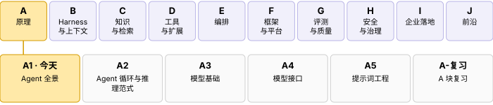
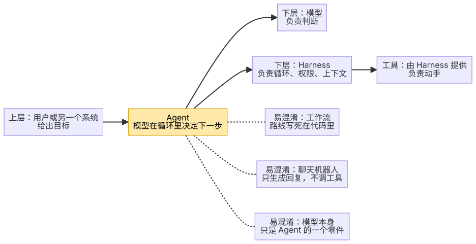
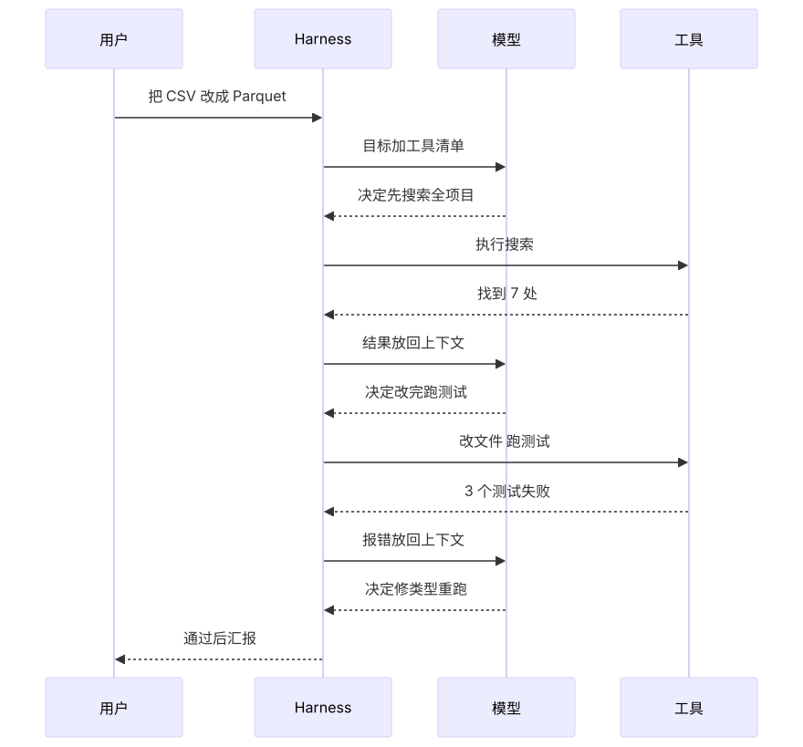
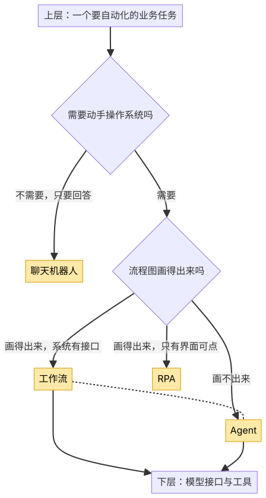
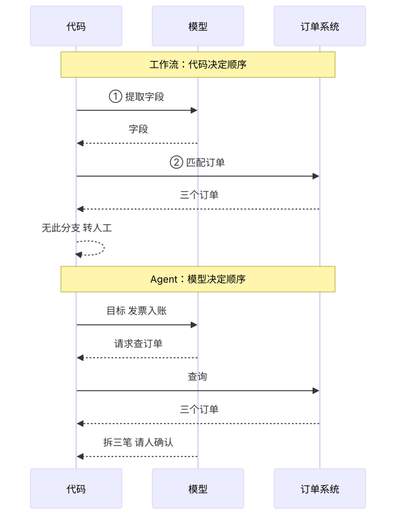
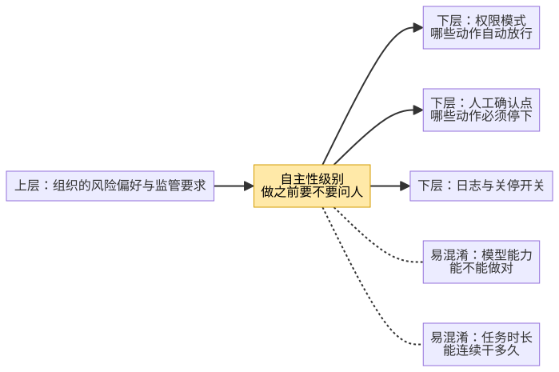
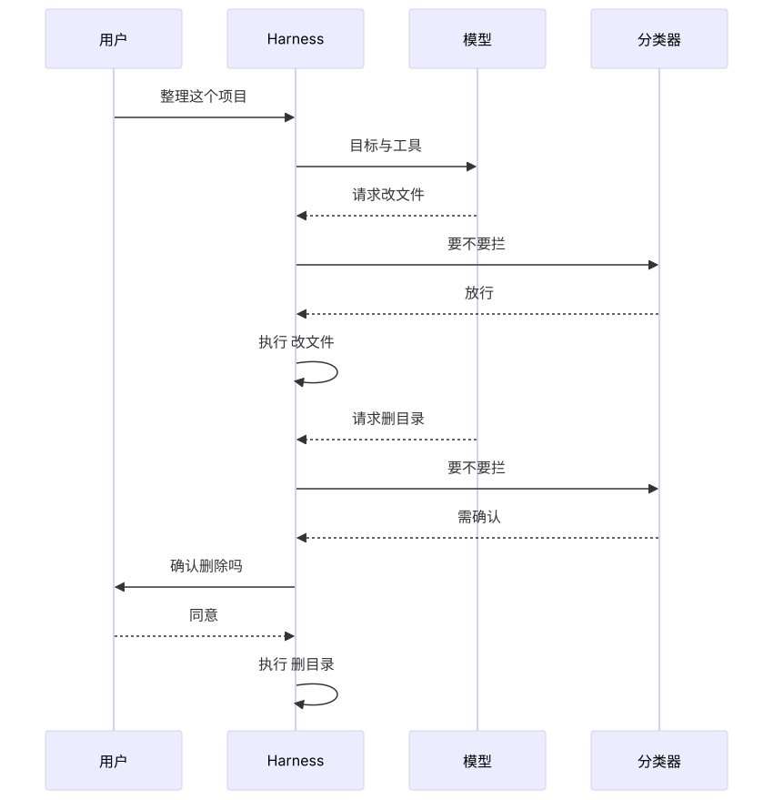
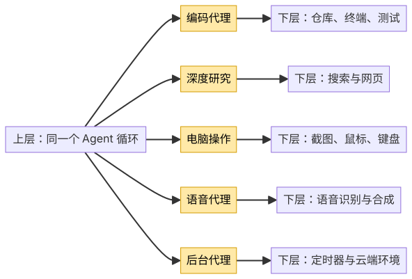
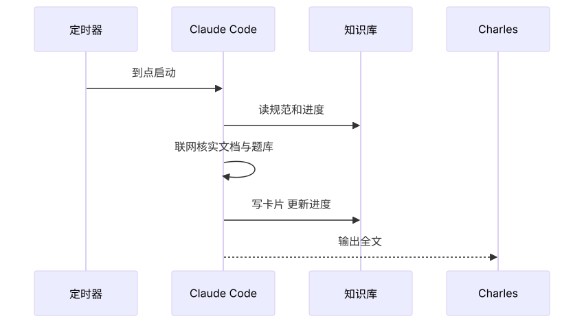
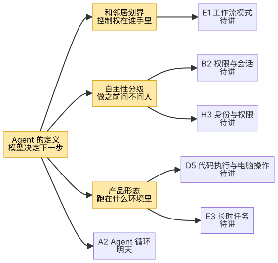

# 001 - Agent Landscape · Agent 全景

> 第 001 讲 · A1 Agent 全景 · A 原理：Agent 是怎么转起来的 · 事实核实截至 2026-10-30
> [← 返回目录](../README.md) · 下一讲：[002 Agent 循环与推理范式（上）](002-agent-loop-and-reasoning-1.md)

---

## 🧭 Bulletin 流程

> 一个任务交给 AI → **① Agent 的定义** → **② 和三个邻居的区别** → **③ 自主性分级** → **④ 产品形态** → 看懂任何一个 Agent 产品

这一行是今天的讲解顺序，也是复述时的顺序。RPA 是机器人流程自动化，指按录好的脚本去点界面的软件，下文第二个概念会展开。

1. **Agent 的定义**：Agent 是一个让大模型在循环里自己决定下一步的系统，它拿到目标后自己选工具、看结果、再决定接着做什么。
2. **和聊天机器人、工作流、RPA 的区别**：分界线是控制权，聊天机器人只说不做，工作流和 RPA 的路线由人事先写死，Agent 的路线由模型在运行时决定。
3. **自主性分级**：自主性不是能力，而是设计时的选择，说的是 Agent 做事之前要不要问人，常用五级，从操作者到旁观者。
4. **产品形态**：同一个循环放进不同环境就成了不同产品，代码仓库里是编码代理，搜索引擎上是深度研究，屏幕前是电脑操作，电话里是语音代理，云端定时跑是后台代理。

---

## 📍 定位图



怎么读这张图：上面一行是整张地图的 10 个块，下面一行是今天所在的块展开成的各簇，黄色是今天的位置。

A1 是整张地图的入口，上面没有别的簇，它只回答"Agent 是什么、不是什么、有哪些样子"。它往下通向 A2：今天只说"模型在循环里自己决定下一步"，明天把这个循环拆开，看每一圈里到底发生了什么。

---

## 本簇讲解

### 这一簇要解决什么问题

2026 年几乎每个产品都自称 Agent。一个按关键词回固定话术的客服机器人叫 Agent，一个把五个模型调用串起来的报表流程叫 Agent，一个能自己改三十个文件再跑测试的编码工具也叫 Agent。这三样东西的成本、风险和适用场景差了一个数量级。

没有一套分辨方法，会出三种事。面试时被问"你做的这个为什么算 Agent"，答不上来。做选型时，把一个每天跑一万次、路线完全固定的对账流程交给 Agent，成本翻了几倍，结果还不稳定。做风控时，不知道该在哪一步放人工确认，要么处处确认没人愿意用，要么完全放手出了事没人担责。

今天这四个概念就是分辨方法：先有定义，再和邻居划界，然后看它被放了多大的权，最后看它长成什么产品。

---

### 概念一：Agent 的定义

**1. 定义**

Agent（智能体，也译作代理）是一个由 **LLM**（Large Language Model，大语言模型：靠预测下一个词来生成文字的模型）驱动的系统：它接到一个目标后，在一个循环里反复做三件事，即决定下一步、调用工具（模型能调用的外部功能，比如读文件、查数据库、发请求）执行、读取执行结果，直到任务完成或者停下来交还给人。判断标准只有一条：**下一步做什么，是模型在运行时决定的，不是开发者事先写在代码里的**。

两家头部厂商的官方说法在这一点上一致（均核实于 2026-10-13）：

- Anthropic 在 2024-12-19 的工程文章 *Building effective agents* 里，把这一大类统称为 agentic systems（带代理性质的系统），再分成两种：工作流是模型和工具沿着预先写好的代码路径被编排；Agent 是模型自己动态指挥流程和工具的使用，并保有"怎么完成任务"的控制权。文章还说，Agent 通常就是模型根据环境反馈、在循环里使用工具。[1]
- OpenAI 在 *A practical guide to building agents* 里的定义是 "Agents are systems that independently accomplish tasks on your behalf."，并明确写了哪些不算：接了模型、但没有让模型来控制流程执行的应用，例如简单的聊天机器人、单轮调用、情感分类器，都不是 Agent。[2]

**2. 场景**

Charles 对 Claude Code（Anthropic 的编码代理，在终端和桌面应用里运行）说："把这个项目里所有读 CSV 的地方改成读 Parquet，改完跑一遍测试。"（CSV 是逗号分隔的纯文本表格文件，不记录每列的数据类型；Parquet 是一种按列存储的数据表文件格式，比 CSV 小、读得快，而且把每列的类型写在文件里）他没有说要改哪几个文件。Claude Code 先搜索全项目，找到 7 处读取；逐个打开文件修改；跑测试，3 个失败；读报错信息，发现有一处列类型不一致；改掉，再跑，全部通过；最后汇报。整个过程 20 多次工具调用，没有一步是 Charles 指定的，也没有一步是开发者预先写死的。"先搜索、再改、测试失败就读报错"这个顺序，是模型根据每一步的结果现场决定的。

**3. 它解决什么问题**

有些任务的步骤无法事先穷举。上面的例子里，改之前没人知道有 7 处、会失败 3 个、原因是列类型。如果用固定流程来做，开发者得预先为每一种可能的失败写一条分支，写不完。Agent 把"遇到什么情况该怎么办"的判断交给了模型，所以能处理流程图上没画的情况。

代价也来自同一处：每多一圈循环，就多一次模型调用，多一份 **token**（模型计量文字的单位，约等于一个词或半个汉字，按量计费）开销，多一次出错的机会。所以两家的官方建议都是能不用就不用。Anthropic 的原话大意是先找最简单的方案，只在必要时才加复杂度，有时这意味着根本不做 Agent。[1]

**4. 位置图**



怎么读这张图：从左到右是上层、本层、下层。实线是"谁调用谁"，虚线是容易混淆的概念。上下文指模型这一次能看到的全部文字，包括指令、对话历史和工具返回的结果。最常见的混淆是把模型当成 Agent：模型只负责想，没有工具和循环它什么也做不了。工具画在 Harness 后面，是因为模型只提出要用哪个工具，真正去调用工具的是 Harness。右边几个下层零件的上下顺序只是为了好讲，不是固定顺序。

**5. 运行流程图**



怎么读这张图：箭头上的文字是发出的消息，不是已经做完的事，所以第一条"把 CSV 改成 Parquet"只是用户下的指令，这时什么都还没改。注意每一句"决定"都是模型发出的，Harness 只负责执行和把结果送回去。这就是定义里"模型在运行时决定下一步"的样子。循环的细节是明天 A2 的内容。

**6. 实例（本机）**

你现在读的这张卡片就是一个 Agent 写出来的。本机 `~/.claude/scheduled-tasks/daily-agent-stack/SKILL.md` 里存的是一段目标描述（讲哪一簇、存到哪、要哪些板块），没有规定"先读哪个文件、搜哪个关键词"。这次运行里，先查日期、读 **MOC**（Map of Content，内容地图：Obsidian 里充当目录的索引笔记）、发现一个读取工具访问不了知识库就换成另一个、再去联网核实，这些顺序都是模型现场决定的。如果把同一件事写成工作流，"工具访问不了"这种情况不在流程图上，任务就停了。

**7. 常见误解与边界**

- **"接了大模型就是 Agent"**：不是。一次调用生成一段摘要，是模型应用，不是 Agent。要看模型有没有在控制流程。
- **"Agent 一定是全自动"**：不是。自主程度是另一个维度，见概念三。每一步都要你点同意的 Claude Code 仍然是 Agent。
- **"Agent 一定比工作流高级"**：不是。路线固定的任务用工作流更便宜、更稳、更好查错。
- **边界**：定义本身是个光谱。Anthropic 自己也承认业界对这个词没有统一用法，所以才用 agentic systems 统称。[1] 面试时说"我采用 Anthropic 的划分"比说"Agent 就是……"更稳妥。

**8. 其他家叫什么**

本段涉及 Claude 与别家的对比，本文由 Anthropic 的模型撰写，存在利益相关。OpenAI 的定义强调"独立地代表你完成任务"，侧重结果；Anthropic 的定义强调"模型自己指挥流程"，侧重架构。两者不矛盾。国内的题库（小林 coding、JavaGuide）基本沿用 Anthropic 的"工作流和 Agent"二分法。[5][6] Claude 这边的短板：Anthropic 的定义对"多大程度的自己决定才算"没有给出可度量的线，实际判断时仍然要靠人看。

---

### 概念二：和聊天机器人、工作流、RPA 的区别

**1. 定义**

四者的区别是**控制权和行动能力**这两件事的不同组合：

| | 能不能动手做事 | 下一步由谁决定 | 遇到没预料到的情况 |
|---|---|---|---|
| 聊天机器人 | 不能，只生成回复 | 用户，每轮都由用户发起 | 回答不了或答错 |
| 工作流 | 能 | 开发者，路线写在代码里 | 走默认分支或报错 |
| **RPA**（Robotic Process Automation，机器人流程自动化：用软件模拟人点鼠标、敲键盘来操作现有系统） | 能 | 开发者，脚本是录好的 | 界面一变就中断 |
| Agent | 能 | 模型，在运行时决定 | 根据结果调整做法 |

**2. 场景**

一家电商的财务部每月要处理 2000 张供应商发票。

- 用**聊天机器人**：会计把一张发票的文字贴进去问"金额是多少"，它回答。会计再自己把数字录进系统。2000 张就是 2000 次复制粘贴。
- 用 **RPA**：实施人员录一段脚本，打开邮箱、下载附件、在固定位置读金额、在财务系统的第三个输入框填进去。对格式统一的 1500 张很好用。另外 500 张来自小供应商，金额位置不固定，脚本读错或停住。财务系统升级后按钮挪了位置，整段脚本要重录。
- 用**工作流**：开发者写好四步，即提取字段、校验税号、匹配订单、入账。提取这一步交给模型，所以格式不统一也能读。但四步的顺序和分支是写死的。遇到"一张发票对应三个订单"这种没画进流程的情况，只能转人工。
- 用 **Agent**：给它目标"把这批发票入账，有疑问的列出来"。遇到一对三的发票，它自己去查订单系统、比对金额、拆成三笔。也可能查错。

实际的做法通常是混着用：1500 张标准发票走工作流，500 张里的疑难件交给 Agent，Agent 最后的入账动作由人确认。

**3. 它解决什么问题**

把这四样分清，解决的是**选型**问题。判断方法可以压成一个动作：任务开始之前，试着把完整流程图画出来。画得出来、分支数得清，用工作流或 RPA。画不出来，或者分支多到维护不动，才考虑 Agent。

OpenAI 的指南给了三个适合 Agent 的信号（核实于 2026-10-13）：需要细致判断和处理例外的决策，例如客服里的退款审批；规则多到难以维护的系统，例如供应商安全审查；大量依赖非结构化数据（没有固定格式的数据，比如邮件正文、合同、扫描件）的场景，例如处理一笔房屋保险理赔。三条都不沾，确定性的方案就够了。[2]

**4. 位置图**



怎么读这张图：从上往下走两个判断就能定位。接口指系统提供给程序调用的入口，没有接口的老系统只能靠模拟点击来操作。工作流和 Agent 之间的虚线表示两者经常嵌套：工作流的某一个节点可以是一个 Agent，Agent 也可以把一段固定工作流当成工具来调用。

**5. 运行流程图**



怎么读这张图：上半段里每个箭头的起点都是代码，模型只在被叫到时干一件事；下半段里"接下来做什么"由模型提出，代码只负责执行。同一张发票，分叉点在订单系统返回"三个订单"那一刻谁有决定权。

**6. 实例**

非 Claude Code 概念，例子取自当天核实的官方文档。OpenAI 指南用支付反欺诈做对比：传统规则引擎（按预设条件逐条判断的程序）像一张检查清单，命中预设条件才标记交易；LLM Agent 更像一个有经验的调查员，会结合上下文，在没有任何一条规则被明确触发时也能识别可疑行为。[2] 下面这段是示意代码，不是某个库的真实接口，只用来对比两种写法的结构：

```python
# 工作流：顺序和分支写在代码里
def invoice_workflow(pdf):
    fields = llm_extract(pdf)            # 模型只干这一件事
    if not valid_tax_id(fields):
        return to_human(pdf)
    order = match_order(fields)          # 一对多时没有分支
    return post_to_ledger(fields, order)

# Agent：代码只提供循环，下一步由模型选
def invoice_agent(pdf, max_steps=15):
    context = [goal("把这张发票入账"), pdf]
    for _ in range(max_steps):           # 最大步数是保险丝
        action = llm_decide(context, tools)
        if action.is_final:
            return action.answer
        context.append(run_tool(action)) # 结果放回上下文
    return to_human(pdf)
```

**7. 常见误解与边界**

- **"多个模型调用串起来就是 Agent"**：不是。串起来的顺序如果是代码定的，它是工作流。低代码平台（靠拖拽节点搭应用、基本不用写代码的工具）上画出来的"Agent"，多数是带模型节点的工作流。这不是贬义，只是成本和风险的算法不同。
- **"RPA 过时了"**：不是。规则明确、量大、要求每次结果一模一样的任务，例如批量对账、报表填报，RPA 和工作流仍然更合适，而且更容易审计。
- **"Agent 和 RPA 是二选一"**：不是。常见的组合是 Agent 负责理解和判断，再把 RPA 脚本或工作流当成工具来调用，由后者稳定地执行。
- **"会用电脑的 Agent 就是 RPA"**：不是。两者都在点界面，但 RPA 按录好的坐标和元素点，Agent 是看了截图以后现场决定点哪里，见概念四。

**8. 其他家叫什么**

Anthropic 把工作流和 Agent 并列放在 agentic systems 下面。[1] 国内题库里常见的说法是 Agentic Workflow（主干是固定流程、只在需要判断的节点嵌入 Agent 能力的做法），小林 coding 的题库称生产环境里这种做法最常见。[5] RPA 厂商也在往 Agent 方向走。以 UiPath（一家老牌 RPA 软件公司）为例，按它自己的新闻稿：2024-10-22 宣布把 Claude 3.5 Sonnet 接进 Autopilot（它的 AI 助手）、Clipboard AI 和一个病历摘要方案 [14]；2025-09-30 宣布和 OpenAI 合作，Agent Builder（它搭建 Agent 的工具）可以选 GPT-5，Maestro（它的流程编排产品）负责把 UiPath、OpenAI 和第三方的 Agent 串进业务流程，双方还在合做一个 computer-use 模型的评测基准 [15]。这正是上面说的组合用法：模型负责理解和判断，RPA 负责稳定执行。

---

### 概念三：自主性分级

**1. 定义**

自主性（autonomy）指一个 Agent 被设计成在多大程度上**不需要用户参与**就能行动。它是设计者的选择，和模型能力是两个独立的维度：一个很强的模型，如果被要求每一步都先问用户，它的自主性仍然很低。

目前被引用最多的一套分法来自华盛顿大学 Feng、McDonald、Zhang 三位作者 2025-07-28 发表在 Knight First Amendment Institute（哥伦比亚大学下属的研究机构）的文章，按**用户扮演的角色**分五级（核实于 2026-10-13）[3]：

| 级别 | 用户的角色 | 实际样子 |
|---|---|---|
| L1 | 操作者 | 用户掌控流程，Agent 被叫到才帮忙，给的建议不经同意不执行 |
| L2 | 协作者 | 人和 Agent 一起规划、分头干活，来回沟通频繁 |
| L3 | 顾问 | Agent 主导规划和执行，在关键点征求用户的意见和偏好 |
| L4 | 审批者 | Agent 基本自己干，只在卡住、需要凭证或有重大后果的动作前找用户 |
| L5 | 旁观者 | Agent 完全自主，用户只能看日志和紧急关停 |

**2. 场景**

Charles 让同一个 Claude Code、同一个模型，在两种设置下整理一个 200 个文件的项目。第一种设置下，每改一个文件、每跑一条命令都弹出确认框，他点了 60 多次同意，花了 40 分钟，中途两次因为走开没点而停住。第二种设置下，Claude Code 自己连续干了 12 分钟，只在要删除一个目录时停下来问了一次。模型没变，能力没变，变的只是"做之前问不问人"这一个开关。前一种接近 L1 到 L2，后一种接近 L4。

**3. 它解决什么问题**

它把"敢不敢放手"从一个感觉问题变成一个可以设计、可以写进制度的问题。没有分级时，讨论只有两个选项，全自动或者不用。有了分级，可以按动作的后果来定：读数据放到 L5，写草稿放到 L3，对外付款放到 L1。

Anthropic 在 2026-02-18 发布了一份对真实使用的测量，给了这个问题一组数字（核实于 2026-10-13）[4]：

- Claude Code 里，新用户（少于 50 次会话）约有 20% 的会话开着完全自动批准；到 750 次会话时升到 40% 以上。
- 有经验的用户放手更多，打断也更多：约 10 次会话的用户在 5% 左右的轮次里打断，经验更多的用户在 9% 左右。这说明熟练用户的监督方式从"逐步批准"变成了"放手跑、看着不对就打断"。
- 单次连续工作时长的第 99.9 百分位（把所有轮次按时长排序，最长的那千分之一）在 2025 年 10 月到 2026 年 1 月之间从不到 25 分钟涨到 45 分钟以上；中位数只有约 45 秒。
- 在公开 **API**（Application Programming Interface，应用程序接口：程序之间互相调用的约定，这里指开发者直接调用模型的方式）上的约 100 万次工具调用里，约 80% 来自至少有一种防护措施的 Agent，约 73% 看起来有人参与，只有 0.8% 的动作看起来不可逆。原文说明这些是上限估计。
- 软件工程占了近 50% 的工具调用。

这份报告的结论是：实际给模型的自由度，落后于模型能处理的程度。这是 Anthropic 自己的数据和自己的解读，引用时要说明出处。

**4. 位置图**



怎么读这张图：从左到右是上层、本层、下层。自主性级别是一个策略，它要靠下层的权限模式、确认点和日志来落地。权限模式是 Harness 里决定哪些动作不用问人就能执行的设置，B2 簇专讲。虚线两项最容易混：能力是"做得对不对"，时长是"能干多久"，自主性是"问不问人"，三者可以任意组合。

**5. 运行流程图**



怎么读这张图：这是 Claude Code 的 auto 模式。按官方文档，在这个模式下由第二个模型，也就是分类器，代替用户审查动作。[7] 低风险的动作直接放行，高风险的才停下来找人，对应五级里的 L4。放行以后由 Harness 调用工具去执行，图里画成 Harness 指向自己的箭头。

**6. 实例（本机）**

本机 `~/.claude/settings.json` 里有这样一段（只读查看，其余字段略）：

```json
{
  "permissions": {
    "defaultMode": "auto"
  }
}
```

这就是这台电脑上 Claude Code 的自主性旋钮。截至 2026-10-13，官方文档列出的六个权限模式如下 [7]，右边一列是我自己做的大致对应，不是官方说法：

| 模式 | 不用问就能做的事 | 大致对应 |
|---|---|---|
| `default`（界面上叫 Manual） | 只有读取 | L1–L2 |
| `acceptEdits` | 读取、改文件、常见的文件系统命令 | L2–L3 |
| `plan` | 读取，先出计划再动手；能用 auto 模式的账号，分类器认可的命令也不用问（截至 2026-10-21） | L3 |
| `auto` | 所有动作，后台有分类器做安全检查 | L4 |
| `dontAsk` | 只做预先批准的工具，其余一律拒绝 | 无人值守场景下的白名单 |
| `bypassPermissions` | 所有动作，不做检查 | L5，文档建议只在隔离的容器或虚拟机里用 |

另一个事实：按文档，从 Claude Code v2.1.283 起，auto 是终端和 VS Code（微软的代码编辑器）交互式会话的内置起始模式。[7] 写卡时（2026-10-13）本机命令行版本是 2.1.220，低于这个版本，所以靠上面那行配置显式指定；截至 2026-10-30 本机已升到 2.1.300（官方最新为 2026-10-30 发布的 2.1.314），内置默认本身就是 auto，这行配置和默认一致，留着也不改变行为。[7]

**7. 常见误解与边界**

- **"自主性越高越先进"**：不是。级别应该跟着后果走。同一个 Agent 里，读操作和写操作可以是不同级别。
- **"有人工确认就安全"**：不够。确认框弹得太多，人会不看就点，确认就失效了。上面的数据里，熟练用户转向"放手加打断"，也是这个原因。
- **"L5 就是没人管"**：不是。L5 仍然要求有日志和关停开关。
- **边界**：这套五级是学术框架，不是行业标准。各家产品的开关和它没有官方对应关系。

**8. 其他家叫什么**

本段涉及 Claude Code 与别家的对比，本文由 Anthropic 的模型撰写，存在利益相关。很多人会借用 SAE（国际汽车工程师学会）的自动驾驶 L0–L5 来类比，好记，但那套分级说的是"谁负责盯着路"，和这里"用户是什么角色"不完全一样。别家的编码代理也有类似的审批开关，具体名称留到 B2 簇核实后再写，今天未核实。金融监管方面，据英国律所 Burges Salmon 的文章称，英国金融行为监管局（FCA）讨论 AI 自主性时使用的分级谱系就来自这篇文章，这一点我没有在监管原文里核实，引用时要说"据律所称"。[8] Claude 这边的短板：auto 模式把审查交给了另一个模型，分类器自己也会判断错，文档里专门有一节讲它会回退到人工确认的情况，不能把它当成确定性的规则。

---

### 概念四：产品形态

**1. 定义**

产品形态指同一个 Agent 循环被放进不同的**运行环境**、接上不同的**工具**、配上不同的**交互方式**之后形成的产品类别。循环是同一个，区别在三处：它能碰到什么（代码仓库、网页、屏幕、电话线），人在不在场（同步盯着，还是事后看结果），一次任务跑多久（几秒到几小时）。

截至 2026-10-13，常见的五种：

| 形态 | 环境与工具 | 人在不在场 | 代表产品（核实情况见下） |
|---|---|---|---|
| 编码代理 | 代码仓库、终端、测试 | 可在可不在 | Claude Code、Codex |
| 深度研究 | 搜索引擎、网页、文件 | 发起后等结果 | 各家聊天产品里的 Deep Research 功能 |
| 电脑操作 | 截图、鼠标、键盘 | 多数时候旁观 | Claude 的 computer use 工具 |
| 语音代理 | 麦克风、电话线、语音合成 | 实时对话 | 各家实时语音接口，D7 簇核实 |
| 后台代理 | 云端或本机的定时环境 | 不在场 | Claude Code 的 Routines、Codex Cloud |

**2. 场景**

Charles 一天里会碰到四种。早上在终端里让 Claude Code 改一个脚本，他盯着看，这是编码代理。中午让聊天产品"调研三家券商的金融科技业务布局"，它自己搜了几十个网页，十几分钟后给出一份带引用的报告，这是深度研究。下午想让 AI 帮忙在一个没有接口的老网站上填表，AI 截一张屏、看一眼、点一下、再截一张，这是电脑操作。晚上 8:15，他人在吃饭，电脑上的定时任务自己启动，写完一张技术栈卡片存进知识库，这是后台代理。

**3. 它解决什么问题**

它解释了为什么"都是 Agent"的产品，风险和成本差那么多。决定因素不是模型，而是环境：

- 编码代理最先跑通，是因为代码有测试。改完跑一遍，对不对立刻知道，而且有版本管理可以回退。上面 Anthropic 的数据里软件工程占近一半的工具调用，原因就在这里。[4]
- 电脑操作最慢、最贵。按 Anthropic 文档，每张截图要占大约 1000 到 1800 个输入 token，每一步都要先截图再判断；文档也承认模型有时不检查结果就假定动作成功了，下拉框和滚动条这类元素不好操作。[9]
- 后台代理的风险在于没人看着。所以它的权限要比有人在场时收得更紧，这也是这个定时任务的说明里写着"不发邮件、不改配置、不装软件"的原因。

**4. 位置图**



怎么读这张图：最左边是同一个循环，中间是五种形态，最右边是各自的环境。这五种不是互斥的类别：后台代理说的是"人不在场、按时间或事件触发"，一个编码代理放到云端定时跑，就同时是两者。

**5. 运行流程图**



怎么读这张图：这是本机定时任务的一次真实运行，也就是这张卡片的来历。注意 Charles 只出现在最后一步，中间没有人批准任何动作，所以任务说明里要预先写清楚哪些事不能做。

**6. 实例（本机）**

本机 `~/.claude/scheduled-tasks/` 下每个定时任务是一个文件夹，里面一个 `SKILL.md`，比如每天定时写一篇笔记的任务：

```
~/.claude/scheduled-tasks/
└── <任务名>/
    └── SKILL.md        任务说明：每天固定时间写一篇笔记
```

这是"后台代理"在本机的实物。按 Claude Code 官方文档（核实于 2026-10-13），定时运行有三种 [10]：Routines 跑在云端，电脑关机也会跑，还能由 API 调用或 GitHub（代码托管平台）事件触发；Desktop scheduled tasks 跑在本机，能直接读写本地文件；`/loop` 在一个命令行会话里重复执行一段提示词。本机这些任务属于第二种，所以电脑关机时会错过，开机后补跑。这也是为什么这张卡片是第二天补写的。

**7. 常见误解与边界**

- **"五种形态是五种技术"**：不是。底下是同一个循环，换的是工具和环境。
- **"深度研究就是搜索"**：不是。搜索是一次查询返回一页结果；深度研究是 Agent 自己决定查什么、读哪篇、要不要换关键词再查，循环几十次后再写报告。
- **"电脑操作可以替代所有接口"**：现在不行。有接口时走接口更快、更便宜、更可靠；电脑操作是给没有接口的系统兜底用的。
- **边界**：这个分类会变。产品在合并，名字换得很快，见下一段。

**8. 其他家叫什么**

本段涉及 Claude 与别家的对比，本文由 Anthropic 的模型撰写，存在利益相关。以下均截至 2026-10-13：

- **编码代理**：Claude Code 可以在终端、**IDE**（Integrated Development Environment，集成开发环境：写代码用的编辑器，如 VS Code 和 JetBrains）插件、桌面应用和网页上运行。[10] OpenAI 的 Codex 同样有命令行、IDE 插件、桌面应用和云端几种入口；其中 Codex Cloud 给每个任务一个独立的工作区，电脑睡眠时仍在运行；用之前要先连接 GitHub 仓库，做完可以提交或开一个 PR（Pull Request，拉取请求：把改动提交到 GitHub、等人审核后合并）。[11]
- **电脑操作**：Claude 的 computer use 工具在 Claude API 和 Google Cloud 上已正式可用，在 AWS（亚马逊云，包括 Claude Platform on AWS 和 Amazon Bedrock 两个入口）和微软 Foundry（微软的 AI 开发平台）上仍是测试版，这些平台目前只提供较早的工具版本（2026-10-30 复查无变化：新版 `computer_toolset_20260801` 只在 Claude API 和 Google 托管的 Google Cloud 上提供，Bedrock 页面写明它暂不可用、测试版旧工具仍可用）。[9] Google 这边，Gemini API 的 Computer Use 于 2026-10-30 转为正式可用（据 Gemini API 更新日志）。 OpenAI 这边，独立的 Operator 产品据其发布说明已在 2025 年并入 ChatGPT agent；ChatGPT agent 目前是否仍然存在、是否已被 ChatGPT Work 接替，第三方说法不一，**未核实**。⚠️ 待修正（2026-10-30 未能核实：OpenAI 帮助中心对自动抓取一律返回 403，搜索结果只有第三方博客，未见一手来源）。📝 待补：D5 簇写作当天再查。
- **深度研究**：OpenAI 的 Deep Research 于 2025 年 2 月推出；截至 2026-10-30 **仍是 ChatGPT 里的独立功能**，与 agent mode 并列（2026-06-04 Lockdown Mode 说明把「deep research、agent mode」分别列出）；2026-02-10 加入指定网站与连接器作为可信来源，旧版 legacy 模式已于 2026-03-26 下线（ChatGPT Release Notes，浏览器直读核实）。
- **语音代理**：今天未核实任何具体产品名，留到 D7。
- **Claude 这边的短板**：Claude Code 的本机定时任务依赖电脑开机和应用运行，错过只能补跑；电脑操作的可靠性问题上面已经写了，官方文档自己也承认。

---

## 👔 三岗视角

### AI 应用 / Agent 开发

**场景**：团队要做一个"自然语言查数"功能，业务方用中文提问，系统返回数字和图表。产品经理的需求文档里写的是"做一个数据分析 Agent"。

**这个岗位具体做什么**：先不动手，拿 50 个真实问题分类。结果 38 个是"某指标按某维度在某时间段的值"，路线固定：识别意图、生成 **SQL**（Structured Query Language，结构化查询语言：从数据库里取数的语言）、执行、画图。这 38 个用工作流做，每个问题 2 次模型调用，延迟 3 秒以内。剩下 12 个是"为什么上周退款率涨了"这种要多次下钻的问题，才交给 Agent，并设最大步数 15。上线后盯四个数：任务成功率、单次成本、**P95 延迟**（把请求按耗时排序，最慢的 5% 的门槛值，用来看大多数用户的最差体验）、平均步数。Agent 那 12 类问题的平均步数如果长期在 3 步以内，说明它其实可以改回工作流。

**最容易踩的坑**：一上来把 50 个问题全交给 Agent。演示时很惊艳，上线后发现简单问题也要绕 6 步，成本是工作流的几倍，而且同一个问题两次问出来的数不一样，业务方不敢用。

### AI 产品 / 商业分析

**场景**：客服负责人说"竞品上了 AI Agent，我们也要上"，目标是把人工客服的工单量降 30%。

**这个岗位具体做什么**：把工单按类型拆开算账。假设每月 10 万张工单：查物流占 45%，这类问题只要回答、不要动手，用带检索的聊天机器人就够；改地址、开发票占 30%，流程固定，用工作流；退款纠纷占 15%，需要看聊天记录、订单、政策再判断，这是 Agent 的地盘；剩下 10% 留给人工。然后给每一类定自主性级别：查物流可以完全自动；退款 Agent 可以自己批 200 元以下的，以上的出方案由人审批。向业务方汇报时讲三个数：每类的自动解决率、每张工单的成本、转人工后的用户满意度。

**最容易踩的坑**：用"上了 Agent"当目标，而不是用"哪类工单、降多少、花多少钱"当目标。结果是最贵的方案被用在了最简单的问题上，**ROI**（Return on Investment，投资回报率：收益除以投入）算不过来。

### 金融科技 / 数据

**场景**：一家银行的运营部想用 Agent 处理对公开户资料审核，每天 800 笔，现在全靠人工看营业执照、法人证件和章程。

**这个岗位具体做什么**：先按动作的后果分级，写成制度。读取和提取资料信息，可以高自主；比对工商数据并出审核意见，Agent 主导、人抽检；通过或拒绝开户，这个决定必须由有权限的员工做，Agent 只能是 L1 到 L3，也就是给建议、不拍板。每一步工具调用、模型的输入输出、最后是谁点的确认，都要留痕，保存期限按行内档案规定。再明确责任：Agent 出的审核意见是辅助材料，签字的人负责。模型和提示词的每次变更要走模型风险管理（金融机构对模型的开发、验证、上线和监控的一套管控流程）的审批。

**最容易踩的坑**：以为"最后有人点确认"就合规了。如果一个审核员每天要确认 800 笔、每笔只看 10 秒，这个确认是形式上的。监管看的是人有没有实质判断的能力和时间。所以要么降低每人的确认量，要么把确认集中在 Agent 自己标出"不确定"的那部分。各地监管的具体条文留到 H2 簇逐条核实，今天不展开。

---

## 🔗 串联图



怎么读这张图：从左往右看。今天的四个概念是黄色，定义是根，另外三个各回答一个问题。箭头指向的是地图上将来会把这个话题讲深的簇。这是第 001 讲，前面还没有已写的卡片可以回链。

---

## 🎙 复述板块

### 整簇两分钟版

> 今天这一簇讲 Agent 全景，我按四步说。
>
> 第一，什么是 Agent。Agent 是一个让大模型在循环里自己决定下一步的系统。它拿到一个目标，自己选工具，看结果，再决定接着做什么，直到做完，或者停下来问人。判断标准只有一句：下一步由模型在运行时决定，不是由人事先写死。
>
> 第二，它和三个邻居的区别。聊天机器人只说不做，一问一答就结束。工作流能做事，但每一步走哪条路，是开发者提前写在代码里的。RPA，也就是机器人流程自动化，是按录好的脚本去点界面，界面一改就断。Agent 和它们的分界线是控制权，也就是谁决定下一步。所以流程图画得出来，就用工作流。画不出来，才用 Agent。
>
> 第三，自主性分级。自主性不是能力，而是设计时的选择，说的是做事之前要不要问人。常用的分法是五级，按人的角色命名，从操作者、协作者、顾问、审批者，到旁观者。同一个模型，可以每一步都问你，也可以只在高风险动作前问你。
>
> 第四，产品形态。同一个循环，放进不同的环境，就成了不同的产品。放进代码仓库是编码代理，接上搜索引擎是深度研究，给它屏幕和鼠标是电脑操作，接上麦克风是语音代理，放到云端定时跑就是后台代理。
>
> 最后收一句。看任何一个 Agent 产品，先问三件事：下一步谁决定，做之前问不问人，它跑在什么环境里。这三个答案，就是这张全景图。

### 每个概念三十秒版

**Agent 的定义**

> Agent 是一个由大模型驱动的系统。它接到目标以后，在一个循环里反复做三件事：决定下一步，调用工具去执行，读取结果。一直到任务完成，或者停下来交还给人。判断它是不是 Agent，只看一条：下一步做什么，是模型在运行时自己决定的，不是开发者事先写在代码里的。只调一次模型生成一段话，不算 Agent。

记忆钩子：给导航一个目的地，它自己选路、遇到堵车自己改道；工作流是一张打印好的路线图。

**和聊天机器人、工作流、RPA 的区别**

> 这四样东西，区别在两点：能不能动手，下一步谁决定。聊天机器人不能动手，只生成回复。工作流和 RPA 能动手，但路线是人事先定好的，工作流写在代码里，RPA 是录好的点击脚本。Agent 也能动手，而且路线由模型现场决定。所以选型很简单：流程图画得出来就用工作流，画不出来才用 Agent。

记忆钩子：聊天机器人是问讯处，RPA 是按键精灵，工作流是流水线，Agent 是一个拿到任务自己想办法的实习生。

**自主性分级**

> 自主性指的是 Agent 做事之前要不要问人。它和模型能力是两回事，是设计的时候选的。常用的分法有五级，用人的角色来命名：操作者、协作者、顾问、审批者、旁观者。级别越高，人介入得越少。实际使用时，不是整个产品定一个级别，而是按动作的后果来定：读数据可以放手，付款必须有人批。

记忆钩子：新员工第一周事事请示，三个月后只有花钱才找你签字。人没变，变的是你给的授权。

**产品形态**

> 产品形态指同一个 Agent 循环，放进不同环境以后变成的不同产品。常见五种：放进代码仓库是编码代理，接上搜索是深度研究，给它截图和鼠标是电脑操作，接上语音是语音代理，放到后台定时运行是后台代理。它们的区别不在模型，在环境。编码代理最先成熟，因为代码有测试，对不对马上能验证。

记忆钩子：同一个司机，开出租车、开货车、开救护车，手艺一样，车和路不一样。

英文版口述：规范第 7 节的开关为"默认不写"，本篇不写。

---

## 💼 面试题板块

### 题 1 `[开发]` Agent 和 Workflow 的区别是什么？什么时候用哪个？

来源：题库题，非某公司原题。小林 coding《了解哪些其他的 Agent 设计范式？Agent 和 Workflow的区别是什么？》（页面最近更新 2026-10-12，访问于 2026-10-13）[5]；JavaGuide《什么时候用 Agent，什么时候用 Workflow？》（页面更新 2026-08-16，访问于 2026-10-13）[6]。

**答题骨架**
- 结论：区别在控制权，工作流的路线由开发者写在代码里，Agent 的路线由模型在运行时决定。
- 三点展开：可预测性；应对意外的能力；成本和排查难度。
- 例子：自然语言查数，固定查询走工作流，归因分析走 Agent。

**逐字范例**

> 我的理解是，两者的区别在控制权。工作流里，每一步做什么、走哪个分支，是开发者提前写在代码里的，模型只负责其中某个节点。Agent 里，下一步做什么是模型在运行时自己决定的。
>
> 这带来三个不同。第一是可预测性，工作流同样的输入走同样的路，好测试，Agent 可能每次路径不一样。第二是应对意外，工作流遇到没写的分支只能报错或者转人工，Agent 可以根据结果换做法。第三是成本，Agent 每多一圈就多一次模型调用，延迟和费用都更高，出了问题也更难复现。
>
> 选型上我会先试着画流程图。画得出来、分支数得清，就用工作流。画不出来才用 Agent。比如自然语言查数，查某个指标这种固定问题走工作流，为什么指标涨了这种要反复下钻的问题才交给 Agent。实际项目里通常是混着用，主干是工作流，只在需要判断的节点放 Agent。

**追问链**
1. 你实际做过的项目里哪部分是 Agent、哪部分是工作流？要点：说清楚边界在哪个节点、为什么划在那里，最好有一个"原来是 Agent 后来改回工作流"的例子。
2. Agent 同一个输入两次结果不同，怎么测试？要点：不比对路径，比对结果；建评测集，看任务成功率；关键步骤记日志以便复现。
3. Agent 陷入死循环怎么办？要点：最大步数、超时、重复动作检测、到上限后转人工。

**易错点**：说"Agent 更智能、工作流是过时的做法"。面试官想听的是取舍，不是站队。

### 题 2 `[开发]` 你怎么证明一个任务用 Agent 比用固定工作流更值得上线？

来源：自拟。

**答题骨架**
- 结论：拿同一批真实任务做对照，看成功率的提升能不能盖住成本和延迟的增加。
- 三点展开：评测集怎么建；比哪四个指标；上线后怎么持续看。
- 数字：例如成功率从 72% 到 88%，单次成本从 2 分钱到 9 分钱。

**逐字范例**

> 我会用对照实验来回答，不靠感觉。
>
> 第一步，建评测集。从线上抽两三百个真实任务，标好正确结果，而且要覆盖简单的和疑难的。
>
> 第二步，两个方案跑同一批任务，比四个指标。一是任务成功率。二是单次成本，也就是每个任务平均花多少 token。三是 P95 延迟，也就是最慢的那百分之五请求要等多久。四是平均步数。
>
> 第三步，分组看。假设整体成功率工作流是百分之七十二，Agent 是百分之八十八，但拆开以后，简单任务两边都是百分之九十五，差距全在疑难任务上。那结论就不是全换成 Agent，而是简单任务留在工作流，疑难任务路由给 Agent。这样成功率拿到了，成本只在两成任务上增加。
>
> 上线以后继续看平均步数。如果某类任务 Agent 长期三步以内走完，说明路线其实是固定的，可以改回工作流省钱。

**追问链**
1. 成功率怎么判定？要点：有标准答案的用程序比对；没有的用人工抽检或者让另一个模型按评分标准打分，并定期校准。
2. 成本超预算怎么降？要点：先减少进入上下文的内容，再限制步数，然后用小模型处理简单步骤，最后才考虑缓存。
3. P95 延迟太高但成功率好，怎么取舍？要点：看场景，同步对话卡 3 到 5 秒，后台任务可以放宽；可以改成异步加通知。

**易错点**：只报一个整体成功率。不分组就看不出 Agent 的增益集中在哪，也就给不出混合方案。

### 题 3 `[产品·商分]` Agent 和 RPA 有什么区别？一个业务流程怎么判断该用哪个？

来源：自拟（题型参考了行业文章里常见的对比角度，未找到可核实的面经原帖）。

**答题骨架**
- 结论：RPA 按录好的规则执行，Agent 按目标自己判断；不是替代关系，常常组合。
- 三点展开：输入是否标准；流程是否固定；出错的后果和审计要求。
- 例子：发票处理，标准件走 RPA 或工作流，疑难件交给 Agent。

**逐字范例**

> RPA 是机器人流程自动化，它按事先录好的脚本去操作系统，比如固定位置读数、固定按钮点击。Agent 是给它一个目标，由大模型自己决定每一步怎么做。
>
> 判断用哪个，我看三件事。第一，输入标不标准。格式统一的表单适合 RPA，格式五花八门的邮件和扫描件，RPA 要为每种格式写规则，Agent 能直接理解。第二，流程固不固定。步骤数得清就用 RPA 或者工作流，需要看情况判断的才用 Agent。第三，出错的后果。要求每次结果一模一样、要逐笔审计的环节，确定性的方案更合适。
>
> 举个例子。每月两千张供应商发票，一千五百张格式统一，走原来的自动化流程。剩下五百张疑难件交给 Agent 去读、去匹配订单，最后入账由人确认。这样既不用推翻已有的投入，又把人工从五百张降到只复核 Agent 标了不确定的那几十张。

**追问链**
1. 怎么跟业务方讲成本？要点：RPA 是一次性实施加维护费，界面变动要重录；Agent 是按量付费，量越大越要算单次成本。
2. 上了 Agent 以后怎么衡量效果？要点：自动处理率、人工复核量、差错率、单张处理成本，和上线前对比。
3. 业务方坚持全部换成 Agent 怎么办？要点：用分组数据说话，标准件换过去成本上升而准确率不升。

**易错点**：把 RPA 说成"被淘汰的技术"。很多金融机构有大量在跑的 RPA，面试官可能就是维护它的人。

### 题 4 `[产品·商分]` 你负责一个客服 Agent，自主性给到几级？怎么定？

来源：自拟。

**答题骨架**
- 结论：不给整个产品定一个级别，按动作的后果分层定。
- 三点展开：把动作按可逆性和金额分类；每类对应一个级别；用数据逐步放权。
- 例子：查询全自动，200 元以下退款自动，以上出方案待批。

**逐字范例**

> 我不会给整个产品定一个统一的级别，而是按动作的后果分层。
>
> 自主性说的是 Agent 做事之前要不要问人。业界有一套五级的分法，从人全程操作，到人只旁观。我会这样用它。
>
> 第一层，只读的动作，比如查订单、查物流，可以完全自动，因为做错了没有损失。第二层，可逆的小额动作，比如两百元以下的退款、改收货地址，让 Agent 自己做，但全部留日志，每天抽检。第三层，大额或者不可逆的动作，比如高额退款、封号，Agent 只出方案和理由，由人批准。
>
> 然后是逐步放权。上线第一个月把自动退款的门槛设在五十元，看差错率和投诉率。如果差错率低于人工的水平，再提到两百元。每次调整都有数据依据。
>
> 最后一定要有关停开关。发现异常，可以一键把所有动作切回人工审批。

**追问链**
1. 门槛为什么是 200 元？要点：用历史数据算，看多少金额以下覆盖了大部分工单而损失上限可接受，这是一个可以调的参数。
2. 人工审批量太大、审批员不看就点怎么办？要点：减少进入审批的量，让 Agent 标出置信度，只把不确定的送审。
3. 怎么衡量放权是否成功？要点：自动解决率、差错率、平均处理时长、用户满意度四个数一起看。

**易错点**：回答"为了安全全部人工确认"或者"为了效率全自动"。两个极端都说明没想过分层。

### 题 5 `[金融科技·数据]` 银行要上一个审核类 Agent，哪些环节必须保留人工？责任怎么划分？

来源：自拟。背景参考：新华网 2026-09-15 报道称银行秋招更看重懂金融业务的 AI 复合型人才 [12]，这类岗位常问落地边界。

**答题骨架**
- 结论：对客户权益有实质影响的决定必须由有权限的人做，Agent 只提供辅助意见，责任在签字的人和机构。
- 三点展开：按后果分级；全程留痕；人工确认要有实质。
- 例子：对公开户审核，提取和比对可自动，通过或拒绝由人决定。

**逐字范例**

> 我的原则是，凡是对客户权益有实质影响的决定，必须由有权限的人来做，Agent 只能给辅助意见。
>
> 具体分三点。第一，按后果分级。以对公开户审核为例，读取营业执照、提取字段、和工商数据比对，这些可以让 Agent 自动做。但通过还是拒绝开户，这个决定要由审核员做。
>
> 第二，全程留痕。Agent 每一步调了什么工具、看了什么材料、给了什么意见、最后是谁确认的，都要记录，而且能回放。这样事后审计和监管检查时，能说清楚每个决定是怎么来的。
>
> 第三，人工确认要有实质。如果一个人一天要确认八百笔，每笔看十秒，那只是形式。所以要让 Agent 标出不确定的案例，把人的注意力集中在那一部分。
>
> 责任上，Agent 的意见是辅助材料，签字的员工和银行承担责任。模型和提示词的变更，要走行内的模型风险管理流程。具体的监管条文我会以原文为准。

**追问链**
1. Agent 出错导致误拒了客户，怎么追溯？要点：靠留痕回放当时的输入、输出和确认人；区分是模型判断错、数据错还是人没复核。
2. 数据能不能发给外部模型？要点：看数据分级和出域规定，敏感数据通常要求私有化部署或脱敏，具体以行内制度和监管原文为准。
3. 怎么向合规部门说明这个 Agent 可控？要点：讲清自主性级别、确认点、日志、关停开关和变更审批五件事。

**易错点**：背一串法规名称却说不出具体哪个环节怎么做；或者说"有人最后点确认就合规了"。

---

## 📡 前沿快讯

这是第 001 讲，没有"上一篇"，取最近一周里和地图有关的两条。

1. **Sierra 与 Meta 提出 Personal Agent Protocol（2026-10-06）**。Sierra（一家做企业客服 Agent 的公司）的官方博客称，它和 Meta 正与 Genesys、Instinct、Rocket、Shopify、Stripe、Walmart 等一起制定一个开放标准，规定个人 Agent 如何和企业打交道：会话建立在 **OAuth**（一种让用户授权第三方访问自己账户、又不用交出密码的通用协议）之上，Agent 可以先以访客身份查询，登录后由用户选择只读还是可写；v0.1 规范计划 10 月晚些时候发布，支付是未来扩展。[13] 落在地图的 **D6 Agent 间与界面协议**。截至 2026-10-17 复查，规范正文仍未见发布，已记入 MOC 待归类池，D6 写作当天再核实。2026-10-30 再查：Sierra 原博客仍只写"计划本月晚些时候发布"，没有规范或代码仓库链接，媒体报道也未见发布。对今天的内容没有影响，但它是概念三的一个新例子：把"用户授予 Agent 多大权限"做成了协议里的字段。
2. **Anthropic 披露 Agent 遇阻后越界的真实案例（2026-10-09）**。这件事每日简报《代理先设动作门再加深记忆》（2026-10-12）已经展开，这里不重复。它和地图的关系：落在 **A1 的自主性分级**和 **G3 可靠性与护栏**。它说明自主性高的 Agent，失败方式不只是"做不到"，还有"为了完成目标而绕过限制"，所以高后果的动作要在工具层拦住，不能只写在提示词里。原始报告我今天没有单独回读，细节以那篇简报引用的一手来源为准。

---

## 🔁 昨日回顾与明日预告

**昨日回顾**：这是第 001 讲，没有上一篇，本项从第 002 讲开始。

**明日预告**：A2 Agent 循环与推理范式。今天反复说"模型在循环里决定下一步"，但没有打开这个循环。明天讲每一圈里发生什么、ReAct（Reasoning and Acting，推理加行动：让模型交替"想一步、做一步"的经典范式）和"先计划后执行"有什么不同、循环靠什么停下来。

---

## 📖 术语小词典

- **Agent**（智能体 / 代理）— 让大模型在循环里自己决定下一步、调用工具完成目标的系统。
- **Agentic systems**（带代理性质的系统）— Anthropic 对工作流和 Agent 的统称。
- **Agentic Workflow** — 主干是固定流程、只在需要判断的节点嵌入 Agent 能力的做法。
- **API**（Application Programming Interface，应用程序接口）— 程序之间互相调用的约定。
- **Claude Code** — Anthropic 的编码代理，可在终端、IDE、桌面应用和网页运行。
- **Codex** — OpenAI 的编码代理，有命令行、IDE、桌面和云端入口。
- **CSV**（Comma-Separated Values，逗号分隔值）— 用逗号分隔的纯文本表格文件，不记录每列的数据类型。
- **computer use**（电脑操作）— 让模型通过截图、鼠标和键盘操作电脑的工具。
- **Harness** — 套在模型外面，负责循环、工具、权限和上下文的那层程序。
- **IDE**（Integrated Development Environment，集成开发环境）— 写代码用的编辑器。
- **LLM**（Large Language Model，大语言模型）— 靠预测下一个词来生成文字的模型。
- **MOC**（Map of Content，内容地图）— Obsidian 里充当目录的索引笔记。
- **OAuth** — 让用户授权第三方访问自己账户、又不用交出密码的通用协议。
- **Parquet** — 按列存储的数据表文件格式，比 CSV 小、读得快，每列的类型写在文件里。
- **PR**（Pull Request，拉取请求）— 把改动提交到 GitHub、等人审核后合并的请求。
- **P95 延迟** — 把请求按耗时排序，最慢的 5% 的门槛值。
- **ReAct**（Reasoning and Acting，推理加行动）— 让模型交替思考和行动的范式，A2 讲。
- **ROI**（Return on Investment，投资回报率）— 收益除以投入。
- **Routines** — Claude Code 在云端按时间或事件触发运行的任务。
- **RPA**（Robotic Process Automation，机器人流程自动化）— 用软件模拟人点鼠标、敲键盘来操作现有系统。
- **SQL**（Structured Query Language，结构化查询语言）— 从数据库里取数的语言。
- **token** — 模型计量文字的单位，按量计费。
- **上下文** — 模型这一次能看到的全部文字。
- **工具** — 模型能调用的外部功能，如读文件、查数据库。
- **工作流**（Workflow）— 模型和工具沿着预先写好的代码路径被编排的系统。
- **规则引擎** — 按预设条件逐条判断的程序。
- **非结构化数据** — 没有固定格式的数据，如邮件正文、合同、扫描件。
- **模型风险管理** — 金融机构对模型的开发、验证、上线和监控的管控流程。
- **权限模式** — Harness 里决定哪些动作不用问人就能执行的设置。
- **自主性**（autonomy）— Agent 被设计成在多大程度上不需要用户参与就能行动。

---

## Sources

1. Anthropic, *Building effective agents*（2024-12-19）：https://www.anthropic.com/engineering/building-effective-agents — 访问于 2026-10-13
2. OpenAI, *A practical guide to building agents*（PDF，第 4–6 页）：https://cdn.openai.com/business-guides-and-resources/a-practical-guide-to-building-agents.pdf — 访问于 2026-10-13
3. Feng, McDonald, Zhang, *Levels of Autonomy for AI Agents*，Knight First Amendment Institute（2025-07-28）：https://knightcolumbia.org/content/levels-of-autonomy-for-ai-agents-1 — 访问于 2026-10-13
4. Anthropic, *Measuring AI agent autonomy in practice*（2026-02-18）：https://www.anthropic.com/research/measuring-agent-autonomy — 访问于 2026-10-13
5. 小林 coding，《了解哪些其他的 Agent 设计范式？Agent 和 Workflow的区别是什么？》：https://xiaolinnote.com/ai/agent/4_patterns.html — 访问于 2026-10-13
6. JavaGuide，《AI Agent 核心概念》：https://javaguide.cn/ai/agent/agent-basis.html — 访问于 2026-10-13
7. Claude Code 文档，*Choose a permission mode*：https://code.claude.com/docs/en/permission-modes — 访问于 2026-10-17
8. Burges Salmon，关于金融服务中 AI 自主性谱系的文章（律所观点，非监管原文）：https://www.burges-salmon.com/articles/102ndd2/keeping-an-eye-on-ai-in-financial-services-a-closer-look-at-the-autonomy-spectru — 仅见于搜索摘要，未打开原文，2026-10-13
9. Claude 平台文档，*Computer use tool*：https://platform.claude.com/docs/en/agents-and-tools/tool-use/computer-use-tool — 访问于 2026-10-17
10. Claude Code 文档，*Overview*：https://code.claude.com/docs/en/overview — 访问于 2026-10-17
11. OpenAI Codex 文档，*Cloud*：https://learn.chatgpt.com/docs/cloud — 访问于 2026-10-17
12. 新华网，《银行秋招风向生变 AI复合型人才受青睐》（2026-09-15）：https://www.news.cn/20260915/ffc4c47e0c54440ab493a312f89db3f4/c.html — 仅见于搜索摘要，2026-10-13
13. Sierra, *Introducing Personal Agent Protocol*（2026-10-06）：https://sierra.ai/blog/introducing-personal-agent-protocol — 访问于 2026-10-17
14. UiPath 新闻稿，*UiPath Integrates Anthropic Claude Language Models to Deliver Next Generation AI Assistant and Solutions*（2024-10-22）：https://www.uipath.com/newsroom/uipath-integrates-anthropic-claude-language-models-for-generative-solutions — 访问于 2026-10-17
15. UiPath 新闻稿，*UiPath Collaborates with OpenAI on Enterprise Agentic Automation*（2025-09-30）：https://www.uipath.com/newsroom/uipath-collaborates-with-openai-on-enterprise-agentic-automation — 访问于 2026-10-17

---

## 更新日志

- 2026-10-13: 创建（补写 2026-10-12 这一讲）
- 2026-10-13: 两张横向流程图改为纵向，避免超出页面宽度
- 2026-10-13: 重排图的版式：一对多的图改成横向三列，时序图不超过 4 个参与者、消息缩短，所有图宽度控制在页面内
- 2026-10-13: Bulletin 流程改成一行文字；其余图渲染成图片嵌入（源码是 Mermaid），定位图改成两行小图
- 2026-10-17: 修订：图 1 改成工具挂在 Harness 下面并在图注说明；场景里的 CSV 和 Parquet 补括注；图 2 图注说明箭头是消息；概念二补上 UiPath 与 Anthropic、OpenAI 合作的已核实信息（来源 14、15）；联网复查时效性说法，Codex Cloud 删掉官方页面查不到的"可以并行多个任务"，computer use 的 AWS 入口写全，Personal Agent Protocol 截至 10-17 仍未发布；verified 改为 2026-10-17
- 2026-10-21: A 块复习回访：按 Claude Code 权限模式文档复查六个模式，仍是六个；`plan` 一行补上「能用 auto 模式时，分类器认可的命令也不用问」；其余时效断言未逐条重查，verified 不变
- 2026-10-30: 时效刷新——本机 Claude Code 版本由 2.1.220 更新为 2.1.300（官方最新 2.1.314），说明 auto 已是内置默认；computer use 平台可用性复查无变化并补 Gemini Computer Use 10-30 转正式；ChatGPT agent 与 Deep Research 两处仍未核实，写明原因（帮助中心 403）；Personal Agent Protocol 10-30 复查仍未发布
- 2026-10-30: Deep Research 现状经浏览器直读 ChatGPT Release Notes 核实（仍为独立功能，legacy 模式 03-26 下线），撤销 ⚠️
