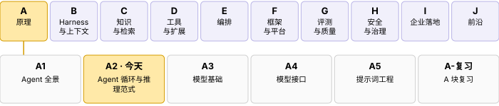
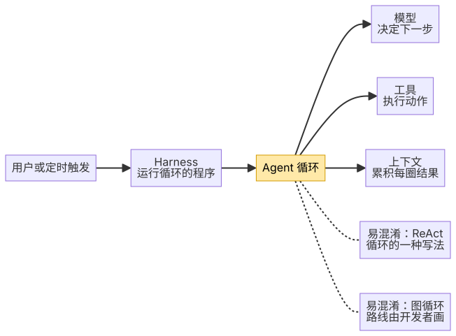
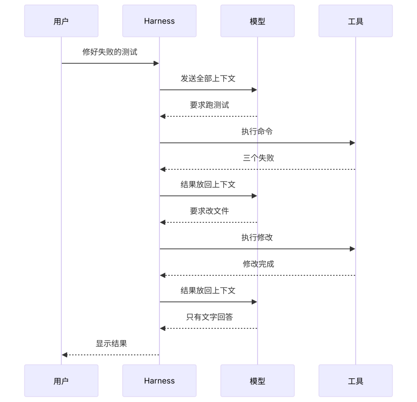
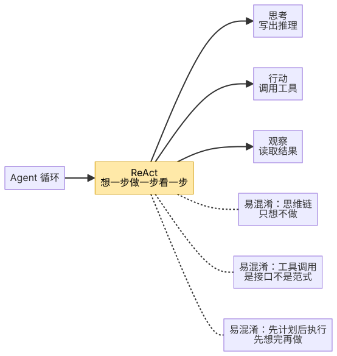
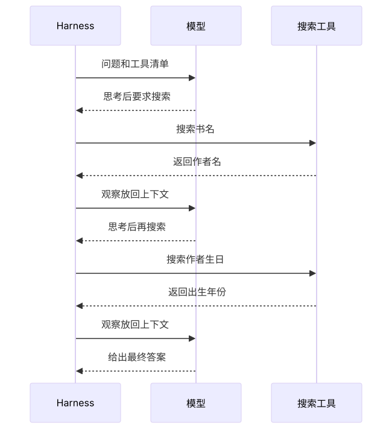
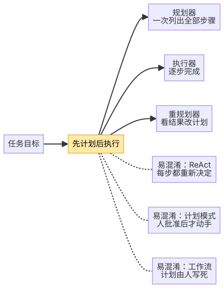
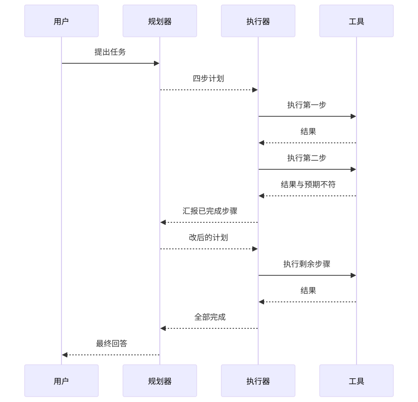
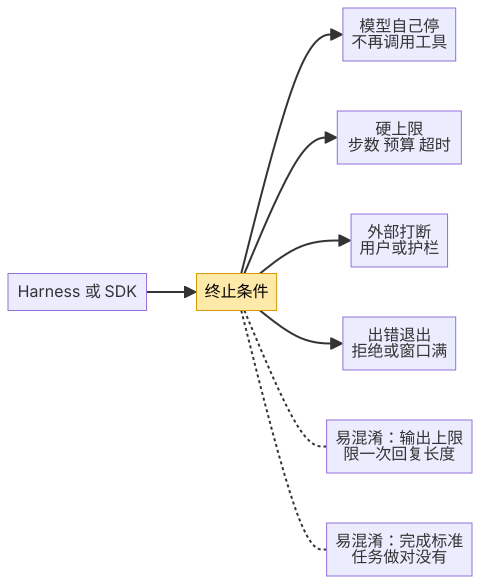
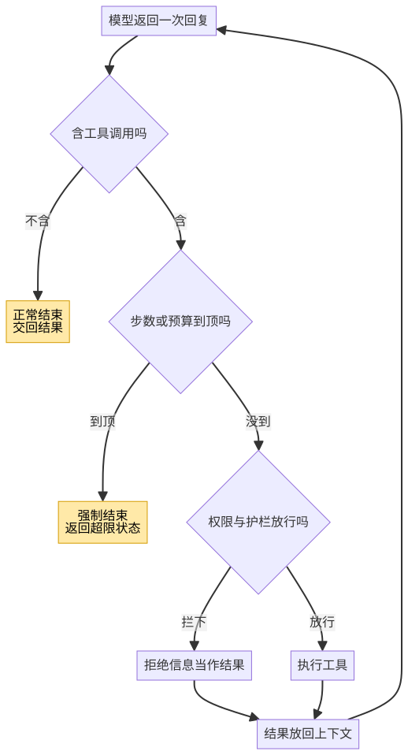
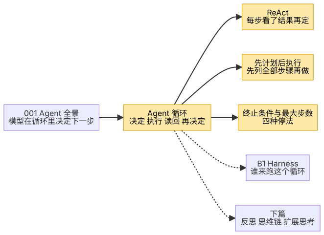

# 002 - Agent Loop and Reasoning Patterns Part 1 · Agent 循环与推理范式（上）

> 第 002 讲 · A2 Agent 循环与推理范式（上） · A 原理：Agent 是怎么转起来的 · 事实核实截至 2026-10-30
> [← 返回目录](../README.md) · 上一讲：[001 Agent 全景](001-agent-landscape.md) · 下一讲：[003 Agent 循环与推理范式（下）](003-agent-loop-and-reasoning-2.md)

---

## 🧭 Bulletin 流程

> 一个目标交给 Agent → **① Agent 循环** → **② ReAct** → **③ 先计划后执行** → **④ 终止条件与最大步数** → 任务做完，或者被安全地叫停

这一行是今天的讲解顺序，也是复述时的顺序。A2 一共 7 个概念，今天讲"循环本身怎么转、怎么停"的 4 个；反思、思维链与思维树、扩展思考这 3 个"怎么让每一圈想得更好"的概念放到下篇。

1. **Agent 循环**：Agent 循环就是模型看上下文、决定调用工具、读回结果、再决定，这样一圈一圈转，直到模型给出一个不带工具调用的回答。
2. **ReAct**：ReAct 是这个循环最经典的一种写法，每一圈都是想一步、做一步、看一步，下一步永远根据刚看到的结果来定。
3. **先计划后执行**：先计划后执行是另一种写法，先让模型一次列出全部步骤，再逐步去做，做的过程中发现不对再改计划。
4. **终止条件与最大步数**：循环有四种停法，模型自己停、撞到硬上限、被外部打断、出错退出，其中最大步数和预算是防止它一直转下去的保险丝。

---

## 📍 定位图



怎么读这张图：上面一行是整张地图的 10 个块，下面一行是今天所在的块展开成的各簇，黄色是今天的位置。

A2 上面接的是 A1：上一讲只说了"模型在循环里自己决定下一步"，今天把这个循环拆开看。A2 下面通向 A3 模型基础和 B1 Harness：循环里负责"想"的那一半是模型，负责"转"和"停"的那一半是 Harness。

---

## 本簇讲解

### 这一簇要解决什么问题

上一讲给 Agent 下了定义：下一步由模型在运行时决定。但这句话没有回答三个实际问题。

第一，"决定下一步"在机器里到底是什么样子。模型只会生成文字，它并不能真的去读文件。是谁把它的"决定"变成动作，又是谁把动作的结果告诉它。

第二，同样是循环，为什么有的 Agent 改一个错别字要绕 8 圈，有的 Agent 做一个 20 步的任务却走到第 12 步就忘了自己要干什么。这是循环的组织方式不同造成的。

第三，它什么时候停。一个没有上限的循环遇到一个永远修不好的测试，会一直改、一直跑、一直失败。假设每圈花 0.3 美元，一晚上转 400 圈就是 120 美元，而且第二天早上你拿到的仍然是一个失败的测试。

今天的四个概念依次回答这三个问题：循环是什么，循环的两种主流组织方式，循环怎么停。

---

### 概念一：Agent 循环

**1. 定义**

Agent 循环（agent loop，Claude Code 文档里叫 agentic loop）是 Agent 的执行骨架：Harness（套在模型外面、负责循环、工具、权限和上下文的那层程序）把当前上下文（模型这一次能看到的全部文字）发给模型；模型返回文字，或者返回一个或多个工具调用请求；Harness 执行这些工具，把结果追加进上下文，再发给模型。这样重复，直到模型返回一个**不包含工具调用**的回复，循环结束。

Claude Agent SDK（Anthropic 提供的开发套件，把 Claude Code 的同一套循环开放给开发者用代码调用）的文档把它写成五步（核实于 2026-10-13）[2]：接收提示词；模型评估并回应；执行工具；重复第二、三步；返回结果。文档对"一圈"的定义是：一个 turn（回合）就是循环里的一次往返，模型的输出里带有工具调用，SDK 执行这些工具，结果自动送回模型。

Claude Code 的产品文档从任务的角度描述同一件事：三个阶段，收集上下文、采取行动、验证结果，三者混在一起、反复进行。文档还明确了分工：循环由两个部件驱动，负责推理的模型和负责行动的工具；Claude Code 是包在模型外面的那一层，提供工具并管理模型能看到的上下文，这一层就是 agentic harness。[1]

**2. 场景**

Charles 对 Claude Code 说"把 auth.ts 里失败的测试修好"。按 Agent SDK 文档里的同款例子，接下来是四圈 [2]：

- 第 1 圈：模型请求运行 `npm test`（JavaScript 项目里跑测试的命令）。Harness 执行，结果是 3 个失败，放回上下文。
- 第 2 圈：模型请求读 `auth.ts` 和 `auth.test.ts` 两个文件。Harness 读完，把内容放回上下文。
- 第 3 圈：模型请求修改 `auth.ts`，再请求重跑测试。3 个测试全过。
- 第 4 圈：模型只输出一句话"修好了，三个测试都通过"，没有工具调用。循环结束。

三圈带工具调用，一圈纯文字。模型从头到尾没有"碰"过任何文件，它只是四次说出"我想要什么"；真正动手的是 Harness。

**3. 它解决什么问题**

模型本身有两个硬限制：它只能输出文字，不能执行；它一次调用只能回应一次，回应完就结束。循环把这两个限制绕过去了。执行交给 Harness；"回应一次就结束"变成"回应一次，如果还要做事就再来一次"。

循环也是成本的来源，因果链是这样的：上下文在一个会话里不会在圈与圈之间清空，每一圈的工具输入和输出都累积在里面 [2]；所以第 20 圈发给模型的内容，包含前 19 圈的全部结果；所以圈数越多，每一圈要处理的 token（模型计量文字的单位，按量计费）越多，总花费的增长比圈数的增长更快。文档提到不变的前缀，例如系统提示词和工具定义，会被自动做提示词缓存（把重复发送的前缀存起来、之后按更低价格计费的机制，A4 簇细讲），这能减轻但不能消除这个增长。

**4. 位置图**



怎么读这张图：从左到右是上层、本层、下层，实线是"谁调用谁"，虚线是容易混淆的概念。ReAct 是给循环里每一圈规定内容的一种范式，今天第二个概念讲。图循环指用 LangGraph（LangChain 公司出的框架，把 Agent 的流程画成节点和连线组成的图）这类框架把流程画成图以后形成的环：环在哪里、从哪个节点回到哪个节点是开发者画的；而 Agent 循环里每一圈做什么是模型定的。

**5. 运行流程图**



怎么读这张图：模型和工具之间没有任何一条直接的线，所有消息都经过 Harness。图里省略了读文件和重跑测试两步。最后一条"只有文字回答"就是循环的出口：Harness 看到回复里没有工具调用，就不再发起下一圈。

**6. 实例（本机）**

本机的每一次 Claude Code 会话都会被记成一个 JSONL 文件（每行一条 JSON 记录的文本文件），存在 `~/.claude/projects/<项目目录>/<会话编号>.jsonl`，官方文档写明每条消息、每次工具调用和结果都会写进去。[1] 写这张卡片的这次运行也有一个。调研进行到一半时我对它做了只读统计（只数字段，不看内容）：

```
模型回复 8 次，stop_reason 全部是 tool_use
工具调用 35 次：WebFetch 21，Bash 5，Read 4，WebSearch 3，其余 2
```

`stop_reason` 是模型每次回复里带的一个字段，说明它这次为什么停笔；`tool_use` 表示"我停下来是因为要调用工具"。8 次回复却有 35 次工具调用，是因为模型一次回复里可以并行请求多个工具，这 8 次就是 8 圈。只要这个字段还是 `tool_use`，循环就没有结束。这张卡片写完、最后一次回复不再带工具调用时，它才会变成 `end_turn`（正常结束）。

**7. 常见误解与边界**

- **"循环是模型自己在转"**：不是。模型每次调用都是独立的一次生成，转圈的是 Harness 里的一段普通程序。模型不知道自己在第几圈，除非上下文里写着。
- **"一圈等于一次工具调用"**：不一定。一圈里模型可以并行请求多个工具。按文档，只读工具可以并发执行，会改状态的工具（例如编辑文件、跑命令）顺序执行。[2]
- **"循环结束等于任务完成"**：不是。循环结束只说明模型不再请求工具了。它可能是做完了，也可能是做不下去而放弃了，还可能是错误地以为做完了。判断任务对不对，是评测（G1 簇）的事。
- **边界**：循环本身不提供记忆。同一个会话里靠上下文累积；跨会话每次都是全新的上下文，要靠记忆文件之类的机制（B5 簇）。

**8. 其他家叫什么**

本段涉及 Claude 与别家的对比，本文由 Anthropic 的模型撰写，存在利益相关。OpenAI Agents SDK（OpenAI 的 Agent 开发套件）文档对循环的描述和上面几乎逐条对应：调用模型；如果输出被判定为最终输出，循环结束；如果模型请求交接（handoff，把任务转给另一个 Agent），就换一个 Agent 再跑；如果有工具调用，就执行、追加结果、再跑。[5] 区别在两处：OpenAI 的循环里"交接"是和工具调用并列的一等动作；它的"最终输出"还要求符合指定的输出类型。JavaGuide（国内常用的面试题库网站）把这个结构称为 Agent Loop，并专门列了一道题区分 Graph Loop 和 Agent Loop。[11] Claude 这边的短板：Claude Code 的循环默认没有步数上限（见概念四），无人值守运行时要开发者自己记得加。

---

### 概念二：ReAct

**1. 定义**

ReAct（Reasoning and Acting，推理加行动）是一种让模型**交替输出推理和行动**的范式：每一圈先写一段思考（Thought），再给出一个行动（Action，也就是调用哪个工具、传什么参数），然后读取行动的结果（Observation，观察），再进入下一圈的思考。它出自 Yao 等七位作者 2022-10-06 提交的论文 *ReAct: Synergizing Reasoning and Acting in Language Models*，发表于 ICLR 2023（International Conference on Learning Representations，机器学习领域的顶级会议之一）。[4]

和概念一的关系：Agent 循环是骨架，说的是"模型和工具来回"；ReAct 规定了每一圈里模型要先把推理写出来再行动，并且**每一步都根据上一步的观察重新决定**，不预先制定全盘计划。

**2. 场景**

问题是"《三体》作者的出生年份，比《流浪地球》电影上映早多少年"。模型的训练数据里可能有这些事实，但假设要求它必须查证。

- 第 1 圈。思考：我需要先确认《三体》的作者。行动：搜索"三体 作者"。观察：刘慈欣。
- 第 2 圈。思考：现在查刘慈欣的出生年份。行动：搜索"刘慈欣 出生"。观察：1963 年。
- 第 3 圈。思考：再查电影的上映年份。行动：搜索"流浪地球 电影 上映"。观察：2019 年。
- 第 4 圈。思考：2019 减 1963 等于 56，信息够了。给出答案：早 56 年。

注意第 2 圈搜什么，取决于第 1 圈查到了谁。如果第 1 圈的观察是"没有结果"，第 2 圈的思考就会变成"换一个关键词"。这就是"走一步看一步"。

**3. 它解决什么问题**

在 ReAct 之前有两条分开的路。一条是只推理不行动，例如思维链（让模型把推理步骤一步步写出来再作答的提示方法，下篇讲）：模型推理得头头是道，但事实全凭记忆，记错了就一路错下去。另一条是只行动不推理：模型直接输出动作，遇到意外结果时没有"停下来想一想"的环节，也没法解释自己为什么这么做。

ReAct 把两者交织起来，论文摘要的说法是：推理帮助模型制定、跟踪和更新行动计划并处理例外，行动让模型能从外部获取信息。论文报告的结果（核实于 2026-10-13）[4]：在问答和事实核查任务上，通过调用一个简单的维基百科接口，减少了思维链常见的幻觉（模型编造出看似合理但不符合事实的内容）和错误传播；在 ALFWorld（让 Agent 在文字描述的模拟家居环境里完成任务的基准）和 WebShop（模拟网购的基准）两个交互式决策基准上，只给一两个示例，成功率分别比模仿学习和强化学习方法高出绝对值 34% 和 10%。这是 2022 年的模型和基准，数字只说明方向，不代表今天的水平。

**4. 位置图**



怎么读这张图：ReAct 的上层是 Agent 循环，它是循环的一种组织方式；下层是每一圈里的三个环节。三条虚线是最常被混在一起的：思维链只有推理没有行动；工具调用（function calling，模型按约定的格式输出"调用哪个函数、传什么参数"的接口能力，A4 簇讲）是模型接口提供的机制，ReAct 是怎么用这个机制的范式；先计划后执行是下一个概念。

**5. 运行流程图**



怎么读这张图：每次模型发给 Harness 的消息里都同时带着"思考"和"行动"两部分，这是 ReAct 和普通循环在形式上的区别。图里省略了查电影上映年份的那一圈。

**6. 实例**

非 Claude Code 概念，下面是按论文的格式写的示意，不是某个库的真实输出。2022 年的原始做法是把这个格式写进提示词，让模型按纯文本输出，再由代码把 `Action:` 那一行解析出来去执行：

```text
Question: 《三体》作者的出生年份比《流浪地球》电影上映早多少年？
Thought 1: 我需要先确认《三体》的作者。
Action 1: Search[三体 作者]
Observation 1: 《三体》是刘慈欣创作的长篇科幻小说。
Thought 2: 接着查刘慈欣的出生年份。
Action 2: Search[刘慈欣 出生]
Observation 2: 刘慈欣，1963 年 6 月出生。
Thought 3: 再查电影上映年份。
Action 3: Search[流浪地球 电影 上映]
Observation 3: 《流浪地球》于 2019 年 2 月上映。
Thought 4: 2019 - 1963 = 56。
Action 4: Finish[56 年]
```

今天的做法变了，这一点面试里常被追问。现在主流模型都有原生的工具调用接口，模型直接输出结构化的调用请求，不再需要代码从文本里解析 `Action:`；"思考"的部分要么是工具调用前的一段文字，要么是模型的扩展思考（模型在回答前先在专门的区块里推理的功能，下篇讲）。所以现在说"某个 Agent 是 ReAct 式的"，通常指的是它"每一步根据观察决定下一步"的结构，而不是指它用了 `Thought / Action / Observation` 这套文本格式。这是社区通行的说法；我今天读的两篇 Claude 官方文档 [1][2] 描述的就是这种结构，但通篇没有用 ReAct 这个词。

**7. 常见误解与边界**

- **"ReAct 就是 Agent"**：不是。ReAct 是组织循环的一种范式。先计划后执行的 Agent 也是 Agent。
- **"用了工具调用就是 ReAct"**：不准确。只调一次工具就结束的应用用了工具调用，但没有"观察后再推理"的循环。
- **"思考写得越多越好"**：不是。每一圈的思考都会留在上下文里，圈数多了以后占用大量 token。
- **边界**：ReAct 只看眼前一步，没有全局计划。小林 coding（国内另一个常用的面试题库网站）的题库指出，在十几步的复杂任务里它可能偏离目标，或者在几个工具之间反复打转。[12] 步骤之间依赖强、需要统筹的任务，更适合下一个概念。

**8. 其他家叫什么**

各家基本都直接叫 ReAct。LangChain 系有预置的 ReAct 式 Agent 构造函数：截至 2026-10-30，官方 v1 迁移指南写明 1.0 之前推荐 `langgraph.prebuilt` 里的 `create_react_agent`，1.0 起改名为 `create_agent`，用 `from langchain.agents import create_agent` 引入；新文档把它描述成"模型在循环里调用工具、直到任务完成"，不再直接叫 ReAct。细节留到 F2 簇。[17]国内题库通常把 ReAct、Plan-and-Execute、Reflection 并列为三种范式来考。[12]

---

### 概念三：先计划后执行

**1. 定义**

先计划后执行（Plan-and-Execute）是把"想"和"做"拆成两个阶段的范式：先由规划器（planner）根据目标**一次性生成完整的多步计划**，再由执行器（executor）按计划逐步执行；执行中或执行后，由重规划器（replanner）根据实际结果决定是直接作答，还是修改剩余的计划。

LangChain（最早流行起来的大模型应用开发框架）团队 2024-02-13 的文章给出了这个三件套的标准描述，并列了它相对 ReAct 的三个好处（核实于 2026-10-13，以下是该团队的说法）[8]：更快，因为每做完一个动作不必再回去问一次主模型；更省，因为子任务可以交给更小的模型，大模型只在规划、重规划和最后作答时被调用；质量可能更好，因为规划器被迫把整个任务需要的步骤先想一遍。

**2. 场景**

假设要做一份"三家券商金融科技岗位招聘要求的对比表"。

用 ReAct：搜第一家，读页面；想到该搜第二家，搜，读；想到还缺第三家；读到一半发现三家的页面结构不一样，前面记下的字段对不上，回头重查第一家。总共 14 圈，每一圈都由大模型决定下一步，而且每一圈都带着前面所有网页的内容。

用先计划后执行：规划器先出四步计划。第一步，确定对比字段，即岗位名称、专业要求、技能要求、截止日期、工作地点。第二到第四步，分别按这五个字段去查三家。最后汇总成表。第二到第四步互不依赖，可以交给三个便宜的小模型并行去做。执行到第三步时发现第二家今年没有单独的金融科技岗，重规划器把这一步改成"查它的信息技术岗并在表里注明"。大模型只被调用了三次：规划、重规划、汇总。

**3. 它解决什么问题**

它针对的是 ReAct 的两个弱点。一是没有全局视野：ReAct 走到第 12 步时，决定下一步的依据是一个很长的、塞满中间结果的上下文，最初的目标被稀释了；一份写在最前面的计划起到了路标的作用。二是每一步都要用大模型：先计划后执行把大模型的调用次数从"等于步数"降到"规划加重规划的次数"。

代价来自同一个设计。计划是在还没看到任何实际结果时写的，如果一开始方向就错了，执行器会沿着错的计划一路做下去；重规划又多出额外的模型调用。所以它适合步骤之间依赖清楚、可以事先想明白的任务，不适合每一步都充满未知的探索型任务。

**4. 位置图**



怎么读这张图：下层是三个角色，可以是三个不同的模型，也可以是同一个模型用三段不同的提示词。执行器再往下才是工具，图里没画。三条虚线里最需要分清的是工作流（模型和工具沿着预先写好的代码路径被编排的系统）：两者都"有一份步骤清单"，但工作流的清单是开发者在上线前写死的，先计划后执行的清单是模型在运行时针对这一次任务现写的，所以后者仍然是 Agent。

**5. 运行流程图**



怎么读这张图：规划器在图里出现了三次，开头出计划、中途改计划、最后作答，这就是"大模型只在规划时被调用"的样子。图里把重规划器和规划器画成了同一个参与者，因为时序图最多放四个参与者，实际实现里它常常是同一个模型换一段提示词。执行器执行某一步时，内部可以是一次工具调用，也可以是一个小的 ReAct 循环。

**6. 实例（本机）**

本机有两个实物，分别对应"计划由谁写"的两种情况。

第一个，计划由人写、Agent 执行。`~/.claude/scheduled-tasks/daily-agent-stack/SKILL.md` 一共 79 行，主体是"第 0 步"加上编号 1 到 13 的步骤清单：先判断日期，再读规范，再确定讲哪一簇，再联网核实，直到更新索引和输出全文。这是一份 Charles 事先写好的高层计划。但每一步内部怎么做没有写，例如"联网核实"这一步，今天实际是先查了循环的文档，从文档里的一个链接发现了一篇讲循环设计的官方博客又去读了它，这是 ReAct 式的走一步看一步。所以这次运行是混合体：外层是人给的计划，内层是 ReAct。

第二个，计划由模型写、人批准。Claude Code 的计划模式（plan mode）：按官方文档（核实于 2026-10-13），在这个模式下 Claude 读文件、运行探索用的命令、写出一份计划，但不改你的源文件；计划写好后它会展示出来并询问怎么继续，你批准以后会话才切换到可以编辑的权限模式；进入方式是按 `Shift+Tab` 切换、在某一条提示词前加 `/plan`，或者用 `claude --permission-mode plan` 启动；按 `Ctrl+G` 可以在文本编辑器里直接改这份计划。[6] 本机 `~/.claude/settings.json` 里的 `defaultMode` 是 `auto`，不是 `plan`，所以这台电脑上计划模式要手动切。

下面是三件套结构的示意代码，不是某个库的真实接口：

```python
def plan_and_execute(goal, max_replans=3):
    plan = planner_llm(goal)                 # 大模型：一次列出全部步骤
    done = []
    for _ in range(max_replans + 1):
        for step in plan:
            done.append(executor(step))      # 小模型或一个小循环
            if done[-1].unexpected:          # 结果和预期不符
                break
        else:
            return writer_llm(goal, done)    # 全部做完，汇总作答
        plan = replanner_llm(goal, done)     # 大模型：改剩下的计划
    return to_human(goal, done)              # 重规划次数用完，转人工
```

**7. 常见误解与边界**

- **"计划模式就是 Plan-and-Execute"**：只对了一半。相同点是都先出计划再动手。不同点有两个：计划模式的核心是一道**权限闸门**，计划和执行之间隔着人的批准；批准之后，执行计划的还是同一个模型、同一个 ReAct 式循环，没有单独的"执行器小模型"。计划模式属于 B2 簇。
- **"Plan-and-Solve 和 Plan-and-Execute 是一回事"**：不是。Plan-and-Solve 是 Wang 等人 2023 年发表于 ACL（Association for Computational Linguistics，计算语言学领域的顶级会议）的一种**提示方法**：在一次调用里让模型先列计划再按计划解题，针对的是零样本思维链漏步骤的问题，没有工具、没有循环。[9] Plan-and-Execute 是 Agent 的架构。国内面经里两个词经常混着用，被问到时先确认对方指的是哪一个。
- **"有了计划就不用循环了"**：不是。执行每一步仍然要调用工具、看结果；重规划本身也是一个环。
- **"先计划一定更省"**：不一定。任务只有三四步时，规划加重规划的开销可能比直接 ReAct 还多。
- **边界**：计划过期是它的典型故障，执行器照着一份已经不符合现状的计划继续做。所以重规划的触发条件和次数上限要设计，不能省。

**8. 其他家叫什么**

同一篇 LangChain 文章还介绍了两个变体（以下均为该文和所引论文的说法）[8]：ReWOO（Reasoning WithOut Observations，不依赖观察的推理），规划器在计划里用变量占位，后面的步骤可以引用前面步骤的结果，执行时不用每步回去问大模型，但任务仍是顺序执行的；LLMCompiler，规划器输出一个带依赖关系的任务图，即 **DAG**（Directed Acyclic Graph，有向无环图：节点之间有先后依赖、但不会绕回自己的图），没有依赖的任务并行执行，文章引用其论文称可达 3.6 倍加速。除此之外，很多 Agent 用一种更轻的做法：给模型一个"待办清单"工具，让它在循环里自己写计划、勾掉完成的项。Claude Agent SDK 的文档把 `TaskCreate` 和 `TaskUpdate` 列在编排类工具里，用途是跟踪任务。[2] 这种做法把计划留在同一个循环里，不拆出独立的规划器。

---

### 概念四：终止条件与最大步数

**1. 定义**

终止条件是决定 Agent 循环何时结束的规则集合，分四类：

| 类别 | 谁触发 | 例子 |
|---|---|---|
| 模型自己停 | 模型 | 返回一个不带工具调用的回复 |
| 硬上限 | Harness | 最大步数、预算上限、超时 |
| 外部打断 | 用户或护栏 | 用户按下中止；护栏（在模型输入、输出或工具调用上做检查并可以拦截的规则，G3 簇讲）拦下动作 |
| 出错退出 | 模型接口或运行环境 | 模型拒绝回答；上下文窗口被填满；进程崩溃 |

最大步数（max steps，各家多叫 max turns 或 max iterations）是硬上限里最常用的一个：循环转满指定的圈数后，无论模型还想不想继续，Harness 都强制结束，并返回一个明确的"超限"状态。

**2. 场景**

Charles 用一个无人值守的脚本让 Agent 修一个测试。这个测试失败的真实原因是测试环境缺一个数据库，改代码永远修不好。

没有任何上限时：Agent 改代码、跑测试、失败、换个改法、再跑、再失败。它每一圈都"有新想法"，所以每一圈都会请求工具，"模型自己停"这个条件永远不触发。一晚上转了 400 圈。

设了最大 30 圈和 5 美元预算时：第 30 圈结束，Harness 返回超限状态，脚本把"30 圈未完成、最后的报错是连不上数据库"写进日志并通知 Charles。他早上花两分钟就看出是环境问题。

**3. 它解决什么问题**

"模型自己停"是唯一的正常出口，但它依赖模型的判断，而模型的判断会在三种情况下失灵：任务本身无解，模型却一直有新尝试；模型在两三个动作之间来回震荡，例如改过去、改回来；工具反复返回同样的错误，模型反复用同样的参数重试。硬上限不依赖模型的判断，所以它是保险丝。

各家的默认值差别很大，这是今天最值得记的一组事实（均核实于 2026-10-13）：

- **Claude Agent SDK**：`max_turns` 和 `max_budget_usd` 默认都是**不限**。`max_turns` 只数带工具调用的回合。触顶时返回的结果消息里，`subtype` 字段是 `error_max_turns` 或 `error_max_budget_usd`，而正常完成是 `success`。文档建议生产环境的 Agent 默认设一个预算。[2]
- **预算会略微超支**：预算是在每次模型回复返回之后才比对的，因为花费要等接口返回用量才算得出来；所以触顶的那一次回复仍会完成并计费，实际花费可能超出上限，文档提醒要留余量。[2]
- **Claude Code 命令行**：`--max-turns` 和 `--max-budget-usd` 只在非交互的 print 模式（用 `claude -p` 启动、跑完就退出的模式）下生效；`--max-turns` 默认不限，触顶时以报错退出。[3]
- **OpenAI Agents SDK**：默认最多 **10** 圈，源码里是 `DEFAULT_MAX_TURNS = 10`；超过时抛出 `MaxTurnsExceeded` 异常；传 `max_turns=None` 可以关掉上限；也可以注册一个针对 `max_turns` 的错误处理器，在触顶时返回一个兜底的最终输出，而不是让整次运行报错。[5]
- **LangGraph**：上限叫递归上限（recursion limit），数的是超步（super-step，图执行里的一轮：这一轮里所有被激活的节点各跑一次），不是工具调用次数。官方文档写明从 1.0.6 版起默认值是 **1000** 步；触顶时抛出 `GraphRecursionError`；文档推荐用 `RemainingSteps` 这个内置值在触顶前主动转去收尾节点。[7] 第三方资料普遍写旧版默认值是 25，这一点我没有在官方文档里核实到，但它解释了为什么很多面经答案还在说"LangGraph 默认 25 步"。

**4. 位置图**



怎么读这张图：上层是 Harness，因为所有终止条件最终都由它来执行。下层是四类出口。虚线两项：输出上限指 `max_tokens`，它限制的是模型**一次回复**最多写多少 token，不是限制循环转多少圈；完成标准是"任务算不算做对"，循环停了不代表达到了完成标准。

**5. 运行流程图**



怎么读这张图：这是一张通用示意，每一圈 Harness 依次问三个问题，黄色的两个节点是循环的两个出口。各家检查的先后顺序不完全一样。注意右下的"拦下"并不结束循环：按 Agent SDK 文档，工具被拒绝时模型会收到一条拒绝信息作为工具结果，通常会换一种做法或者报告做不下去。[2] 这也是为什么"被拦下后绕路"会成为一种失败模式。

**6. 实例（本机）**

先看模型接口这一层。Claude 的接口每次回复都带 `stop_reason`，官方文档列了七个取值（核实于 2026-10-13）[10]：

| 取值 | 含义 | Harness 该怎么办 |
|---|---|---|
| `end_turn` | 模型自然说完 | 循环结束 |
| `tool_use` | 模型要调用工具 | 执行工具，继续下一圈 |
| `max_tokens` | 这次回复撞到输出上限 | 调高上限或让它接着写 |
| `stop_sequence` | 输出了预设的停止词 | 看是哪个停止词 |
| `pause_turn` | 服务端工具的内部循环到了次数上限 | 把内容原样发回去让它继续 |
| `refusal` | 模型拒绝回答 | 读拒绝详情，按策略处理 |
| `model_context_window_exceeded` | 回复把上下文窗口填满了 | 当作被截断处理 |

再看本机。`~/.claude/settings.json` 里没有任何步数或预算相关的键；三个定时任务的说明文件里也没有。也就是说，本机这三个后台任务的硬上限是空的，它们靠两样东西停下来：模型自己返回 `end_turn`，以及任务说明里写的规则，例如"本篇日期对应的卡片已经存在就直接结束""每次运行只写一张卡片"。写在提示词里的规则属于软约束，要靠模型遵守。本机 Claude Code 版本是 2.1.220，高于文档说的预算上限强制行为所需的 2.1.217。[2] 我没有改任何配置，这里只是把现状记下来。

如果用 Agent SDK 自己写一个无人值守的 Agent，文档给的写法是这样（节选自官方示例，核实于 2026-10-13）[2]：

```python
from claude_agent_sdk import query, ClaudeAgentOptions, ResultMessage

async def run_agent():
    try:
        async for message in query(
            prompt="Find and fix the bug causing test failures",
            options=ClaudeAgentOptions(
                allowed_tools=["Read", "Edit", "Bash", "Glob", "Grep"],
                max_turns=30,      # 最多 30 个带工具调用的回合
                effort="high",
            ),
        ):
            if isinstance(message, ResultMessage):
                if message.subtype == "success":
                    print(f"Done: {message.result}")
                elif message.subtype == "error_max_turns":
                    print(f"Hit turn limit. Resume {message.session_id}")
                elif message.subtype == "error_max_budget_usd":
                    print("Hit budget limit.")
    except Exception as error:   # 触顶后 query() 会抛出异常
        print(f"Session ended with an error: {error}")
```

两个细节：只有 `success` 时才有 `result` 字段，所以要先判断 `subtype` 再读结果；触顶时会话没有丢，拿 `session_id` 可以带着更高的上限接着跑。

**7. 常见误解与边界**

- **"`max_tokens` 就是最大步数"**：不是。一个管单次回复的长度，一个管循环的圈数。
- **"设了最大步数就不会死循环"**：只是不会无限循环。上限设成 200，它照样可以空转 200 圈。要早发现，还需要重复动作检测，例如记录每次的工具名和参数，连续出现相同组合就中断或提醒模型换策略，以及"连续几圈没有进展就停"的判断。这些属于社区经验，今天读的官方文档没有给出标准实现。
- **"步数上限越小越安全"**：不是。设得太小，正常的长任务会被拦腰截断，产出一个半成品，而且已经花掉的钱收不回来。上限应该参照真实任务的步数分布来定。
- **"触顶等于失败"**：不一定。触顶时任务可能已经完成了八成。好的设计会在触顶时保留会话、返回已有进展，或者像 LangGraph 文档推荐的那样在快到顶时主动转去收尾。[7]
- **边界**：硬上限只管"停"，不管"对"。让循环在该停的时候停、而且停的时候任务确实做对了，需要可验证的完成标准。Claude Code 的 `/goal` 命令就是往这个方向走。按 Claude Code 官方文档的 `/goal` 专页（截至 2026-10-30）：每一轮结束后，Claude Code 把你写的条件和到目前为止的对话交给配置好的小而快的模型（默认走 Haiku 档）判断，结论只有三种：未满足、已满足、不可能；未满足就自动开下一轮，已满足或判定不可能就清掉目标。它本质上是一个只在当前会话生效、由模型做判断的 Stop 钩子（Stop hook：每轮结束时自动执行的检查）。评估模型不调用工具，只能看 Claude 已经在对话里展示出来的结果，所以条件要写成输出能证明的样子；想设回合上限，就把它写进条件里，比如"或者跑满 20 轮就停"。[16] Anthropic 2026-06-30 的博客 *Loop engineering* 也介绍过这个命令。[13]

**8. 其他家叫什么**

本段涉及 Claude 与别家的对比，本文由 Anthropic 的模型撰写，存在利益相关。名字对照：Claude 叫 `max_turns`，OpenAI Agents SDK 也叫 `max_turns`，LangGraph 叫 `recursion_limit`，旧的 LangChain Agent 和很多教程里叫 `max_iterations`（⚠️ 待修正，2026-10-30 未能核实：它属于已移到 `langchain-classic` 包的旧 Agent 写法，当前 v1 文档和迁移指南都没有列这个参数）。三家数的东西不一样：Claude 数带工具调用的回合，OpenAI 数模型调用次数，LangGraph 数超步。所以"上限 25"在三家意味着完全不同的工作量，迁移框架时不能照搬数字。Claude 这边的短板：默认不限。这对有人盯着的交互式会话是合理的，但 OpenAI 默认 10 圈的做法对"忘了设上限"的开发者更安全；用 Claude Agent SDK 做无人值守任务时，步数和预算两个上限都要自己加，而且预算是按客户端估算的花费来比对的，和实际账单可能有出入。[3]

---

## 👔 三岗视角

### AI 应用 / Agent 开发

**场景**：团队的"自然语言查数" Agent 上线两周，账单比预估高了三倍。产品经理问是不是模型涨价了。

**这个岗位具体做什么**：先把每次运行的步数拉出来看分布，而不是看平均值。结果是：**P50**（中位数，一半的运行在这个步数以内）是 4 步，**P95**（把运行按步数排序，最多的那 5% 的门槛值）是 9 步，但有 2% 的运行跑满了 50 步的上限，这 2% 占了总花费的 41%。打开这些运行的 **trace**（一次运行里每一步输入、输出和耗时的完整记录，G2 簇讲）一看，是一个查询工具在表名写错时只返回"执行失败"四个字，模型拿不到有用信息，就换着花样重试。于是做三件事。第一，改工具，报错时返回具体原因和可用的表名。第二，加重复检测，同一个工具连续三次用相同参数失败就中断，并把情况告诉模型。第三，把上限从 50 降到 15，依据是 P95 才 9 步，15 留了足够余量；触顶时返回"已查到的部分结果加上卡在哪一步"。之后长期盯四个数：步数的 P50 和 P95、触顶率、单次成本、任务成功率。触顶率的目标定在 1% 以下。

**最容易踩的坑**：只设步数上限，不看触顶以后发生了什么。触顶时如果直接把异常抛给用户，用户看到的是一个转了半分钟然后报错的界面，体验比不上线还差。

### AI 产品 / 商业分析

**场景**：公司要做一个"竞品周报" Agent，每周一自动调研五家竞品的动态并出报告。技术团队问：做成走一步看一步，还是先出计划再执行。

**这个岗位具体做什么**：把这个技术选择翻译成业务能判断的三个问题。第一，任务的步骤事先说得清吗。周报的结构是固定的，五家公司、每家看产品更新、定价、招聘三项，说得清，所以适合先计划后执行，而且五家可以并行。第二，中间要不要人看一眼。让 Agent 先把计划发出来，也就是打算查哪些来源、输出哪些栏目，负责人花一分钟确认，这比等它跑完 20 分钟才发现方向错了便宜得多。第三，成本和时效怎么算。先计划后执行时，贵的大模型只在规划和汇总时用，五路调研用小模型，假设单次周报成本从 4 美元降到 1.5 美元，一年 52 期，差出 130 美元，金额不大，真正的收益是并行以后从 20 分钟缩到 6 分钟、而且每期的栏目一致，方便跨周对比。向业务方汇报时讲：每期成本、出报告的时长、人工返工的比例。

**最容易踩的坑**：把"能自己规划"当成卖点，却没有给计划设检查点。计划一旦错了，后面所有步骤的钱都白花，这是先计划后执行特有的风险。

### 金融科技 / 数据

**场景**：一家券商的运营部门想让 Agent 每晚自动核对当天的交易流水和清算文件，发现差异就生成工单。任务在夜里无人值守地跑。

**这个岗位具体做什么**：把终止条件当成风控参数来设计，写进制度。第一，三道硬上限同时设：最大步数、预算、总时长，任何一个触顶都停。总时长要早于第二天开盘前的处理窗口。第二，触顶不能静默。触顶视为一次异常事件，自动通知值班人员，并且保留会话，让人能接着看它停在哪。第三，留痕。每一圈的模型输入、输出、工具调用、结束原因都落日志；结束原因要区分"正常完成""步数触顶""预算触顶""被护栏拦截""模型拒绝"，因为审计时"它为什么停"和"它做了什么"同样重要。第四，上限参数本身纳入变更管理，谁把 30 改成 300、为什么改，要有审批记录。第五，写操作单独设限：核对是只读的，可以放开步数；生成工单是写操作，单次运行最多生成多少张要有上限，防止一个循环故障刷出几千张工单。

**最容易踩的坑**：把上限写在提示词里，例如"最多尝试五次"。提示词是软约束，模型可能不遵守，而且事后无法证明它被执行了。上限必须在 Harness 这一层用代码强制，这样才可审计。各地监管对自动化系统的具体要求留到 H2 簇逐条核实，今天不展开。

---

## 🔗 串联图



怎么读这张图：最左边是上一讲 [001 Agent 全景](001-agent-landscape.md) 留下的那句话，今天把它展开成一个骨架和三个围绕骨架的问题：每一圈怎么组织有两种答案，即 ReAct 和先计划后执行；怎么停有一个答案，即终止条件。虚线指向还没讲的内容。今天的概念以后还会接到三处：先计划后执行接 E1 工作流模式，终止条件接 G3 可靠性与护栏，计划模式接 B2 权限与会话。

---

## 🎙 复述板块

### 整簇两分钟版

> 今天这一簇讲 Agent 循环和推理范式的上半部分，我按四步说。
>
> 第一，Agent 循环。它是 Agent 的骨架。Harness，也就是套在模型外面的那层程序，把上下文发给模型。模型要么给出回答，要么请求调用工具。Harness 去执行工具，把结果放回上下文，再发给模型。这样一圈一圈转，直到模型给出一个不带工具调用的回答。要记住，转圈的是程序，不是模型。
>
> 第二，ReAct。它是循环最经典的一种写法，名字是推理加行动。每一圈做三件事：想一步，做一步，看一步。下一步永远根据刚看到的结果来定。它的好处是灵活，遇到意外能马上调整。短板是没有全局计划，步骤一多，容易跑偏或者打转。
>
> 第三，先计划后执行。它把想和做分成两段。先让规划器一次列出全部步骤，再让执行器逐步去做，做的过程中发现不对，由重规划器改计划。好处是有全局视野，而且贵的大模型只在规划时用。风险是计划一开始就错了，后面会一路错下去。
>
> 第四，终止条件。循环有四种停法：模型自己停，撞到硬上限，被用户或者护栏打断，出错退出。模型自己停是正常出口，但它会失灵，所以要有最大步数和预算做保险丝。各家默认值不一样，Claude 的开发套件默认不限，OpenAI 的默认十圈，所以无人值守的任务一定要自己设。
>
> 最后收一句。看一个 Agent 怎么转，问三件事：每一圈谁在动手，下一步是现想的还是先计划好的，它凭什么停下来。

### 每个概念三十秒版

**Agent 循环**

> Agent 循环是 Agent 的执行骨架。程序把上下文发给模型，模型返回回答，或者返回工具调用的请求。程序执行工具，把结果放回上下文，再发给模型。这样重复，直到模型的回复里不再有工具调用，循环结束。这里有两个要点。第一，模型只负责说它想要什么，真正动手的是外面那层程序。第二，每一圈的结果都累积在上下文里，所以圈数越多，后面每一圈越贵。

记忆钩子：模型是坐在屋里口述的指挥，Harness 是来回跑腿的助理；指挥从不出门，每次只说"帮我去看看那个"。

**ReAct**

> ReAct 是推理加行动的缩写，是组织 Agent 循环的一种范式，出自二零二二年的一篇论文。它让模型每一圈做三件事：先写出思考，再给出行动，然后读取观察到的结果，再进入下一圈。关键是每一步都根据上一步的结果重新决定，不预先做全盘计划。它的优点是灵活、过程可以追溯。缺点是只看眼前，步骤多的任务容易偏离目标或者在几个工具之间打转。

记忆钩子：在陌生城市问路，走到一个路口问一次，根据回答决定下一个路口往哪拐。

**先计划后执行**

> 先计划后执行，英文是 Plan and Execute，是把想和做分成两个阶段的范式。先由规划器一次生成完整的多步计划，再由执行器逐步执行，最后由重规划器根据结果决定是作答还是改计划。它比 ReAct 多了全局视野，而且大模型只在规划时调用，子任务可以交给小模型，还能并行。它的风险是计划写在看到结果之前，一开始方向错了会一路错下去，所以重规划必不可少。

记忆钩子：出门前先在地图上把整条路线规划好再上路；路上遇到封路，停下来重新规划一次。

**终止条件与最大步数**

> 终止条件决定 Agent 循环什么时候结束，一共四类。第一，模型自己停，也就是它不再请求工具。第二，硬上限，包括最大步数、预算和超时。第三，外部打断，来自用户或者护栏。第四，出错退出。模型自己停是正常出口，但任务无解或者动作来回震荡的时候它会失灵，所以必须有硬上限做保险丝。触顶以后要返回明确的状态和已有的进展，不能悄悄地停。

记忆钩子：洗衣机洗完会自己停，但它还有定时器和漏电保护；定时器不管衣服干不干净，只管到点断电。

英文版口述：规范第 7 节的开关为"默认不写"，本篇不写。

---

## 💼 面试题板块

### 题 1 `[开发]` Agent Loop 的完整流程是什么？

来源：题库题，非某公司原题。JavaGuide《AI Agent 面试题总结》列有原题"Agent Loop 的完整流程是什么？"，该页只列考点、不给答案（页面更新 2026-08-16，访问于 2026-10-13）。[11]

**答题骨架**
- 结论：Agent Loop 是模型和工具之间由 Harness 驱动的来回，直到模型不再请求工具。
- 三点展开：一圈里的四个动作；谁在转圈；上下文怎么累积。
- 例子：修一个失败的测试，四圈走完。

**逐字范例**

> Agent Loop 是 Agent 的执行骨架，我分三点讲。
>
> 第一，一圈里发生什么。外层的程序，一般叫 Harness，把系统提示词、对话历史和工具清单发给模型。模型返回两种东西之一：一个最终回答，或者一个工具调用的请求。如果是工具调用，Harness 先做权限检查，然后执行，把结果追加到上下文里，再发给模型。这就是一圈。
>
> 第二，谁在转。转圈的是 Harness 里的一段普通代码，不是模型。模型每次调用都是独立的，它只负责说下一步想做什么。
>
> 第三，上下文。每一圈的工具结果都留在上下文里，所以越往后，每一圈要处理的内容越多，成本也越高。
>
> 举个例子。让它修一个失败的测试。第一圈跑测试，看到三个失败。第二圈读相关文件。第三圈改代码并重跑，全部通过。第四圈模型只输出一句总结，没有工具调用，循环结束。出口条件就是这一条：回复里不再有工具调用。

**追问链**
1. 你自己实现过这个循环吗？要点：说出消息列表、工具结果怎么拼回去、用什么字段判断结束；用过框架的话说清框架替你做了哪几步。
2. 一圈里模型请求了多个工具，怎么执行？要点：只读的可以并发，会改状态的顺序执行，结果要和请求一一对应地放回去。
3. 上下文越来越长怎么办？要点：缓存不变的前缀、清理旧的工具结果、压缩成摘要、把子任务交给子代理；每种都有丢信息的风险。

**易错点**：说"模型自己循环调用工具"。面试官要听的是 Harness 和模型的分工。

### 题 2 `[开发]` Loop 如何防止死循环？

来源：题库题，非某公司原题。JavaGuide 列有原题"Loop 如何防止死循环？"（页面更新 2026-08-16，访问于 2026-10-13）[11]；小林 coding 题库目录里有同类题"Agent 为什么会出现路径震荡、重复调用和死循环？怎么检测和治理？"（仅见于目录标题，未打开正文，2026-10-13）。[12]

**答题骨架**
- 结论：分三层防，硬上限兜底、重复和无进展检测早发现、改工具反馈治根因。
- 三点展开：硬上限怎么设；检测什么信号；触顶后怎么收尾。
- 数字：步数的 P95、触顶率、单次成本。

**逐字范例**

> 我分三层来防，从兜底到治本。
>
> 第一层是硬上限，在 Harness 里用代码强制，不写在提示词里。包括最大步数、预算上限和总超时。数值不拍脑袋，看线上步数的分布。比如 P95，也就是最多的那百分之五的门槛，是九步，我就把上限设在十五步左右。
>
> 第二层是早发现。硬上限只能保证不会无限转，不能保证不空转。所以我会记录每一步的工具名和参数，同样的组合连续失败三次就中断，或者提示模型换策略。再加一个无进展判断，连续几圈的结果没有新信息就停。
>
> 第三层是治根因。死循环多数是因为工具的报错太含糊，模型拿不到有用的信息只能乱试。把报错改得具体，往往比加限制更有效。
>
> 最后是触顶以后。不能直接抛异常，要返回已有的进展和卡在哪一步，并且保留会话方便续跑。上线后我盯触顶率，目标是百分之一以下，同时看单次成本有没有长尾。

**追问链**
1. 最大步数具体设多少？要点：没有通用值，按任务类型分别看分布；注意各框架数的东西不同，有的数工具回合，有的数模型调用，有的数图的超步。
2. 设了上限，正常的长任务被截断怎么办？要点：按任务类型分级设限；触顶时保留会话，允许带更高的上限恢复；快到顶时让它先收尾。
3. 怎么区分"死循环"和"任务确实需要很多步"？要点：看有没有进展，也就是每一步是否产生新信息、动作是否重复；有进展的长任务不是死循环。

**易错点**：只答"设一个最大迭代次数"。这只是第一层，说不出检测和收尾，会被认为没在生产环境里处理过。

### 题 3 `[开发]` ReAct 和 Plan-and-Execute 有什么区别？实际项目怎么选？

来源：题库题，非某公司原题。小林 coding 题库目录里的原题是"ReAct、Plan-and-Execute、Reflection 三种范式有什么核心区别？实际项目中该如何选型？"（仅见于目录标题，未打开正文，2026-10-13）；同站《了解哪些其他的 Agent 设计范式》一页有对前两者的描述（页面更新 2026-10-12，访问于 2026-10-13）。[12] 原题里的 Reflection 留到下篇，这里只答前两种。

**答题骨架**
- 结论：区别在什么时候做决定，ReAct 每一步现想，Plan-and-Execute 先想完再做。
- 三点展开：适应性；成本与速度；失败方式。
- 例子：探索型任务用 ReAct，结构清楚的多步任务用 Plan-and-Execute，实际常常嵌套。

**逐字范例**

> 两者的区别在于什么时候做决定。ReAct 是每一步都根据刚拿到的结果决定下一步。Plan-and-Execute 是先一次列出全部步骤，再逐步执行，不对了再重新规划。
>
> 展开三点。第一，适应性。ReAct 更灵活，适合事先不知道会遇到什么的任务，比如排查一个线上问题。Plan-and-Execute 适合步骤之间依赖清楚的任务，比如按固定栏目调研五家公司。
>
> 第二，成本和速度。ReAct 每一步都要调用大模型，而且每次都带着全部历史。Plan-and-Execute 只在规划和重规划时用大模型，子步骤可以给小模型，没有依赖的步骤还能并行。
>
> 第三，失败方式不一样。ReAct 容易跑偏或者打转。Plan-and-Execute 的风险是计划过期，执行器照着一份已经不对的计划继续做。
>
> 实际项目里我通常混着用。外层先出一个粗的计划，把任务拆成几块。每一块内部用 ReAct 去应对细节。任务只有三四步的时候，直接用 ReAct，规划的开销不值得。

**追问链**
1. 重规划什么时候触发？要点：某一步结果和预期不符、某一步失败、或者每完成若干步检查一次；重规划次数也要设上限。
2. 现在模型都有原生工具调用，ReAct 还有意义吗？要点：文本格式的思考、行动、观察已经不常用了，但"根据观察决定下一步"的结构仍然是多数 Agent 的默认形态。
3. Claude Code 的计划模式算 Plan-and-Execute 吗？要点：相似但不等同；计划模式的核心是人批准之后才动手的权限闸门，批准后执行的仍是同一个循环。

**易错点**：把 Plan-and-Solve 和 Plan-and-Execute 当成一回事讲。前者是一次调用里的提示方法，后者是 Agent 架构。

### 题 4 `[产品·商分]` 你负责的 Agent 有 3% 的任务会跑到步数上限被强制终止，用户投诉"转了半天什么都没给"。你怎么处理？

来源：自拟。

**答题骨架**
- 结论：先把这 3% 拆开看原因，再分别处理，同时改掉触顶时的用户体验。
- 三点展开：分类；对症；体验与指标。
- 数字：触顶率、这部分任务的成本占比、改后的满意度。

**逐字范例**

> 我不会直接去调高上限，先把这百分之三拆开看。
>
> 第一步，分类。抽一两百个触顶的任务，看它们停在哪。一般会分成三类。一类是任务本来就很长，上限设小了。一类是 Agent 在空转，比如反复重试同一个失败的操作。还有一类是用户的需求本身没法完成，比如要查的数据根本不存在。
>
> 第二步，对症处理。真的很长的任务，单独给更高的上限，或者拆成几个小任务。空转的，交给研发去改工具的报错和加重复检测。没法完成的，让 Agent 尽早说做不到，而不是试到上限。
>
> 第三步，改体验。不管哪一类，触顶的时候都不能只给一个报错。要告诉用户已经完成了什么、卡在了哪里、他可以怎么做，比如换一种问法或者转人工。
>
> 指标上我看三个数。触顶率，目标降到百分之一以下。触顶任务占总成本的比例，它们往往占了很大一块。还有触顶之后用户的满意度和转人工率。

**追问链**
1. 研发说调高上限最省事，你同意吗？要点：不同意一刀切；空转类调高只会更贵，要用分类数据说话。
2. 怎么估算这 3% 的成本？要点：触顶任务每个都跑满了上限，单个成本是普通任务的好几倍，用步数乘以每步平均成本估算占比。
3. 触顶时给部分结果，会不会误导用户？要点：明确标注"未完成"，把已核实的和没做完的分开写。

**易错点**：把它当成纯技术问题甩给研发，或者只提"调高上限"。面试官想看的是先拆解再决策。

### 题 5 `[金融科技·数据]` 一个夜间无人值守跑批的 Agent，终止条件和留痕应该怎么设计？

来源：自拟。

**答题骨架**
- 结论：终止条件是风控参数，要在代码层强制、触顶必告警、结束原因必留痕。
- 三点展开：多道硬上限；触顶后的处置；日志和变更管理。
- 例子：夜间对账，步数、预算、时长三道上限，写操作单独限量。

**逐字范例**

> 我会把终止条件当成风控参数来设计，分三点。
>
> 第一，多道硬上限，在程序里强制，不写在提示词里。至少三道：最大步数、预算、总时长。总时长要早于第二天业务开始前的处理窗口。另外，写操作单独限量，比如一次运行最多生成多少张工单，防止循环出故障的时候批量写入错误数据。
>
> 第二，触顶不能静默。触顶算一次异常事件，自动通知值班人员，保留现场，让人能看到它停在哪一步、已经做了什么。只读的核对可以让它重跑，写操作不自动重试。
>
> 第三，留痕和变更管理。每一步的输入、输出、工具调用都记日志。结束原因要分开记，是正常完成、步数触顶、预算触顶、被规则拦截，还是模型拒绝。这样审计的时候能回答它为什么停。上限参数的修改也要走审批，有记录。
>
> 举个例子，夜间对账。核对流水是只读的，步数可以给得宽一些。发现差异后生成工单是写操作，单次限量，并且第二天由人复核。具体的监管要求，我会以原文为准。

**追问链**
1. 为什么上限不能写在提示词里？要点：提示词是软约束，模型可能不遵守，事后也无法证明它被执行；代码层的上限是确定性的、可审计的。
2. 任务跑到一半触顶，已经写入的数据怎么办？要点：写操作要设计成幂等，也就是重复执行不会产生重复结果；记录已完成的位置，恢复时从断点继续。
3. 怎么向审计说明这个 Agent 不会失控？要点：讲清四件事，多道上限、触顶告警、全程日志、参数变更审批，并能现场调出一次触顶的完整记录。

**易错点**：只讲"设一个最大步数"，不讲触顶之后谁知道、怎么处置、怎么留痕。在金融机构里，后三件事比上限本身更重要。

---

## 📡 前沿快讯

取上一篇（写于 2026-10-13 下午）之后的发布。当天的 AI 效率简报在本篇写作时尚未生成，没有需要避开的重复内容。

1. **Google 用 Gemini 4 Argon 无人值守优化 ADK 代码库（2026-10-13）**。Google 开发者博客称，Gemini 4 Argon（Google 当天正式开放的新模型）在 Antigravity（Google 的编码代理产品）里用 /goal 模式连续跑了 11 小时，优化 google/adk-python 这个约 20.5 万行的代码库；ADK 是 Agent Development Kit（Google 的 Agent 开发套件）。它跑完全部 16892 个单元测试后自行停止，产出一个留给人审的 **PR**（Pull Request，合并请求：把一组代码改动提交给维护者审核的方式）；人工评审否决了它提出的六项优化中的四项。[14] 这是厂商自己的案例和数字。落在地图的 **A2 终止条件**和 **E3 长时任务**。对今天内容没有修正，但它是概念四的一个实例：长时间的循环靠可验证的条件来停，即基线测量、全量测试、一个 Agent 没见过的独立基准，并且最后一道关是人。
2. **LangSmith 推出 AI Search 公测（2026-10-13）**。LangChain 官方博客称，LangSmith（LangChain 公司的 Agent 追踪与评测平台）现在可以用自然语言描述一种行为来搜索 trace，例如"Agent 说任务完成了但其实没完成"；做法是先用结构化条件筛掉一部分，再让一个快速模型并行判断每条轨迹；目前在其云服务的 GCP（Google Cloud Platform，谷歌云）美国、欧洲、亚太区公测，不另收费。[15] 落在 **G2 追踪与可观测**。对已写内容没有影响；和今天的关系是，"循环停了但任务没做对"这类问题，以前只能靠人翻日志找。

另有一条线索没有核实：Ars Technica（美国科技媒体）2026-10-12 报道称 Claude 曾向费城警方提交了一条不实的凶案线索。原文今天无法打开，我没有读到一手信息，不作为快讯展开，也不据此修订任何卡片；它涉及本文作者一方，记在这里避免选择性遗漏，待能读到原文时再判断它落在 A1 自主性还是 G3 护栏。

上一篇待归类池里的 Personal Agent Protocol，截至今天没有查到新进展。

---

## 🔁 昨日回顾与明日预告

**昨日回顾**（针对 [001 Agent 全景](001-agent-landscape.md)）

> [!question]- 1. 判断一个系统是不是 Agent，只看哪一条？
> 下一步做什么，是模型在运行时决定的，还是开发者事先写在代码里的。模型决定的是 Agent；写死的是工作流。接了大模型但只调用一次生成一段话，不算 Agent。

> [!question]- 2. 自主性和模型能力是什么关系？五级分法按什么命名？
> 两者是独立的维度。自主性是设计时的选择，说的是 Agent 做事之前要不要问人；同一个模型可以每步都问，也可以只在高风险动作前问。五级按用户的角色命名：操作者、协作者、顾问、审批者、旁观者。

> [!question]- 3. 一个业务流程该用工作流还是 Agent，最快的判断方法是什么？
> 任务开始前试着把完整流程图画出来。画得出来、分支数得清，用工作流或 RPA；画不出来或分支多到维护不动，才考虑 Agent。实际项目里常常混用：标准件走工作流，疑难件交给 Agent。

**明日预告**：A2 Agent 循环与推理范式（下），讲反思、思维链与思维树、扩展思考。今天讲的是循环怎么转、怎么停，默认每一圈模型都"想对了"。明天讲怎么让它想得更好：做完以后回头检查自己，是反思；把推理一步步写出来，或者同时探索几条思路，是思维链和思维树；让模型在回答前先专门推理一段，是扩展思考。下篇写完，A2 才在地图上标 ✅。

---

## 📖 术语小词典

- **ACL**（Association for Computational Linguistics，计算语言学协会）— 计算语言学领域的顶级会议。
- **ADK**（Agent Development Kit，Agent 开发套件）— Google 的 Agent 开发框架。
- **Agent 循环**（agent loop / agentic loop）— 模型决定、工具执行、结果读回、再决定的重复过程。
- **ALFWorld** — 让 Agent 在文字描述的模拟家居环境里完成任务的基准。
- **Antigravity** — Google 的编码代理产品。
- **Claude Agent SDK** — Anthropic 的开发套件，把 Claude Code 的循环开放给代码调用。
- **DAG**（Directed Acyclic Graph，有向无环图）— 节点之间有先后依赖、但不会绕回自己的图。
- **GCP**（Google Cloud Platform，谷歌云）— Google 的云服务。
- **Harness** — 套在模型外面，负责循环、工具、权限和上下文的那层程序。
- **ICLR**（International Conference on Learning Representations，国际表征学习大会）— 机器学习领域的顶级会议之一。
- **JSONL** — 每行一条 JSON 记录的文本文件格式。
- **LangChain** — 最早流行起来的大模型应用开发框架，也是公司名。
- **LangGraph** — LangChain 公司的框架，把 Agent 流程画成节点和连线组成的图。
- **LangSmith** — LangChain 公司的 Agent 追踪与评测平台。
- **LLMCompiler** — 规划器输出带依赖的任务图、无依赖任务并行执行的规划变体。
- **max_tokens** — 限制模型一次回复最多输出多少 token 的参数，不是步数上限。
- **max_turns** — Claude 和 OpenAI 的开发套件里限制循环圈数的参数。
- **OpenAI Agents SDK** — OpenAI 的 Agent 开发套件。
- **P50 / P95** — 把数据排序后位于 50% 和 95% 位置的值，用来看典型情况和偏差情况。
- **Plan-and-Execute**（先计划后执行）— 先一次生成完整计划、再逐步执行、必要时重规划的 Agent 范式。
- **Plan-and-Solve** — 在一次调用里让模型先列计划再解题的提示方法，不是 Agent 架构。
- **PR**（Pull Request，合并请求）— 把一组代码改动提交给维护者审核的方式。
- **print 模式** — 用 `claude -p` 启动、跑完就退出的非交互模式。
- **ReAct**（Reasoning and Acting，推理加行动）— 每一圈交替思考、行动、观察的范式。
- **recursion_limit**（递归上限）— LangGraph 里限制图执行超步数的参数。
- **ReWOO**（Reasoning WithOut Observations，不依赖观察的推理）— 计划里用变量引用前面步骤结果的规划变体。
- **stop_reason** — 模型每次回复里说明"这次为什么停笔"的字段。
- **Stop 钩子**（Stop hook）— Claude Code 在每轮结束时自动执行的检查，可以跑脚本，也可以让模型判断；`/goal` 就是会话级的这种钩子。
- **token** — 模型计量文字的单位，按量计费。
- **trace** — 一次运行里每一步输入、输出和耗时的完整记录。
- **turn**（回合）— 循环里的一次往返。
- **WebShop** — 模拟网购任务的基准。
- **超步**（super-step）— 图执行里的一轮，这一轮里所有被激活的节点各跑一次。
- **重规划器**（replanner）— 根据执行结果决定作答还是修改计划的角色。
- **工具调用**（function calling）— 模型按约定格式输出"调用哪个函数、传什么参数"的接口能力。
- **规划器**（planner）— 根据目标一次生成多步计划的角色。
- **护栏**（guardrail）— 在模型输入、输出或工具调用上做检查并可以拦截的规则。
- **幻觉** — 模型编造出看似合理但不符合事实的内容。
- **计划模式**（plan mode）— Claude Code 里只探索和出计划、批准后才改文件的权限模式。
- **幂等** — 同一个操作重复执行多次，结果和执行一次相同。
- **上下文** — 模型这一次能看到的全部文字。
- **思维链** — 让模型把推理步骤一步步写出来再作答的提示方法。
- **提示词缓存** — 把重复发送的前缀存起来、之后按更低价格计费的机制。
- **执行器**（executor）— 按计划逐步完成子任务的角色。
- **终止条件** — 决定循环何时结束的规则集合。

---

## Sources

1. Claude Code 文档，*How Claude Code works*：https://code.claude.com/docs/en/how-claude-code-works — 访问于 2026-10-13
2. Claude Code 文档，*How the agent loop works*（Agent SDK）：https://code.claude.com/docs/en/agent-sdk/agent-loop — 访问于 2026-10-13
3. Claude Code 文档，*CLI reference*：https://code.claude.com/docs/en/cli-reference — 访问于 2026-10-13
4. Yao 等，*ReAct: Synergizing Reasoning and Acting in Language Models*（arXiv:2210.03629，2022-10-06 提交，ICLR 2023）：https://arxiv.org/abs/2210.03629 — 访问于 2026-10-13
5. OpenAI Agents SDK 文档，*Running agents*：https://openai.github.io/openai-agents-python/running_agents/ ；默认值见源码 `run_config.py` 中的 `DEFAULT_MAX_TURNS = 10`：https://github.com/openai/openai-agents-python/blob/main/src/agents/run_config.py — 访问于 2026-10-13
6. Claude Code 文档，*Choose a permission mode*（计划模式一节）：https://code.claude.com/docs/en/permission-modes — 访问于 2026-10-13
7. LangGraph 文档，*Graph API overview*（recursion limit 一节）：https://docs.langchain.com/oss/python/langgraph/graph-api ；错误说明页：https://docs.langchain.com/oss/python/langgraph/errors/GRAPH_RECURSION_LIMIT — 访问于 2026-10-13。旧版默认 25 步的说法来自第三方资料，未在官方文档核实
8. LangChain Team，*Plan-and-Execute Agents*（2024-02-13）：https://www.langchain.com/blog/planning-agents — 访问于 2026-10-13
9. Wang 等，*Plan-and-Solve Prompting*（arXiv:2305.04091，ACL 2023）：https://arxiv.org/abs/2305.04091 — 访问于 2026-10-13
10. Claude 平台文档，*Handling stop reasons*：https://platform.claude.com/docs/en/build-with-claude/handling-stop-reasons — 访问于 2026-10-13
11. JavaGuide，《AI Agent 面试题总结》（页面更新 2026-08-16）：https://javaguide.cn/ai/interview-questions/agent-interview-questions.html — 访问于 2026-10-13
12. 小林 coding，《了解哪些其他的 Agent 设计范式？Agent 和 Workflow的区别是什么？》（页面更新 2026-10-12）：https://xiaolinnote.com/ai/agent/4_patterns.html — 访问于 2026-10-13；同站第 6 题与第 20 题仅见于目录标题
13. Anthropic，*Loop engineering: Getting started with loops*（Delba de Oliveira、Michael Segner，2026-06-30）：https://claude.com/blog/getting-started-with-loops — 访问于 2026-10-13
14. Google Developers Blog，*Optimizing a 200,000-line Python codebase overnight with Gemini 4 Argon*（2026-10-13）：https://developers.googleblog.com/optimizing-a-200000-line-python-codebase-overnight-with-gemini-4-argon/ — 访问于 2026-10-13
15. LangChain，*AI Search for agent traces in LangSmith*（2026-10-13）：https://www.langchain.com/blog/agent-traces-ai-search-langsmith — 访问于 2026-10-13
16. Claude Code 文档，*Keep Claude working toward a goal*（`/goal` 专页）：https://code.claude.com/docs/en/goal — 访问于 2026-10-30
17. LangChain 文档，*LangChain v1 migration guide* 与 *Agents*：https://docs.langchain.com/oss/python/migrate/langchain-v1 ；https://docs.langchain.com/oss/python/langchain/agents — 访问于 2026-10-30

---

## 更新日志

- 2026-10-13: 创建。A2 共 7 个概念，拆成上下两篇，本篇讲 Agent 循环、ReAct、先计划后执行、终止条件与最大步数
- 2026-10-30: 时效刷新——`/goal` 的机制说明改按 Claude Code 官方 /goal 文档写（每轮结束后由小而快的模型判断、三种结论、会话级 Stop 钩子、回合上限写进条件），新增来源 16；Anthropic 2026-06-30 博客 *Loop engineering* 经核实确实存在（官方 agent-loop 文档也链接它），保留为补充来源；OpenAI Agents SDK 默认 10 圈、Claude Agent SDK 两个上限默认不限，复查无变化；LangChain 预置 Agent 函数名（v1 起为 `create_agent`）按官方迁移指南补齐，新增来源 17；`max_iterations` 仍未核实，标 ⚠️ 写明原因
