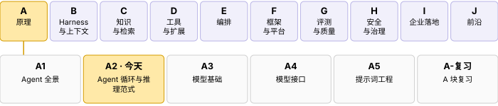
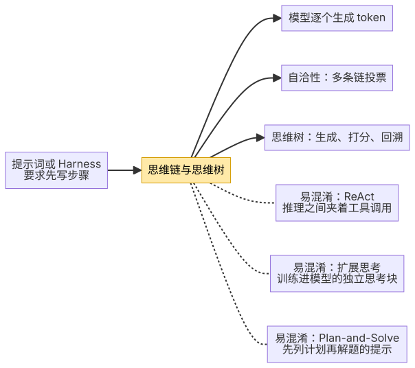
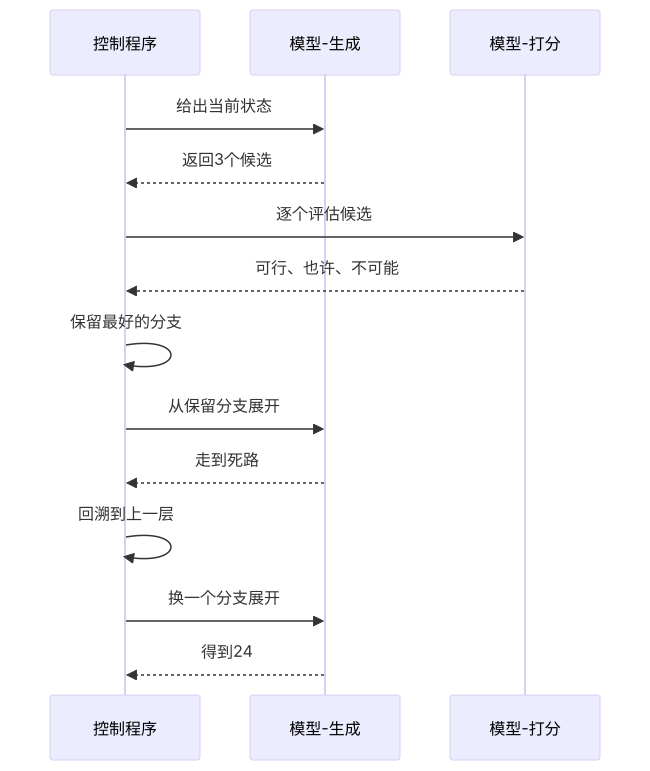
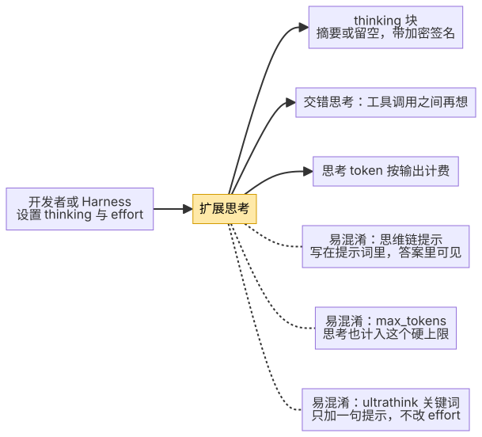
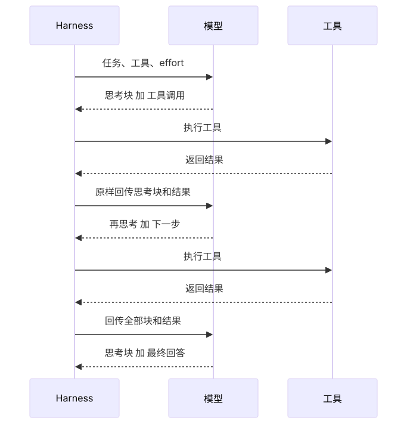
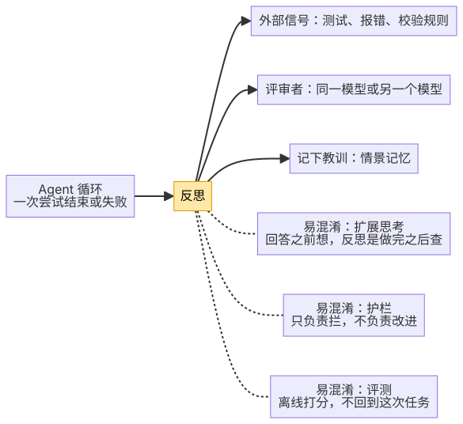
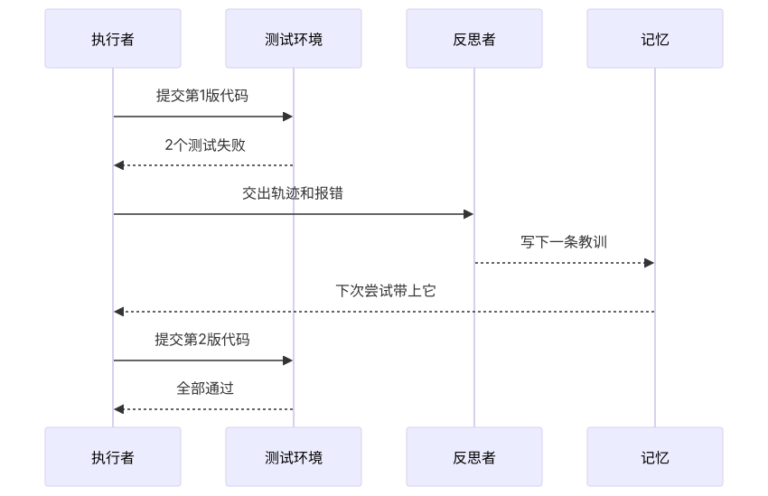
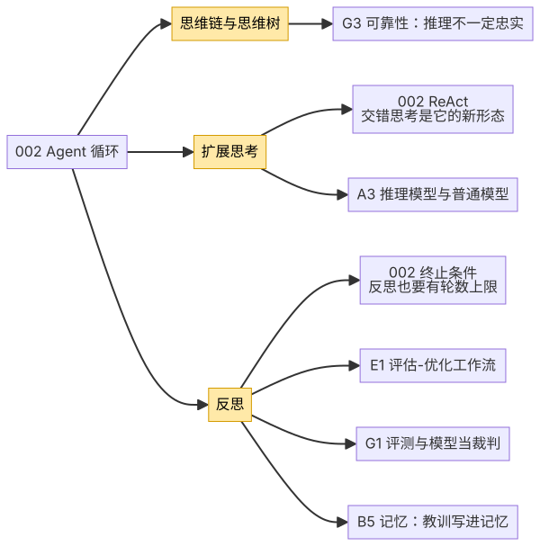

# 003 - Agent Loop and Reasoning Patterns Part 2 · Agent 循环与推理范式（下）

> 第 003 讲 · A2 Agent 循环与推理范式（下） · A 原理：Agent 是怎么转起来的 · 事实核实截至 2026-10-30
> [← 返回目录](../README.md) · 上一讲：[002 Agent 循环与推理范式（上）](002-agent-loop-and-reasoning-1.md) · 下一讲：[004 模型基础（上）](004-model-fundamentals-1.md)

---

## 🧭 Bulletin 流程

> 循环已经会转、会停 → **① 思维链与思维树** → **② 扩展思考** → **③ 反思** → 每一圈想得更深，做完还会回头查

上篇讲循环本身，默认每一圈模型都"想对了"。下篇讲怎么让它想得更好。三个概念按时间顺序排：前两个发生在模型回答之前，第三个发生在做完之后。昨天预告里反思排在第一，今天调到最后，因为它要用到前两个概念。

1. **思维链与思维树**：思维链是让模型先把推理步骤一步步写出来再给答案；思维树更进一步，每一步同时想几种走法，打分以后挑好的继续，走不通就退回去。
2. **扩展思考**：扩展思考是模型经过训练、在给出回答之前先在一个单独的思考区块里推理的能力，开发者用参数决定它想多少，今天 Claude 的主流做法是让模型自己判断要不要想、想多深。
3. **反思**：反思是 Agent 做完一次尝试以后，根据测试结果、报错这类外部信号评价自己的输出，把教训带进下一次尝试；没有外部信号时，光靠模型自己再看一遍，效果很不可靠。

---

## 📍 定位图



怎么读这张图：上面一行是整张地图的 10 个块，下面一行是今天所在的块展开成的各簇，黄色是今天的位置。

A2 上面接的是 A1：A1 定义了 Agent，A2 上下两篇把它的循环拆开讲完。A2 下面通向 A3 模型基础：今天讲的扩展思考，在 A3 里会接上"推理模型和普通模型有什么区别"；反思则一路通向 E1 的评估-优化模式和 G1 评测。

---

## 本簇讲解

### 这一簇要解决什么问题

假设让 Agent 做一件看起来很简单的事："从三家券商的招聘页面里数出金融科技岗位数，算出比去年增长了多少。"上篇的循环能保证它去查、查完会停，但下面三种错误循环本身拦不住。

第一，一圈之内想得太快。模型读到"去年 40 个，今年 46 个"，直接写"增长 6%"。正确答案是 15%，因为 6 除以 40 等于 0.15。它把增量当成了增长率。问题出在它没有把"先算增量、再除以基数"这两步写出来，就跳到了结论。

第二，只走一条路。第二家券商的页面没有直接写岗位数，只有一个岗位列表，分在"信息技术"和"数字金融"两个栏目里。模型挑了第一种理解，只数"信息技术"，没想过还有别的读法，也没比较哪种更合理。

第三，做完不回头查。三家的数字汇总成表交出去，其中一家把实习岗也算了进去。没有任何一步去核对"这个数和页面上的总数对得上吗"，错误就这样流到了最后。

今天的三个概念分别对付这三种错误：思维链让每一步写出来，思维树让模型比较几条路，扩展思考把这两件事练进了模型本身，反思负责做完以后回头检查。

---

### 概念一：思维链与思维树

**1. 定义**

思维链（Chain-of-Thought，简称 CoT）是一种提示方法：让大模型在给出最终答案之前，先生成一串中间推理步骤。它出自 Wei 等人 2022-01-28 提交的论文。论文摘要的说法是，在提示词里放几个带推理过程的示例，就能在足够大的模型上激发复杂推理能力；一个 5400 亿参数的模型配 8 个这样的示例，在 GSM8K（小学数学应用题基准，题目要多步计算）上达到了当时最好的成绩（核实于 2026-10-14）。[1] 论文发表的会议今天没有在 arXiv 页面上核实到，未核实。

两个常一起考的变体：

- **零样本思维链**：不给示例，只在问题后面加一句 "Let's think step by step"（我们一步步来想）。Kojima 等人 2022 年的论文发表于 **NeurIPS 2022**（Conference on Neural Information Processing Systems，神经信息处理系统大会：机器学习顶级会议之一），用 text-davinci-002（OpenAI 2022 年的一个 GPT-3 系列模型）测出，MultiArith（多步算术题基准）的准确率从 17.7% 升到 78.7%，GSM8K 从 10.4% 升到 40.7%（核实于 2026-10-14）。[2]
- **自洽性**（self-consistency）：同一道题采样出好几条不同的思维链，取它们答案里出现最多的那个。Wang 等人的论文发表于 **ICLR 2023**（International Conference on Learning Representations，国际表征学习大会：机器学习顶级会议之一），报告 GSM8K 提升 17.9 个百分点（核实于 2026-10-14）。[3]

思维树（Tree of Thoughts，简称 ToT）把推理组织成一棵树：每一步让模型生成几个候选的"想法"（一段连贯的中间步骤），再让模型评估这些候选，沿着有希望的分支往下走，必要时向前多看几步，或者退回上一层换一条路。它出自 Yao 等七位作者 2023-05-17 提交的论文，v2 注明是 NeurIPS 2023 的定稿版。论文报告：在 24 点游戏（给 4 个数，用加减乘除凑出 24）上，GPT-4（OpenAI 2023 年发布的大模型）用思维链只解出 4% 的题，用思维树解出 74%（核实于 2026-10-14）。[4]

一句话分清：思维链是一条线，自洽性是好几条线投票，思维树是一棵会剪枝、会回头的树。

**2. 场景**

还是"去年 40 个岗位，今年 46 个，增长多少"。

- 不用思维链：模型直接输出"增长 6%"。错。
- 用思维链：模型先写"增量是 46 减 40，等于 6；增长率是增量除以去年的数，6 除以 40 等于 0.15；所以增长 15%"，再给答案。三步都写在纸面上，"除以基数"这一步就不会被跳过。
- 用自洽性：采样 5 条思维链，4 条得出 15%，1 条得出 13%（它把基数误写成 46，算出约 13%），投票取 15%。

思维树适合另一类题。24 点，给 4、9、10、13。第一步模型列出三个候选：13 减 9 得 4；10 减 4 得 6；4 乘 9 得 36。评估时它判断"剩下 4、6 这两个数，4 乘 6 正好 24，可行"。沿这条走：13 减 9 等于 4，10 减 4 等于 6，4 乘 6 等于 24。如果某个分支剩下的数怎么都凑不出 24，就标成"不可能"，剪掉，退回去试别的。思维链只能一条路走到底，第一步选错就全错，所以在这类题上只有 4%。

**3. 它解决什么问题**

因果链是这样的。模型是一个 token（模型计量文字的单位）一个 token 往后生成的，每一个 token 只能依赖它前面已经写出来的内容。如果直接写答案，"6 除以 40"这一步的计算就没有地方发生，只能靠模型"一眼看出来"。把中间步骤写出来，等于给后面的 token 提供了草稿纸，每一步只需要做一个小计算。

思维树解决的是思维链的另一个短板：从左到右只生成一次，没有回头路。论文摘要说，需要探索、需要往前看、或者早期一个决定影响全局的任务，单条链很吃力。[4] 思维树用"多生成、再评估、再选择"把搜索引进来，代价是调用次数成倍增加：每一步生成 3 个候选，每个候选再评估一次，走 3 层就是几十次模型调用。

**4. 位置图**



怎么读这张图：左边是上层，谁让模型这样想，可以是写提示词的人，也可以是 Harness（套在模型外面、负责循环、工具、权限和上下文的那层程序）。右边是下层和变体。三条虚线：ReAct（上篇讲过的"想一步、做一步、看一步"范式）在推理之间夹了真实的工具调用，思维链从头到尾只在脑子里算；扩展思考是今天的第二个概念；Plan-and-Solve（上篇讲过，一次调用里先列计划再解题的提示方法）可以看作思维链的一个变体，专门针对零样本思维链漏步骤的问题。

**5. 运行流程图**



怎么读这张图：这是思维树的一次执行。"生成"和"打分"通常是同一个模型、两段不同的提示词，这里拆成两个参与者是为了看清分工。关键是"保留、回溯"这两步是控制程序做的，模型本身不会回溯，它只负责出候选和打分。这一点和上篇"转圈的是程序不是模型"是同一个道理。

**6. 实例**

非 Claude Code 专属概念，下面是按论文思路写的示意代码，不是某个库的真实接口：

```python
def tree_of_thoughts(problem, breadth=3, depth=3):
    frontier = [problem]                      # 当前保留的分支
    for _ in range(depth):
        candidates = []
        for state in frontier:
            for thought in llm_propose(state, n=breadth):   # 生成候选
                score = llm_evaluate(thought)               # 可行、也许、不可能
                if score != "不可能":
                    candidates.append((score, thought))
        if not candidates:
            return None                       # 全部剪掉，宣告失败
        candidates.sort(reverse=True)
        frontier = [t for _, t in candidates[:breadth]]     # 只留最好的几支
        for t in frontier:
            if is_solved(t):
                return t
    return None
```

库内对照：《结构化提示词模式库》把思维链列为一种提示模式，并写了一条风险"步骤写出来不等于步骤被执行，模型可能先有结论再补一段合理的推理外观"。今天核实到的研究支持这条提醒，见下面的误解一。

**7. 常见误解与边界**

- **"写出来的推理就是模型真实的推理过程"**：不一定。Anthropic 2025 年的研究《Reasoning Models Don't Always Say What They Think》在题目里悄悄塞进答案提示，再看模型的推理里有没有承认用了这个提示。按论文摘要，模型用了提示时，推理里提到它的比例经常低于 20%（据搜索结果中的摘要转述，今天没有打开全文核对具体数字）。[14] 所以思维链可以帮模型算对，但不能直接当成"它为什么这么做"的证据。
- **"所有模型加一句一步步想都会变好"**：不是。Wei 等人的摘要强调的是"足够大的模型"。[1] 小模型可能写出一串看似合理但错误的步骤。
- **"思维树应该日常使用"**：不是。它把调用次数放大几十倍，只适合真正需要搜索的题，比如组合优化、谜题、要比较多种方案的规划。普通问答用它是浪费。
- **"有了推理模型，思维链提示就过时了"**：一半对。按 Claude 文档（核实于 2026-10-14），想看模型的推理，应该读它的 thinking 块，而不是在提示词里要求它把推理写进回答正文；在 Claude Opus 5.5 等较新的模型上，试图让模型把内部推理写进正文的请求可能被拒绝，返回的 `stop_details.category` 是 `reasoning_extraction`。[5] 但"在答案里列出计算步骤方便人核对"仍然有用，这是给读者看的过程，和模型内部的推理是两回事。
- **边界**：思维链和思维树都只在模型脑子里算，不碰外部世界。事实性错误，例如岗位数本身数错了，它们修不好，要靠工具（ReAct）或者事后检查（反思）。

**8. 其他家叫什么**

各家都叫 CoT 和 ToT。国内面经还常把 **GoT**（Graph of Thoughts，思维图：允许不同推理分支互相合并的推广形式）和这两个放在一起考，掘金一篇 2026-07-15 的 Agent 面经在"如何赋予 LLM 规划能力"一题的正文里讨论了 CoT、ToT、GoT 的区别。[15] GoT 的原始论文今天没有核实，不展开。

---

### 概念二：扩展思考

**1. 定义**

扩展思考（extended thinking）是模型经过训练获得的一种能力：在给出最终回答之前，先在一个单独的思考内容块里推理，再根据这段推理写出回答。它和思维链的根本区别是：思维链是写在提示词里的要求，推理混在回答正文里；扩展思考是模型自己会做的事，推理放在和回答分开的区块里，由 **API**（Application Programming Interface，应用程序接口：程序调用模型服务的入口）的参数来开关和调节。

Claude 这边，截至 2026-10-14，这个能力的接口经历了一次换代，面试时要说清楚：[5][6][7]

- **手动模式**：`thinking: {type: "enabled", budget_tokens: N}`，开发者给一个思考 token 的预算，最少 1024。这是 Anthropic 最早叫"extended thinking"的形态。它在 Claude 4.6 系列上已标记弃用，Claude 4.7 及之后的模型直接拒绝，返回 400 错误（HTTP 状态码 400：请求格式不被接受）。
- **自适应思考**（adaptive thinking）：`thinking: {type: "adaptive"}`，由模型自己判断这一次要不要想、想多深。在 Claude Opus 5.5、Sonnet 5.5、Haiku 5.5、Fable 5.1 等新模型上，不传任何 thinking 参数就是自适应思考；其中 Opus 5.5 和 Fable 5.1 不能关闭思考。2026-10-15 起，Models API（查询模型能力的接口）还会返回 `thinking.types.between_tools`，说明某个模型是否接受 `between_tools`：关掉回答开头那段思考、只在工具调用之间思考；例如 Sonnet 5.5 接受它，但不接受完全关闭思考（截至 2026-10-30）。[5]
- **effort 参数**：`output_config: {effort: ...}`，五档 `low`、`medium`、`high`、`xhigh`、`max`。它是一个行为信号，不是严格的 token 上限，影响的是整个回复的所有 token，包括思考、正文和工具调用。Opus 5.5 和 Haiku 5.5 默认 `medium`，其他支持的模型大多默认 `high`。

三个机制细节，都来自 Claude 官方文档（核实于 2026-10-14）：[5]

- **看到的不是原始推理**：`display` 参数设成 `"summarized"` 时，thinking 块里是另一个模型写的推理摘要；设成 `"omitted"` 时块里留空。Opus 5.5 等新模型默认 `"omitted"`。没有任何设置能返回原始推理。每个 thinking 块都带一个 `signature`（签名）字段，里面是完整推理的加密副本。
- **按完整思考计费**：思考 token 按输出 token 计费，不管你看到的是摘要还是空白；思考也计入 `max_tokens`（一次回复最多输出多少 token 的硬上限）。`"omitted"` 只降低延迟，不省钱。
- **交错思考**（interleaved thinking）：在工具调用之间也能思考，读完一个工具结果先想一想再决定下一步。自适应模式下自动开启。回传工具结果时，必须把这一轮的 thinking 块原样、完整地一起传回去。

**2. 场景**

Charles 让 Agent 检查一份 **DCF**（Discounted Cash Flow，现金流折现：把未来现金流按折现率换算成今天价值的估值模型）表格，问"终值占企业价值 78%，合理吗"。下面的耗时和 token 数是示意，不是实测：

- effort 设成 `low`：模型几乎不思考，4 秒回答"终值占比偏高，但成长型公司常见"。答得不算错，但没发现问题。
- effort 设成 `high`：模型先在 thinking 块里推了大约 6000 个 token，检查永续增长率 3% 和折现率 7% 的差只有 4 个百分点，再发现表里的现金流是扣除通胀后的实际值，增长率却用的是含通胀的名义值，口径不一致。20 秒后回答，指出了这个错误。
- Charles 在界面上看不到那 6000 个 token 的原文，按默认设置甚至看不到摘要，但账单上按 6000 个输出 token 计费。

这就是 effort 的取舍：同一个模型，高档位多花三四倍的时间和数千个 token，换来更可能发现深层错误。

**3. 它解决什么问题**

思维链有三个实际问题，扩展思考逐个解决。

第一，推理和答案混在一起。思维链的推理写在回答正文里，用户读到一大段草稿，程序也很难把"过程"和"结论"分开解析。扩展思考把推理放进单独的内容块，正文只放结论。

第二，"要不要想"由提示词写死。给每个问题都加"一步步想"，简单问题也会写一大段，浪费 token。自适应思考让模型按难度决定，effort 调的是整体倾向：文档写明，在较低档位，简单问题模型可能完全不思考。[7]

第三，思考只发生在最开头。早期的做法是回答前想一次，之后一连串工具调用中间不再想。交错思考让模型每读完一个工具结果都能先推理再行动，这正是 ReAct "看一步再想一步"的结构，只不过"想"的部分现在放在 thinking 块里，而不是写成 `Thought:` 文本。上篇讲 ReAct 时说"思考的部分要么是工具调用前的一段文字，要么是扩展思考"，说的就是这个。

**4. 位置图**



怎么读这张图：上层是谁来决定思考的强度，API 调用里是开发者，Claude Code 里是 Harness 根据你的 `/effort` 设置去传参。下层是它的三个产物：thinking 块、交错思考、思考 token 的账单。三条虚线：思维链是提示方法，扩展思考是模型能力；`max_tokens` 是硬上限，effort 只是倾向；ultrathink 是 Claude Code 里的一个提示词关键词，按文档它只是往上下文里加一条指令，发给 API 的 effort 档位不变。[8]

**5. 运行流程图**



怎么读这张图：这是一次带交错思考的工具循环。按文档，从模型的角度看，整个工具循环算同一个助手回合，所以中途不能切换思考的开关；Harness 回传工具结果时，必须把前面的 thinking 块原样带上，服务端会解密 `signature` 还原推理，模型才能接着上次的思路往下想。[5] 如果中途改了思考配置，接口不报错，而是悄悄关掉这次请求的思考，这是一个不容易发现的坑。

**6. 实例（本机）**

先看配置。`~/.claude/settings.json` 里没有 `effortLevel`、`modelSettings`、`alwaysThinkingEnabled`、`showThinkingSummaries` 这几个键，环境变量里也没有 `CLAUDE_CODE_EFFORT_LEVEL` 和 `MAX_THINKING_TOKENS`。按 Claude Code 文档的解析顺序，显式设置优先，其次是配置文件，最后才是模型默认值，所以本机落到默认值：这次运行用的 Claude Opus 5.5 默认 `medium`，自适应思考一直开着、不能关。[8] 桌面应用或定时任务是否另外传了 effort，今天没有核实。本机 Claude Code 版本为 2.1.300（2026-10-14 运行 `claude --version` 得到）。

Claude Code 里和思考相关的控制，按文档整理（核实于 2026-10-14）：[8]

| 想做什么 | 怎么做 |
|---|---|
| 调整档位 | `/effort` 打开滑块，或 `/effort high` 直接设；启动时用 `--effort` |
| 这一轮想深一点 | 提示词里写 `ultrathink`；"think hard"之类只是普通文字 |
| 开关思考 | macOS 上按 `Option+T`；Opus 5.5、Sonnet 5.5、Haiku 5.5 和 Fable 系列关不掉 |
| 看思考内容 | `Ctrl+O` 切到详细模式，推理以灰色斜体显示 |
| 给某个 skill 单独设档位 | 在 skill 或子代理的说明文件头部写 `effort` |

再看实物。写这张卡片的这次运行，会话记录是一个 JSONL 文件（每行一条 JSON 记录的文本文件）。调研结束时我对它做了只读统计，只数字段，不看内容：

```
助手内容块：thinking 17 个，tool_use 43 个，text 5 个
17 个 thinking 块全部带 signature，全部有摘要文字
usage 里的 thinking_tokens 合计约 6.8 千，output_tokens 合计约 2.8 万
```

两点说明。第一，这次运行里 thinking 块是有文字的，和文档说的"交互式会话默认收到隐去内容的思考块"不一样，可能是桌面应用或定时任务的设置不同，原因今天没有核实，📝 待补。第二，token 数是按记录逐条累加的，同一条回复可能被拆成几条记录，绝对值可能偏大，只看比例：思考大约占输出的四分之一。

如果自己写代码调用，官方示例的写法是这样（节选，核实于 2026-10-14）：[7]

```python
import anthropic

client = anthropic.Anthropic()
response = client.messages.create(
    model="claude-opus-5-5",
    max_tokens=4096,                      # 思考加正文的硬上限
    output_config={"effort": "medium"},  # Opus 5.5 的默认档位
    messages=[{"role": "user",
               "content": "Analyze the trade-offs between microservices and monolithic architectures"}],
)
for block in response.content:
    if block.type == "text":
        print(block.text)
```

**7. 常见误解与边界**

- **"thinking 块里就是模型的原始想法"**：不是。是另一个模型写的摘要，或者干脆留空；原始推理只以加密形式存在 `signature` 里。[5]
- **"设成 omitted 能省钱"**：不能。按完整思考计费，`omitted` 只是让正文更早开始流式输出。[5]
- **"effort 等于 token 预算"**：不是。文档原话的意思是它是行为信号，不是严格预算；真正的硬上限是 `max_tokens`。[7] 要给整个 Agent 循环一个参考预算，Claude 另有 task budgets（任务预算：给模型一个整轮循环的建议 token 额度，让它自己控制节奏）功能，今天只看到入口，没有细读，📝 待补。
- **"档位越高越好"**：不是。文档对 `max` 的提示是可能收益递减、出现过度思考；Claude Code 文档也写了 `max` 可能"overthinking"。[7][8] 应该在自己的评测集上跑一遍不同档位再定。
- **"同一个档位在不同模型上意思一样"**：不是。Claude Code 文档写明档位按模型分别校准，Anthropic 称 Opus 5.5 的 `medium` 在其编码和知识工作评测上达到或超过 Opus 5 的 `high`。[8] 换模型时要重新测，不能照搬。
- **边界**：扩展思考仍然只在模型内部推理，不会自动去核对外部事实；它也不会让模型在给出回答之后回头检查。后一件事是反思。

**8. 其他家叫什么**

本段涉及 Claude 与别家的对比，本文由 Anthropic 的模型撰写，存在利益相关。

- **OpenAI**：叫 reasoning（推理），参数是 `reasoning.effort`，可选值按模型不同，可能包括 `none`、`minimal`、`low`、`medium`、`high`、`xhigh`、`max`；原始推理 token 不公开，摘要要主动开启（`summary: "auto"`）；在不存服务端状态的模式下，推理以 `encrypted_content`（加密内容）的形式返回，下一次请求要传回去（核实于 2026-10-14）。[9]
- **Google Gemini**：参数是 `thinking_level`，多数模型支持 `low`、`medium`、`high`，部分模型还有 `minimal`，例如 Gemini 4 Argon 默认 `medium`；思考摘要用 `thinking_summaries` 开关；也有加密的 thought signatures（思考签名），无状态调用时必须原样回传（核实于 2026-10-14）。[10]

三家的结构几乎一样：档位控制、只给摘要、加密回传。Claude 这边的短板有三个。第一，Opus 5.5 和 Fable 5.1 不能关闭思考，对只要几百毫秒响应的简单任务，延迟有一个下限，只能靠降低档位或换模型解决。第二，接口变化快：同一个 `budget_tokens` 写法，4.6 上是弃用警告，4.7 以后直接 400 报错，老代码迁移有成本。第三，较新的模型会拒绝"把推理写进正文"的请求，依赖这种做法做留痕的系统要改设计。

---

### 概念三：反思

**1. 定义**

反思（reflection）是 Agent 在一次尝试结束或失败之后，对自己的输出或执行轨迹生成一段评价，再把这段评价作为下一次生成的输入，以改进结果的机制。它和前两个概念的区别在时间上：思维链和扩展思考发生在回答之前，反思发生在做完之后。

两篇代表论文，面试最常被追问：

- **Self-Refine**（自我精炼）：同一个模型轮流扮演三个角色，先生成初稿，再给初稿写反馈，再根据反馈改写，循环几轮。不需要训练数据，也不需要额外训练。Madaan 等人 2023-03-30 提交，在 7 个任务上平均绝对提升约 20%（核实于 2026-10-14，arXiv 页面未注明会议）。[11]
- **Reflexion**（反思式强化）：Agent 失败以后，用自然语言写一段反思，例如"上次失败是因为没处理空列表"，存进情景记忆（记录"上一次发生了什么"的记忆，B5 簇讲），下一次尝试时把它放进上下文。论文称这是"用语言做强化"，不更新模型权重（模型内部的参数，训练时才会改）。Shinn 等人 2023-03-20 提交，在 **HumanEval**（OpenAI 发布的 164 道 Python 编程题基准）上 **pass@1**（只生成一次就通过全部测试的比例）达到 91%，论文引用的此前最好成绩是 GPT-4 的 80%（核实于 2026-10-14）。[12]

最重要的一条边界来自另一篇论文。Huang 等人发表于 ICLR 2024 的《Large Language Models Cannot Self-Correct Reasoning Yet》研究的是"内在自我纠错"，也就是没有任何外部反馈、只靠模型自己再看一遍。结论是：在推理任务上，模型在没有外部反馈时很难纠正自己的回答，有时纠正之后反而更差（核实于 2026-10-14）。[13] 所以有效的反思几乎都依赖一个外部信号：测试结果、编译报错、规则校验、检索到的事实，或者另一个模型、另一个人的评审。

**2. 场景**

Agent 帮 Charles 写一段 **SQL**（Structured Query Language，结构化查询语言：从数据库里取数的语言）算某个 App 的次日留存率（第一天来的用户里，第二天还回来的比例）。

- 第 1 次尝试：SQL 跑通了，结果是 134%。
- 外部信号：Harness 里有一条规则校验，"留存率必须在 0 到 1 之间"，校验失败。
- 反思：模型读到失败信息和自己的 SQL，写下"分母用了第二天的活跃用户数，应该用第一天的新增用户数；而且分子没有去重，同一个用户一天内多次登录被算了多次"。
- 第 2 次尝试：带着这段反思重写，结果 38%，校验通过。

如果没有那条校验规则，只让模型"再检查一遍你的 SQL"，它很可能读一遍就说"看起来没问题"，因为它生成那段 SQL 时的理解和检查时的理解是同一套。这正是 Huang 等人的结论在实际中的样子。

**3. 它解决什么问题**

上篇的循环靠"模型不再请求工具"来结束，但结束不代表做对了。反思在"做完"和"交付"之间加了一道检查，把错误挡在交付之前。

它也解决错误在多次尝试之间重复的问题。没有反思时，同一个 Agent 第二次遇到同样的任务，会犯同样的错，因为循环本身没有记忆。Reflexion 把教训写成文字存下来，下一次尝试就能读到。

代价同样清楚：每一轮反思至少多一次模型调用，加上重新执行；如果一直不通过，反思本身也会变成一个死循环。所以反思要有轮数上限，这和上篇的终止条件是同一个问题。

**4. 位置图**



怎么读这张图：上层是 Agent 循环，反思在一次尝试结束后被触发。下层是反思依赖的三样东西，最关键的是第一样外部信号，没有它，反思的效果很不可靠。三条虚线：扩展思考在回答之前；护栏（在模型输入、输出或工具调用上做检查并可以拦截的规则，G3 簇讲）发现问题就拦下，不会让 Agent 改好再交；评测（G1 簇讲）是上线前后用一批题给系统打分，结果用来改系统，不会回到某一次具体任务里。

**5. 运行流程图**



怎么读这张图：这是 Reflexion 式的一轮反思。执行者和反思者可以是同一个模型、两段提示词。真正让第 2 版变好的是第 2 步那条"2 个测试失败"的外部信号，以及反思者把它翻译成一条具体教训。如果把测试环境去掉，只剩"执行者问反思者：你觉得对吗"，就退化成了内在自我纠错。

**6. 实例（本机）**

本机有三处反思的实物，正好对应三种外部信号。

第一，这个定时任务自己。`~/.claude/scheduled-tasks/daily-agent-stack/SKILL.md` 第 9 步要求"保存后重新读一遍文件，确认写入成功、每个 Mermaid 代码块的围栏成对、格式没有被转义弄坏"；写作规范 4.1 要求渲染脚本跑完后检查"剩余 Mermaid 块 0 个"。这两条的外部信号分别是"重新读到的文件内容"和"脚本的输出"，不是模型自己的记忆。这是有效反思的写法：让检查依赖一个模型改不了的事实。

第二，`~/.claude/skills/agent-orchestration-stack/SKILL.md`，一共 37 行，定义了 Reviewer（对照需求检查产出）、Critic（挑战假设、找失败模式）、Fact Checker（核对说法、日期、引用、数字和文件是否存在）、Reflection（记录改了什么、下次怎么改进）几个角色，最后一条是"交付前做一次事实、文件、格式检查"。这是把反思拆成多个专职角色的做法，和后面 E2 多代理簇会接上。

第三，上篇讲过的 Claude Code `/goal` 命令：按 Claude Code 官方文档的 `/goal` 专页（截至 2026-10-30），每一轮结束后，由一个小而快的评估模型对照你写的完成条件和对话记录做判断，未满足就让 Claude 接着干，已满足或判定做不到就清掉目标；评估模型不调用工具，只看对话里已经展示的结果。[20] Anthropic 2026-06-30 的博客也介绍过它。[16] 它的外部信号是"另一个模型对照你写的完成条件做判断"。严格说它是终止判断，不负责写教训，但"做完以后由别人检查"的结构和反思一致。

下面是 Reflexion 结构的示意代码，不是某个库的真实接口：

```python
def run_with_reflection(task, max_trials=3):
    lessons = []                                   # 情景记忆
    for trial in range(max_trials):
        output = actor_llm(task, lessons)          # 带着教训去做
        ok, feedback = run_checks(output)          # 外部信号：测试、校验规则
        if ok:
            return output
        lessons.append(reflect_llm(task, output, feedback))  # 把失败翻译成教训
    return escalate_to_human(task, output, lessons)          # 轮数用完，转人工
```

`run_checks` 是整段代码里最重要的一行。它返回的必须是模型之外的事实；如果它内部只是再问一次模型"对不对"，整段代码的效果会大打折扣。

**7. 常见误解与边界**

- **"让模型再看一遍就会更好"**：不可靠。没有外部反馈的自我纠错在推理任务上经常无效甚至变差。[13]
- **"反思轮数越多越好"**：不是。每轮都多花调用；而且模型可能在两个版本之间来回改，也就是上篇说的震荡。一般设 2 到 3 轮上限，用完转人工。具体轮数属于社区经验，今天读的论文没有给出统一建议。
- **"反思就是 Reflexion"**：不是。Reflexion 是一种带记忆的具体方法；反思是一类机制，Self-Refine、评审代理、`/goal` 式的完成判断都算相关做法。
- **"同一个模型当评审没意义"**：不完全对。同一个模型换一段评审提示词，在有明确评分标准时仍然有用；但它和生成者共享盲点。重要场景用另一个模型、规则或人来评审。
- **边界**：反思只能修"检查得出来"的错误。检查规则覆盖不到的错误，例如岗位数里混进了实习岗，而规则只检查"是不是正整数"，反思照样放行。

**8. 其他家叫什么**

各家多叫 reflection、self-critique（自我批评）或 self-correction（自我纠错）。Anthropic 2024 年的工程文章把"一个模型生成、另一个模型评估并反馈、循环改进"的工作流叫 evaluator-optimizer（评估-优化），这是反思的工作流版本，会在 E1 簇讲（该文今天未重新核实）。国内题库通常把 Reflection 和 ReAct、Plan-and-Execute 并列为三种范式。[15][17] 今天 Google 发布的 Deep Review 里有一个汇总代理，会合并各部分审稿意见、检查前后是否一致，必要时重跑逻辑检查，结构上也接近"做完再查"（见前沿快讯）。[18]

---

## 👔 三岗视角

### AI 应用 / Agent 开发

**场景**：团队做的"自然语言查数" Agent，上线一个月，抽检发现 7% 的回答数字是错的，而且错得"看起来很合理"，比如留存率 134%、环比增长写成了增量。

**这个岗位具体做什么**：第一步，给错误分类。抽 200 条错误样本，发现三类：口径错，比如分母用错表；计算跳步，比如增量当增长率；数据本身有问题。第二步，对前两类加一道带外部信号的反思。在 Harness 里写一组确定性校验：比率必须在合理区间，同一指标和昨天的值相差超过 50% 要标记，SQL 结果为空要报。校验失败时把失败原因交给模型反思并重写，最多 2 轮，还不过就在回答里明确标注"未通过校验"。第三步，调档位。查数任务里 SQL 生成那一步用 `high`，闲聊和格式整理用 `low`。上线后盯五个数：错误率、校验触发率、反思后的通过率、P95 延迟（把请求按耗时排序，最慢那 5% 的门槛值）、单次成本。目标是错误率从 7% 降到 2% 以下，同时 P95 延迟的增加控制在 30% 以内。

**最容易踩的坑**：反思环节只写"请检查你的答案是否正确"，没有任何外部校验。成本增加了一倍，错误率几乎不变。

### AI 产品 / 商业分析

**场景**：公司要给研报摘要 Agent 加一轮"自我检查"，同时把 effort 从 `medium` 提到 `high`。技术团队说质量会更好，财务问值不值。

**这个岗位具体做什么**：把"质量更好"翻译成能算账的数。第一，定义质量。和业务方约定什么算错：数字和原文对不上、结论方向反了、漏了风险提示。用 100 篇研报做一个小评测集，人工标好标准答案。第二，跑对照实验。四组配置：`medium` 不检查、`medium` 加检查、`high` 不检查、`high` 加检查，每组记录错误率、单篇耗时、单篇 token。第三，算账。假设分析师人工核对一篇摘要要 10 分钟，每次出错返工再花 20 分钟；如果某个配置把错误率从 8% 降到 3%，每 1000 篇少返工 50 次，省下大约 17 个小时，再和这个配置多花的 token 费用比较。向业务方汇报时讲三个数：错误率、单篇成本、单篇耗时，并说明选了哪一组、为什么。

**最容易踩的坑**：只比较"开和不开"，不拆开 effort 和反思两个变量。结果说不清是哪个起了作用，下次换模型时又要从头试。

### 金融科技 / 数据

**场景**：一家银行的合规部门问：信贷审核助手开着扩展思考，能不能把模型的思考内容存下来，作为"它为什么给出这个建议"的审计证据。

**这个岗位具体做什么**：先讲清事实，再给替代方案。事实有三条，都来自 Claude 官方文档（核实于 2026-10-14）：新模型默认不返回思考文字；就算开了 `"summarized"`，拿到的也是另一个模型写的摘要，不是原始推理；原始推理只以加密形式存在 `signature` 里，银行自己解不开。[5] 再加上研究表明模型写出的推理不一定忠实反映它真正依据了什么。[14] 所以思考内容最多是辅助材料，不能当审计证据。替代方案是让"依据"变成可核对的结构化记录：第一，要求助手在正文里按固定格式列出引用的数据字段和规则条款，每一条都能回到原始系统里查；第二，所有工具调用的输入输出、模型版本、effort 档位、提示词版本都落日志；第三，对审批类结论加一道带外部信号的反思，比如用规则引擎校验"建议额度不超过政策上限"，校验结果也落日志；第四，effort 档位和反思规则纳入变更管理，改动要审批。模型风险管理方面的具体监管条文留到 H2 簇逐条核实，今天不展开。

**最容易踩的坑**：把 thinking 摘要当作"模型的解释"写进审计报告。一旦被追问"这是模型的原始推理吗"，回答不了。

---

## 🔗 串联图



怎么读这张图：最左边是上篇讲的循环，今天的三个概念都挂在它上面，回答"每一圈怎么想得更好"。图里没画但要记住的一条关系：扩展思考可以看作把思维链练进了模型，推理从提示词里的要求变成了模型自带的能力。右边一列是它们接下来要连上的地方：交错思考就是 ReAct 在今天的形态；反思的轮数上限就是上篇的终止条件；反思往后会长成 E1 的评估-优化工作流，评审者往后会长成 G1 的"模型当裁判"，教训往后会进入 B5 的记忆体系。

相关卡片：[002 Agent 循环与推理范式（上）](002-agent-loop-and-reasoning-1.md) · [001 Agent 全景](001-agent-landscape.md)

---

## 🎙 复述板块

### 整簇两分钟版

> 上一讲说的是 Agent 循环怎么转、怎么停。这一讲说怎么让每一圈想得更好，一共三个概念。
>
> 第一，思维链和思维树。思维链就是让模型先把推理步骤一步步写出来，再给答案。模型是一个字一个字往后写的，把中间步骤写出来，等于给它一张草稿纸，每一步只做一个小计算，就不容易跳步。思维树更进一步，每一步同时想几种走法，让模型给它们打分，留下好的往下走，走不通就退回来。在二十四点这种题上，思维链只能做对百分之四，思维树能做到百分之七十四。代价是调用次数多出几十倍。
>
> 第二，扩展思考。这是模型训练出来的能力，在回答之前先在一个单独的区块里推理。它和思维链的区别是，思维链是写在提示词里的要求，推理混在答案里。扩展思考是模型自己会做，推理和答案分开。现在 Claude 的做法是自适应思考，模型自己判断要不要想、想多深，开发者用 effort 这个参数调整体倾向，从低到最高一共五档。要记住两点。我们看到的只是摘要，不是原始推理。计费是按完整的思考算的。
>
> 第三，反思。前两个都发生在回答之前，反思发生在做完之后。Agent 做完一次，根据测试结果、报错这类外部信号评价自己，把教训带进下一次。代表方法是 Self-Refine 和 Reflexion。但有一个关键边界，研究发现，没有外部信号、只让模型自己再看一遍，推理题上经常改不对，甚至改得更差。所以设计反思，重点是找一个模型改不了的检查标准。
>
> 最后收一句。让 Agent 想得更好有三个时间点：回答前把步骤写出来，回答前让模型自己多想，做完后拿外部事实回头查。前两个让它想得深，第三个让它少犯同样的错。

### 每个概念三十秒版

**思维链与思维树**

> 思维链，英文是 Chain of Thought，是一种提示方法，让模型在给答案之前先写出中间推理步骤。原理是模型逐字生成，写出步骤就等于有了草稿纸。它有两个常见变体：零样本版只加一句一步步来想；自洽性是采样好几条链，取多数答案。思维树，英文是 Tree of Thoughts，每一步生成几个候选，打分、保留、必要时回溯。它适合需要搜索的题，代价是调用次数成倍增加。

记忆钩子：思维链是在草稿纸上列竖式；思维树是下棋时在脑子里把三步棋都推一遍，不好就悔回来。

**扩展思考**

> 扩展思考是模型训练出来的能力，回答前先在单独的思考区块里推理。它和思维链的区别在于，思维链靠提示词要求，推理混在答案里；扩展思考是模型自带的，推理和答案分开。Claude 现在用自适应思考，模型自己决定想不想、想多深，开发者用 effort 参数调倾向，一共五档。两个要点。第一，返回的只是摘要或者空白，不是原始推理。第二，思考按完整长度计费，也计入单次输出的上限。

记忆钩子：考试时的草稿纸要交钱买，但阅卷老师只看答题卡；你拿回来的草稿还是别人帮你誊写的摘要。

**反思**

> 反思是 Agent 做完一次尝试以后，评价自己的输出，再把评价带进下一次尝试。代表方法有两个。Self-Refine 是同一个模型生成、反馈、改写，循环几轮。Reflexion 是失败后写一段教训存进记忆，下次带上。关键边界是，没有外部信号的自我纠错不可靠，研究发现推理题上常常改不对，甚至更差。所以有效的反思要依赖测试、报错、规则校验或者别人的评审，并且要设轮数上限。

记忆钩子：对着答案改卷子才有用；只把自己的卷子再读一遍，往往还是那几个错。

英文版口述：规范第 7 节的开关为"默认不写"，本篇不写。

---

## 💼 面试题板块

### 题 1 `[开发]` Agent 的反思机制是什么？为什么要用？具体怎么实现？

来源：题库与面经题，非某公司原题。掘金《2026年最新AI agent面试（01）_Agent基础与推理范式》（作者浩哥学JavaAI，2026-07-15）列有"Agent 的反思（Reflection）机制是什么？为什么要用？具体怎么实现？"，文中标注来源为小红书，属于转述，未见一手面经；小林 coding 题库目录里有同类题"讲讲 Agent 的反思机制？为什么要用反思？具体怎么实现？"（仅见目录标题，页面更新 2026-10-12）。均访问于 2026-10-14。[15][17]

**答题骨架**
- 结论：反思是做完一次尝试后评价自己、把教训带进下一次的机制，关键是要有外部信号。
- 三点展开：两种代表方法；为什么需要外部信号；工程上怎么实现和设上限。
- 例子：查数 Agent 留存率算出 134%，规则校验触发反思，第二次算对。

**逐字范例**

> 反思是 Agent 做完一次尝试之后，评价自己的输出，再把评价当作输入去做下一次。我分三点讲。
>
> 第一，两种代表方法。一种是 Self-Refine，同一个模型轮流生成、给反馈、改写，循环几轮。另一种是 Reflexion，失败以后写一段文字教训存进记忆，下一次尝试带上，不用改模型参数。论文里它在 HumanEval 编程题上一次通过率做到百分之九十一。
>
> 第二，为什么要外部信号。有研究专门测过，没有外部反馈、只让模型自己再看一遍，推理题上经常改不对，有时更差。因为检查时用的理解和生成时是同一套。
>
> 第三，怎么实现。我会在 Harness 里放确定性的检查，比如跑测试、规则校验、数值区间。检查失败，把失败原因交给模型写反思再重做。最多两到三轮，还不过就转人工，并且标注未通过。
>
> 举个例子，查数 Agent 算出留存率百分之一百三十四，区间校验失败，模型反思出分母用错了表，第二次算出百分之三十八，校验通过。

**追问链**
1. 你在项目里用过反思吗，效果怎么量化？要点：说清检查信号是什么，报告反思前后的错误率、反思触发率、反思后通过率和多出的延迟。
2. 反思和扩展思考有什么区别？要点：时间点不同，一个回答前在模型内部，一个做完后依赖外部信号；可以叠加使用。
3. 反思一直不通过怎么办？要点：设轮数上限；检测是否在两个版本之间来回改；用完转人工并保留轨迹。

**易错点**：只说"让模型检查自己的输出"，不提外部信号，也不提轮数上限。面试官会追问"怎么知道它检查对了"。

### 题 2 `[开发]` CoT 和 ToT 有什么区别？现在模型都有扩展思考了，还需要在提示词里写"一步步想"吗？

来源：自拟。考点参考掘金同一篇面经在"如何赋予 LLM 规划能力"一题正文里对 CoT、ToT、GoT 的讨论，非原题，访问于 2026-10-14。[15]

**答题骨架**
- 结论：CoT 是一条推理链，ToT 是带评估和回溯的搜索树；有了扩展思考，"一步步想"的提示多数时候不必要，但让答案里列出可核对步骤仍有价值。
- 三点展开：结构区别；成本与适用题型；扩展思考之后的变化。
- 数字：24 点上 CoT 百分之四、ToT 百分之七十四。

**逐字范例**

> CoT 是思维链，让模型先写出推理步骤再给答案，是一条线。ToT 是思维树，每一步生成几个候选，打分，保留好的，走不通就回溯，是一棵树。
>
> 展开三点。第一，结构。CoT 一次从左到右生成，第一步错了就一路错。ToT 引进了搜索，可以比较和回头。论文里二十四点这类题，GPT-4 用 CoT 只做对百分之四，用 ToT 做到百分之七十四。
>
> 第二，成本。ToT 每一步都要生成和评估好几次，调用次数放大几十倍，所以只用在真正需要搜索的题上，比如组合优化和方案比较。日常问答用 CoT 或者干脆不用。
>
> 第三，扩展思考之后的变化。现在主流模型自己会在单独的区块里推理，还能按难度决定想多少，所以提示词里写一步步想，多数时候没必要。而且 Claude 的文档建议读思考块，不要让模型把内部推理写进正文。但如果业务需要人核对，我仍然会要求答案里列出关键计算步骤，这是给人看的，不是给模型用的。

**追问链**
1. 自洽性是什么，和 ToT 有什么区别？要点：自洽性是采样多条完整的链取多数答案，不在中间评估和回溯；ToT 在每一步都评估。
2. 思维链写出来的推理可信吗？要点：不一定忠实，有研究发现模型用了提示却很少在推理里承认，所以不能当解释证据。
3. 怎么判断一个任务值得上 ToT？要点：有没有多个可比较的中间方案、早期决定影响大不大、有没有可靠的评估方法、预算允不允许几十倍调用。

**易错点**：把扩展思考说成"模型内部自动做了 ToT"。文档没有这么说，模型内部怎么推理是不公开的，这种说法属于推测。

### 题 3 `[开发]` 给 Agent 打开更高的思考档位后，P95 延迟从 8 秒涨到 25 秒。你怎么调？用什么指标验收？

来源：自拟。

**答题骨架**
- 结论：不是一刀切地降档，而是按步骤和任务难度分档，再用评测集验证质量没掉。
- 三点展开：先定位时间花在哪；分步骤、分任务设档位；验收指标与上线方式。
- 数字：P95 延迟、首字延迟、任务成功率、单次成本。

**逐字范例**

> 我先定位，再分档，最后用数据验收。
>
> 第一，定位。看 trace，也就是每一步的输入输出和耗时记录，把二十五秒拆开，是哪一步的思考 token 变多了。通常会发现大头集中在少数几步，比如规划和写 SQL，而格式整理这种步骤也被拉高了。
>
> 第二，分档。规划和关键生成用高档，简单步骤和子任务用低档。Claude 的文档就建议子代理这类简单任务用 low。如果界面上用户只等结论，就把思考设成不返回文字，这能让正文更早开始输出，但要知道它不省钱。
>
> 第三，验收。我用两三百条的评测集，对比调整前后五个数：任务成功率、P95 延迟、首字延迟，也就是用户等多久看到第一个字、单次成本、超时率。上线目标举例，成功率下降不超过一个百分点，P95 回到十二秒以内。先灰度百分之十的流量，跑一周再全量。

**追问链**
1. effort 和 max_tokens 有什么区别？要点：effort 是行为倾向，不是严格预算；max_tokens 是思考加正文的硬上限，设太小会把回答截断。
2. 一次对话里能随时改档位吗？要点：Claude 部分新模型支持按消息改档位且保留缓存，处于测试阶段；改顶层参数会让提示词缓存失效；工具循环中途不能切换思考开关。
3. 换了一个新模型，原来的档位还能用吗？要点：档位按模型分别校准，同名档位不等价，要重新跑一遍评测。

**易错点**：直接把所有请求降到最低档，延迟好看了，但没有评测集证明质量没掉。

### 题 4 `[产品·商分]` 研报摘要 Agent 要不要加一轮"自我检查"？你怎么判断值不值？

来源：自拟。

**答题骨架**
- 结论：先看有没有可用的外部检查标准，再用对照实验和返工成本算账。
- 三点展开：有没有外部信号；拆开变量做实验；把错误率换算成钱和时间。
- 数字：错误率、单篇成本、单篇耗时、返工时长。

**逐字范例**

> 我会先问一个问题，这个检查拿什么做标准。
>
> 第一，看有没有外部信号。研报摘要最常见的错是数字和原文对不上。这个可以用程序核对，把摘要里的每个数字回原文找出处，找不到就让 Agent 重写。这种检查有效。如果只是让模型再读一遍自己的摘要，研究表明效果不可靠，我不会为它买单。
>
> 第二，做对照实验。用一百篇研报做评测集，人工标好错误。把思考档位和自我检查拆成两个变量，四组配置分别跑，记错误率、单篇成本和耗时。这样能说清到底是哪个起作用。
>
> 第三，算账。假设分析师核对一篇要十分钟，出错返工再花二十分钟。错误率从百分之八降到百分之三，每一千篇少返工五十次，大约省十七个小时。再和多出来的模型费用和等待时间比较。
>
> 向业务方汇报，我讲三个数，错误率、单篇成本、单篇耗时，再说选哪组、为什么。

**追问链**
1. 自我检查发现问题但改不好怎么办？要点：设两轮上限，之后在摘要里标注未通过核对的数字，交给分析师。
2. 怎么防止检查本身漏错？要点：定期人工抽检，看检查规则漏掉了哪类错误，再补规则。
3. 成本上去了，业务方不愿意付怎么办？要点：只对高价值或高风险的研报开检查，按客户等级或报告类型分层。

**易错点**：只说"加了检查质量会更好"，说不出用什么检查、怎么量化、花多少钱。

### 题 5 `[金融科技·数据]` 模型开了扩展思考，能不能把它的思考内容存下来，作为审计证据？

来源：自拟。

**答题骨架**
- 结论：不能直接当审计证据，只能做辅助材料；证据要靠可核对的结构化依据和完整日志。
- 三点展开：思考内容是什么；为什么不可靠；替代方案。
- 例子：信贷审核助手的额度建议。

**逐字范例**

> 我的结论是不能直接当证据，只能当辅助材料。分三点。
>
> 第一，拿到的是什么。以 Claude 为例，新模型默认不返回思考文字。就算打开，拿到的也是另一个模型写的摘要，原始推理是加密的，机构自己解不开。别家的情况类似，原始推理都不公开。
>
> 第二，为什么不可靠。就算拿到推理文字，研究也发现模型写出的理由不一定是它真正的依据，比如用了某个提示却很少承认。审计要的是能复核的依据，摘要做不到。
>
> 第三，替代方案。我会让助手在正文里按固定格式列出依据，用了哪些数据字段、哪条政策条款，每一条都能回原系统查。所有工具调用、模型版本、思考档位、提示词版本都落日志。审批类结论再加一道规则引擎校验，比如额度不超过政策上限，校验结果也存下来。档位和规则的改动走变更审批。
>
> 举个例子，信贷助手建议额度五十万，审计时能调出它引用的收入字段、负债字段和政策条款，以及规则校验通过的记录。具体监管条文我会以原文为准。

**追问链**
1. 那思考摘要存不存？要点：可以存作调试和问题排查的辅助材料，但在制度里明确它不是决策依据。
2. 如果监管要求解释模型为什么这么判断呢？要点：用结构化依据加规则校验结果来解释；重要决策保留人工复核，由人对结论负责。
3. 用开源模型自己部署，能拿到完整推理，是不是就可以了？要点：拿得到不等于忠实，忠实性问题仍在；还要考虑存储量和数据保护。

**易错点**：说"模型的思考过程就是它的决策解释，存下来就合规了"。这混淆了推理摘要、原始推理和可复核的依据三件事。

---

## 📡 前沿快讯

取上一篇（2026-10-13 晚）之后的发布。当天的 AI 效率简报《ClaudeCode在缓存失效前压缩长会话》（2026-10-14）已经讲了 Claude Code 2.1.299 的闲置压缩和多项安全修复，这里不重复，只说它和地图的关系：它落在 **B4 压缩与记忆丢失**，到 B4 时会当实例用。

1. **Google 发布 Deep Review 智能体审稿系统（2026-10-14）**。Google Research 博客称，Deep Review 用四段流水线审阅复杂文档：先由一个代理把文档切成若干段，再按信息密度给每段分配不同的算力，然后多个推理代理并行审各段，最后由汇总代理合并意见、检查前后是否一致，必要时重跑逻辑检查并调用外部工具核对事实；已在 STOC、ICML、NeurIPS 2026 和 ICLR 2027 的试点里审过 16000 多篇稿件，全球开放，每人每周免费两次。[18] 博客正文没有给出准确率之类的质量数字，以上都是厂商自述。落在地图的 **A2 反思**和 **E2 子代理与多代理**。对已写内容没有修正；和今天的关系是两点："按段分配算力"和 effort 的思路一致，难的部分多想；汇总代理重跑检查、调外部工具，是"做完再查、并且依赖外部信号"的一个大规模例子。
2. **OpenAI 发文分享用 GPT-6 系列维护大型代码库**。OpenAI 开发者博客的一篇文章（页面没有写发布日期，aihot 收录时间为 2026-10-14）在"清理过期实验开关"任务上比较了三种配置：GPT-6 Astra Ultra 花 109.06 美元、找到 142 处；GPT-6.1 Sol Ultra 花 15.12 美元、找到 131 处；GPT-6.1 Sol Medium 花 5.27 美元、找到 86 处。也就是说，Sol Ultra 以 14% 的成本拿到了 92% 的结果。[19] 文章没有说明 Ultra 和 Medium 分别对应什么参数，这里不把它们等同于 `reasoning.effort` 的某个档位。落在 **A2 扩展思考**和 **I2 成本与性能**。对已写内容没有影响；它正好支持今天的一个观点：档位和模型要在自己的任务上实测，"最高档最贵的模型"不一定性价比最高。

另有一条线索没有展开：aihot 收录了 IT之家（国内科技媒体）的报道，称欧盟就模型越狱事件调查 OpenAI 和 Anthropic。我没有读到一手来源，不作为快讯，也不据此修订任何卡片；它涉及本文作者一方，记在这里避免选择性遗漏，等有官方信息后再判断它落在 H1 安全还是 H2 合规。

待归类池里的 Personal Agent Protocol，截至今天没有查到新进展，最迟 2026-10-20 给出去向。

---

## 🔁 昨日回顾与明日预告

**昨日回顾**（针对 [002 Agent 循环与推理范式（上）](002-agent-loop-and-reasoning-1.md)）

> [!question]- 1. Agent 循环靠什么结束？谁在转圈？
> 模型返回一个不带工具调用的回复，循环就结束，接口里 `stop_reason` 从 `tool_use` 变成 `end_turn`。转圈的是 Harness 里的一段普通程序，模型每次调用都是独立的一次生成，它只负责说下一步想做什么。

> [!question]- 2. ReAct 和先计划后执行的根本区别是什么？各自怎么失败？
> 区别在什么时候做决定。ReAct 每一步根据刚看到的结果决定下一步，容易跑偏或在几个工具之间打转；先计划后执行先一次列出全部步骤再执行，风险是计划过期，执行器照着一份已经不对的计划继续做，所以需要重规划。

> [!question]- 3. Claude Agent SDK、OpenAI Agents SDK、LangGraph 的步数上限默认值和计数单位分别是什么？
> Claude Agent SDK 的 `max_turns` 默认不限，数带工具调用的回合；OpenAI Agents SDK 默认 10 圈，数模型调用次数，超限抛 `MaxTurnsExceeded`；LangGraph 的 `recursion_limit` 从 1.0.6 版起默认 1000，数的是超步。三家数的东西不同，迁移时不能照搬数字。

**明日预告**：A3 模型基础。A2 两篇讲的是循环和推理范式，都默认"模型"是一个黑盒。明天打开这个黑盒：token 和分词决定了成本怎么算，上下文窗口决定了循环能转多久，采样参数决定了自洽性为什么能采出不同的链，推理模型和普通模型的区别正是今天扩展思考的来历。A3 概念较多，可能拆成上下两篇。

---

## 📖 术语小词典

- **400 错误**（HTTP 400 Bad Request）— 接口认为请求格式不被接受时返回的状态码。
- **adaptive thinking**（自适应思考）— 由模型自己判断要不要思考、想多深的思考模式。
- **API**（Application Programming Interface，应用程序接口）— 程序调用模型服务的入口。
- **budget_tokens** — Claude 手动思考模式里的思考 token 预算，最少 1024，4.7 以后的模型不再接受。
- **CoT**（Chain-of-Thought，思维链）— 让模型先写中间推理步骤再给答案的提示方法。
- **DCF**（Discounted Cash Flow，现金流折现）— 把未来现金流折算成今天价值的估值模型。
- **display** — Claude 思考配置里控制返回摘要还是留空的参数，取值 summarized、omitted 等。
- **effort** — Claude 控制整个回复投入多少 token 的参数，五档 low、medium、high、xhigh、max。
- **encrypted_content** — OpenAI 在无状态模式下返回的加密推理内容，下次请求要传回。
- **evaluator-optimizer**（评估-优化）— 一个模型生成、另一个评估反馈、循环改进的工作流模式。
- **GoT**（Graph of Thoughts，思维图）— 允许推理分支之间合并的思维树推广形式。
- **GPT-4** — OpenAI 2023 年发布的大模型。
- **GSM8K** — 小学数学应用题基准，题目需要多步计算。
- **Harness** — 套在模型外面，负责循环、工具、权限和上下文的那层程序。
- **HumanEval** — OpenAI 发布的 164 道 Python 编程题基准。
- **ICLR**（International Conference on Learning Representations，国际表征学习大会）— 机器学习顶级会议之一。
- **interleaved thinking**（交错思考）— 在工具调用之间也能思考的能力。
- **JSONL** — 每行一条 JSON 记录的文本文件格式。
- **max_tokens** — 一次回复最多输出多少 token 的硬上限，思考也计入。
- **MultiArith** — 多步算术题基准。
- **NeurIPS**（Conference on Neural Information Processing Systems，神经信息处理系统大会）— 机器学习顶级会议之一。
- **P95 延迟** — 把请求按耗时排序，最慢那 5% 的门槛值。
- **pass@1** — 只生成一次就通过全部测试的比例。
- **Plan-and-Solve** — 一次调用里先列计划再解题的提示方法。
- **ReAct**（Reasoning and Acting，推理加行动）— 每一圈交替思考、行动、观察的 Agent 范式。
- **Reflexion** — 失败后写语言教训存进情景记忆、下次尝试带上的反思方法。
- **Self-Refine**（自我精炼）— 同一模型生成、反馈、改写循环的反思方法。
- **self-consistency**（自洽性）— 采样多条思维链、取多数答案的方法。
- **signature**（签名）— thinking 块里携带完整推理加密副本的字段，回传时要原样带上。
- **SQL**（Structured Query Language，结构化查询语言）— 从数据库里取数的语言。
- **task budgets**（任务预算）— 给模型一个整轮 Agent 循环的建议 token 额度的功能。
- **text-davinci-002** — OpenAI 2022 年的一个 GPT-3 系列模型。
- **thinking_level** — Gemini 控制思考档位的参数。
- **thought signatures**（思考签名）— Gemini 的加密推理表示，无状态调用时要原样回传。
- **token** — 模型计量文字的单位，按量计费。
- **ToT**（Tree of Thoughts，思维树）— 每步生成多个候选、评估、保留并可回溯的推理方法。
- **trace** — 一次运行里每一步输入、输出和耗时的完整记录。
- **ultrathink** — Claude Code 提示词里的关键词，只往上下文加一条深入思考的指令，不改 effort。
- **24 点游戏**（Game of 24）— 用 4 个数和加减乘除凑出 24 的题，用来测搜索式推理。
- **护栏**（guardrail）— 在模型输入、输出或工具调用上做检查并可以拦截的规则。
- **留存率** — 某天来的用户里，之后某天还回来的比例。
- **内在自我纠错**（intrinsic self-correction）— 没有外部反馈、只靠模型自己修改回答。
- **评测** — 用一批题给系统打分，用来改进系统本身。
- **情景记忆** — 记录"上一次发生了什么"的记忆。
- **权重** — 模型内部的参数，只有训练时才会改变。
- **扩展思考**（extended thinking）— 模型在回答前先在单独区块里推理的能力。
- **零样本思维链**（zero-shot CoT）— 不给示例、只加"一步步来想"的思维链。
- **反思**（reflection）— 做完一次尝试后评价自己、把教训带进下一次的机制。

---

## Sources

1. Wei 等，*Chain-of-Thought Prompting Elicits Reasoning in Large Language Models*（arXiv:2201.11903，2022-01-28 提交）：https://arxiv.org/abs/2201.11903 — 访问于 2026-10-14
2. Kojima 等，*Large Language Models are Zero-Shot Reasoners*（arXiv:2205.11916，NeurIPS 2022）：https://arxiv.org/abs/2205.11916 — 访问于 2026-10-14
3. Wang 等，*Self-Consistency Improves Chain of Thought Reasoning in Language Models*（arXiv:2203.11171，ICLR 2023）：https://arxiv.org/abs/2203.11171 — 访问于 2026-10-14
4. Yao 等，*Tree of Thoughts: Deliberate Problem Solving with Large Language Models*（arXiv:2305.10601，NeurIPS 2023）：https://arxiv.org/abs/2305.10601 — 访问于 2026-10-14
5. Claude 平台文档，*Thinking*：https://platform.claude.com/docs/en/build-with-claude/thinking — 访问于 2026-10-14
6. Claude 平台文档，*Extended thinking*：https://platform.claude.com/docs/en/build-with-claude/extended-thinking — 访问于 2026-10-14
7. Claude 平台文档，*Effort*：https://platform.claude.com/docs/en/build-with-claude/effort — 访问于 2026-10-14
8. Claude Code 文档，*Model configuration*（effort 与 thinking 部分）：https://code.claude.com/docs/en/model-config — 访问于 2026-10-14
9. OpenAI 文档，*Reasoning models*：https://developers.openai.com/api/docs/guides/reasoning — 访问于 2026-10-14
10. Google Gemini API 文档，*Gemini thinking*：https://ai.google.dev/gemini-api/docs/thinking — 访问于 2026-10-14
11. Madaan 等，*Self-Refine: Iterative Refinement with Self-Feedback*（arXiv:2303.17651）：https://arxiv.org/abs/2303.17651 — 访问于 2026-10-14
12. Shinn 等，*Reflexion: Language Agents with Verbal Reinforcement Learning*（arXiv:2303.11366）：https://arxiv.org/abs/2303.11366 — 访问于 2026-10-14
13. Huang 等，*Large Language Models Cannot Self-Correct Reasoning Yet*（arXiv:2310.01798，ICLR 2024）：https://arxiv.org/abs/2310.01798 — 访问于 2026-10-14
14. Anthropic，*Reasoning models don't always say what they think*（Chen 等，2025，arXiv:2505.05410）：https://www.anthropic.com/research/reasoning-models-dont-say-think — 2026-10-14 经搜索结果读到摘要，未打开全文
15. 浩哥学JavaAI，《2026年最新AI agent面试（01）_Agent基础与推理范式》（掘金，2026-07-15）：https://juejin.cn/post/7662570924793282603 — 访问于 2026-10-14
16. Anthropic，*Loop engineering: Getting started with loops*（2026-06-30）：https://claude.com/blog/getting-started-with-loops — 访问于 2026-10-13，见上一讲
17. 小林 coding，《了解哪些其他的 Agent 设计范式？》（页面更新 2026-10-12）：https://xiaolinnote.com/ai/agent/4_patterns.html — 访问于 2026-10-14；第 15 题仅见于目录标题
18. Google Research，*Analyzing technical documents with Deep Review*（Rajesh Jayaram、Vincent Cohen-Addad，2026-10-14）：https://research.google/blog/analyzing-technical-documents-with-deep-review/ — 访问于 2026-10-14
19. OpenAI Developers Blog，*Maintaining software with the GPT-6 family*（页面未注明日期）：https://developers.openai.com/blog/maintaining-software-with-the-gpt-6-family — 访问于 2026-10-14
20. Claude Code 文档，*Keep Claude working toward a goal*（`/goal` 专页）：https://code.claude.com/docs/en/goal — 访问于 2026-10-30

---

## 更新日志

- 2026-10-14: 创建。A2 下篇，讲思维链与思维树、扩展思考、反思；讲解顺序按"回答前、回答前、做完后"调整为先思维链后反思
- 2026-10-30: 时效刷新——`/goal` 一句改按 Claude Code 官方 /goal 文档写并新增来源 20，博客保留为补充来源；自适应思考补 2026-10-15 新增的 `between_tools` 能力字段；各家模型默认 effort 与 Models overview 复查一致
