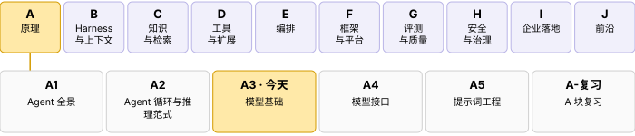
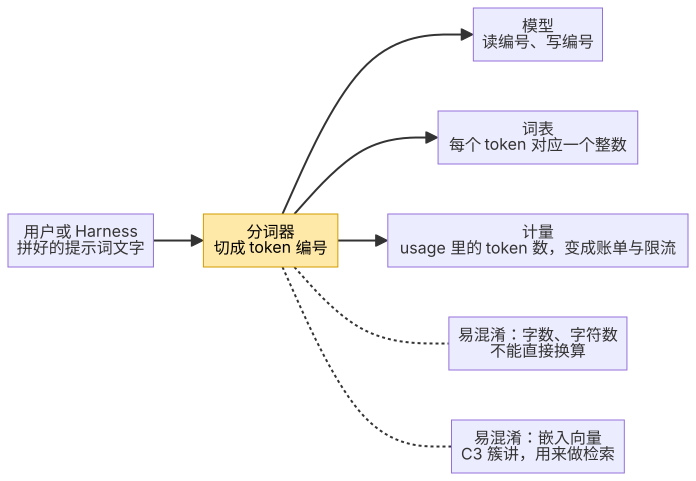
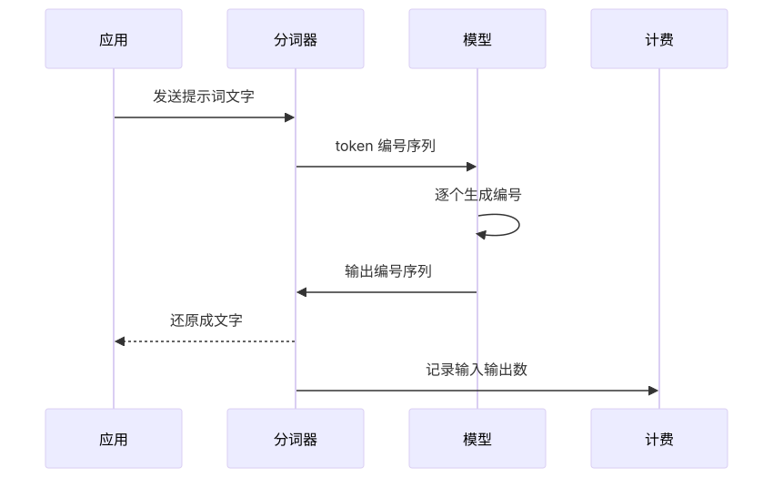
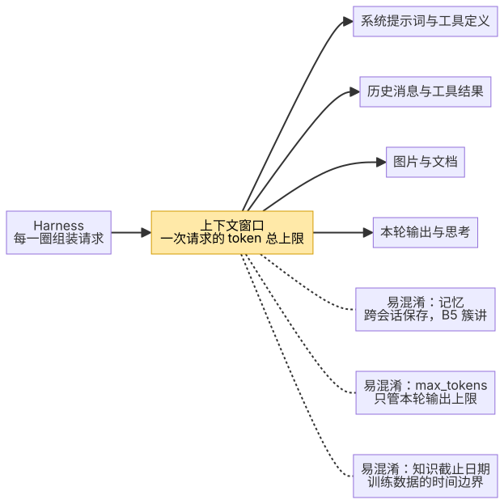
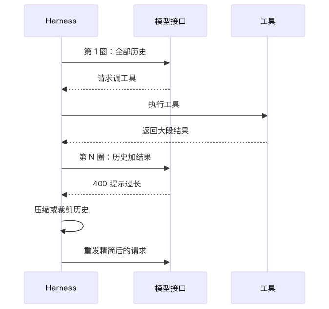
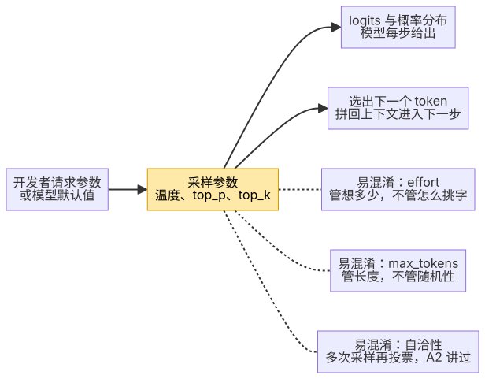
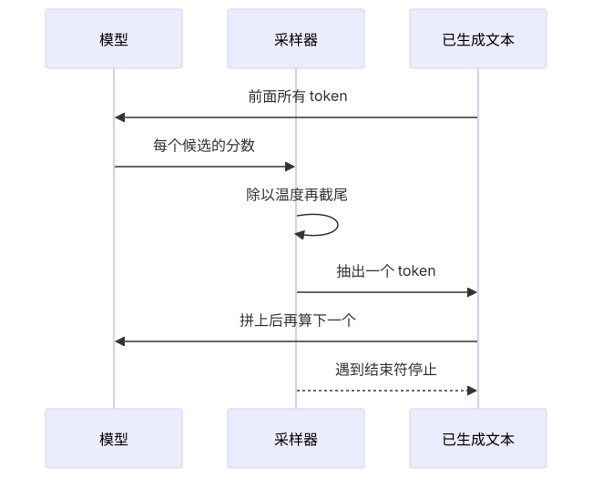
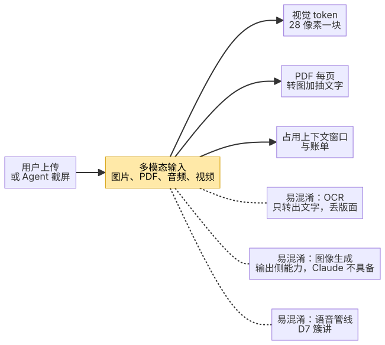
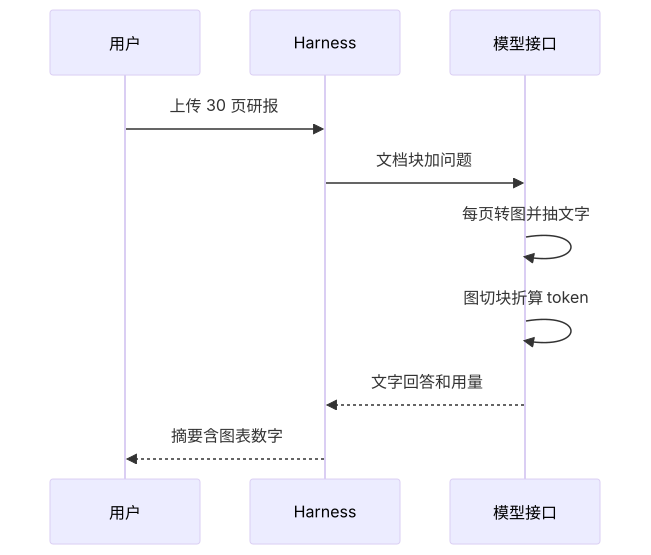
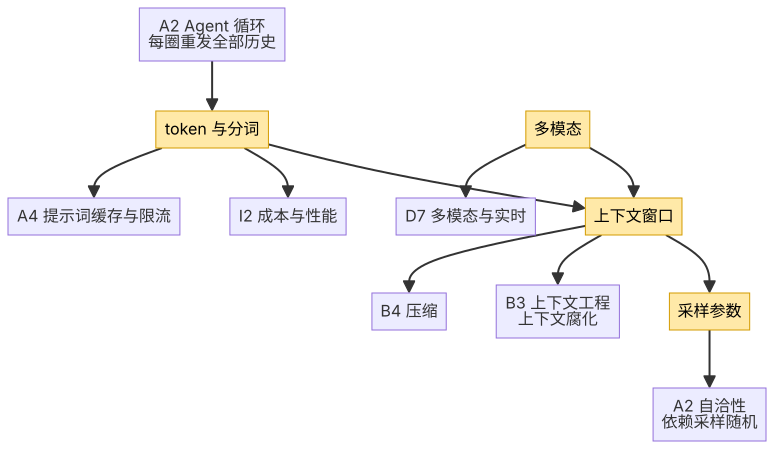

# 004 - Model Fundamentals Part 1 · 模型基础（上）

> 第 004 讲 · A3 模型基础（上） · A 原理：Agent 是怎么转起来的 · 事实核实截至 2026-10-30
> [← 返回目录](../README.md) · 上一讲：[003 Agent 循环与推理范式（下）](003-agent-loop-and-reasoning-2.md) · 下一讲：[005 模型基础（下）](005-model-fundamentals-2.md)

---

## 🧭 Bulletin 流程

> 一段文字、一张图交给模型 → **① token 与分词** → **② 上下文窗口** → **③ 采样参数** → **④ 多模态** → 知道模型读进去多少、装得下多少、怎么挑字吐出来、除了文字还能看什么

A2 两篇把模型当成一个会"想"的黑盒。A3 打开黑盒。A3 一共 9 个概念，拆成两篇：上篇讲模型怎么读、怎么写，四个概念按一次调用的先后顺序排；下篇讲选哪个模型、怎么改模型。

1. **token 与分词**：模型不认字，只认 token；分词器把文字切成 token 编号，计费、窗口、限流全按 token 算，同一段话换个模型 token 数可能差三成。
2. **上下文窗口**：上下文窗口是一次请求里模型能处理的 token 总量，系统提示、历史消息、工具结果、图片和这次的输出全算在里面；Agent 每转一圈都要把整段历史重新发一遍，所以窗口会被越填越满。
3. **采样参数**：模型每一步给所有候选 token 打出一个概率分布，采样参数决定从里面怎么挑；温度改分布的尖锐程度，top_p 和 top_k 截掉长尾。最新的 Claude 模型已经不接受改这几个参数。
4. **多模态**：多模态是模型接受或生成文字以外内容的能力；图片会被切成小块折算成 token，PDF 每一页既转成图又抽出文字，所以一份带图表的研报比纯文本贵得多。

---

## 📍 定位图



怎么读这张图：上面一行是整张地图的 10 个块，下面一行是今天所在的块展开成的各簇，黄色是今天的位置。

A3 上面接的是 A2：A2 讲循环每一圈怎么想，A3 讲每一圈里模型实际收到什么、吐出什么。A3 下面通向 A4 模型接口：今天的 token、窗口和采样参数，到 A4 都会变成请求里一个个具体字段，比如提示词缓存、流式和限流。

---

## 本簇讲解

### 这一簇要解决什么问题

Charles 搭了一个研报助手 Agent，用 Claude Opus 5.5（Anthropic 2026 年的主力模型，API 标识 `claude-opus-5-5`）。第一周跑下来出了四件说不清的事。

第一，账单对不上。他按"一个汉字一个 token"估了预算，实际账单高出一截；更奇怪的是，同一批研报，上个月用 Sonnet 4.6（Anthropic 2026 年初的中档模型）跑，token 数比现在少了大约四分之一。原因是计费单位 token 不等于字，而且 Claude 4.7 以后换了分词器。

第二，Agent 跑到第 40 圈突然报错 "prompt is too long"。他明明只给了一份 30 页的研报。原因是每一圈都要把完整历史重新发一遍，30 页研报加 40 圈工具结果，把窗口塞满了。

第三，他想让摘要"每次都一样"，在代码里写了 `temperature=0`，结果请求直接被拒绝，返回 400 错误（HTTP 状态码 400：请求格式不被接受）。原因是新模型已经不让改采样参数。

第四，研报里最关键的是一张营收拆分柱状图，助手的摘要却漏了。原因是他把 PDF 先转成了纯文本再发给模型，图里的信息在转换时就丢了。

这四件事对应今天的四个概念。它们都不难，但面试和实际排查里，大部分"模型怎么这样"的问题，答案都在这四个概念里。

---

### 概念一：token 与分词

**1. 定义**

token 是大模型读写文本的最小单位。分词器（tokenizer）是模型配套的一段固定程序，它把输入文字切成一串 token，再把每个 token 换成词表（模型认识的全部 token 及其编号的清单）里的一个整数编号；模型读进去的是编号序列，生成出来的也是编号，最后再由分词器还原成文字。模型的计费、上下文窗口、限流，全部以 token 为单位计算。

主流分词器用的是子词切分：常见的词整体是一个 token，罕见的词拆成几块。OpenAI 开源的分词库 tiktoken 用的是 **BPE**（Byte Pair Encoding，字节对编码：反复把出现最多的相邻字节对合并成一个新 token 的算法），README 里给出的经验值是"平均每个 token 大约对应 4 个字节"（核实于 2026-10-16）。[1] Google 的 Gemini 文档给的经验值是 1 个 token 大约 4 个字符，100 个 token 大约 60 到 80 个英文单词（截至 2026-10-16，页面更新于 2026-10-13）。[2]

Claude 这边有两条要记住的事实，都来自 Claude 官方文档（截至 2026-10-16）：[3][4][5]

- **分词器换代**：Claude 4.7 及之后的模型（包括今天的 Opus 5.5、Sonnet 5.5、Haiku 5.5、Fable 5.1）用的是新分词器，同一段文字大约多产生 30% 的 token；Sonnet 4.6 及更早的模型用旧分词器。
- **换算口径**：在当前分词器上，100 万 token 大约是 55.5 万个英文单词或 250 万个 Unicode 字符（Unicode：给世界上所有文字统一编号的字符标准，一个汉字算一个字符）；旧分词器上 100 万 token 大约能装 75 万个单词。

中文怎么换算，今天没有在三家官方文档里查到明确数字，未核实。JavaGuide（国内常用的 Java 与 AI 面试学习站）的文章称 DeepSeek（国内大模型公司）给过"中文每字约 0.6 个 token、英文每字符约 0.3 个 token"的经验值；2026-10-30 已回到 DeepSeek 官方 API 文档的 Token 用量页核实，原文就是这两个近似比例，并注明不同模型分词方式不同、实际以接口返回的计数为准。[6] 实际工作中不要靠经验值，而是用官方的计数接口去量。

**2. 场景**

Charles 要估算"每天摘要 200 篇研报"的成本。下面的 token 数是示意，单价是官方价目表上的真实数字（截至 2026-10-16）。[5]

- 他先拿一篇典型研报调用 Claude 的 token 计数接口，返回 `input_tokens: 24000`。
- Opus 5.5 输入价是每百万 token 4 美元，输出价 20 美元。一篇的输入成本是 24000 除以 100 万再乘 4，等于 0.096 美元。
- 摘要输出约 1500 个 token，成本 0.03 美元。注意输出单价是输入的 5 倍，所以输出虽然只有输入的十六分之一，成本却占了四分之一。
- 每天 200 篇，大约 25 美元。
- 如果他拿上个月 Sonnet 4.6 时期记下的 token 数来估，会少估大约 30%，因为分词器换了。

**3. 它解决什么问题**

因果链是这样的。模型内部只能处理数字，不能直接处理文字，所以必须有一个固定的规则把文字变成数字序列。如果一个字母一个编号，序列会非常长，模型每多处理一个位置就多一份计算；如果一个完整的词一个编号，词表会大到装不下，遇到新词还没有编号。子词切分是折中：常见片段合并成一个 token，序列变短；罕见片段拆小，任何文字都能表示。

这个设计带来三个直接后果。第一，token 成了计量单位：模型按处理多少个位置付出算力，厂商就按 token 收钱。第二，不同语言、不同内容的 token 密度不一样，代码、数字、生僻字通常更"费 token"。第三，模型看到的是编号而不是字母，所以"数一个单词里有几个 r""按字数精确截断"这类任务容易出错。这一条是根据机制推出来的，各家文档没有逐字这样写。

**4. 位置图**



怎么读这张图：左边是上层，交给分词器的是已经拼好的整段提示词，拼它的通常是 Harness（套在模型外面、负责循环、工具、权限和上下文的那层程序）。右边是下层：词表、模型本身，以及按 token 记下的用量，用量再变成账单和限流额度。两条虚线：字数和 token 数没有固定比例；嵌入向量（把一段文字压成一串数字、用来比较语义相近程度的表示，C3 簇讲）也是把文字变成数字，但它表示整段意思，分词器只是切块编号。

**5. 运行流程图**



怎么读这张图：这是一次调用里 token 的来回。分词器在服务端，应用看不到这一步，只能在返回结果的 `usage` 字段（返回结果里记录这次用了多少 token 的部分）里看到数字。模型那一步是自己指向自己，因为它一次只生成一个 token，生成完拼回去再生成下一个，这一点在概念三会展开。

**6. 实例（本机加官方接口）**

先看本机实物。写这张卡片的这次运行，会话记录是一个 JSONL 文件（每行一条 JSON 记录的文本文件）。我只读了其中助手消息的 `usage` 字段，不看内容，36 条记录里摘三条：

```
第 1 条：  cache_creation_input_tokens 82405，output_tokens 430
中间一条： cache_read_input_tokens 149306，output_tokens 317
最后一条： cache_read_input_tokens 184676，output_tokens 340
```

两点读法。第一，第一条记录写进缓存的 8.2 万个 token，在我还没读任何文件之前就已经存在，是系统提示词、工具定义和技能清单这类"开场白"。第二，每次输出只有三四百个 token，但每次输入都是十几万，说明在 Agent 里，钱和窗口主要花在"读"上，不是花在"写"上。这里的 `cache_read`、`cache_creation` 属于提示词缓存（把重复的提示词前缀在服务端存一段时间，再次使用时按低价计费的机制，A4 簇讲）。

再看官方计数接口。Claude 提供 `POST /v1/messages/count_tokens`，请求格式和正常发消息一样，返回 `input_tokens`；它免费，但有单独的每分钟请求数限制，Start、Build、Scale 三个用量等级分别是每分钟 5000、10000、20000 次；文档写明结果是估计值，并且按你传入的那个模型的分词器来数（截至 2026-10-16）。[4]

```python
import anthropic

client = anthropic.Anthropic()
resp = client.messages.count_tokens(
    model="claude-opus-5-5",          # 按这个模型的分词器计数
    system="你是研报摘要助手",
    messages=[{"role": "user", "content": "请用三句话总结这份研报：……"}],
)
print(resp.input_tokens)              # 只数输入，不包括还没生成的输出
```

**7. 常见误解与边界**

- **"一个汉字等于一个 token"**：不成立。换算比例取决于分词器，同一个模型里中文、英文、代码、数字的密度也不同。要估成本，用计数接口量，不用经验值。
- **"同一段话在哪个模型上 token 数都一样"**：不成立。Claude 4.7 前后同一段文字就差约 30%。[3] 所以跨代比较价格时，单价不变不代表成本不变。
- **"输入输出一样贵"**：不成立。Opus 5.5 输出价是输入价的 5 倍；扩展思考产生的 token 也按输出计费。[5]
- **"计数接口的数就是账单上的数"**：接近但不保证。文档说它是估计值，可能包含系统自动加入的 token，而这部分不收费。[4]
- **边界**：token 只描述文字层面的量。图片、PDF 页面也会折算成 token，但规则不一样，见概念四。

**8. 其他家叫什么**

各家都叫 token。OpenAI 的分词器开源在 tiktoken 里，README 举例的编码有 `o200k_base` 和 `cl100k_base` 两种，哪个模型用哪种，README 没有列，今天未核实。[1] Gemini 的计数接口叫 `count_tokens`，返回结果里把输入、输出、思考、缓存、工具调用的 token 分开列（截至 2026-10-16）。[2] 国内文章常把 token 叫"词元"。

---

### 概念二：上下文窗口

**1. 定义**

上下文窗口（context window）是模型在一次请求里能处理的 token 总量上限。按 Claude 官方文档的说法，请求里的一切都计入窗口：系统提示词、`messages` 里的每一条消息（包括工具结果、图片和文档）、工具定义，再加上这一轮模型生成的输出，包括扩展思考（模型在回答前先在单独区块里推理的能力，上一讲讲过）（截至 2026-10-16）。[7]

截至 2026-10-16 的官方数字：[7][3]

- Claude Fable 5.1、Opus 5.5、Sonnet 5.5、Haiku 5.5 等当前模型的窗口都是 100 万 token，单次最多输出 12.8 万 token（`max_tokens`：一次回复最多输出多少 token 的硬上限）。更早的部分模型是 20 万。
- 100 万是默认值，不需要额外的测试版请求头；长请求按标准单价计费。例外是 Haiku 5.5：提示词超过 10 万 token 时，单价从输入 0.10、输出 0.50 美元每百万 token，涨到 0.50 和 2.50 美元。[5]
- 缓存过的提示词前缀照样占窗口；之前轮次的思考块在 Opus 4.5 以后的 Opus 模型、Sonnet 4.6 以后的 Sonnet 模型和 Haiku 5.5 上默认保留，也计入输入。

**2. 场景**

Charles 的研报助手做一件事：读一份 30 页的 PDF 研报，再去网上查 5 家可比公司的数据，最后写比较表。

- 开场：系统提示词加工具定义约 1 万 token，研报约 9 万 token。
- 每一圈：模型调一次工具，工具返回一段网页内容，平均 1.5 万 token。
- 关键在于：模型接口是无状态的，它不记得上一次请求，所以 Harness 每一圈都要把完整历史，从系统提示到最新的工具结果，全部重新发一遍。
- 第 40 圈时，历史已经是 10 万加 40 乘 1.5 万，约 70 万 token。如果某一步工具一次返回了一整个年报，就可能越过 100 万，请求被拒绝。

这也是为什么上一讲说"每一圈都要付钱"：第 40 圈那一次请求，输入就有 70 万 token。提示词缓存能让重复部分便宜很多，但不能让它不占窗口。

**3. 它解决什么问题**

严格说，上下文窗口不是一个"解决问题的功能"，而是一个约束。理解它解决的是"为什么模型突然不行了"这一类排查问题。

因果链有两条。第一条是硬上限：模型生成每一个新 token 时，都要和前面所有 token 计算关联，长度越长，算力和显存（显卡上的内存，存放模型参数和中间计算结果）消耗越大，所以每个模型都有一个训练和部署时定下的最大长度。超过它，请求直接失败。

第二条是软退化：没到上限，效果也会变差。Claude 文档写明，随着 token 数增长，准确率和召回率会下降，这被称为上下文腐化（context rot），所以"窗口里放什么"和"窗口有多大"同样重要。[7] 学术上更早的证据是 Liu 等人 2023 年的论文《Lost in the Middle》（发表于 **TACL**，Transactions of the Association for Computational Linguistics，计算语言学协会会刊）：关键信息放在开头或结尾时模型表现最好，放在长上下文的中间时明显变差，呈 U 形曲线。[8] 这篇论文测的是 2023 年的模型，具体数字不能套到今天的模型上，但"越长越难找"的方向，Claude 文档今天仍然承认。这两条现象是 B3 上下文工程簇的主题，今天只记住它们和窗口的关系。

**4. 位置图**



怎么读这张图：上层是 Harness，它决定每一圈往窗口里放什么。下层是窗口的四块组成，最后一块"本轮输出与思考"最容易被忘记，它也占窗口。三条虚线：记忆（把信息存在窗口之外、下次再取回来的机制）是跨会话的，窗口只管一次请求；`max_tokens` 只限本轮输出，窗口限的是输入加输出的总和；知识截止日期（模型训练数据截止的时间，当前 Claude 四个主力模型都是 2026 年 6 月）决定模型"天生知道什么"，窗口决定"这次额外看到什么"。

**5. 运行流程图**



怎么读这张图：这是窗口被填满的过程。第 N 圈和第 1 圈的区别只是"历史加结果"变长了。按官方文档，如果输入本身已经超过窗口，所有模型都返回 400 错误 "prompt is too long"；如果输入没超、但输入加 `max_tokens` 超了，Claude 4.5 以后的模型会接受请求，生成到窗口边上时停下，`stop_reason`（返回结果里说明这次为什么停下的字段）是 `model_context_window_exceeded`。[7] 最后两步"压缩或裁剪"是 Harness 的补救，B4 压缩簇会讲。

**6. 实例（本机）**

接着看上面那组本机数字。这次运行到写卡片前，单次请求的输入大约 18.5 万 token，用了 100 万窗口的不到五分之一。粗算一下"读"的总量：36 次请求，每次输入从 8 万涨到 18 万，平均约 13 万，合计约 480 万 token 被模型重新读过。如果按 Opus 5.5 的 API 价目表算，缓存命中价是每百万 token 0.20 美元，这部分约 1 美元；不用缓存按 4 美元算，就是约 19 美元。[5] 这里是按 API 价目做的示意，桌面应用的实际计费方式可能不同，没有核实。

Claude Code 里和窗口直接相关的实物，是上一讲前沿快讯提到的 2.1.299 版闲置压缩：会话闲置后、缓存失效前先把历史压成摘要，下次从摘要继续。它就是上面流程图最后两步的产品化做法，详见每日简报《ClaudeCode在缓存失效前压缩长会话》（2026-10-14）。本机 `~/.claude/settings.json` 里配置了 `PreCompact` 和 `PostCompact` 两个 Hook（在特定事件发生时由 Harness 自动执行的脚本，D4 簇讲），说明压缩事件在这台电脑上是被关注的；这两个 Hook 具体做什么，今天没有展开读。

**7. 常见误解与边界**

- **"窗口 100 万，就能放心塞 100 万"**：不对。有上下文腐化，越长越难找；放进去之前先想清楚哪些是必须的。[7]
- **"窗口就是模型的记忆"**：不对。窗口只存在于一次请求里，接口本身无状态，"记得之前说过什么"是 Harness 每次重发历史造成的。claude.ai 这类聊天界面还可能按先进先出滚动丢弃最早的内容。[7]
- **"用了缓存就不占窗口"**：不对。缓存省的是钱和延迟，占的位置一点不少。[7]
- **"窗口大，长请求也一样便宜"**：要看厂商。Claude 除 Haiku 5.5 外按标准价；OpenAI 的 GPT-6 Astra 和 GPT-6 Luna 页面写明，输入超过 27.2 万 token 时，输入和缓存价翻倍、输出价乘 1.5（截至 2026-10-16）。[9]
- **边界**：窗口决定"这一次能看多少"，不决定"看得好不好"。看得好不好是上下文工程的事，B3 讲。

**8. 其他家叫什么**

各家都叫 context window，国内也叫"上下文长度"。截至 2026-10-16：OpenAI 旗舰 GPT-6 Astra 窗口 105 万 token，其中最多 92.2 万给输入、12.8 万给输出；[9] Google Gemini 4 Argon 窗口 1,048,576 token，由输入、思考和输出共用，同步调用默认最多输出 65,536 token。[2] 三家的窗口量级已经一样，差别在长请求怎么收费、输出上限多大。

---

### 概念三：采样参数

**1. 定义**

模型每生成一个 token，都会给词表里的每一个候选打一个原始分数，叫 logits（模型对每个候选 token 输出的未归一化分数），再用 softmax（把一组分数变成加起来等于 1 的概率的函数）换成概率分布。采样参数决定从这个分布里怎么挑出下一个 token：

- **temperature**（温度）：把每个分数先除以温度再算概率。温度低于 1，分布变尖，高分的候选更占优势，输出更保守；高于 1，分布变平，低分候选也有机会，输出更多样。
- **top_p**（核采样，nucleus sampling）：把候选按概率从高到低排，累加到 p 为止，只在这一小撮里抽。
- **top_k**：只在概率最高的 k 个候选里抽。k 等于 1 就是每次都选最高分，叫贪心解码。

**2026 年的关键变化**，面试必须说清（截至 2026-10-16）：[10][11][12]

- Claude 在 Opus 4.6 之后发布的模型，包括 Opus 4.7、Opus 5.5、Sonnet 5.5、Haiku 5.5，**不再接受非默认的 temperature、top_p、top_k**，传了就返回 400 错误。Opus 5.5 迁移指南的原话意思是：不要传这三个参数，或者保持默认值，改用提示词来引导模型行为。
- **2026-10-21 起更进一步**：Claude 发布了新的 API 版本 `2026-10-21`（请求头 `anthropic-version` 的取值，决定接口按哪一套规则处理请求）。在这个版本下，任何模型的请求只要带了 temperature、top_p、top_k 之一就返回 400 错误，**哪怕传的是默认值**。同日发布的新版 **SDK**（Software Development Kit，软件开发工具包：厂商提供的现成调用代码库），例如 Python SDK 2.0.0、TypeScript SDK 1.0.0，类型里已经删掉这三个参数，并且默认发送新版本号。迁移指南写明：不传时一律按默认值采样，温度是 1.0；对 Sonnet 4.6 这类还接受其他取值的旧模型，原来靠调低温度换来的稳定性会消失，而且没有别的设置可以替代，真离不开的请求只能留在旧版本 `2023-06-01`（截至 2026-10-21）。[21][22] 本卡原先写的「Python SDK 1.0 及以后不再定义这几个参数」当时未逐字核对，以这一条为准。
- Haiku 5.5 的规则最细：在旧版本 `2023-06-01` 下，如果带 temperature，只能是 1；带 top_p，只能是 0.99；top_k 任何值都拒绝；同时带 temperature 和 top_p 也拒绝。换到 `2026-10-21` 后，三个参数一律不能带。
- 文档同时提醒：以前用 `temperature=0` 求确定性，在旧模型上也从来不能保证每次输出完全相同。

OpenAI 的 Responses API（OpenAI 当前主推的模型调用接口）参考文档里，temperature 的范围是 0 到 2，并建议"改 temperature 或 top_p 其中一个，不要两个都改"（截至 2026-10-16）。[13] GPT-6 系列推理模型是否接受这两个参数，⚠️ 待修正（2026-10-30 未能核实：GPT-6 Astra 模型页只列不支持的接口，没有提采样参数；推理指南也没有写）。

**2. 场景**

把采样过程拆开算一遍。研报助手写到"公司二季度营收同比"，下一个词有三个候选，模型给的分数是："增长"2.0，"下降"1.0，"持平"0.0。

- 温度 1：三个分数直接做 softmax，e 的 2 次方约 7.39，e 的 1 次方约 2.72，e 的 0 次方是 1，总和约 11.11。概率分别约 66.5%、24.5%、9.0%。
- 温度 0.5：分数先除以 0.5，变成 4、2、0。概率变成约 86.7%、11.7%、1.6%。"增长"几乎每次都被选中。
- 温度 2：分数除以 2，变成 1、0.5、0。概率变成约 50.6%、30.7%、18.6%。将近五分之一的概率写出"持平"。
- top_p 设 0.9、温度 1：按概率排序累加，66.5% 加 24.5% 等于 91%，已经超过 0.9，于是只在"增长"和"下降"两个里抽，"持平"被截掉。

如果这份研报里营收确实增长了，温度 2 意味着大约每 5 次就有 1 次写错方向。这就是"事实类任务用低温"这条经验的来历。反过来，在 Claude 最新模型上，这个旋钮已经交不到开发者手里，要靠提示词写清"只依据原文数字"，再用上一讲的反思和外部校验兜底。

**3. 它解决什么问题**

因果链是这样的。模型输出的本来就是一个概率分布，不是一个确定的词。总选最高分，输出稳定但容易单调、重复；完全按原始分布抽，偶尔会抽到很低概率的怪词，一个怪词又会影响后面所有 token，因为每个 token 都依赖前面写出来的内容。采样参数就是在"稳"和"活"之间调的旋钮：温度调整体倾向，top_p 和 top_k 专门剪掉长尾里的怪词。

它还和上一讲的自洽性（同一道题采样多条推理链、取多数答案的方法）直接相关：自洽性要求每次采样出来的推理不一样，如果分布被压得太尖，五条链会一模一样，投票就没有意义。

至于 Claude 新模型为什么不再开放这几个参数，官方文档没有给出原因。一种推测是，这些模型默认开着自适应思考，推理质量和采样方式是一起调好的，开发者乱改反而容易变差。这只是推测，不是官方说法。

**4. 位置图**



怎么读这张图：上层是谁设置采样参数，旧模型上是开发者，Claude 最新模型上只能用默认值。下层是它作用的对象：模型每一步给出的概率分布，选出的 token 再拼回去影响下一步。三条虚线：effort（Claude 控制整个回复投入多少 token 的档位参数，上一讲讲过）调的是"想多少"，采样参数调的是"每一步怎么挑"；`max_tokens` 只管长度；自洽性是建立在采样随机性之上的一种用法，不是采样参数本身。

**5. 运行流程图**



怎么读这张图：这是生成一个 token 的一圈，一次回复要转几百上千圈。采样器在服务端，和模型一起运行。"除以温度再截尾"这一步就是今天的概念：先用温度改分布，再用 top_p 或 top_k 剪掉长尾，最后按剩下的概率抽一个。抽到表示"回答结束"的特殊 token 时，这一轮生成停下。

**6. 实例**

非 Claude Code 专属概念。下面是把场景里的计算写成代码的示意，纯数学，不调用任何接口：

```python
import math

def sample_probs(logits, temperature=1.0, top_p=1.0):
    scaled = [x / temperature for x in logits]          # 先除以温度
    exps = [math.exp(x) for x in scaled]
    probs = [e / sum(exps) for e in exps]               # softmax
    order = sorted(range(len(probs)), key=lambda i: -probs[i])
    kept, total = [], 0.0
    for i in order:                                     # 核采样：累加到 top_p 为止
        kept.append(i)
        total += probs[i]
        if total >= top_p:
            break
    z = sum(probs[i] for i in kept)
    return {i: round(probs[i] / z, 3) for i in kept}    # 截尾后重新归一

logits = [2.0, 1.0, 0.0]                                # 增长、下降、持平
print(sample_probs(logits, 1.0))         # 约 0.665、0.245、0.090
print(sample_probs(logits, 0.5))         # 约 0.867、0.117、0.016
print(sample_probs(logits, 1.0, 0.9))    # 只剩前两个，约 0.731、0.269
```

在 Claude Opus 5.5 上调用时，正确的写法就是**不传**这三个参数。

**7. 常见误解与边界**

- **"温度设 0 就完全可复现"**：不成立。Claude 文档明确说温度 0 在旧模型上也不保证完全相同的输出。[11] JavaGuide 的文章把原因归到 **GPU**（Graphics Processing Unit，图形处理器：大模型推理用的计算芯片）浮点误差等因素，并建议配合 seed（随机种子：固定随机数起点的参数）使用，属于社区说法，今天没有逐条核实。[6]
- **"温度越高越有创意，质量越好"**：不对。温度高只是更随机，低概率的错词、怪词也会变多。
- **"temperature 和 top_p 一起调效果更好"**：通常不建议。OpenAI 文档建议只改一个；[13] 两个同时调，作用会互相叠加，很难判断是谁起了作用。
- **"代码里沿用老参数没关系"**：在 Claude 新模型上不成立，非默认值直接 400。[10][11] 从旧模型迁移时，这是最常见的一类报错。
- **边界**：采样参数只影响"同一个分布里怎么挑"，改变不了分布本身。模型根本不知道的事实，怎么调温度都写不对。

**8. 其他家叫什么**

本段涉及 Claude 与别家的对比，本文由 Anthropic 的模型撰写，存在利益相关。

名字各家一样：temperature、top_p（nucleus sampling）、top_k。OpenAI Responses API 的温度范围是 0 到 2，比 Claude 旧模型的 0 到 1 宽。[13][10] 自己部署开源模型时，这几个参数通常仍然可以随意调，具体框架接口今天没有核实。Claude 这边的短板很明确：最新模型把采样参数整体收回了。需要稳定格式的场景，只能改用提示词、结构化输出（让模型按指定 JSON 格式返回的功能，A4 簇讲）和外部校验；需要刻意提高多样性的场景，比如生成多个候选文案，也不能再靠调高温度，只能在提示词里明确要求"给出风格不同的几版"。

---

### 概念四：多模态

**1. 定义**

多模态（multimodal）指模型能接受或生成文字以外的内容，例如图片、PDF 页面、音频、视频。面试时要分清两组概念：

- **输入多模态和输出多模态**：能"看"图不等于能"画"图。截至 2026-10-16，Claude 所有当前模型支持文字和图片输入、只输出文字；Claude 文档写明它不能生成或编辑图片。[3][14]
- **原生多模态和拼接管线**：原生是一个模型直接读图片或音频；拼接是先用别的系统把它转成文字，例如 **OCR**（Optical Character Recognition，光学字符识别：把图片里的字识别成文本）、**ASR**（Automatic Speech Recognition，自动语音识别：把语音转成文字），再交给语言模型。拼接管线在 D7 多模态与实时簇讲。

Claude 的图片和 PDF 规则，截至 2026-10-16：[14][15]

- **格式与上限**：支持 JPEG、PNG、GIF、WebP，动图只取第一帧；单张最大 8000 乘 8000 像素；直接调用 API 单张最大 10MB；100 万窗口的模型每次请求最多 600 张图或 600 页 PDF。
- **折算 token**：图片被切成 28 乘 28 像素的小块，每块算一个视觉 token，总数是宽除以 28 向上取整，乘以高除以 28 向上取整。Claude 4.7 及以后的模型是高分辨率档，长边最多 2576 像素、最多 4784 个视觉 token；更早的模型长边 1568 像素、最多 1568 个。超过的图会被自动缩小。
- **PDF**：每一页先转成图片，同时抽出这一页的文字，两者一起交给模型；每页文字部分通常 1500 到 3000 token，图片部分按上面的规则另算。
- **局限**：不能识别图中的人是谁；低质量、旋转或小于 200 像素的图容易看错；坐标和计数只是近似；判断不了图片是不是 AI 生成的。

**2. 场景**

Charles 的研报里有一张 1920 乘 1080 像素的营收拆分图。

- 按规则算：1920 除以 28 向上取整是 69，1080 除以 28 向上取整是 39，69 乘 39 等于 2691 个视觉 token。官方示例表给出的正是 2691。[14] 在 Opus 5.5 上，这张图的输入成本约 0.011 美元。
- 同一张图在旧模型上会被缩到 1456 乘 819，只算 1560 个 token，便宜，但细节变少。
- 官方示例：一张 1000 乘 1000 的图，在 Opus 5.5 上每千张约 5.18 美元；一张 4K 图每千张约 19.14 美元。[14]
- 再回到开头的第四件事。Charles 原来把 PDF 先转纯文本再发，柱状图里的数字没有被转出来，模型自然看不到。直接把 PDF 作为文档发送，每页会附带页面图片，图表就能被读到；代价是每页多出一份图片 token。30 页的研报，光文字部分就是 4.5 万到 9 万 token，图片部分另算。

**3. 它解决什么问题**

因果链是这样的。现实里大量信息不在纯文字里：研报的柱状图、合同的扫描件、截图里的报错、电脑屏幕本身。拼接管线可以先转文字，但转换会丢东西：OCR 读得出字，读不出柱子的相对高度和图例颜色的对应关系。原生多模态让模型直接看原图，信息损失少，管线也少一段。

对 Agent 来说还有一层意义：电脑操作类 Agent（让模型看屏幕截图、再决定点哪里的 Agent，D5 簇讲）完全依赖图片输入。每一步截一张图，每张图就是一两千到四五千个 token，这也是这类 Agent 特别贵、特别容易撑满窗口的原因。

**4. 位置图**



怎么读这张图：上层是内容从哪来，可能是用户上传，也可能是 Agent 自己截屏。下层是它在模型里变成什么：图片变视觉 token，PDF 每页变"图片加文字"，最终都占窗口、算钱。三条虚线：OCR 是拼接管线的一段，只交出文字；图像生成是输出侧的能力；语音的识别、生成和实时打断属于 D7。

**5. 运行流程图**



怎么读这张图：这是把 PDF 原样发给 Claude 的一次调用。"每页转图并抽文字"和"切块折算 token"都发生在服务端，开发者只看到最后 `usage` 里的输入 token 变大了。如果在 Harness 那一步先把 PDF 转成纯文本，第三、四步就只剩文字，图表信息在进模型之前就已经没了。

**6. 实例（本机加官方示例）**

本机实物：这次运行里 Claude Code 提供给模型的读文件工具，说明里写着可以读取 PNG、JPG 等图片并以图像形式呈现给模型，读 PDF 要用页码参数，每次最多 20 页。也就是说，在 Claude Code 里让它"看一下这张截图"，截图是以图片 token 的形式进入窗口的，不是先转成文字。

官方调用写法如下，按文档的 base64（把二进制文件编码成纯文本字符串的方式）图片示例改写，节选：[14]

```python
import anthropic, base64

client = anthropic.Anthropic()
with open("revenue_chart.png", "rb") as f:
    img = base64.standard_b64encode(f.read()).decode()

msg = client.messages.create(
    model="claude-opus-5-5",
    max_tokens=1024,
    messages=[{"role": "user", "content": [
        {"type": "image",
         "source": {"type": "base64", "media_type": "image/png", "data": img}},
        {"type": "text", "text": "列出图中各业务的营收占比，只写图上能读到的数字"},
    ]}],
)
print(msg.content[0].text)
```

**7. 常见误解与边界**

- **"能看图就能画图"**：不对。Claude 只输出文字。[14]
- **"图片很便宜，随便放"**：不对。一张 4K 图在 Claude 新模型上接近 4800 个 token，相当于几千字的文字；电脑操作类 Agent 每一步一张截图，很快就是几十万 token。
- **"把 PDF 转成文字再发更省、效果一样"**：省是真的，效果不一样。图表、版面、扫描件里的信息会丢。
- **"多模态模型什么都能读"**：Claude 当前文档里没有音频、视频输入；它也不能识别人脸身份，计数和坐标是近似的。[3][14] 小于 200 像素、旋转、模糊的图容易看错。
- **边界**：多模态解决的是"看得到"，不保证"看得对"。图表里读出的数字，和文字里抽出的数字一样，需要用上一讲的外部校验去核对。

**8. 其他家叫什么**

本段涉及 Claude 与别家的对比，本文由 Anthropic 的模型撰写，存在利益相关。

各家都叫 multimodal，国内常说"多模态"或"视觉理解"。截至 2026-10-16：

- **Google Gemini**：图片两边都不超过 384 像素算 258 个 token，更大的图切成 768 乘 768 的块，每块 258 个；音频每秒 32 个 token；视频的折算，文档同一页里一处写每秒 263 个，另一处写低分辨率约 100、高分辨率约 300，前后不一致，以实际计数为准。Gemini 的实时接口支持原生音频输入和输出。[2][16]
- **OpenAI**：GPT-6 Astra 和 GPT-6 Luna 的模型页写的是文字和图片输入、文字输出。[9]
- **开源阵营**：Meta 2026-10-15 发布的开放权重模型 Muse Spark Open 自称原生多模态，支持图片、音频和音视频输入，见前沿快讯。[17]

Claude 这边的短板有两个：一是没有原生音频和视频输入，做语音或视频场景要自己接识别管线；二是不能生成图片。长处是 PDF 原生支持、单次请求最多 600 页或 600 张图。

---

## 👔 三岗视角

### AI 应用 / Agent 开发

**场景**：团队把研报助手从 Sonnet 4.6 迁到 Opus 5.5。上线第一天，三类告警同时响：大约 12% 的请求返回 400；处理长研报的任务里，有 3% 在第 30 圈以后报 "prompt is too long"；每任务成本比预估高了约 35%。

**这个岗位具体做什么**：第一，查 400。按错误信息分类，发现大部分来自代码里还留着 `temperature=0.2`，新模型不接受非默认采样参数。删掉这几个参数，稳定性改用提示词约束加 JSON 格式校验。第二，查窗口。在 Harness 里给每次请求记录输入 token 数，画出"第几圈对应多少 token"的曲线，找出哪个工具一次返回了整份年报。给工具结果设上限，比如单次最多 2 万 token，超过就只返回摘要和定位信息，原文存在外面按需再取。第三，查成本。用计数接口把同一批 200 篇研报在新旧模型上各数一遍，确认其中约 30 个百分点来自分词器换代，剩下的来自更多的工具轮次。上线后盯五个数：400 错误率、窗口超限率、每任务输入 token 的 P95（把所有任务按 token 数排序，最多那 5% 的门槛值）、每任务成本、任务成功率。

**最容易踩的坑**：直接沿用旧模型时期测出的"每篇研报多少 token"做预算和告警阈值，不重新计数。分词器换了，所有基于 token 数的阈值都要重新标定。

### AI 产品 / 商业分析

**场景**：财务找到产品经理：模型升级后官网单价没变，研报助手的月账单却从 8000 美元涨到 1.1 万美元。要不要退回旧模型？

**这个岗位具体做什么**：第一，把涨幅拆开。和工程一起把 3000 美元的增量拆成三块：分词器换代让同样的文字多出约 30% 的 token；新模型能力更强，Agent 平均多调了 2 次工具；用户开始上传带图表的 PDF，图片 token 增加。第二，把"贵了"换成"每单位价值的成本"。算每篇合格摘要的成本，而不是每个 token 的价格；同时拿回质量数据，比如人工抽检的错误率从 9% 降到 4%，分析师返工时间每周少 12 小时。第三，给出分层方案。图表多、价值高的深度报告继续用 Opus 5.5 加原生 PDF；只要文字摘要的快讯类研报改用 Haiku 5.5，但要盯住它"提示词超过 10 万 token 单价变成 5 倍"的门槛，把单篇输入控制在 10 万以内。向财务汇报时讲三个数：每篇合格摘要成本、错误率、返工时长。

**最容易踩的坑**：拿每百万 token 的单价跨模型、跨代比较，得出"价格没变"的结论。分词器不同，单价相同的两个模型，同一篇研报的账单可以差三成。

### 金融科技 / 数据

**场景**：一家银行的信用卡中心想让模型读客户上传的银行流水截图和工资单 PDF，自动提取月收入；风控部门同时要求：同一份材料重复处理，结果必须一致。

**这个岗位具体做什么**：第一，可复现性不能交给温度。先讲清事实：最新的 Claude 模型不接受改温度，旧模型上温度 0 也不保证完全一致。[10][11] 所以可复现要靠流程：模型只负责从图里抽取字段，按固定 JSON 格式输出；关键数字由规则程序二次核对，比如月收入等于各笔工资入账之和；最终入库的是核对通过的结构化结果，而不是模型的原始回答。第二，留痕。每次处理记录模型版本、提示词版本、输入文件的哈希值（用文件内容算出的唯一指纹，文件改一个字指纹就变）、输出和核对结果。第三，多模态的风险边界。截图模糊、旋转、低于 200 像素时，模型容易读错，这类材料自动转人工；文档写明模型不能识别人的身份，所以身份核验不能交给它，仍走现有的证件核验系统。[14] 第四，数据出域。客户流水属于敏感个人信息，用哪家模型、数据在哪个地区处理，要先过合规评估；具体监管条文留到 H2 簇逐条核实，今天不展开。

**最容易踩的坑**：在需求文档里写"温度设为 0 保证结果一致"。一旦换到新模型，这句话既做不到，代码也跑不通。

---

## 🔗 串联图



怎么读这张图：黄色是今天的四个概念。最上面是 A2 的循环，它每一圈都把全部历史变成 token 重新发一遍，所以 token 和窗口是循环的"燃料表"。多模态和文字一起流进窗口，图片也占位置。采样参数作用在窗口之后，决定每一步吐出哪个 token，它的随机性正是 A2 自洽性能成立的前提。下面几行是今天概念的去向：token 变成 I2 的成本账和 A4 的缓存与限流；窗口的软退化是 B3 的主题，窗口满了怎么办是 B4 的主题；多模态里的语音和实时交互在 D7 展开。

相关卡片：[003 Agent 循环与推理范式（下）](003-agent-loop-and-reasoning-2.md) · [002 Agent 循环与推理范式（上）](002-agent-loop-and-reasoning-1.md) · [001 Agent 全景](001-agent-landscape.md) · 《爆款拆解：Jev 判断型模型》（判断型模型留到 A3 下篇）

---

## 🎙 复述板块

### 整簇两分钟版

> A2 讲的是 Agent 的循环怎么转、怎么想。A3 打开模型这个黑盒，上篇讲模型怎么读、怎么写，一共四个概念。
>
> 第一，token 和分词。模型不认字，只认 token。分词器把文字切成一块一块，每块换成一个编号。常见的词是一块，罕见的词拆成几块。计费、窗口、限流，全部按 token 算。要记住两点。一是 token 和字数没有固定比例，要用官方的计数接口去量。二是 Claude 从 4.7 开始换了分词器，同一段话大约多出三成 token，单价没变，账单也会变。
>
> 第二，上下文窗口。它是一次请求里模型能处理的 token 总量，现在三家主力模型都在一百万左右。系统提示、历史消息、工具结果、图片，还有这一轮的输出和思考，全部算在里面。模型接口是无状态的，Agent 每转一圈都要把整段历史重发一遍，所以窗口会越填越满。而且没满也会变差，越长越难找到关键信息，这叫上下文腐化。
>
> 第三，采样参数。模型每一步给所有候选打分，变成概率，再从里面挑一个。温度调分布的尖锐程度，越低越保守。top p 和 top k 把长尾的怪词截掉。但是要注意，Claude 最新的模型已经不接受改这几个参数，传了就报错，要改用提示词和外部校验来控制。另外，温度设成零也从来不保证每次一样。
>
> 第四，多模态。就是模型能看文字以外的东西。Claude 现在能看图片和 PDF，只输出文字。图片会被切成二十八像素见方的小块，一块算一个 token，一张高清截图就是两三千 token。PDF 每一页既转成图又抽出文字，所以图表能读到，但也更贵。
>
> 最后收一句。读进去多少，看 token。装得下多少，看窗口。怎么挑字吐出来，看采样。除了文字还能看什么，看多模态。四个概念，都是在算同一本账。

### 每个概念三十秒版

**token 与分词**

> token 是模型读写文字的最小单位。分词器把文字切块、换成编号，模型只处理编号。主流做法是子词切分，常见词一块，罕见词拆开。它决定三件事，计费、窗口占用和限流。两个要点。第一，token 和字数没有固定比例，中文、代码、数字密度都不一样，要用计数接口量。第二，换模型可能换分词器，Claude 四点七以后同样的话多出大约三成 token。

记忆钩子：token 像出租车的计价器跳表，不是按公里数算钱，而是按跳了几下算；换一辆车，跳表规则可能就变了。

**上下文窗口**

> 上下文窗口是一次请求里模型能处理的 token 总上限。请求里的一切都算，系统提示、历史、工具结果、图片，还有这一轮的输出和思考。模型接口不记事，Agent 每一圈都要把整段历史重发，所以越跑越满。超过上限，请求直接被拒绝。没超也会变差，越长越难找到中间的关键信息。所以窗口大小是上限，放什么才决定效果。

记忆钩子：窗口是考试时允许带进考场的那一张纸，纸再大，抄得太满也找不到答案；而且每一题都得把整张纸重新带进去一次。

**采样参数**

> 模型每一步给所有候选打分，变成概率，再挑一个。采样参数决定怎么挑。温度改分布的尖锐程度，低温保守，高温多样。top p 只在累计概率达到某个比例的候选里挑，top k 只在前几名里挑，都是为了剪掉怪词。现在有两个关键事实。第一，Claude 最新模型不再接受改这几个参数。第二，温度设成零也不保证结果完全一样。

记忆钩子：温度是抽奖箱里好签的多少，温度越低箱子里几乎全是头奖；top p 是先把没人要的烂签扔掉再抽。

**多模态**

> 多模态是模型能接收或生成文字以外的内容。要分清两组。第一，能看不等于能画，Claude 能看图片和 PDF，只输出文字。第二，原生和拼接不一样，原生是模型直接看原图，拼接是先转成文字再交给模型，会丢掉图表和版面。图片按二十八像素一块折算 token，一张高清图几千 token。PDF 每页既转图又抽字，图表能读到，代价是更贵。

记忆钩子：拼接管线像让别人把照片念给你听，原生多模态是你自己看照片；自己看更准，但看照片也要买票。

英文版口述：规范第 7 节的开关为"默认不写"，本篇不写。

---

## 💼 面试题板块

### 题 1 `[开发]` Token 是什么？为什么中文、英文、代码消耗的 Token 不一样？

来源：题库题，非某公司原题。JavaGuide《大模型基础面试题总结》"LLM 运行机制"一节原题（页面最近更新 2026-08-03），访问于 2026-10-16。[18]

**答题骨架**
- 结论：token 是模型读写和计费的最小单位，由分词器切出来；不同内容的切分密度不同，所以消耗不同。
- 三点展开：分词器怎么切；为什么密度不同；工程上怎么准确估算。
- 例子或数字：Claude 4.7 以后的新分词器，同一段文字约多出 30% 的 token。

**逐字范例**

> token 是大模型读写文字的最小单位，也是计费单位。我分三点讲。
>
> 第一，怎么切。模型不认字，只认编号。分词器把文字切成一块块的 token，每块对应词表里的一个编号。主流用 BPE，也就是字节对编码，反复把最常一起出现的片段合并成一块。所以常见词是一块，罕见词会拆成好几块。
>
> 第二，为什么不一样。分词器的词表主要是从训练语料里统计出来的。哪种内容在语料里多、片段常见，它就切得粗，一个 token 装得多。代码里有大量符号、缩进和变量名，数字也常被拆碎，所以通常更费 token。中文和英文的比例取决于具体分词器，没有通用常数。
>
> 第三，工程上怎么做。我不用经验值，而是用官方的计数接口量一批真实样本，再估预算。还要注意换模型可能换分词器，比如 Claude 从四点七开始，同样的文字大约多出三成 token。另外输出单价通常是输入的好几倍，Opus 五点五是五倍，所以预算要把输入和输出分开算。

**追问链**
1. 你在项目里怎么监控 token 消耗？要点：每次请求记录 usage 里的输入、输出、缓存读写数，按任务汇总，看每任务 token 的 P95 和每任务成本。
2. 为什么模型数不清一个单词里有几个字母？要点：它看到的是 token 编号，不是字母，一个单词可能整体就是一个 token；这是机制推论。
3. 换了分词器，你要改什么？要点：重新计数，重新标定所有基于 token 数的预算、告警阈值和截断长度。

**易错点**：背一个"中文一个字约等于几个 token"的固定数字当结论。面试官会追问"哪个模型、哪个分词器"。

### 题 2 `[开发]` Temperature、Top-P、Top-K 分别控制什么？生产环境怎么设置更稳？为什么温度设成 0 输出仍可能不一致？

来源：题库题，非某公司原题。JavaGuide《大模型基础面试题总结》中两道原题合并："Temperature、Top-P、Top-K 分别控制什么？生产环境怎么设置更稳？""为什么 Temperature 设置为 0，模型输出仍然可能不完全一致？"（页面最近更新 2026-08-03），访问于 2026-10-16。[18]

**答题骨架**
- 结论：三者都作用在每一步的概率分布上，温度改形状，top_p 和 top_k 截长尾；生产上求稳不能只靠调参。
- 三点展开：三者的原理；生产设置和最新变化；温度 0 为什么仍不一致。
- 数字：三个候选的分数 2、1、0，温度 1 时最高项概率约 66%，温度 0.5 时约 87%。

**逐字范例**

> 这三个参数都作用在模型每一步给出的概率分布上。我分三点。
>
> 第一，原理。温度是把每个候选的分数先除以温度再算概率。温度低，分布变尖，高分项更占优势。举个例子，三个候选分数是二、一、零，温度一的时候第一名概率大约百分之六十六，温度降到零点五，就到了百分之八十七。top p 是按概率从高到低累加，到某个比例为止，只在这一小撮里抽。top k 是只在前 k 名里抽。后两个都是剪长尾。
>
> 第二，生产上怎么设。一般只调一个，不同时调温度和 top p。事实类任务偏低温，创意类偏高温。但要注意最新变化，Claude 四点六之后发布的模型已经不接受非默认的采样参数，传了直接报错。所以我现在求稳，主要靠三样东西，提示词写清约束，结构化输出固定格式，再加外部校验。
>
> 第三，温度零为什么还不一致。温度零理论上接近每次选最高分，但官方文档也说不保证完全确定。社区常见的解释是推理时的浮点计算和批处理方式会带来细小差异，两个候选分数很接近时就可能翻转。所以需要可复现的场景，要靠流程留痕，不能只靠参数。

**追问链**
1. 温度和 top p 同时设会怎样？要点：先用温度改分布，再在改过的分布上截尾，两者叠加，很难归因；OpenAI 文档建议只改一个。
2. 自洽性和温度有什么关系？要点：自洽性要采样出不同的推理链再投票，分布太尖时几条链一样，投票就失效。
3. 新模型不让调温度，怎么让输出更多样？要点：在提示词里明确要求给出几种不同风格；或者用不同的提示词变体分别生成。

**易错点**：说"生产环境把温度设成 0 就稳定、可复现了"。既不保证一致，在最新 Claude 模型上还会直接报错。

### 题 3 `[开发]` 上下文窗口越大效果一定越好吗？现在主流模型都有 100 万窗口了，Agent 还需要管理上下文吗？用什么指标说明？

来源：前半句为题库题，JavaGuide《大模型基础面试题总结》原题"上下文窗口是什么？上下文窗口越大，效果一定越好吗？"（页面最近更新 2026-08-03），访问于 2026-10-16；[18] 后半句与指标部分为自拟。

**答题骨架**
- 结论：不一定；窗口是上限不是效果，Agent 仍然要管理上下文。
- 三点展开：窗口装什么、为什么越跑越满；长了为什么变差；怎么用数据证明管理有效。
- 数字：输入 token 的 P95、首字延迟、每任务成本、任务成功率。

**逐字范例**

> 我的回答是不一定，而且 Agent 一定要管上下文。分三点。
>
> 第一，窗口是怎么被填满的。窗口算的是一次请求的全部内容，系统提示、历史、工具结果、图片，还有这一轮的输出。模型接口不记事，Agent 每一圈都要把整段历史重发。一份三十页的研报加四十圈工具结果，就能到七十万 token。
>
> 第二，长了为什么会变差。Claude 的官方文档就写了，token 越多，准确率和召回率会下降，叫上下文腐化。更早的 Lost in the Middle 研究也发现，关键信息放在中间最容易被忽略。而且每一圈都要重新读一遍，越长越慢、越贵。
>
> 第三，怎么证明管理有效。我会做对照，一组不做管理，一组给工具结果设上限，比如单次最多两万 token，超过只返回摘要和定位，再定期压缩历史。比四个数：任务成功率、每任务输入 token 的 P95、首字延迟，也就是用户等多久看到第一个字，还有每任务成本。目标是成功率不降，输入 token 和成本明显下来。

**追问链**
1. 长上下文会不会取代 RAG？要点：两者互补；文档少、要通读时用长上下文，资料库大、要精准找时用检索，检索的内容最后也要进窗口。RAG 在 C1 簇讲。
2. 请求超过窗口会发生什么？要点：输入本身超过时直接 400；输入没超但加上输出上限超了，Claude 新模型会生成到边界停下，并给出专门的停止原因。
3. 缓存能解决窗口问题吗？要点：不能，缓存省钱和延迟，缓存的部分照样占窗口。

**易错点**：把"窗口有 100 万"直接等同于"可以把所有资料都塞进去"，没有提上下文腐化，也没有提每圈重发带来的成本。

### 题 4 `[产品·商分]` 模型升级后单价没变，月账单却涨了约三成。你怎么分析？要不要退回旧模型？

来源：自拟。

**答题骨架**
- 结论：先拆涨幅来源，再按每单位价值的成本决策，不按 token 单价决策。
- 三点展开：拆开三块来源；换成每篇合格产出的成本；分层用模型。
- 数字：分词器换代约 30%，每篇合格摘要成本，错误率，返工时长。

**逐字范例**

> 我不会先决定退不退，而是先把这三成拆开。
>
> 第一，拆来源。通常有三块。一是分词器，比如 Claude 从四点七开始，同样的文字大约多出三成 token，单价不变，账单就涨。二是行为变化，新模型更积极，可能多调几次工具。三是用法变化，比如用户开始上传带图的 PDF，图片也算 token。我会让工程用计数接口把同一批样本在新旧模型上各数一遍，分清各占多少。
>
> 第二，换口径。我不看每百万 token 多少钱，而看每篇合格摘要多少钱。同时拿回质量数据，比如错误率从百分之九降到百分之四，分析师每周少返工十几个小时，把这部分省下的人力成本算进去。
>
> 第三，分层。价值高、图表多的深度报告留在新模型；只要文字的快讯类，改用小模型，但要注意小模型的计价门槛，比如 Haiku 五点五提示词超过十万 token，单价会变成五倍。
>
> 最后向财务讲三个数：每篇合格产出的成本、错误率和返工时长，再给结论。

**追问链**
1. 怎么防止下次又被分词器坑？要点：在模型变更流程里加一步，用固定样本集重新计数并重估预算。
2. 业务方坚持要省钱怎么办？要点：给出分层方案和对应的质量损失，让业务方在明确的取舍下选。
3. 怎么判断多调工具是好事还是坏事？要点：看多出的工具调用有没有带来成功率提升；没有就去优化提示词或工具描述。

**易错点**：直接比较两个模型官网的每百万 token 单价，得出"没涨价、是用量涨了"的结论，忽略分词器口径变化。

### 题 5 `[金融科技·数据]` 风控要求同一份申请材料重复处理结果必须一致。把模型温度设成 0，能满足要求吗？

来源：自拟。

**答题骨架**
- 结论：不能；温度 0 不保证一致，最新模型还不允许设；一致性要靠流程和留痕。
- 三点展开：为什么参数做不到；流程上怎么做到；留痕和转人工。
- 例子：从流水截图里抽取月收入。

**逐字范例**

> 不能，而且这个思路本身要换。分三点。
>
> 第一，参数做不到。官方文档写明，温度设成零在旧模型上也不保证每次输出完全一样。最新的 Claude 模型更进一步，不接受改温度，传了直接报错。所以需求文档里不能写温度为零保证一致。
>
> 第二，流程上做到。我会把模型的角色缩小，只负责从流水截图和工资单里抽取字段，按固定格式输出。关键数字由规则程序二次核对，比如月收入要等于各笔工资入账之和。真正入库、参与决策的是核对通过的结构化结果。这样即使模型两次的措辞不同，入库的数也一样。
>
> 第三，留痕和兜底。每次处理记录模型版本、提示词版本、输入文件的哈希指纹、模型输出和核对结果，审计时能完整复现当时发生了什么。截图模糊、旋转、太小的，模型容易读错，自动转人工。
>
> 一句话，一致性是流程的属性，不是参数的属性。

**追问链**
1. 模型版本升级了，历史结果还能复现吗？要点：记录了当时的模型版本和提示词版本，可以说明当时为什么是这个结果；重要结论以核对通过的结构化数据为准。
2. 规则核对不通过怎么办？要点：最多重试一两次，仍不通过就转人工，并保留每次的输出。
3. 能不能用模型识别客户本人？要点：Claude 文档写明不能识别图中人的身份，身份核验走现有证件系统。

**易错点**：把"可复现"理解成"模型每次逐字一样"。审计需要的是决策依据可复现、可核对，而不是模型措辞一致。

---

## 📡 前沿快讯

取上一篇（2026-10-14 晚）之后的发布。当天的 AI 效率简报已经讲了两件和今天相关的事，这里不重复，只说和地图的关系：每日简报《代理运行不再只看完成》（2026-10-15）讲 Claude 平台的 OpenTelemetry（一种开放的追踪数据标准，各家监控系统都能读）导出测试版，落在 **G2 追踪与可观测**；每日简报《先修方向再买速度》（2026-10-16）讲 Opus 5.5 快速模式结束研究预览，落在今天的 **token** 和 **I2 成本与性能**：按官方文档，它同一个模型最高约 2.5 倍每秒输出 token，单价翻倍到输入 8 美元、输出 40 美元每百万 token，主要加快的是输出速度而不是首字延迟，而且快慢两种速度不共享提示词缓存（截至 2026-10-16）。[19]

1. **Meta 发布开放权重模型 Muse Spark Open（2026-10-15）**。PyTorch 官方博客称，它总参数 8160 亿、激活参数 420 亿（激活参数：每生成一个 token 实际参与计算的参数，总参数和激活参数分开是 **MoE**，Mixture of Experts，专家混合架构的特征，但博客正文没有直接写 MoE），上下文窗口 100 万 token，原生多模态，支持图片、文档、音频和音视频输入，以 Muse Model License 在 Hugging Face（全球最大的开源模型托管平台）发布。[17] 许可证的具体限制和输出模态，博客没写，未核实。落在 **A3 多模态、上下文窗口** 和 **F8 国内外模型生态**。对已写内容没有修正；和今天的关系是：100 万窗口和原生音视频输入已经出现在开放权重模型上，"闭源才有长窗口和多模态"的说法不再成立。
2. **PromptArmor 称开放权重模型对间接提示词注入更易感（页面未注明日期，aihot 收录于 2026-10-16）**。这家安全公司用自建的、未公开的基准跑了 9800 次试验，开放权重模型的平均易感率 26.7%，闭源模型 14.2%，标题里的"高 88%"是两者的相对差。[20] 它还报告，闭源厂商的低价小模型比同厂旗舰更易感，其中 Claude Haiku 5.5 比 Fable 5.1 高 38 个百分点。这是厂商自报、基准不公开，只能当线索。落在 **H1 安全**，和今天 A3 下篇要讲的"模型分级与选型"直接相关：选小模型省钱时，安全性也是选型维度。对已写内容没有影响。本条涉及 Anthropic 自家模型的不利数据，按利益相关原则如实列出。

待归类池里的 Personal Agent Protocol，截至今天没有查到新进展，最迟 2026-10-20 给出去向。

---

## 🔁 昨日回顾与明日预告

**昨日回顾**（针对 [003 Agent 循环与推理范式（下）](003-agent-loop-and-reasoning-2.md)）

> [!question]- 1. 思维链、自洽性、思维树三者的结构区别是什么？
> 思维链是一条线，先写出推理步骤再给答案；自洽性是采样好几条完整的链，取答案里出现最多的那个；思维树每一步生成几个候选、打分、保留好的，走不通还能回溯。思维树在 24 点上从思维链的 4% 提到 74%，代价是调用次数放大几十倍。

> [!question]- 2. 把 Claude 的 thinking 内容存下来当审计证据，为什么不行？
> 新模型默认不返回思考文字；打开摘要也只是另一个模型写的摘要；原始推理只以加密形式存在 signature 字段里，机构解不开；研究还发现模型写出的推理不一定忠实反映它真正的依据。所以只能当辅助材料，证据要靠结构化依据、完整日志和规则校验。

> [!question]- 3. 为什么说有效的反思必须依赖外部信号？
> Huang 等人 ICLR 2024 的研究发现，没有外部反馈、只让模型自己再看一遍，推理题上经常改不对，甚至更差，因为检查时的理解和生成时是同一套。测试结果、报错、规则校验、另一个模型或人的评审，才能让反思真正发现错误。

**明日预告**：A3 模型基础（下）。今天讲的是模型怎么读、怎么写，明天讲选哪个模型、怎么改模型：推理模型和普通模型的区别，接上 A2 的扩展思考；判断型模型，接上 J02 的 Jev；模型分级与选型，用今天的 token 单价和窗口数字做比较；微调、提示、检索三条路怎么取舍；最后是蒸馏。

---

## 📖 术语小词典

- **400 错误**（HTTP 400 Bad Request）— 接口认为请求格式不被接受时返回的状态码。
- **ASR**（Automatic Speech Recognition，自动语音识别）— 把语音转成文字的系统。
- **base64** — 把二进制文件编码成纯文本字符串的方式，常用来在接口里传图片。
- **BPE**（Byte Pair Encoding，字节对编码）— 反复合并最常见相邻片段的子词分词算法。
- **cache_read / cache_creation** — usage 里记录提示词缓存命中读取和写入的 token 数。
- **context rot**（上下文腐化）— token 越多、准确率和召回率越下降的现象。
- **count_tokens** — Claude 与 Gemini 的 token 计数接口，Claude 版免费、有单独的请求数限制。
- **effort** — Claude 控制整个回复投入多少 token 的档位参数。
- **GPU**（Graphics Processing Unit，图形处理器）— 大模型推理用的计算芯片。
- **Harness** — 套在模型外面，负责循环、工具、权限和上下文的那层程序。
- **Hook** — 在特定事件发生时由 Harness 自动执行的脚本。
- **Hugging Face** — 全球最大的开源模型托管平台。
- **JSONL** — 每行一条 JSON 记录的文本文件格式。
- **logits** — 模型对每个候选 token 输出的未归一化分数。
- **Lost in the Middle** — 关键信息放在长上下文中间时模型表现最差的现象。
- **max_tokens** — 一次回复最多输出多少 token 的硬上限，思考也计入。
- **MoE**（Mixture of Experts，专家混合）— 每个 token 只激活部分参数的模型架构。
- **multimodal**（多模态）— 模型接受或生成文字以外内容的能力。
- **OCR**（Optical Character Recognition，光学字符识别）— 把图片里的字识别成文本。
- **OpenTelemetry** — 一种开放的追踪数据标准，各家监控系统都能读。
- **P95** — 把数据从小到大排序，第 95% 位置上的值，用来看最差的那一小部分。
- **Responses API** — OpenAI 当前主推的模型调用接口。
- **SDK**（Software Development Kit，软件开发工具包）— 厂商提供的现成调用代码库。
- **seed**（随机种子）— 固定随机数起点的参数。
- **softmax** — 把一组分数变成加起来等于 1 的概率的函数。
- **stop_reason** — 返回结果里说明这次为什么停下的字段。
- **TACL**（Transactions of the Association for Computational Linguistics，计算语言学协会会刊）— 计算语言学领域的期刊。
- **temperature**（温度）— 把分数除以温度来调整概率分布尖锐程度的采样参数。
- **tiktoken** — OpenAI 开源的分词库。
- **token** — 模型读写文字和计费的最小单位。
- **tokenizer**（分词器）— 把文字切成 token 并换成编号的程序。
- **top_k** — 只在概率最高的 k 个候选里采样。
- **top_p**（核采样，nucleus sampling）— 只在累计概率达到 p 的候选里采样。
- **Unicode** — 给世界上所有文字统一编号的字符标准。
- **usage** — 返回结果里记录这次用了多少 token 的部分。
- **贪心解码** — 每一步都选概率最高的 token。
- **哈希值** — 用文件内容算出的唯一指纹，内容改一点指纹就变。
- **激活参数** — 每生成一个 token 实际参与计算的参数量。
- **结构化输出** — 让模型按指定 JSON 格式返回的功能。
- **嵌入向量** — 把一段文字压成一串数字、用来比较语义相近程度的表示。
- **视觉 token** — 图片切成 28 乘 28 像素小块后，每块折算的一个 token。
- **显存** — 显卡上的内存，存放模型参数和中间计算结果。
- **知识截止日期** — 模型训练数据截止的时间。
- **自洽性**（self-consistency）— 采样多条推理链、取多数答案的方法。
- **词表** — 模型认识的全部 token 及其编号的清单。
- **提示词缓存** — 把重复的提示词前缀存在服务端、再次使用时按低价计费的机制。
- **上下文窗口**（context window）— 一次请求里模型能处理的 token 总量上限。
- **采样参数** — 决定从概率分布里怎么挑出下一个 token 的参数。

---

## Sources

1. OpenAI，*tiktoken* README：https://github.com/openai/tiktoken — 访问于 2026-10-16
2. Google Gemini API 文档，*Understand and count tokens*（页面更新 2026-10-13）与 *Models*：https://ai.google.dev/gemini-api/docs/tokens ；https://ai.google.dev/gemini-api/docs/models — 访问于 2026-10-16
3. Claude 平台文档，*Models overview*：https://platform.claude.com/docs/en/models/overview — 访问于 2026-10-16
4. Claude 平台文档，*Token counting*：https://platform.claude.com/docs/en/build-with-claude/token-counting — 访问于 2026-10-16
5. Claude 平台文档，*Pricing*：https://platform.claude.com/docs/en/about-claude/pricing — 访问于 2026-10-16；页面末尾约一万字只读到工具摘要，本篇未引用该部分
6. JavaGuide，《万字拆解 LLM 运行机制：Token、上下文与采样参数》（CSDN 同作者发布，2026-03-30）：https://aicoding.csdn.net/6a3233e210ee7a33f27e8064.html — 访问于 2026-10-16；文中 DeepSeek 换算值 2026-10-30 已对照 DeepSeek 官方 API 文档 *Token & Token Usage*（https://api-docs.deepseek.com/quick_start/token_usage ）核实
7. Claude 平台文档，*Context windows*：https://platform.claude.com/docs/en/build-with-claude/context-windows — 访问于 2026-10-16
8. Liu 等，*Lost in the Middle: How Language Models Use Long Contexts*（arXiv:2307.03172，TACL）：https://arxiv.org/abs/2307.03172 — 2026-10-16 经搜索结果核实摘要与发表信息
9. OpenAI 文档，*Models*、*GPT-6 Astra*、*GPT-6 Luna* 模型页：https://developers.openai.com/api/docs/models — 访问于 2026-10-16
10. Claude API 参考，*Messages*（temperature、top_p、top_k 字段说明）：https://platform.claude.com/docs/en/api/messages — 访问于 2026-10-16；这三个字段位于页面后部，只读到工具摘要，措辞未逐字核对
11. Claude 平台文档，*Opus 5.5 migration guide*：https://platform.claude.com/docs/en/models/opus-5-5/migration-guide — 访问于 2026-10-16
12. Claude 平台文档，*Haiku 5.5 migration guide*、*Sonnet 5.5 migration guide*：https://platform.claude.com/docs/en/models/haiku-5-5/migration-guide ；https://platform.claude.com/docs/en/models/sonnet-5-5/migration-guide — 访问于 2026-10-16
13. OpenAI API 参考，*Create a model response*（temperature 字段）：https://developers.openai.com/api/reference/resources/responses/methods/create — 访问于 2026-10-16
14. Claude 平台文档，*Vision*：https://platform.claude.com/docs/en/build-with-claude/vision — 访问于 2026-10-16
15. Claude 平台文档，*PDF support*：https://platform.claude.com/docs/en/build-with-claude/pdf-support — 访问于 2026-10-16
16. Google Gemini API 文档，*Live API*（页面更新 2026-10-06）：https://ai.google.dev/gemini-api/docs/live — 访问于 2026-10-16
17. PyTorch Blog，*Muse Spark Open*（页面更新 2026-10-15）：https://pytorch.org/blog/muse-spark-open/ — 访问于 2026-10-16
18. JavaGuide，《大模型基础面试题总结》（最近更新 2026-08-03）：https://javaguide.cn/ai/interview-questions/llm-interview-questions.html — 访问于 2026-10-16
19. Claude 平台文档，*Fast mode*：https://platform.claude.com/docs/en/build-with-claude/fast-mode — 访问于 2026-10-16
20. PromptArmor，*Open-weight susceptibility*（页面未注明日期）：https://www.promptarmor.com/resources/open-weight-susceptibility — 访问于 2026-10-16
21. Claude 平台文档，*Release notes*（2026-10-21 条目）：https://platform.claude.com/docs/en/release-notes/overview — 访问于 2026-10-21
22. Claude 平台文档，*Migrating to API version 2026-10-21*（Sampling parameters are removed 一节）：https://platform.claude.com/docs/en/api/migration-2026-10-21 — 访问于 2026-10-21

---

## 更新日志

- 2026-10-16: 创建（补写，本篇日期 2026-10-15）。A3 上篇，讲 token 与分词、上下文窗口、采样参数、多模态；A3 其余五个概念留到下篇
- 2026-10-21: A 块复习回访，修订概念三「2026 年的关键变化」：补上 API 版本 2026-10-21 起三个采样参数对所有模型一律报错、新版 SDK 删除这三个参数；更正原先未逐字核对的「Python SDK 1.0」说法；Haiku 5.5 一条注明只适用旧版本；新增来源 21、22；verified 改为 2026-10-21
- 2026-10-30: 时效刷新——Claude 四档价格、100 万窗口、Haiku 5.5 超 10 万 token 加价规则与 GPT-6 Astra 窗口和长请求加价，按官方价目表与模型页复查无变化；DeepSeek 中英文 token 换算比例回到 DeepSeek 官方文档核实；GPT-6 是否接受采样参数仍未核实，改标 ⚠️ 并写明原因
