# 005 - Model Fundamentals Part 2 · 模型基础（下）

> 第 005 讲 · A3 模型基础（下） · A 原理：Agent 是怎么转起来的 · 事实核实截至 2026-10-30
> [← 返回目录](../README.md) · 上一讲：[004 模型基础（上）](004-model-fundamentals-1.md) · 下一讲：[006 模型接口（上）](006-model-api-1.md)

> 本篇多处拿 Claude 和 OpenAI、Google 的模型对比。本文由 Anthropic 的模型撰写，存在利益相关；Claude 这边的短板在各概念的「其他家叫什么」里单独写出。

---

## 🧭 Bulletin 流程

> 一个任务要交给哪个模型、模型不够好怎么办 → **① 推理模型与普通模型** → **② 判断型模型** → **③ 模型分级与选型** → **④ 微调、提示、检索三条路** → **⑤ 蒸馏** → 知道该想多深、该不该生成、该用哪一档、该改输入还是改模型、怎么把大模型的本事搬到小模型上

上篇讲模型怎么读、怎么写；下篇讲选哪个模型、怎么改模型。五个概念按"从选到改"的顺序排。

1. **推理模型与普通模型**：推理模型在回答前先生成一段思考，再给答案；到 2026 年，三家主力模型几乎都是推理模型，区别从"选哪条产品线"变成了"把思考档位调到多深"，思考的 token 按输出计费。
2. **判断型模型**：判断型模型不写文字，只对你给的选项打出概率；Agent 里大量"这一步安不安全、该走哪条路"的小判断，可以从大模型手里拿出来交给它，换来更快、更便宜、可设阈值。
3. **模型分级与选型**：各家都把模型分成旗舰、主力、均衡、轻量几档，单价能差上百倍；选型的顺序是先建评测集，从主力档和默认档位起跑，先调档位再换模型，最后按每单位合格产出的成本定稿。
4. **微调、提示、检索三条路**：模型不够好时，提示是改说明，检索是改资料，微调是改参数；先提示、再检索、最后才考虑微调，而且 2026 年闭源厂商的自助微调正在收缩。
5. **蒸馏**：蒸馏是用强模型的输出去训练一个弱模型，让小模型学到大模型的本事；自家做是正当的降本手段，未经许可抓别家的输出就是蒸馏攻击。

---

## 📍 定位图

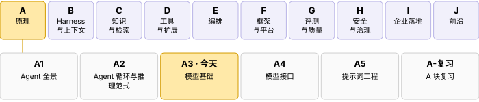

怎么读这张图：上面一行是整张地图的 10 个块，下面一行是今天所在的块展开成的各簇，黄色是今天的位置。

A3 上面接的是 A2：A2 的扩展思考和反思，到今天变成"推理模型的思考档位"这个选型参数。A3 下面通向 A4 模型接口：今天定下用哪个模型、开多深的思考，A4 讲这些选择怎么落到请求字段上，比如 `output_config.effort`（Claude 请求里设置思考档位的字段）、结构化输出和批处理。

---

## 本簇讲解

### 这一簇要解决什么问题

Charles 的研报助手跑了两周，上篇那四件事解决了，又冒出五件新事。

第一，他把 Opus 5.5（Anthropic 2026 年的主力模型）的档位从默认的 medium 调到 xhigh，想让摘要更准。结果平均每次回答慢了十几秒，账单里输出 token 翻了一倍多，可是他在回复里根本看不到多出来的文字。原因是多出来的是思考 token，它不显示全文，但照样按输出收钱。

第二，Agent 每一圈都要问自己一个小问题："这段网页结果和研报有没有关系，要不要留在上下文里？"他让 Opus 5.5 来回答这个是或否的问题，一天几万次，钱花得比写摘要还多。原因是他用一个会写长文的模型去做选择题。

第三，财务问他：所有任务都用 Opus 5.5，有没有必要？他答不上来，因为他从来没有一套能比较不同模型的评测集。

第四，研究部希望助手"学会"公司的研报模板，还要"知道"上周刚发布的行业数据。有人建议直接微调一个专属模型。他去 OpenAI 的平台上一看，发现自助微调已经不对新用户开放了。原因是微调正在从默认选项变成少数场景的选项，而"学模板"和"知道新数据"本来就该走两条不同的路。

第五，合规部门想要一个能在内网离线跑的小模型。有人说：拿 Claude 的回答当教材，训练一个开源小模型就行。这就碰到了蒸馏，以及它的边界：拿自家授权的输出做是降本，违反服务条款抓别家输出就是蒸馏攻击。

这五件事对应今天的五个概念。上篇解决的是"模型怎么算账"，这篇解决的是"该用哪个模型、什么时候该改模型"。

---

### 概念一：推理模型与普通模型

**1. 定义**

推理模型（reasoning model）是在给出最终回答之前，先生成一段内部推理 token 的大模型；这段推理在 Claude 叫 thinking（思考），在 OpenAI 叫 reasoning tokens（推理 token），在 Gemini 叫 thoughts（思考）。普通模型指不做这一步、直接逐字生成回答的模型。三家官方文档的共同点是：推理 token 占上下文窗口，按输出 token 计费，而且计费按完整推理过程算，不按你看到的那部分算（截至 2026-10-16）。[1][2][3]

到 2026 年，这个二分法的边界已经移动了。截至 2026-10-16 的官方事实：

- **Claude**：当前四个主力模型 Fable 5.1、Opus 5.5、Sonnet 5.5、Haiku 5.5 全部使用 adaptive thinking（自适应思考：模型对每个请求自己判断要不要想、想多少）。控制它的主要手段是 effort（档位参数，分 low、medium、high、xhigh、max 五档），Fable 5.1 和 Sonnet 5.5 默认 high，Opus 5.5 和 Haiku 5.5 默认 medium。Opus 5.5 的思考"始终开启、不能关闭"，传 `thinking: {"type": "disabled"}` 会返回 400 错误（HTTP 状态码 400：请求不被接受）；Haiku 5.5 只在 high 及以下档位允许关掉思考。旧的 `budget_tokens`（手动指定思考 token 上限的参数）在 4.6 代已弃用，更新的模型不再接受。[1][4][5]
- **OpenAI**：推理指南建议多数推理任务从 GPT-6 Astra（OpenAI 当前旗舰模型）起步，更便宜的选 gpt-5.6-terra，最低成本和延迟选 gpt-5.6-luna（截至 2026-10-30 推理指南仍是这三个名字；但模型页的旗舰列表已换成 GPT-6 Astra、GPT-6.1 Sol、GPT-6.1 Terra、GPT-6 Luna 四档，其中 GPT-6.1 Terra 于 2026-10-26 发布、接替 GPT-5.6 Terra，指南尚未同步）；`reasoning.effort` 的取值"依模型而定"，可能包括 none、minimal、low、medium、high、xhigh、max，其中 GPT-6 Astra 不支持 none。推理 token 在接口里不可见，计入 `usage.output_tokens_details.reasoning_tokens`；文档建议刚开始时给推理和输出预留至少 2.5 万 token。[2]
- **Gemini**：用 `thinking_level` 控制，旗舰 Gemini 4 Argon（Google 当前旗舰推理模型）默认 medium，可选 low、medium、high，文档里没有给它"关闭"的选项；只有 gemini-2.5-flash-lite 默认关闭思考。[3]

所以 2026 年的准确说法是：三家的主力模型几乎都是推理模型，"推理模型和普通模型"的区别，已经从"选哪条产品线"变成"同一个模型把思考档位开到多深"。这是根据三家文档归纳的判断，不是某家文档的原话。

**2. 场景**

Charles 的研报助手每天处理 200 篇研报，每篇一次总结请求。下面的 token 数是示意，单价是官方数字（截至 2026-10-16）。[6]

- 在默认档位 medium，Opus 5.5 平均每次思考约 2000 token，回答 1500 token，共 3500 个输出 token，按每百万 20 美元算，输出成本 0.07 美元。
- 调到 xhigh 后，思考涨到约 8000 token，输出成本变成 0.19 美元，每天 200 篇多花 24 美元。首字延迟（从发出请求到看到第一个字的时间）因为要先想完，从约 4 秒拉长到 15 秒以上。
- 他抽检 50 篇，发现 xhigh 只把"数字抄错"从 3 篇降到 2 篇。于是结论是：日常研报保持 medium，只有"跨三家公司做财务比较"这类多步推理的任务开到 high。

**3. 它解决什么问题**

因果链是这样的。普通模型一个 token 一个 token往外写，写下一个字时只能依赖已经写出的字；如果一道题需要先算出中间结果再下结论，模型又直接从结论写起，它就没有地方"打草稿"。A2 讲过的思维链（让模型先写出推理步骤再给答案的提示方法）就是靠提示词让模型先写草稿。推理模型把这件事做进了训练：模型被专门训练成先在单独的思考区块里打草稿，再写正式回答，草稿越长，能处理的多步问题越复杂。

代价也跟着来：草稿是实打实生成出来的 token，要算力、要时间、要钱，也占窗口。所以推理模型解决的是"难题答不对"，带来的是"简单题也变慢变贵"，档位参数就是用来在这两者之间取舍的。

**4. 位置图**

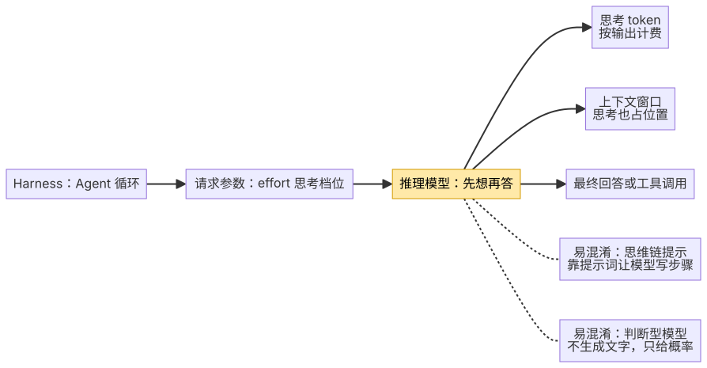

怎么读这张图：左边是上层，Harness（套在模型外面、负责循环、工具、权限和上下文的那层程序）在每次请求里带上档位参数。右边是下层：思考 token 要计费、要占窗口，最后才产出回答或工具调用。两条虚线：思维链是一种提示写法，任何模型都能用；推理模型是训练出来的能力，不靠提示词也会先想。判断型模型是下一个概念，它走的是相反方向，不生成任何文字。

**5. 运行流程图**

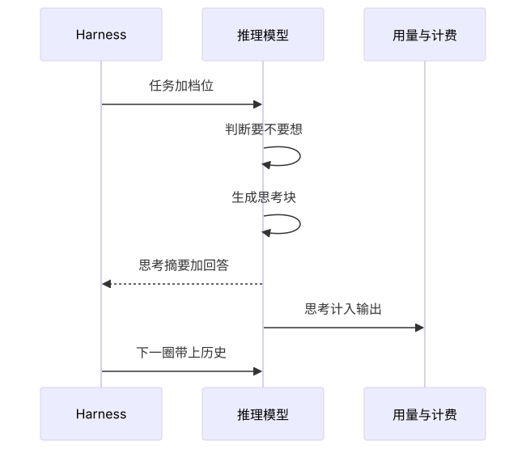

怎么读这张图：第二步是 adaptive thinking 的关键，模型自己决定这一圈要不要想；Claude 文档写明"没有任何档位保证每次都有思考块"，只处理工具结果的后续请求，即使在 xhigh 和 max 也可能跳过思考，所以程序不能假设每轮回答都以思考块开头。[4] 第四步返回的是思考的摘要或者干脆省略，但第五步按完整思考计费。第六步：之前轮次的思考块如果留在上下文里，下一圈会按输入再计一次费。[4]

**6. 实例（本机加官方接口）**

本机实物：写这张卡片的这次运行，会话记录里 50 条助手消息的 `model` 字段全部是 `claude-opus-5-5`。按官方文档，这个模型思考始终开启、默认档位 medium，所以这次运行里每一圈都可能有思考 token 在计费，只是在界面上看不到全文。

官方接口的最小例子（Claude，按当天文档写法；不在本机运行）：[5]

```python
import anthropic

client = anthropic.Anthropic()
resp = client.messages.create(
    model="claude-opus-5-5",
    max_tokens=16000,                      # 思考加回答的硬上限
    output_config={"effort": "high"},      # 档位放在 output_config，不放在 thinking 里
    messages=[{"role": "user", "content": "比较三家公司的毛利率趋势并给出结论"}],
)
print(resp.usage.output_tokens)            # 计费用的输出总数，含思考
```

文档还给了两个容易踩的细节：改顶层档位会让提示词缓存（把重复的提示词前缀存在服务端、再用时按低价计费的机制）失效；如果返回 `stop_reason: "max_tokens"`，说明思考加回答撞到了上限，要么调高 `max_tokens`，要么降档位。[4]

**7. 常见误解与边界**

- **"推理模型一定更好"**：不对。简单任务上它只是更慢更贵。Claude 选型指南的原话方向是"调档位往往比换模型更有效"，也就是先在同一个模型上把档位调对。[7]
- **"看不到思考就不收钱"**：不对。Claude 文档写明，思考显示为摘要还是省略，计费都一样，按完整思考过程收费。[4] OpenAI、Gemini 同理。[2][3]
- **"把档位调低，思考就一定少"**：大体对，但不是硬上限。Claude 文档说档位是"行为信号，不是严格的 token 预算"，要硬控成本还得靠 `max_tokens`。[5]
- **"在提示词里说'别想了'就能省钱"**：不可靠。Claude 文档提到，对 Sonnet 5.5 和 Haiku 5.5 用提示词劝它少想，效果不稳定，应该直接降档位。[4]
- **边界**：思考内容不能当审计证据，上一讲已经讲过；今天要补一句，Anthropic 在 2026-10-12 的文章里说明，把思考做成摘要也是防蒸馏的手段之一，见概念五。[8]

**8. 其他家叫什么**

Claude 叫 adaptive thinking 加 effort；OpenAI 叫 reasoning models 加 `reasoning.effort`，还有一个 `reasoning.mode` 可以选 standard 或 pro，pro 做更多计算、按同样单价计费；Gemini 叫 thinking 加 `thinking_level`。[2][3][4]

Claude 这边的短板：Opus 5.5 不能关闭思考，对"要极低延迟、题目又简单"的场景，只能降到 low 或者换 Haiku 5.5；而 OpenAI 部分模型支持 none 或 minimal，可以把思考压得更低。[2][5]

---

### 概念二：判断型模型

**1. 定义**

判断型模型（judgment model）是一类不生成自由文本、只对调用方给定的有限选项输出概率或分数的模型。调用方给出一段状态和几个"有类型的问题"，比如从几个选项里选一个、在一个量表上打分、判断一句话是否成立，模型一次计算返回每个选项的概率和置信度，代码按阈值决定下一步。地图里把它单列出来，代表样本是 TypeSafe AI（一家 2024 年成立的 AI 公司）的 Jev，详见《爆款拆解：Jev 判断型模型》。

更广义地看，分类器（把输入归入固定类别的模型）、奖励模型（给另一个模型的输出打分、用于强化学习训练的模型）、护栏分类器（专门检测有害输入输出并可拦截的模型）都属于"判断而不生成"的家族。Jev 的新意在于用自然语言定义问题，不需要为每个新问题重新训练。

截至 2026-10-16 的新事实：据 SiliconANGLE 等媒体报道，TypeSafe 在 2026-10-09 宣布 8.7 亿美元 A 轮融资，估值 75 亿美元，由 a16z（Andreessen Horowitz，美国头部风险投资机构）领投；公司自称 Jev 单次请求低于 700 毫秒、比部分前沿大模型的成本效率高出最多 100 倍，这些都是公司自报数字，没有独立测评。[9] 第三方指南转述的价格是每百万输入 token 0.042 美元、输出免费；2026-10-30 TypeSafe 官网首页写的是每十亿输入 token 42 美元，折算一致，访问方式仍写"早期访问"。[10][25] 搜索摘要显示 Jev 曾在 OpenRouter（一个聚合多家模型、统一计费的模型调用平台）上架；2026-10-30 查 OpenRouter 公开的模型列表接口，只见 `typesafe/jev-router` 一项（按路由计价），没有 `jev-latest`。[25]

**2. 场景**

研报助手每一圈拿到一段网页结果后，要回答三个小问题：这段内容和当前研报相关吗；它是一手来源还是转载；要不要留在上下文里。

- 用 Opus 5.5 回答：每次输入约 3000 token、输出约 300 token（含思考），成本约 0.012 + 0.006 = 0.018 美元，延迟约 3 秒。一天 4 万次，就是 720 美元，比写摘要本身还贵。
- 换成判断型模型：三个问题一次请求、并行打分。按第三方转述的价格，3000 个输入 token 约 0.0001 美元，一天约 5 美元；延迟按厂商自报在 1 秒以内。
- 阈值这样设：相关概率高于 0.85 直接保留，低于 0.2 直接丢弃，中间那一段交给 Opus 5.5 再判断。上线后看两个数：中间段占比，以及人工抽检"误丢"的比例。

这里的金额是按示意数字和未经核实的价格算的，只用来说明量级。

**3. 它解决什么问题**

因果链是三步。第一，Agent 里大多数调用不是"写东西"，而是"做选择"：走哪条分支、这个工具调用危不危险、这段上下文还要不要。第二，用生成式大模型做选择题，要为它的长输出、思考和逐字生成付钱，而且它返回的是一段文字，代码还得再解析；"有多确定"这件事，它说不清楚。第三，判断型模型直接返回每个选项的概率，代码可以按阈值自动分流，高置信自动执行、低置信升级给人或大模型。这就是 E1 簇要讲的"生成与判断分离"。

**4. 位置图**

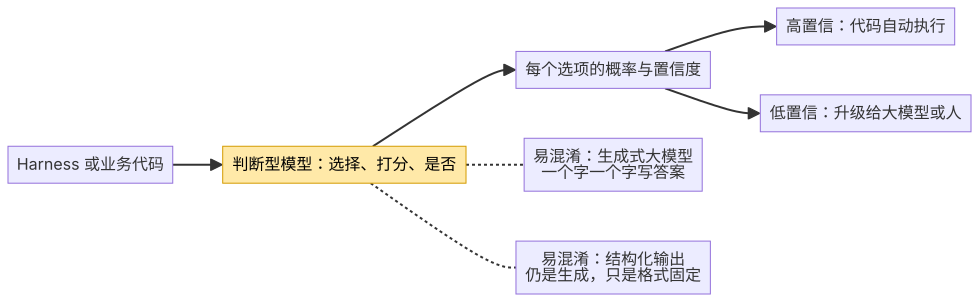

怎么读这张图：调用它的是 Harness 或业务代码，不是用户。它的下层是一组概率，概率再按阈值分成两条路。两条虚线是最常见的混淆：结构化输出（让模型按指定 JSON 格式返回的功能，A4 簇讲）看起来也是"选一个"，但模型仍然在逐字生成，只是被约束成 JSON；判断型模型根本不生成，直接给出每个选项的概率。

**5. 运行流程图**

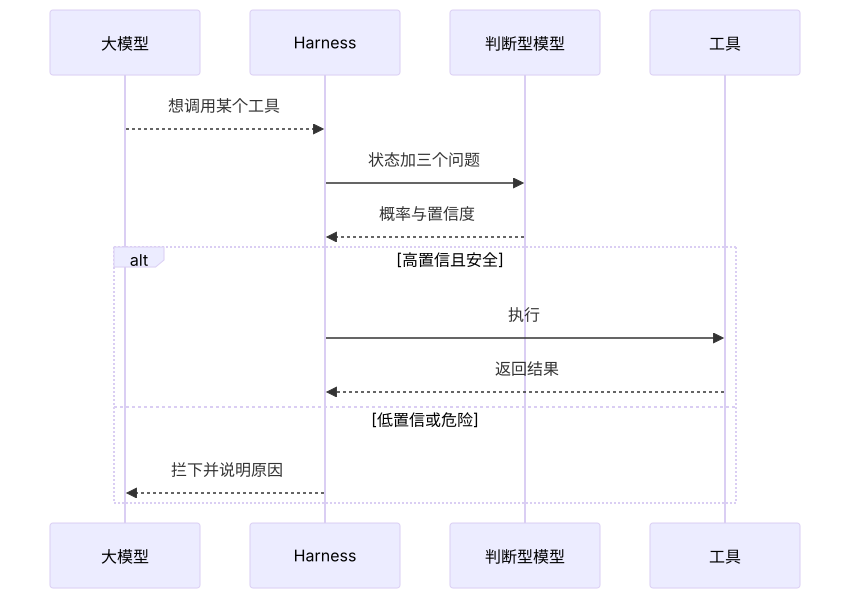

怎么读这张图：这是护栏场景。大模型负责"想做什么"，判断型模型负责"这件事能不能做"。被拦下的动作不结束循环，拦截原因作为结果交回大模型，这和 [002 Agent 循环与推理范式（上）](002-agent-loop-and-reasoning-1.md) 讲的"拦下以后循环继续"是同一回事。

**6. 实例**

Jev 的最小代码已在 J02 卡里给出，这里不重复。一个更贴近日常的实例在 Anthropic 自己身上：Anthropic 在 2026-10-12 的文章里说，它用一个两阶段分类器拦截"提取模型推理过程"的请求，误报率低于 0.1%，部署在 Sonnet 5.5、Opus 5 与 5.5、Fable 5 与 5.1 上。[8] 这个分类器就是一个判断型模型：它不回答问题，只判断"这个请求是不是在套取推理"，然后由系统决定放行还是拦截。

**7. 常见误解与边界**

- **"它保证答案正确"**：不对。它只保证答案落在你给的选项里，对不对要靠评测集去量各个置信度档位的实际准确率。
- **"置信度 0.9 就是 90% 会对"**：不一定。概率要经过校准（让模型说的概率和实际命中率一致的过程）才能这样解读；没有校准的数字只能排序，不能直接当命中率。
- **"所有判断都该交给它"**：不对。需要多步推理、需要查资料才能判断的问题，它一次计算给不出可靠答案，仍然要交给大模型。
- **边界**：版本要锁定。阈值是按某个版本的概率分布调出来的，模型一换，阈值可能失效，J02 卡讲过这一点。

**8. 其他家叫什么**

TypeSafe 叫 System One 模型；更传统的叫法是分类器、裁判模型（用一个模型给另一个模型的输出打分）、护栏模型。三家大模型厂商的公开 API 里，截至 2026-10-16 没有查到一个对外售卖的、通用的判断型模型产品，这一点只是本次检索没找到，未做穷尽核实。

---

### 概念三：模型分级与选型

**1. 定义**

模型分级（model tiering）是厂商把同一代模型按能力、速度和价格分成几档的做法；选型（model selection）是针对具体任务，在这些档位和档位参数之间找到"质量达标且单位成本最低"的组合的过程。选型的输入是业务的质量、延迟和预算要求，以及一套能代表真实任务的评测集（一组带标准答案或打分标准的真实样本）；输出是"哪类任务用哪个模型、开哪个档位"。

截至 2026-10-16，Claude 当前四档的官方数字：[6][7]

| 档位 | 模型 | 输入 / 输出单价（美元每百万 token） | 默认 effort | 官方建议的用途 |
|---|---|---|---|---|
| 旗舰 | Fable 5.1 | 10 / 50 | high | 跑几个小时的 Agent 会话、多步深度研究、做成完整文档 |
| 主力 | Opus 5.5 | 4 / 20 | medium | 复杂的 Agent 编码和企业工作，"多数工作负载从它开始" |
| 均衡 | Sonnet 5.5 | 2 / 10 | high | 日常编码、数据分析、内容生成 |
| 轻量 | Haiku 5.5 | 起价 0.10 / 0.50 | medium | 实时、高并发、成本敏感、子代理任务 |

四档的窗口都是 100 万 token、单次最多输出 12.8 万 token。另有 Mythos 5.1，能力与 Fable 5.1 相同，只开放给通过 Anthropic 验证计划的机构。[7] 旗舰和轻量的输入单价差 100 倍。

**2. 场景**

研报助手的任务可以分成三类：快讯摘要（占 70%）、深度报告摘要（25%）、跨公司比较（5%）。下面是示意计算，单价为官方数字。

- 全部用 Opus 5.5：每个任务输入 2 万 token、输出 1000 token，成本 0.08 + 0.02 = 0.10 美元；每天 1 万个任务，1000 美元。
- 快讯摘要改用 Haiku 5.5：每个任务 0.002 + 0.0005 = 0.0025 美元，7000 个任务 17.5 美元；其余 3000 个仍用 Opus 5.5，300 美元。合计约 318 美元。
- 再算升级成本：假设 Haiku 5.5 有 10% 的快讯摘要没通过校验、要用 Opus 5.5 重跑，加 700 × 0.10 = 70 美元。最终约 388 美元，比原来省六成。
- 但前提是那 70% 的快讯摘要在评测集上确实达标；如果 Haiku 5.5 的错误率从 3% 升到 9%，省下的钱可能不够付分析师返工。

还要注意上篇讲过的门槛：Haiku 5.5 的提示词超过 10 万 token 时单价变成 5 倍。[6]

**3. 它解决什么问题**

因果链是这样的。同一代模型之间，能力差距在难题上大、在简单题上小，价格差距却是固定的几十到上百倍。如果所有任务都用最强的模型，简单任务就在为用不上的能力付钱；如果所有任务都用最便宜的模型，难任务的错误会变成返工和风险。选型就是把任务按难度拆开，再用评测数据给每一类找到"刚好够用"的那一档。

Claude 的选型指南给了两条起跑路线：效率优先，从 Haiku 5.5 起步，测不过再升级；能力优先，从 Opus 5.5 起步，测过以后再试着降档位或降模型；如果 Opus 5.5 在 xhigh 或 max 档位仍然不达标，再换 Fable 5.1。指南把"建一个好的评测集"称为整个过程里最重要的一步。[7]

**4. 位置图**

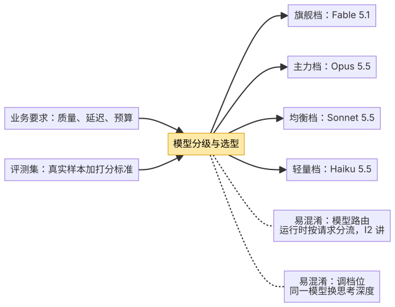

怎么读这张图：上层有两个输入，业务要求和评测集，缺了评测集，选型就只能凭感觉。下层是四个档位。两条虚线：选型是上线前做的决定，模型路由（在运行时按每个请求的特征把它分给不同模型的机制，I2 簇讲）是把这个决定自动化；调档位是在同一个模型内部选思考深度，选型时应该先试它，再考虑换模型。

**5. 运行流程图**

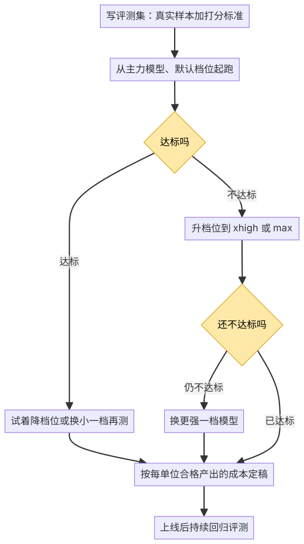

怎么读这张图：这是能力优先路线的完整流程。两个菱形是选型的决策点。注意顺序：不达标时先升档位，档位到顶还不够才换模型；达标时反过来先降档位、再试小模型。最后一步的回归评测（每次换模型、换提示词后，用同一套评测集重新跑一遍，确认没有变差）是 G1 和 I3 簇的主题。

**6. 实例（本机）**

本机的 Claude Code 插件目录里，能直接看到"给不同任务配不同档位模型"的做法。我只读了各插件说明文件开头的 `model` 字段：

```
model: claude-opus-4-7   40 处   金融服务插件里的 pitch-agent 主代理与三个子代理都钉死在这个版本
model: inherit           31 处   跟随会话当前用的模型
model: sonnet            29 处   例如官方 feature-dev 插件里的代码探索、代码审查子代理
model: opus               6 处
model: haiku              6 处   例如 carta-download-tearsheet，一个只负责下载报表的技能
```

读法有三点。第一，"下载一份报表"这种步骤固定的活交给 haiku，探索和审查代码交给 sonnet，做估值模型和写路演材料的金融 Agent 用 Opus，这就是按任务难度分级。第二，`inherit` 占了很大比例，说明很多插件作者把选型权交还给用户。第三，pitch-agent 写死了 `claude-opus-4-7` 这个具体版本，好处是行为稳定、可复现，代价是新模型出来不会自动升级，这正是选型里"锁版本还是跟最新"的取舍。`model` 字段在 Claude Code 里的确切生效规则，今天没有去核对文档，未核实。

**7. 常见误解与边界**

- **"选最强的最保险"**：不对。成本是几十倍的差距，而在简单任务上质量几乎没有差别；而且最强的模型通常最慢，Claude 官方表里 Fable 5.1 的延迟标为"较慢"。[6]
- **"看公开排行榜选就行"**：不够。公开基准（大家都跑的标准测试题）测的不是你的任务。Claude 指南要求用自己的真实提示词和数据测。[7]
- **"单价低就是便宜"**：不一定。上篇讲过，分词器、思考 token、重跑次数都会改变每个合格产出的真实成本。
- **"选一次就完事"**：不对。各家模型几个月一换代，Claude 官方表里每个模型都写了"不早于"某日退役的日期，比如 Opus 5.5 不早于 2027-09-22。[6] 每次换代都要用同一套评测集重跑。
- **边界**：选型不只是质量和价格。上一篇前沿快讯里 PromptArmor（一家 AI 安全公司）自报，同一厂商的小模型对间接提示词注入更易感，Claude Haiku 5.5 也在其中；安全性也应该是选型维度，H1 簇展开。

**8. 其他家叫什么**

OpenAI 的分级，截至 2026-10-30 模型页列四档：GPT-6 Astra 最强（每百万 token 输入 10、输出 50 美元），GPT-6.1 Sol 接近 Astra 但更便宜（2、10 美元），GPT-6.1 Terra 主打快和省（1、5 美元，2026-10-26 发布，接替 GPT-5.6 Terra），GPT-6 Luna 成本和延迟最低（0.10、0.50 美元）；推理指南里仍写 gpt-5.6-terra 和 gpt-5.6-luna，以模型页为准；[2][25] Google 是 Gemini 4 Argon 为旗舰推理模型，下面是 Flash 和 Flash-Lite 两条线，例如 Gemini 3.8 Flash、Gemini 3.5 Flash-Lite（截至 2026-10-16）。[11] 名字不同，结构一样：一个旗舰、一个主力、一到两个便宜快速档。

Claude 这边的短板：最贵的 Fable 5.1 每百万输出 50 美元，旗舰档价格高于多数同行的主力档；轻量档 Haiku 5.5 有"提示词超过 10 万 token 单价变成 5 倍"的门槛，长文档场景下优势会缩小。[6]

---

### 概念四：微调、提示、检索三条路

**1. 定义**

当模型在某个任务上不够好时，有三条改进路线：

- **提示**（prompting）：改写给模型的说明，包括系统提示词（每次请求都放在最前面、规定模型身份和规则的那段文字）、示例和格式约束，不改模型本身。A5 簇专讲。
- **检索**（retrieval，常说的 **RAG**，Retrieval-Augmented Generation，检索增强生成：先从资料库里找到相关段落，再放进窗口让模型据此回答）：改的是放进窗口的资料，也不改模型。C 块专讲。
- **微调**（fine-tuning）：用一批任务样本继续训练模型，改的是模型的参数，产出一个新的定制模型。

三条路改的位置不同：提示改"怎么做"的说明，检索改"知道什么"的资料，微调改"习惯怎么做"的参数。取舍的一般顺序是先提示、再检索、最后才考虑微调。OpenAI 官方的模型优化指南给出的顺序也是：先写评测集建立基线，再写提示词，只有"某些场景"才进入微调，然后循环评测（截至 2026-10-16）。[12]

**2. 场景**

研究部对研报助手提了两个要求。

- 要求一："学会公司研报模板"：固定的七个小节、固定的风险提示写法、数字统一保留一位小数。这是"怎么做"的问题。做法是先把模板和两篇范文放进系统提示词，再用结构化输出固定小节结构。评测集上格式合格率从 72% 升到 97%，不需要微调。
- 要求二："知道上周刚发布的行业数据"。这是"知道什么"的问题。微调做不好这件事：数据每周都变，每周重训一次不现实；而且业界常见的经验是，指令微调主要改变行为，不能可靠地往模型里加新知识，这是社区经验，没有统一的官方结论。[13] 做法是检索：把每周的行业数据存进资料库，提问时检索相关段落放进窗口，回答里附上出处。
- 剩下的 3% 格式不合格的情况，假如是某种很难用文字描述的写作风格，又有几千篇历史研报做样本，才值得考虑微调。

**3. 它解决什么问题**

因果链是这样的。模型答不好，原因只有三类：没听懂要求、缺少知识、习惯不对。这三类原因的修法成本差异很大。改提示词几分钟生效、几乎零成本、随时可回退；加检索要搭资料库和检索管线，但资料更新不用重训；微调要准备几百上千条高质量样本、花训练费、每次基座模型升级都要重做，还可能出现灾难性遗忘（在窄数据上训练后，模型原有的通用能力变差）。

所以按成本从低到高试，先排除便宜的原因，才轮到贵的修法。2026 年还多了一个外部因素：基座模型越来越强，很多过去要靠微调解决的格式和风格问题，现在提示词就能解决。OpenAI 在 2026-05-07 宣布逐步关闭自助微调平台：当天起从未用过微调的组织不能再建训练任务；2026-07-02 起，过去 60 天没有调用过微调模型的组织也不能再建；2027-01-06 起，所有现有客户都不能再创建新的训练任务；已有的微调模型可以一直用到它的基座模型退役（截至 2026-10-16）。[14] 据 Tessl（一家 AI 开发工具公司）的博客转述，OpenAI 给开发者的理由是新模型已经强到让大部分微调变得不必要，这是转述，未在 OpenAI 原文核实。[15]

**4. 位置图**

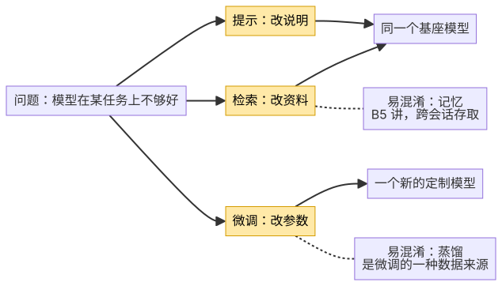

怎么读这张图：上层是同一个问题，中间分出三条路。关键在右边：提示和检索最后用的还是同一个基座模型，所以换模型时它们几乎可以原样搬走；微调产出的是一个新模型，换基座就要重做。两条虚线：蒸馏是微调的一个特例，它的训练数据来自另一个模型的输出，概念五讲；记忆（把信息存在窗口之外、下次再取回的机制）在实现上常常就是检索，但它解决的是"跨会话记住"，B5 簇讲。

**5. 运行流程图**

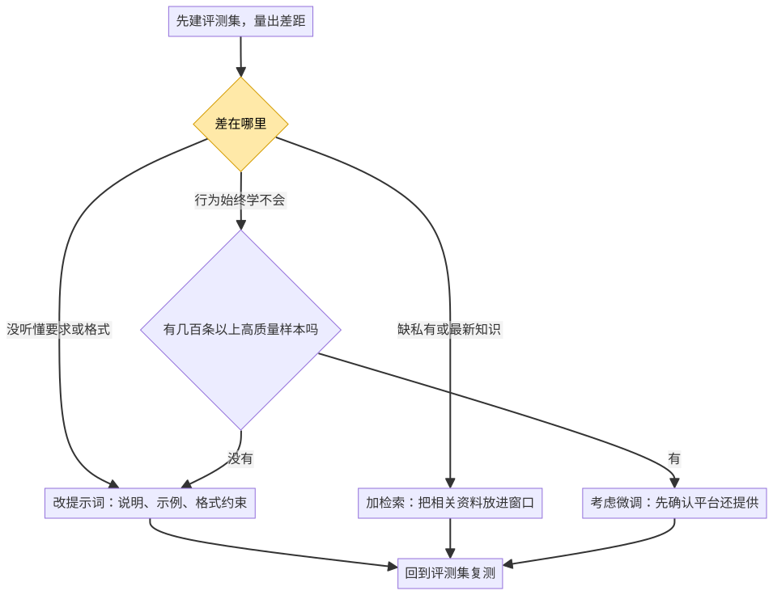

怎么读这张图：第一步永远是评测集，没有它就无法判断"差在哪里"。中间的菱形是诊断：三类原因对应三条路。微调前还有一道门槛，样本不够就退回去改提示词；OpenAI 的监督微调指南写明最少 10 条样本、建议从 50 条起步，但要稳定改变行为，实际通常需要更多，这一句后半是经验，不是文档原话。[16] 每条路做完都回到评测集，形成循环。

**6. 实例（官方文档）**

Claude 这边，截至 2026-10-16，在 Claude 官方文档里没有找到面向 API 用户的自助微调入口，这一点是本次检索没找到，未做穷尽核实。历史上 Anthropic 和 AWS 在 Amazon Bedrock（亚马逊云的模型托管平台）上提供过 Claude 3 Haiku 微调，2024-11-01 正式可用；Anthropic 当时的案例是论坛评论审核，准确率从 81.5% 提到 99.6%，每次请求的 token 减少 85%。[17] 据 AWS 博客，Claude 3 Haiku 已于 2026-09-10 停止服务；Bedrock 上目前还有哪些 Claude 模型可以微调，⚠️ 待修正（2026-10-30 未能核实：AWS 的模型定制页面靠浏览器脚本渲染，抓取只得到空壳；Claude 官方的 Bedrock 页面没有提微调）。[17]

OpenAI 这边，仍在收缩期内的方法有四种：监督微调、视觉微调、**DPO**（Direct Preference Optimization，直接偏好优化：给模型成对的"好回答和差回答"让它学偏好）、**RFT**（Reinforcement Fine-Tuning，强化微调：用自动评分器给模型的回答打分，按分数做强化学习），其中强化微调只支持推理模型 o4-mini；而 o4-mini 和 gpt-4.1-nano 这两个基座已按计划于 2026-10-23 下线，对应的微调模型同日下线，官方给的替代是 gpt-5.6-terra 和 gpt-5.6-luna（2026-10-30 按弃用页核实）。[12][14]

开源模型这边仍是微调的主战场，主流做法是 **LoRA**（Low-Rank Adaptation，低秩适配：冻结原模型，只训练一小块附加参数），库内《训练与微调技术栈》有详细拆解。

**7. 常见误解与边界**

- **"要让模型懂我们公司的知识，就要微调"**：通常不对。知识会变、要能溯源，用检索；微调更适合固化格式、风格和特定行为。
- **"三条路只能选一条"**：不对。常见组合是提示词定规则、检索给资料、必要时微调定风格。
- **"微调后就不用写提示词了"**：不对。微调模型仍然需要提示词，而且换基座时微调要重做，提示词可以搬走。
- **"微调一定比提示词效果好"**：不一定。没有评测集的微调，无法证明比改提示词更好。
- **边界**：长上下文（上篇讲的 100 万窗口）让"把整份资料塞进去"成为第四种选择，它和检索的取舍留到 C4 簇讲。

**8. 其他家叫什么**

各家都叫 prompt engineering、RAG、fine-tuning；国内也常说"提示工程、知识库、精调"。截至 2026-10-16，OpenAI 的自助微调在收缩，Claude 的 API 上没有找到自助微调，Google 和各家云平台的微调现状留到 F7 云托管平台簇核实。

Claude 这边的短板：如果一个任务真的需要微调，在 Claude 自家 API 上目前找不到自助入口，只能走提示和检索，或者换到开源模型上微调。

---

### 概念五：蒸馏

**1. 定义**

蒸馏（distillation，也叫知识蒸馏）是用一个更强的模型（教师模型）的输出，去训练一个更弱、更小的模型（学生模型）的方法。Anthropic 在 2026-02-23 的文章里给的定义是"用一个更强模型的输出训练一个能力较弱的模型"，并明确说这是一种"广泛使用、正当的训练方法"，典型用途是前沿实验室把自家大模型蒸馏成更小、更便宜的版本卖给客户。[18]

经典出处是 Hinton 等人 2015 年的论文《Distilling the Knowledge in a Neural Network》，原始做法是让学生学习教师输出的整个概率分布（软标签），而不是只学最终答案；这篇论文本次没有重新打开原文核实。[19] 在大模型时代，最常见的做法更简单：让教师模型生成大量回答，甚至连推理过程一起，筛选后当成训练数据，对学生做监督微调。

**2. 场景**

合规部门要一个能在内网离线运行的小模型，任务是把监管问询函分成 12 类。

- 第一步，用 Opus 5.5 处理 5000 份历史问询函，输出分类和一句理由，再由合规人员抽检，丢掉错的，留下 4600 条。
- 第二步，用这 4600 条对一个 80 亿参数的开源模型做监督微调。
- 第三步，在 500 份没参与训练的问询函上对比：Opus 5.5 准确率 94%，蒸馏后的小模型 91%，蒸馏前的小模型 76%。小模型在内网一台服务器上就能跑，单份成本接近零。
- 但第一步之前必须先查一件事：模型提供方的服务条款是否允许用它的输出训练其他模型。这一项没查清，后面全部不能做。

这里的准确率是示意数字。

**3. 它解决什么问题**

因果链是这样的。大模型能力强，但贵、慢、通常只能在云上调用；小模型便宜、快、能本地部署，但从零训练很难学到大模型的本事。蒸馏的思路是：大模型已经"会"了，让它把会的东西写成大量示范，小模型照着学，比小模型自己摸索高效得多。

DeepSeek-R1（DeepSeek 2025 年初发布的开源推理模型）的技术报告给了一个有力的证据：在同一个 Qwen2.5-32B（阿里通义千问的 320 亿参数开源模型）基座上，直接用 R1 的输出做蒸馏，效果好于在这个基座上自己做强化学习；他们放出了 15 亿到 700 亿参数的六个蒸馏版本，其中 32B 蒸馏版在 AIME 2024（美国数学邀请赛 2024 年的题目，常用来测数学推理）上得分 72.6%。[20] Anthropic 2026-10-12 的文章从反面印证了"推理过程是最值钱的教材"：他们用 Opus 4.8 的对话记录训练一个预训练版 Claude，用完整推理记录训练出来的模型在 SWE-bench Verified（一个用真实开源项目的修 bug 任务测编码能力的基准）上得 80.4%，用摘要后的推理记录只有 71.8%。[8]

**4. 位置图**

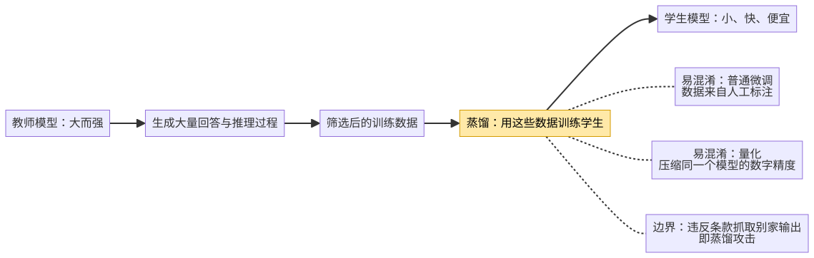

怎么读这张图：从左到右是一条数据流水线，教师模型产出示范，筛选后成为训练数据，再训练学生。三条虚线：普通微调的数据通常来自人工标注，蒸馏的数据来自另一个模型；量化（把模型参数从高精度数字压成低精度，让同一个模型更小更快）不训练新模型，只压缩原模型；最下面是边界，同样的技术用在未经授权的别家模型上，就是蒸馏攻击。

**5. 运行流程图**

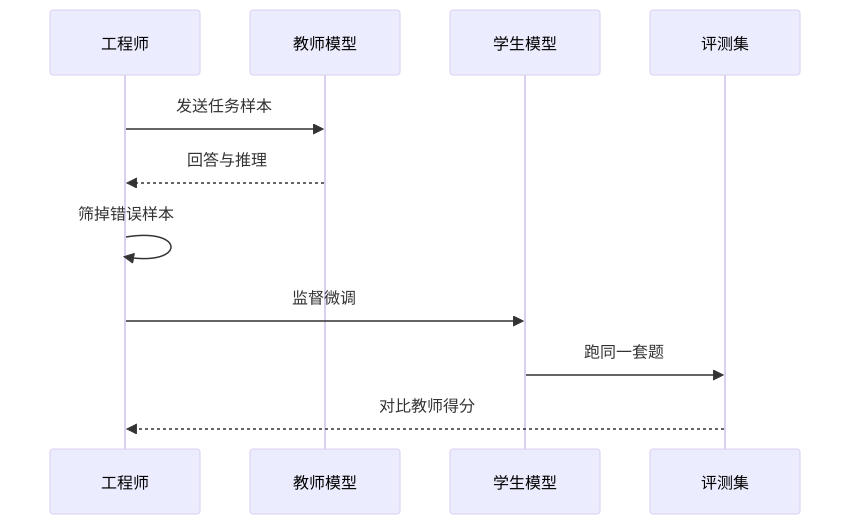

怎么读这张图：第三步"筛掉错误样本"决定上限，教师的错误会被学生原样学走。最后一步要用学生没见过的题和教师对比，差距在可接受范围内才算成功。

**6. 实例（官方文档）**

OpenAI 过去把蒸馏做成过产品功能，现在它的蒸馏文档地址打开的是监督微调指南，蒸馏只剩一段手工流程：先给大模型调好提示词，收集它的输出（文档提到 Responses API，也就是 OpenAI 当前主推的调用接口，默认保存回答 30 天），整理成监督微调数据，再微调一个小模型，例如 gpt-4.1-mini；这条流程同样处在上一节说的收缩期里（截至 2026-10-16）。[16]

蒸馏攻击的官方案例来自 Anthropic。2026-02-23 的文章称，DeepSeek、Moonshot（月之暗面，Kimi 模型的开发公司）、MiniMax（国内大模型公司）三家实验室通过约 2.4 万个欺诈账户，与 Claude 进行了超过 1600 万次交互，目标集中在 Agent 推理、工具使用和编码；其中 MiniMax 超过 1300 万次、Moonshot 超过 340 万次、DeepSeek 超过 15 万次。[18] 这是 Anthropic 单方面的说法，被点名的公司是否回应，本次没有核实。2026-10-12 的后续文章称，新的防御措施让蒸馏者抓到的数据减少约 90% 到 99%，在自家平台上被提取的推理 token 下降到原来的十分之一到百分之一；措施包括：Fable 5.1 和 Opus 5.5 引入"preserved thinking"，2026-08-31 及以后注册的 API 账户不能再编辑 Claude 之前的上下文；Sonnet 5.5 的推理记录只对发起请求的组织可见；一个误报率低于 0.1% 的两阶段分类器拦截提取请求；屡次尝试的账户被限流或封禁。[8]

**7. 常见误解与边界**

- **"蒸馏就是偷模型"**：不对。蒸馏本身是正当技术，各家都用它做自家的小模型；问题在于未经授权、违反服务条款地用别家输出。
- **"学生能超过教师"**：在教师擅长的任务上一般不会；学生的上限大体由教师的示范质量和筛选质量决定。DeepSeek 报告里的结论也只在 32B 基座上做了直接对比，不能推到所有尺寸。[20]
- **"蒸馏和量化是一回事"**：不对。量化压缩的是同一个模型，蒸馏训练的是一个新模型。
- **"有了 API 输出就能随便用来训练"**：要看条款。各家服务条款通常限制用输出训练竞品模型，金融机构用之前要让法务确认；具体条款原文今天没有逐家核实。
- **边界**：蒸馏得到的是一个新模型，它的风险、偏差和合规责任由训练它的一方承担，不能说"这是 Claude 教出来的"就把责任转出去。

**8. 其他家叫什么**

各家都叫 distillation；国内也叫"知识蒸馏""模型蒸馏"。DeepSeek 的开源蒸馏版直接以 `DeepSeek-R1-Distill-` 加基座名命名，比如 `DeepSeek-R1-Distill-Qwen-32B`。[20] 库内《Open Models · 开源模型阵营》第 105 行把"蒸馏管控"列为开源阵营的观察指标，今天的 2026-10-12 文章就是这条指标的最新进展。

---

## 👔 三岗视角

### AI 应用 / Agent 开发

**场景**：团队要把研报助手每月 3 万美元的模型费用降一半，同时任务成功率不能低于现在的 92%。

**这个岗位具体做什么**：第一，先补评测集。从过去一个月的真实任务里按三类各抽 100 条，写清打分标准，跑出当前基线：成功率、每任务成本、P95 延迟（把所有请求按耗时排序，第 95% 位置上的耗时，用来看慢的那一小部分）。第二，按选型流程逐类做实验：快讯摘要先把 Opus 5.5 的档位从 medium 降到 low，再试 Haiku 5.5；跨公司比较保持 Opus 5.5，试 high 档。第三，把每一圈"要不要保留这段网页结果"的判断从 Opus 5.5 拿出来，改用规则加判断型模型，只把中间置信度的交回大模型。第四，在 Harness 里加升级逻辑：小模型的输出没通过 JSON 校验或规则校验，就用大模型重跑，并记录升级率。上线后盯五个数：成功率、每任务成本、升级率、P95 延迟、每任务思考 token 数。

**最容易踩的坑**：只在几条样本上"感觉差不多"就换成小模型。没有每类 100 条以上的评测集，3 到 5 个百分点的成功率下降根本看不出来，等用户投诉时已经晚了。

### AI 产品 / 商业分析

**场景**：业务方说："我们要一个懂公司业务的专属大模型，去微调一个吧。"预算 20 万美元。

**这个岗位具体做什么**：第一，把"懂业务"拆开问：是要知道内部的产品、制度和数据，还是要按公司的格式和口径说话。前者是知识，用检索；后者是行为，先用提示词。第二，做一个两周的对照试点：提示词加检索的方案，对比业务方心目中的"理想答案"，在 200 道题上打分。如果已经达到 90% 的满意度，就没有必要微调。第三，把微调的真实成本讲给业务方：不止训练费，还有样本标注、每次基座升级重做、平台可能停止服务的风险，并举 OpenAI 2026 年收缩自助微调的例子。第四，如果确实有提示和检索解决不了的部分，再评估在开源模型上微调或蒸馏，把预算留给数据标注和评测。

**最容易踩的坑**：把"专属模型"当成项目目标来立项。业务方真正要的是"答得准、答得像我们"，评价标准应该是评测集上的分数和使用率，而不是"有没有自己的模型"。

### 金融科技 / 数据

**场景**：一家券商的合规部想用闭源大模型的输出蒸馏一个本地小模型，处理客户投诉分类，原因是客户数据不能出境、而本地部署的开源模型准确率不够。

**这个岗位具体做什么**：第一，先过条款和数据两道关。条款上，确认模型提供方是否允许用其输出训练模型，留下法务意见的书面记录；数据上，生成训练数据这一步本身就要把投诉文本发给云端模型，这一步要先做脱敏（把姓名、账号等敏感信息替换掉）或者改用已经脱敏的历史数据。第二，按模型风险管理（金融机构对内部模型做的开发、验证、监控和审批的全流程管理）的要求建档：训练数据来源、教师模型的版本、筛选规则、学生模型在留出集上的准确率和各类别的错分率。第三，上线后用判断型思路设阈值：分类置信度低于阈值的投诉转人工，高等级投诉一律人工复核，按月看实际准确率和漂移。第四，关注监管动态：商务部、科技部 2026-10-16 发布第 48 号公告，就在出口技术目录里增列 23 项人工智能技术公开征求意见，涉及大模型和智能体等领域，具体条目今天没读到原文，H2 簇再逐条核实。[21]

**最容易踩的坑**：以为"模型在本地跑"就解决了所有合规问题。蒸馏过程中的数据出境、教师模型的条款限制、学生模型的验证与审批，每一项都要单独留痕。

---

## 🔗 串联图

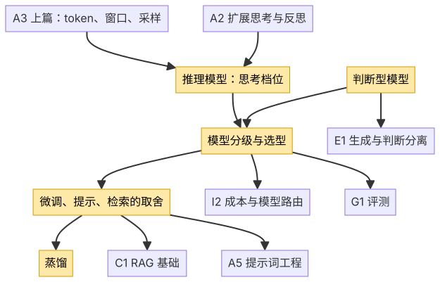

怎么读这张图：黄色是今天的五个概念。最上面两个来源：A2 的扩展思考变成了推理模型的档位参数，上篇的 token 和窗口决定了思考有多贵。推理模型和判断型模型是选型时的两种"零件"，选型之后才谈要不要改模型，改模型的极端形式是蒸馏。下面四个是去向：选型自动化后是 I2 的模型路由，评测集是 G1 的主题，判断型模型落地成 E1 的"生成与判断分离"，提示和检索两条路分别在 A5 和 C1 展开。

相关卡片：[004 模型基础（上）](004-model-fundamentals-1.md) · [003 Agent 循环与推理范式（下）](003-agent-loop-and-reasoning-2.md) · [002 Agent 循环与推理范式（上）](002-agent-loop-and-reasoning-1.md) · 《爆款拆解：Jev 判断型模型》

---

## 🎙 复述板块

### 整簇两分钟版

> A3 上篇讲模型怎么读、怎么写。下篇讲选哪个模型、怎么改模型，一共五个概念。
>
> 第一，推理模型和普通模型。推理模型在回答前先生成一段思考，再给答案。思考是实打实的 token，按输出收费，也占窗口，就算界面上只显示摘要，也按完整思考收费。现在三家的主力模型几乎都是推理模型，所以真正要选的不是哪条产品线，而是思考档位开多深。档位越高，难题越准，简单题越慢越贵。
>
> 第二，判断型模型。它不写文字，只对你给的选项打出概率。Agent 里有大量小判断，比如这一步安不安全、这段内容要不要留。用大模型做这种选择题又贵又慢，交给判断型模型，代码按置信度分流，高的自动执行，低的交给大模型或人。
>
> 第三，模型分级与选型。各家都分旗舰、主力、均衡、轻量几档，Claude 旗舰和轻量的输入单价差一百倍。选型的顺序是，先建评测集，从主力模型和默认档位起跑，不达标先升档位，再换模型，达标了反过来先降档位，再试小模型。最后按每份合格产出的成本定稿。
>
> 第四，微调、提示、检索三条路。提示改说明，检索改资料，微调改参数。顺序是先提示，再检索，最后才微调。要模型知道新东西，用检索，要模型按固定格式说话，先用提示。而且闭源厂商的自助微调在收缩，OpenAI 二零二六年已经开始逐步关闭。
>
> 第五，蒸馏。就是用大模型的输出去训练小模型。自家做是正当的降本办法，DeepSeek 用 R1 的输出蒸馏出一批小模型，效果比小模型自己做强化学习还好。但违反条款去抓别家的输出，就是蒸馏攻击，Anthropic 今年专门写文章披露过，还上线了专门的防御。
>
> 最后收一句。该想多深，看推理档位。该不该生成，看判断型模型。该用哪一档，看评测集。该改输入还是改模型，按三条路的顺序试。想把大模型的本事搬到小模型上，用蒸馏，但先看条款。

### 每个概念三十秒版

**推理模型与普通模型**

> 推理模型在回答前先想一段，再给答案。想的部分是真生成出来的 token，按输出收费，也占窗口，界面只给摘要也照样全额收费。现在三家主力模型基本都是推理模型，区别变成了档位。Claude 叫 effort，从 low 到 max 五档，Opus 五点五默认 medium，而且思考关不掉。选档位的原则是，难题开高，简单题开低，用评测集来定。

记忆钩子：推理模型像带草稿纸进考场的学生，草稿越多难题越准，可草稿纸也按张收钱，而且老师只给你看草稿的摘要。

**判断型模型**

> 判断型模型不写文字，只做选择题。你给它一段状态和几个问题，它直接返回每个选项的概率和置信度。代码按阈值分流，高置信自动执行，低置信交给大模型或人。它适合 Agent 里大量的小判断，比如安全检查、路由、要不要保留上下文。要记住，它只保证答案在选项里，不保证答案是对的。

记忆钩子：大模型是写作文的，判断型模型是阅卷机，只涂答题卡，不写一个字。

**模型分级与选型**

> 各家都把模型分成旗舰、主力、均衡、轻量几档，价格能差上百倍。选型分三步。第一，用真实任务建评测集。第二，从主力模型和默认档位起跑，不达标先升档位，再换大模型，达标就先降档位，再试小模型。第三，按每份合格产出的成本定稿，上线后每次换代都重跑评测。

记忆钩子：选模型像给公司招人，先出考题再面试，能让实习生干的活不派合伙人去干。

**微调、提示、检索三条路**

> 模型不够好，有三条路。提示是改说明，几分钟见效。检索是改资料，适合私有和常变的知识。微调是改参数，适合提示怎么写都改不掉的行为习惯。顺序是先提示，再检索，最后微调，每一步都回评测集复测。还要注意，微调出来的是新模型，换基座要重做，而且闭源厂商的自助微调在收缩。

记忆钩子：员工做不好，先把任务说明写清楚，再给他一本参考手册，实在不行才送去脱产培训。

**蒸馏**

> 蒸馏是用强模型的输出训练弱模型。做法是让大模型批量生成回答和推理，筛掉错的，再拿去微调小模型。好处是小模型又便宜又能本地跑，DeepSeek 的报告显示，蒸馏比让小模型自己做强化学习效果更好。边界是条款，自家模型随便用，违反条款抓别家的输出，就是蒸馏攻击。

记忆钩子：蒸馏像名师把解题过程写成习题册给学生刷题，自己写的习题册随便发，偷印别人的就是盗版。

英文版口述：规范第 7 节的开关为"默认不写"，本篇不写。

---

## 💼 面试题板块

### 题 1 `[开发]` 推理模型和普通模型有什么区别？什么时候该开深度思考？上线后用什么指标验收？

来源：自拟。考点参考 2026 年中文面经把"推理性能优化""模型选型"列为高频方向的总结（掘金《2026 年 AI 工程师面试题变了》，访问于 2026-10-16，仅见搜索摘要）。[22]

**答题骨架**
- 结论：推理模型先生成思考再回答，思考按输出计费、占窗口；现在主力模型基本都是推理模型，关键是档位怎么定。
- 三点展开：原理和代价；怎么定档位；怎么验收。
- 数字：任务成功率、每任务思考 token、首字延迟和 P95 延迟、每任务成本。

**逐字范例**

> 推理模型和普通模型的区别，在于回答前有没有一段专门训练出来的思考。我分三点讲。
>
> 第一，原理和代价。推理模型先在单独的区块里打草稿，再写正式回答，所以多步推理、数学、复杂编码更准。代价是草稿也是生成出来的 token，按输出单价收费，也占上下文窗口。而且就算接口只返回思考摘要，也按完整思考收费。
>
> 第二，怎么定档位。现在三家主力模型基本都是推理模型，Claude 用 effort 分五档，OpenAI 用 reasoning effort，Gemini 用 thinking level。我的做法是按任务类型分开定，比如快讯摘要用 low，跨公司财务比较用 high，不全局一刀切。
>
> 第三，怎么验收。我会在评测集上对比不同档位，看四个数。任务成功率。每任务思考 token 数。首字延迟，也就是用户多久看到第一个字，加上 P95 延迟，也就是最慢那百分之五的请求要等多久。最后是每任务成本。如果档位升一级，成功率只涨一个点，成本却翻倍，那就不升。

**追问链**
1. 你项目里看过思考 token 吗？要点：Claude 在 usage 里的输出数是含思考的计费总数，另有专门的思考 token 字段；OpenAI 在 reasoning_tokens 里。
2. 为什么在提示词里说"别想了"没用？要点：Claude 文档提到对部分模型用提示词劝少想效果不稳定，应直接降档位；档位也不是硬上限，硬上限是 max_tokens。
3. 思考把窗口撑爆了怎么办？要点：给 max_tokens 留足空间，降档位，或在 Harness 里压缩历史；之前轮次的思考如果留在上下文里，也会按输入再计费。

**易错点**：说"推理模型就是更好的模型，所以全部用推理模型最高档"，没有提成本、延迟和按任务分档。

### 题 2 `[开发]` 微调、RAG、提示词工程分别适合什么场景？一个需求来了你怎么选？

来源：常见题，题干综合中文面经与技术文章的说法：多篇 2026 年 CSDN 文章在"面试官可能会问"一类小节列出"RAG 和微调有什么区别""什么时候用 RAG、什么时候用 fine-tuning"（访问于 2026-10-16，仅见搜索摘要，未定位到某公司原题）。[13]

**答题骨架**
- 结论：三条路改的位置不同，提示改说明、检索改资料、微调改参数；先提示、再检索、最后微调。
- 三点展开：各自解决哪类问题；成本和维护差异；怎么用评测集决策。
- 例子：研报模板用提示，周度行业数据用检索。

**逐字范例**

> 我的原则是先诊断差在哪，再按成本从低到高试。分三点。
>
> 第一，三条路解决的问题不同。提示词改的是说明，解决没听懂要求和格式不对。RAG，也就是检索增强生成，改的是放进窗口的资料，解决缺少私有知识和最新知识。微调改的是模型参数，解决提示词怎么写都改不掉的行为习惯。
>
> 第二，成本差很多。改提示词几分钟就能上线，随时回退。RAG 要搭资料库，但资料更新不用重训。微调要准备几百上千条高质量样本，换基座就要重做，还可能让模型的通用能力变差。另外，OpenAI 二零二六年已经在逐步关闭自助微调平台，官方的优化指南也是先评测、再提示、只有部分场景才微调。
>
> 第三，怎么决策。先建评测集量出差距。比如做研报助手，格式不统一，我先在系统提示里放模板和范文，合格率从百分之七十二到九十七。要知道上周的行业数据，就走检索，还能附出处。剩下提示解决不了的风格问题，样本又够多，才评估微调。

**追问链**
1. 微调能不能让模型记住新知识？要点：社区经验认为指令微调主要改行为，不可靠地增加知识，而且知识一变就要重训，知识类需求用检索。
2. 有了一百万窗口还要 RAG 吗？要点：资料少、要通读，可以直接放进窗口；资料库大、要精确找、要控制成本和上下文腐化，还是检索；这在 C4 簇讲。
3. 什么时候必须微调？要点：大量高频调用、需要小模型本地部署、风格或行为用提示稳定不下来，并且有足够高质量样本和评测集时。

**易错点**：一上来就说"业务知识用微调灌进去"，没有提知识更新、溯源和平台现状。

### 题 3 `[开发]` 什么是知识蒸馏？你要把大模型的能力蒸馏到一个小模型上，怎么做、怎么衡量是否成功？

来源：自拟。

**答题骨架**
- 结论：蒸馏是用教师模型的输出训练学生模型；成败看学生在留出集上和教师的差距，以及成本和延迟的下降。
- 三点展开：数据怎么造；怎么训练；怎么评估和守住边界。
- 数字：DeepSeek R1 的 32B 蒸馏版在 AIME 2024 上 72.6%；评估看准确率差距、延迟、单位成本。

**逐字范例**

> 蒸馏是用一个强模型的输出，去训练一个更小的模型，让它学到强模型在某类任务上的本事。我分三步讲。
>
> 第一，造数据。先给教师模型把提示词调好，让它在几千条真实任务上生成回答，最好连推理过程一起要。然后筛选，用规则或人工抽检丢掉错误样本，因为教师的错误会被学生原样学走。
>
> 第二，训练。用筛好的数据对小模型做监督微调，开源模型常用 LoRA，也就是只训练一小块附加参数，成本低。DeepSeek 的报告是个好例子，他们用 R1 的输出蒸馏出几个尺寸的小模型，在三百二十亿参数的基座上，蒸馏效果好于直接做强化学习。
>
> 第三，评估和边界。用学生没见过的留出集，同时跑教师和学生，看准确率差距。我会把门槛定在比如差距三个点以内，再看延迟和单位成本降了多少。边界方面，先确认教师模型的服务条款是否允许用输出训练模型，违反条款抓别家输出就是蒸馏攻击。

**追问链**
1. 推理过程要不要一起蒸馏？要点：通常更有效；Anthropic 的实验里，用完整推理记录训练的模型在 SWE-bench Verified 上 80.4%，用摘要版只有 71.8%。
2. 学生能超过教师吗？要点：在教师擅长的任务上一般不会；上限由示范和筛选质量决定。
3. 蒸馏和量化有什么区别？要点：量化压缩同一个模型的数字精度，蒸馏训练一个新模型，两者可以叠加。

**易错点**：只讲"大模型教小模型"的比喻，不讲数据筛选、留出集评估和条款边界。

### 题 4 `[产品·商分]` 你负责的 Agent 产品全部用最强模型，月成本 3 万美元。老板要求降一半且体验不变，你怎么做？

来源：自拟。

**答题骨架**
- 结论：按任务分级选模型和档位，用评测集证明体验不变。
- 三点展开：拆任务结构；分级方案和测算；验收与回退。
- 数字：示意测算中，七成任务换轻量模型，加上 10% 升级重跑，总成本约降六成。

**逐字范例**

> 我会先把成本按任务拆开，再按任务分级，用数据证明体验没变。分三步。
>
> 第一，拆结构。把一个月的任务按类型分，比如七成是快讯摘要，两成多是深度报告，百分之五是跨公司比较。再看每一类花了多少钱，通常是量大的简单任务花掉大部分。
>
> 第二，分级。简单任务先在同一个模型上降思考档位，再试轻量模型。以 Claude 为例，主力 Opus 和轻量 Haiku 的输入单价差四十倍。我会让工程在每类一百条真实样本上测，达标的才换。没通过校验的自动升级给大模型重跑。粗算下来，七成任务换成轻量模型，再加上一成升级重跑，总成本能降六成左右。
>
> 第三，验收和回退。体验不变要用数字说话，看任务成功率、用户满意度和投诉率，灰度上线，先放百分之十的流量。任何一项掉超过阈值就回退。
>
> 向老板汇报时讲三个数，每份合格产出的成本、成功率和升级率。

**追问链**
1. 业务方不信小模型怎么办？要点：拿同一批真实任务做盲评，让业务方自己打分。
2. 升级率很高怎么办？要点：升级率高说明这类任务不该给小模型，退回大模型或调档位；升级本身也要算进成本。
3. 除了换模型还有什么降本手段？要点：提示词缓存、批处理、压缩上下文，A4 和 I2 簇讲。

**易错点**：只比较单价就决定换模型，没有评测集，也没有升级和回退机制。

### 题 5 `[金融科技·数据]` 券商想用闭源大模型的输出蒸馏一个本地小模型，做客户投诉分类。你会提哪些合规和风险要求？

来源：自拟。

**答题骨架**
- 结论：可以做，但条款、数据出境、模型验证和上线后的监控四道关都要留痕。
- 三点展开：条款与数据；模型风险管理；上线后的分流与监控。
- 例子：置信度低于阈值和高等级投诉一律转人工。

**逐字范例**

> 可以做，但我会提四类要求，每一类都要留痕。
>
> 第一，条款。先让法务确认模型提供方的服务条款是否允许用它的输出训练其他模型，书面意见存档。违反条款去抓输出，就是业内说的蒸馏攻击，Anthropic 二零二六年就公开披露过这类事件。
>
> 第二，数据。生成训练数据这一步要把投诉文本发给云端模型，本身就可能涉及客户信息出境。所以先脱敏，把姓名、账号这些替换掉，或者只用已经脱敏的历史数据。
>
> 第三，模型风险管理。蒸馏出来的是一个新模型，责任在我们自己。要建档，写清教师模型版本、训练数据来源、筛选规则，以及学生模型在留出集上的准确率和每一类的错分率，走内部的模型验证和审批。
>
> 第四，上线后的分流和监控。置信度低于阈值的投诉转人工，高等级投诉一律人工复核。按月看实际准确率和漂移，超过阈值就重新训练或回退。
>
> 一句话，本地部署只解决了一部分问题，蒸馏的每个环节都要能追溯。

**追问链**
1. 教师模型升级了，要不要重新蒸馏？要点：先用评测集比较新旧教师在这个任务上的差距，差距明显才重做，并重新走验证。
2. 错分了一个高等级投诉，责任在谁？要点：在机构和流程设计，所以高等级必须人工复核，阈值调整要审批。
3. 能不能直接用开源模型、不蒸馏？要点：可以先测；开源基座准确率不够时，蒸馏或用内部标注数据微调是两条路，后者没有条款问题但标注成本高。

**易错点**：把"模型在本地运行"当成合规的全部答案，忽略了生成训练数据时的数据出境和服务条款。

---

## 📡 前沿快讯

取上一篇（2026-10-16 上午写入）之后的发布。今天的 AI 效率简报目录里没有新篇目，上一篇已链接的每日简报《先修方向再买速度》（2026-10-16）不重复。

1. **Reflection 发布首个开放权重模型 Beam（2026-10-16 前后）**。vLLM（一个开源的大模型推理服务框架）官方博客称，Beam 是 5010 亿总参数、每个 token 激活 230 亿参数的 **MoE**（Mixture of Experts，专家混合：每个 token 只调用一部分参数的架构），上下文窗口 100 万 token，vLLM 为它提供了专门的推理解析器和思考 token 预算参数；Artificial Analysis（一家独立的模型评测机构）给出的智能指数 30 分，在美国开放权重模型中排第二，仅次于 Meta 的 Muse Spark Open，平均每题约 1.9 万推理 token、7000 回答 token。[23][24] 许可证和价格两页都没写，未核实。落在今天的 **推理模型** 和 **模型分级与选型**：开放权重模型也已经是"先想再答"的推理模型，自建部署时同样要为思考 token 付算力。对已写内容没有修正。
2. **商务部、科技部就出口技术目录增列人工智能技术征求意见（2026-10-16）**。据 IT 之家转载的商务部答记者问，第 48 号公告拟在目录中增列 40 项技术，其中人工智能 23 项，涉及大模型、智能体、算力集群、信息处理；文中点名的有拟禁止的"人工智能驱动的恶意代码生成与变异技术"和拟限制的"人工智能辅助漏洞挖掘技术"；通过 API、应用或网页、SaaS（Software as a Service，软件即服务：通过网络按订阅使用的软件）提供受限模型服务，不视为模型技术出口；征求意见期为 2026-10-16 至 11-15。[21] 23 项的完整清单需要看公告原文，今天没读到。落在 **H2 合规**，和今天的 **蒸馏**、**选型** 相关：跨境部署模型和技术合作要多一道判断。对已写内容没有影响。

待归类池里的 Personal Agent Protocol，截至今天没有查到新进展，最迟 2026-10-20 给出去向。

---

## 🔁 昨日回顾与明日预告

**昨日回顾**（针对 [004 模型基础（上）](004-model-fundamentals-1.md)）

> [!question]- 1. 模型升级后单价没变、账单却涨了约三成，最可能的三个来源是什么？
> 一是分词器换代，Claude 4.7 以后同一段文字约多出 30% 的 token；二是新模型行为变化，比如多调几次工具；三是用法变化，比如用户开始上传带图表的 PDF，图片也折算成 token。用计数接口把同一批样本在新旧模型上各数一遍，就能分清各占多少。

> [!question]- 2. Agent 跑到第 40 圈报 "prompt is too long"，为什么？怎么处理？
> 模型接口无状态，Harness 每一圈都要把完整历史重新发一遍，30 页研报加 40 圈工具结果会把窗口填满。处理办法是给工具结果设上限、超出只返回摘要和定位，并在 Harness 里压缩或裁剪历史；缓存只省钱，不省窗口。

> [!question]- 3. 风控要求重复处理结果一致，为什么不能靠温度设 0？
> 温度 0 在旧模型上也不保证完全一致，最新的 Claude 模型更是不接受改采样参数。一致性要靠流程：模型只抽取字段并按固定格式输出，关键数字由规则程序核对，入库的是核对通过的结构化结果，同时记录模型版本、提示词版本和输入文件的哈希值。

**明日预告**：A4 模型接口。今天定下了用哪个模型、思考档位开多深，明天讲这些决定怎么落到一次次请求上：消息接口与角色、工具调用、结构化输出、流式、批处理、提示词缓存、限流与重试。今天反复出现的 `output_config`、`max_tokens`、缓存失效，都会在明天变成具体字段。

---

## 📖 术语小词典

- **400 错误**（HTTP 400 Bad Request）— 接口认为请求不被接受时返回的状态码。
- **a16z**（Andreessen Horowitz）— 美国头部风险投资机构。
- **adaptive thinking**（自适应思考）— Claude 由模型自己判断每个请求要不要想、想多少的思考方式。
- **AIME 2024** — 美国数学邀请赛 2024 年的题目，常用来测数学推理。
- **Amazon Bedrock** — 亚马逊云的模型托管平台。
- **Artificial Analysis** — 一家独立的模型评测机构。
- **budget_tokens** — 旧版 Claude 手动指定思考 token 上限的参数，新模型已不接受。
- **DeepSeek-R1** — DeepSeek 2025 年初发布的开源推理模型。
- **DPO**（Direct Preference Optimization，直接偏好优化）— 用成对的好坏回答训练模型偏好的微调方法。
- **effort**（档位）— Claude 控制思考深度和整体输出投入的参数，分 low 到 max 五档。
- **Gemini 4 Argon** — Google 当前的旗舰推理模型。
- **GPT-6 Astra** — OpenAI 当前的旗舰模型。
- **Harness** — 套在模型外面、负责循环、工具、权限和上下文的那层程序。
- **LoRA**（Low-Rank Adaptation，低秩适配）— 冻结原模型、只训练一小块附加参数的微调方法。
- **max_tokens** — 一次回复里思考加回答的输出硬上限。
- **MoE**（Mixture of Experts，专家混合）— 每个 token 只调用一部分参数的模型架构。
- **Moonshot** — 月之暗面，Kimi 模型的开发公司。
- **MiniMax** — 国内大模型公司。
- **OpenRouter** — 聚合多家模型、统一计费的模型调用平台。
- **P95 延迟** — 所有请求按耗时排序后第 95% 位置上的耗时。
- **PromptArmor** — 一家 AI 安全公司。
- **Qwen2.5-32B** — 阿里通义千问的 320 亿参数开源模型。
- **RAG**（Retrieval-Augmented Generation，检索增强生成）— 先检索相关资料、再放进窗口让模型据此回答。
- **Responses API** — OpenAI 当前主推的模型调用接口。
- **RFT**（Reinforcement Fine-Tuning，强化微调）— 用自动评分器打分、按分数做强化学习的微调方法。
- **SaaS**（Software as a Service，软件即服务）— 通过网络按订阅使用的软件。
- **SWE-bench Verified** — 用真实开源项目的修 bug 任务测编码能力的基准。
- **TypeSafe AI** — 推出判断型模型 Jev 的公司，2024 年成立。
- **vLLM** — 一个开源的大模型推理服务框架。
- **奖励模型** — 给另一个模型的输出打分、用于强化学习训练的模型。
- **裁判模型** — 用一个模型给另一个模型的输出打分。
- **分类器** — 把输入归入固定类别的模型。
- **公开基准** — 业界共用的标准测试题。
- **护栏分类器** — 专门检测有害输入输出并可以拦截的模型。
- **回归评测** — 每次改动后用同一套评测集重跑，确认没有变差。
- **记忆** — 把信息存在窗口之外、下次再取回来的机制。
- **结构化输出** — 让模型按指定 JSON 格式返回的功能。
- **量化** — 把模型参数从高精度数字压成低精度，让同一个模型更小更快。
- **模型路由** — 运行时按请求特征把请求分给不同模型的机制。
- **模型风险管理** — 金融机构对内部模型做开发、验证、监控和审批的全流程管理。
- **评测集** — 一组带标准答案或打分标准的真实任务样本。
- **思维链** — 让模型先写出推理步骤再给答案的提示方法。
- **首字延迟** — 从发出请求到看到第一个字的时间。
- **提示词缓存** — 把重复的提示词前缀存在服务端、再用时按低价计费的机制。
- **脱敏** — 把姓名、账号等敏感信息替换或去除。
- **校准** — 让模型给出的概率和实际命中率一致的过程。
- **系统提示词** — 每次请求都放在最前面、规定模型身份和规则的文字。
- **灾难性遗忘** — 在窄数据上训练后模型原有通用能力变差的现象。
- **推理模型**（reasoning model）— 回答前先生成内部推理 token 的模型。
- **判断型模型**（judgment model）— 只对给定选项输出概率、不生成自由文本的模型。
- **模型分级与选型** — 厂商把模型分档，以及按任务选出达标且单位成本最低组合的过程。
- **微调**（fine-tuning）— 用任务样本继续训练、改变模型参数。
- **蒸馏**（distillation）— 用强模型的输出训练弱模型。

---

## Sources

1. Claude 平台文档，*Models overview*：https://platform.claude.com/docs/en/models/overview — 访问于 2026-10-16
2. OpenAI 文档，*Reasoning*：https://developers.openai.com/api/docs/guides/reasoning — 访问于 2026-10-16；页面约 7 万字符，前 3.9 万字符逐字读到，其余只读到工具摘要
3. Google Gemini API 文档，*Thinking*（页面更新 2026-10-14）：https://ai.google.dev/gemini-api/docs/thinking — 访问于 2026-10-16
4. Claude 平台文档，*Steering thinking*（由 adaptive-thinking 地址跳转）：https://platform.claude.com/docs/en/build-with-claude/thinking-steering-and-cost — 访问于 2026-10-16
5. Claude 平台文档，*Effort*：https://platform.claude.com/docs/en/build-with-claude/effort — 访问于 2026-10-16
6. Claude 平台文档，*Models overview* 价格与延迟表；Haiku 5.5 长提示词价格沿用第 004 讲核实的 *Pricing* 页：https://platform.claude.com/docs/en/about-claude/pricing — 访问于 2026-10-16
7. Claude 平台文档，*Choosing the right model*：https://platform.claude.com/docs/en/about-claude/models/choosing-a-model — 访问于 2026-10-16
8. Anthropic，*Strengthening our defenses against distillation attacks*（2026-10-12）：https://www.anthropic.com/research/distillation-defenses — 访问于 2026-10-16
9. TypeSafe 融资报道：SiliconANGLE https://siliconangle.com/?p=850033 ；FourWeekMBA https://fourweekmba.com/ai-jev-maker-typesafe-raises-870m-at-a-7-5b-valuation/ — 仅见于搜索摘要，2026-10-16
10. OpenTweet，*Jev API access*（2026-09）：https://opentweet.io/jev/api-access — 仅见于搜索摘要，2026-10-16；OpenRouter 页面 https://openrouter.ai/~typesafe/jev-latest 当天直接访问返回 404
11. Google Gemini API 文档，*Models*（页面更新 2026-10-13）：https://ai.google.dev/gemini-api/docs/models — 访问于 2026-10-16
12. OpenAI 文档，*Model optimization* 与 *Direct preference optimization*：https://developers.openai.com/api/docs/guides/model-optimization ；https://developers.openai.com/api/docs/guides/direct-preference-optimization — 访问于 2026-10-16
13. 中文技术文章与面试题整理（CSDN、阿里云开发者社区等，含"面试官可能会问"小节与"指令微调不能增加知识"的说法）：https://aicoding.csdn.net/6a69c35e10ee7a33f2940767.html ；https://developer.aliyun.com/article/1710940 — 仅见于搜索摘要，2026-10-16；属社区经验
14. OpenAI 文档，*Deprecations*（含 2026-05-07 公布的自助微调时间表与 2026-10-23、2027-01-14 下线安排）：https://developers.openai.com/api/docs/deprecations — 访问于 2026-10-16
15. Tessl 博客，OpenAI 关闭微调的分析（2026-05-20）：https://tessl.io/blog/openai-shutting-fine-tuning-signals-for-enterprise-ai — 仅见于搜索摘要，2026-10-16
16. OpenAI 文档，*Supervised fine-tuning*（由 distillation 地址打开）：https://developers.openai.com/api/docs/guides/distillation — 访问于 2026-10-16
17. Claude，*Fine-tune Claude 3 Haiku in Amazon Bedrock*：https://claude.com/resources/articles/fine-tune-claude-3-haiku ；AWS 机器学习博客：https://aws.amazon.com/jp/blogs/machine-learning/fine-tune-anthropics-claude-3-haiku-in-amazon-bedrock-to-boost-model-accuracy-and-quality/ — 仅见于搜索摘要，2026-10-16；Bedrock 支持模型页需浏览器渲染，未读到
18. Anthropic，*Detecting and preventing distillation attacks*（2026-02-23）：https://www.anthropic.com/news/detecting-and-preventing-distillation-attacks — 访问于 2026-10-16
19. Hinton、Vinyals、Dean，*Distilling the Knowledge in a Neural Network*（arXiv:1503.02531）：https://arxiv.org/abs/1503.02531 — 经典论文，本次未重新打开
20. DeepSeek-AI，*DeepSeek-R1* 技术报告（arXiv:2501.12948）：https://arxiv.org/abs/2501.12948 — 2026-10-16 经搜索结果核实相关段落
21. IT 之家，商务部答记者问与第 48 号公告报道（2026-10-16）：https://www.ithome.com/1/013/983.htm ；https://www.ithome.com/1/013/971.htm — 访问于 2026-10-16；公告原文未读到
22. 掘金，《2026 年 AI 工程师面试题变了：不再只问模型原理，而是开始拷打系统能力》：https://juejin.cn/post/7621105220069621779 — 仅见于搜索摘要，2026-10-16
23. vLLM Blog，*Reflection Beam*（2026-10-16）：https://vllm.ai/blog/2026-10-16-reflection-beam — 访问于 2026-10-16
24. Artificial Analysis，*Reflection Beam*（2026-10-16）：https://artificialanalysis.ai/articles/reflection-beam — 访问于 2026-10-16
25. OpenAI 文档，*Models*（旗舰模型列表）与 *Deprecations*：https://developers.openai.com/api/docs/models ；https://developers.openai.com/api/docs/deprecations — 访问于 2026-10-30；TypeSafe 官网 https://typesafe.ai （页面标注 2026-10-28 发布）与 OpenRouter 模型列表接口 https://openrouter.ai/api/v1/models — 访问于 2026-10-30

---

## 更新日志

- 2026-10-16: 创建。A3 下篇，讲推理模型与普通模型、判断型模型、模型分级与选型、微调提示检索三条路、蒸馏；A3 上下两篇写完
- 2026-10-30: 时效刷新——OpenAI 分级改按 10-30 模型页四档（GPT-6 Astra、GPT-6.1 Sol、GPT-6.1 Terra、GPT-6 Luna）写，并注明推理指南仍用 gpt-5.6 旧名；o4-mini、gpt-4.1-nano 改为已于 10-23 下线；Jev 价格按官网核实、OpenRouter 只见 jev-router；Bedrock 微调现状仍未核实，标 ⚠️ 并写原因；新增来源 25
