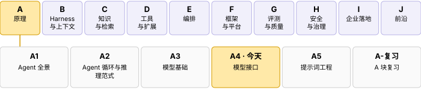
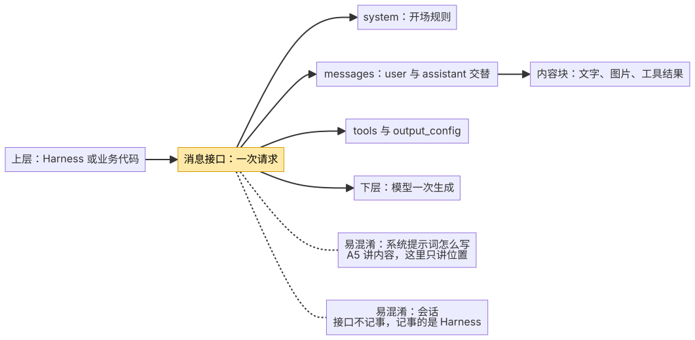
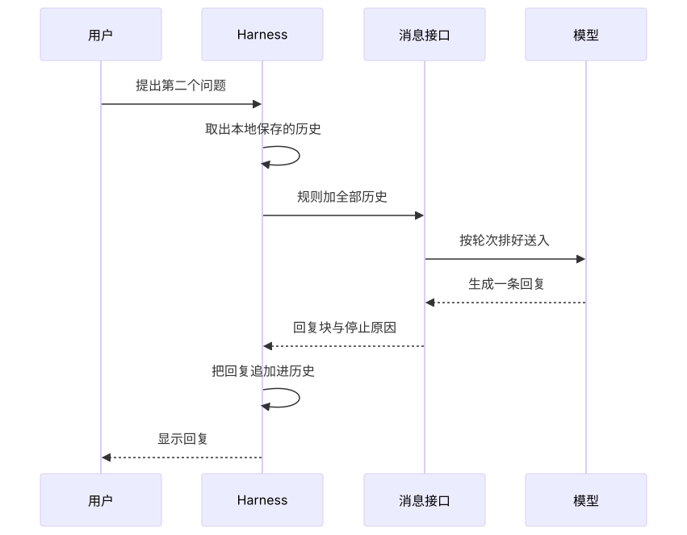
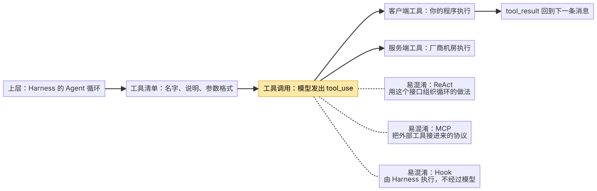
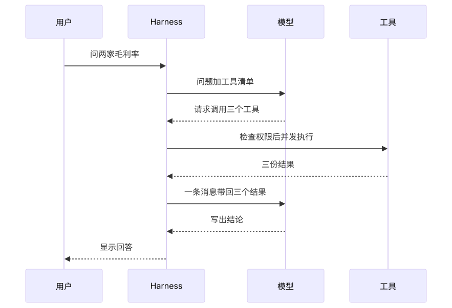
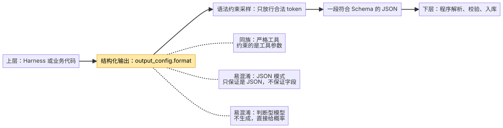
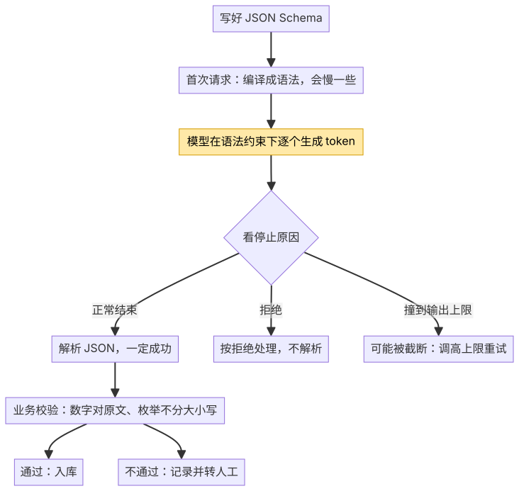
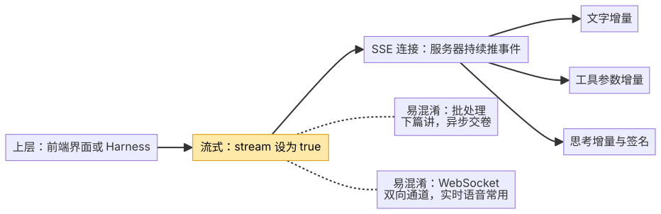
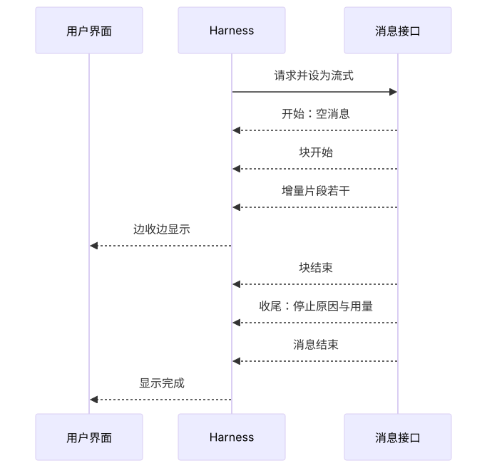
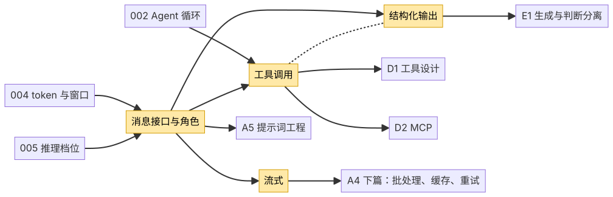

# 006 - Model API Part 1 · 模型接口（上）

> 第 006 讲 · A4 模型接口（上） · A 原理：Agent 是怎么转起来的 · 事实核实截至 2026-10-30
> [← 返回目录](../README.md) · 上一讲：[005 模型基础（下）](005-model-fundamentals-2.md) · 下一讲：[007 模型接口（下）](007-model-api-2.md)

> 本篇多处拿 Claude 的接口和 OpenAI、Google 的接口对比。本文由 Anthropic 的模型撰写，存在利益相关；Claude 这边的短板在各概念的「其他家叫什么」里单独写出。

---

## 🧭 Bulletin 流程

> 程序要跟模型说一句话 → **① 消息接口与角色** → **② 工具调用** → **③ 结构化输出** → **④ 流式** → 程序知道怎么开口、怎么让模型动手、怎么拿到能直接用的结果、怎么让人边等边看

A4 有七个概念，拆成两篇。上篇讲"一次请求长什么样、结果怎么回来"，下篇讲"大量请求怎么省钱、怎么扛住限流"。上篇四个概念按一次请求的先后排。

1. **消息接口与角色**：模型接口不记事，每次请求都要把规则和完整对话重新发一遍；规则放在 system，对话按 user 和 assistant 两个角色一来一回地排。
2. **工具调用**：模型自己不会动手，它只会在回复里写出"我要调用哪个工具、参数是什么"，由你的程序去执行，再把结果作为下一条消息送回去。
3. **结构化输出**：给模型一份 JSON Schema，接口在生成时就只允许符合格式的字，所以拿回来的一定能被程序解析；但格式对不等于内容对。
4. **流式**：不用等整段回答写完，接口一边生成一边把小片段推回来，人能更早看到第一个字；总耗时和费用并不会因此减少。

---

## 📍 定位图



怎么读这张图：上面一行是整张地图的 10 个块，下面一行是今天所在的块展开成的各簇，黄色是今天的位置。

A4 上面接的是 A3：A3 定下了用哪个模型、思考档位开多深，A4 讲这些决定怎么写进一次次请求的字段里。A4 下面通向 A5 提示词工程：今天讲 system 放在请求的哪个位置，A5 讲 system 里面该写什么。

---

## 本簇讲解

### 这一簇要解决什么问题

Charles 的研报助手要从网页聊天框搬到公司的系统里，由程序直接调用模型接口。第一周就碰到四件事。

第一，用户在第二轮问"那它去年呢"，模型完全不知道"它"是谁。原因是接口不记事，他的程序第二次请求只发了这一句，没有把第一轮的问答带上。

第二，他希望助手能自己去行情库查数，于是在提示词里写"需要数据时请调用查询函数"。模型回了一段像模像样的"已为您查询，毛利率为 23.4%"。这个数是编的，因为他的程序根本没有给模型一个真正可用的工具，也没有去执行任何东西。

第三，助手的摘要要写进数据库的五个字段。他在提示词里写"请只返回 JSON"，一千次里有十几次多了一句"好的，以下是结果"，或者少了一个右括号，入库程序直接报错。

第四，深度报告摘要平均要 40 秒才能返回。用户盯着空白页面，以为系统卡死了，不停地刷新，每刷新一次就多花一次钱。

这四件事对应今天的四个概念：怎么把上下文发对，怎么让模型真的能动手，怎么让输出能被程序直接吃下去，怎么让人在等待时看到进展。

---

### 概念一：消息接口与角色

**1. 定义**

消息接口（messages API）是大模型厂商对外提供的、以"一组按顺序排列的消息"为输入、以"一条新的助手消息"为输出的调用方式。每条消息有一个角色（role）和一段内容（content）。Claude 的接口有三类角色：

- **system**：系统提示词（规定模型身份、规则和背景的文字）。主要放在请求顶层的 `system` 字段里，不放进消息列表的开头。
- **user**：用户或程序发给模型的话，工具结果也装在 user 消息里送回。
- **assistant**：模型之前说过的话。

它最关键的性质是**无状态**。Claude 文档的原话是：消息接口是无状态的，你每次都要把完整的对话历史发给接口（截至 2026-10-18）。[1] 所谓"多轮对话"，是调用方的程序每轮把旧消息再发一遍造出来的效果，接口本身不保存任何东西。

截至 2026-10-18 的几条官方细节：[1][2]

- 内容不只是文字。一条消息的 content 可以是一组内容块（content block：消息里的一段有类型的内容），类型包括文字、图片、PDF 文档、检索结果、思考块、工具调用块、工具结果块等。
- 模型是在 user 和 assistant 一来一回的轮次上训练的。连续两条同角色的消息会被合并成一轮；单次请求最多 10 万条消息。
- **会话中途的 system 消息**：在 Fable 5.1、Mythos 5.1、Opus 5.5、Sonnet 5.5、Haiku 5.5 等模型上，可以在某条 user 消息之后插入一条 `role: "system"` 的消息，中途追加一条系统指令。它和顶层 `system` 字段权限相同；因为它追加在历史末尾，不会让前面已缓存的部分失效。它不能是消息列表的第一条。这项功能 2026-07-15 起在 Fable 5、Mythos 5、Opus 4.8 上正式可用。[1][11]
- **预填充不能用了**：过去可以在请求末尾放一条写了一半的 assistant 消息，让模型接着写，这叫 prefill（预填充：替模型写好回复开头）。Claude 4.6 及之后的模型不再支持，这样做会返回 400 错误（HTTP 状态码 400：请求不被接受）；文档建议改用结构化输出或系统提示词。[1]
- 每次回复都带一个 `stop_reason`（停止原因），取值有 `end_turn`（正常说完）、`max_tokens`（撞到输出上限）、`stop_sequence`（碰到预设的停止词）、`tool_use`（要调用工具）、`pause_turn`（服务端工具循环到了上限，需要再发一次让它继续）、`refusal`（拒绝回答）。[2][4] 程序下一步做什么，全看这个字段。

**2. 场景**

研报助手的一次三轮对话，第三轮实际发出去的请求长这样：

- `system`：约 1500 token（token：模型读写文字的最小计数单位），写着"你是券商研究助理，只依据给定资料回答，数字保留一位小数"。
- `messages` 共 5 条：user 问"宁德时代三季度毛利率多少"，assistant 答"23.4%"，user 问"那它去年呢"，assistant 答"去年同期 21.8%"，user 问"差距主要来自哪"。

第三轮的输入 token 不是最后那一句的 20 个，而是 system 加五条消息，合计约 3000 个。每多一轮，前面所有内容都要再算一次输入费。到第 30 轮时，一次请求的输入可能已经是第一轮的十几倍。这就是 [004 模型基础（上）](004-model-fundamentals-1.md) 里"窗口和账单一起涨"的来源，也是下篇提示词缓存要解决的问题。

第一周那个"它是谁"的问题，修法是程序维护一个消息列表，每轮把模型的回复追加进去，再连同新问题一起发。

**3. 它解决什么问题**

因果链是这样的。模型本身只做一件事：读进一串 token，往后续写。要让它"聊天"，必须告诉它哪些话是规则、哪些是人说的、哪些是它自己之前说的，否则它分不清"你是券商研究助理"是一条规则还是用户随口一句话。

角色就是这个标记。模型在训练时见过大量按角色排好的对话，学会了"system 里的话优先级更高""assistant 后面该轮到我接着说"。所以角色不只是格式，它直接影响模型听谁的话。

无状态的设计是为了让厂商的服务器好扩展：任何一台机器都能处理任何一个请求，不用记住你是谁。代价转给了调用方：历史要自己存、自己发、自己管长度。B3 上下文工程和 B4 压缩两簇讲的，就是"历史越来越长"之后怎么办。

**4. 位置图**



怎么读这张图：左边是上层，Harness（套在模型外面、负责循环、工具、权限和上下文的那层程序）或者你自己写的业务代码负责拼请求。中间一列是一次请求的几个部分：system、消息列表、工具清单和输出配置（`output_config`，放思考档位和输出格式的字段）；消息列表再往下拆成内容块。最右是下层，模型拿到这一整包才开始生成。两条虚线：系统提示词里写什么是 A5 的事，今天只讲它放在哪；"会话"是 Harness 用消息列表造出来的，不是接口的功能。四个部分画成并列是为了好讲，它们在请求里确实是平级字段。

**5. 运行流程图**



怎么读这张图：第二步和倒数第二步都发生在 Harness 自己身上，这就是"无状态"的样子：历史存在调用方，不存在接口那边。箭头上是发出的消息，不是完成的动作。第六步的"停止原因"就是 `stop_reason`，Harness 看到 `end_turn` 才把回复交给用户；看到 `tool_use` 就转去执行工具，那是概念二。

**6. 实例（本机）**

本机实物是 Claude Code 自己的会话记录。我只读、只统计，没有抄写任何内容。取笔记库目录下最近一次会话的记录文件，按角色和内容块类型计数：

```
消息条数      assistant 130   user 79   system 41
assistant 的内容块   thinking 55   tool_use 44   text 37
user 的内容块        tool_result 37   text 30   image 6
system 的内容块      text 41   tool_addition 9   tool_removal 6
用到的模型    claude-opus-5-5 64 条   claude-sonnet-5-5 59 条
```

读法有三点。第一，工具结果确实装在 user 消息里送回，而不是一个单独的"工具"角色。第二，出现了 41 条 system 消息，以及 `tool_addition`、`tool_removal` 这两种块，对应的是 2026 年新增的"会话中途的 system 消息"和"会话中途增删工具"：Claude Code 在对话进行中加载或卸下工具时，不改开头的系统提示词，而是在末尾追加一条 system 消息，这样前面的缓存不会失效。[11] 第三，同一个会话里有两个模型，说明 Harness 在不同环节调用了不同模型。

两个说明。这份记录是 Claude Code 自己的本地格式，它和真正发给接口的请求是否逐字段一致，我没有逐项核对。另外 tool_use 有 44 个、tool_result 只有 37 个，按接口规则每个工具调用都必须有一个结果，数字对不上的原因我今天没查清，可能是记录文件按片段分行存储，📝 待补。

运行位置三问：消息接口跑在厂商的云端服务器上；由 Harness 或业务代码在每一轮发起；结果作为一条 assistant 消息回到调用方程序，再由程序显示给人。

**7. 常见误解与边界**

- **"模型记得我们之前聊过什么"**：不对。接口不记事，记得的是调用方程序。换一个程序、或者程序没把历史带上，模型就什么都不知道。
- **"system 就是第一条消息"**：在 Claude 上不对。system 放在顶层字段；带内容的 system 消息不能是列表第一条，只能在对话中途追加。[1]
- **"把用户输入拼进 system 更有权威"**：危险。system 的优先级高，把不受信任的内容放进去，等于把提示词注入（在输入里夹带指令、让模型偏离原本规则的攻击）的入口开在最高权限的位置，H1 簇展开。
- **常见复述偏差**："消息接口就是一个聊天窗口" → 对一半：对在它确实按一问一答排列；错在它没有记忆，也不是给人用的界面，而是程序和模型之间的数据格式，"聊天"是程序每轮重发历史造出来的。
- **边界**：今天讲的是 Claude 消息接口的结构。OpenAI 和 Google 都在往"服务端保存对话"的方向加选项，见下面第 8 块，所以"无状态"是 Claude 消息接口的事实，不是所有接口的定律。

**8. 其他家叫什么**

- **OpenAI**：推荐用 Responses API（OpenAI 当前主推的调用接口），旧的 Chat Completions 仍然支持，新项目建议用 Responses（截至 2026-10-18）。角色有三个：`developer`（开发者指令，优先于用户）、`user`、`assistant`；另有一个顶层 `instructions` 参数，作用相当于本轮的系统提示词，但它不会自动带到下一轮。对话状态有三种做法：自己重发历史；用 `previous_response_id` 把这一轮接到上一轮后面；或者建一个 Conversations 对象。回复默认在服务端保存 30 天，设 `store: false` 可以关掉；接成链的时候，前面所有轮次的输入照样按输入 token 计费。[12] 旧的 Assistants API 已于 2026-08-26 停止服务（2026-10-30 按 OpenAI 弃用页原文核实），官方建议迁到 Responses API 和 Conversations API。
- **Google Gemini**：截至 2026-10-18，官方文档主推新的 Interactions API，旧的 `generateContent` 接口"仍然完全支持"。新接口不再用 user 和 model 两个角色，而是把历史写成一串有类型的步骤（step），比如用户输入、模型输出、函数调用、函数结果、思考；默认在服务端保存，可以用 `previous_interaction_id` 接着上一轮。系统提示词用顶层的 `system_instruction`。[16][17]

Claude 这边的短板：消息接口本身不提供服务端会话保存，多轮对话的存储和裁剪全部落在调用方；OpenAI 和 Google 都给了"服务端接着聊"的选项，接入门槛更低。Claude 的对应能力放在更上层的产品里，比如 Managed Agents（Anthropic 托管的 Agent 运行环境），F5 和 F7 簇再核实。

---

### 概念二：工具调用

**1. 定义**

工具调用（tool use，OpenAI 叫 function calling）是一种接口机制：调用方在请求里附上一份工具清单，每个工具有名字、说明和参数格式；模型判断需要外部能力时，不直接回答，而是返回一个结构化的工具调用请求；调用方的程序执行它，把结果作为一条新消息送回，模型再接着生成。

Claude 文档把这个循环写成五步（截至 2026-10-18）：[4]

1. 发送请求，带上 `tools` 数组和用户消息。
2. 模型回复，`stop_reason` 是 `tool_use`，内容里有一个或多个 `tool_use` 块。
3. 执行每个工具，把输出写成 `tool_result` 块。
4. 发一个新请求，包含原来的消息、模型这次的回复、以及一条装着 `tool_result` 的 user 消息。
5. 只要 `stop_reason` 还是 `tool_use`，就从第 2 步重复；遇到其他停止原因就退出。

关键字段：[3][5][6]

- **工具定义**：`name`（只能用字母、数字、下划线和连字符，最长 128 个字符）、`description`、`input_schema`（参数格式，用 **JSON Schema** 写：JSON Schema，一种描述 JSON 数据应该长什么样的标准写法）；可选的还有 `input_examples`（参数示例）、`strict`（严格模式，见概念三）、`defer_loading`（先不放进提示词，等工具搜索找到了再加载）、`cache_control`（缓存标记）。
- **`tool_use` 块**：`id`（这次调用的唯一编号）、`name`、`input`（符合参数格式的对象）。
- **`tool_result` 块**：`tool_use_id`（对应哪次调用）、`content`（结果，可以是文字、图片、文档）、`is_error`（执行失败时设为 true）。
- **两条硬规则**：工具结果必须紧跟在对应的工具调用后面；在装工具结果的那条 user 消息里，所有 `tool_result` 块必须排在最前面，任何文字只能放在它们后面，否则返回 400 错误。[6] 一次回复里有多个工具调用时（并行工具调用），所有结果要放进同一条 user 消息里一起送回。[7]

工具分两类：[3][4]

- **客户端工具**：在你的程序里执行。包括你自己定义的工具，以及 Anthropic 定好格式、由你执行的工具，比如 `bash`、`text_editor`、`memory`、`computer`、`browser`。
- **服务端工具**：在 Anthropic 的机房里执行，你直接拿到结果，比如网页搜索、网页抓取、代码执行、工具搜索。服务端工具在厂商那边自己转小循环，转到次数上限会返回 `pause_turn`，需要把对话再发一次让它继续。

`tool_choice` 控制模型怎么选工具：`auto`（模型自己决定，有工具时的默认值）、`any`（必须用某个工具）、`tool`（必须用指定工具）、`none`（不许用）。截至 2026-10-18 有一个容易踩的新限制：Opus 5.5、Sonnet 5.5、Fable 5.1、Mythos 5.1 不再接受 `any` 和 `tool`，传了会返回 400 错误，文档建议改用 `auto` 加严格工具，或者结构化输出；Haiku 5.5 仍然接受，但被强制调用时会跳过思考。[5][11]

**2. 场景**

研报助手接了两个工具：`get_financials`（查某家公司某季度的财务指标）和 `search_reports`（在研报库里检索）。用户问："比亚迪和宁德时代三季度毛利率谁高，券商怎么看？"

- 第一轮，模型返回 `stop_reason: tool_use`，内容里有三个工具调用：两次 `get_financials`（分别查两家公司）、一次 `search_reports`。三个调用互不依赖，所以模型一次发出来，这就是并行工具调用。
- Harness 先检查权限，三个都是只读查询，直接并发执行，总共花了 0.8 秒；如果一个一个查，要 2 秒左右。
- Harness 把三个结果放进同一条 user 消息，每个结果用 `tool_use_id` 对上号，再发一次请求。
- 第二轮，模型读到真实数据，写出"宁德时代 23.4%，比亚迪 20.1%"，并引用了检索到的两篇研报观点，`stop_reason` 变成 `end_turn`，循环结束。

对比第一周那次"已为您查询"：那次请求里没有 `tools`，模型没有任何通道去拿数据，只能凭记忆编一个像样的数字。

成本上要算三笔：工具清单本身要占输入 token（每个工具的说明和参数格式都算）；开启工具时接口还会自动加一段系统提示词，Opus 5.5、Sonnet 5.5、Haiku 5.5 在 `auto` 模式下是 286 个 token；服务端工具另外按次计费，比如网页搜索按搜索次数收费。[3]

**3. 它解决什么问题**

因果链分三步。第一，模型只会生成文字，它不能读数据库、不能发请求、不知道今天的股价。第二，如果只在提示词里写"需要时请调用函数"，模型可以写出一段像调用的文字，但程序要从自由文本里猜它想调什么、参数是什么，一旦格式漂移就解析失败；更糟的是，模型可能直接假装已经调用过了。第三，工具调用把这件事变成接口层的约定：工具清单用固定格式告诉模型有哪些能力；模型想用的时候，返回一个专门的、带编号的结构化块，并用 `stop_reason: tool_use` 明确告诉程序"轮到你了"；结果再用编号对回去。

这样，"模型想做什么"和"程序真的做了什么"之间有一道清楚的边界，Harness 可以在这道边界上检查权限、记录日志、拦截危险操作。[002 Agent 循环与推理范式（上）](002-agent-loop-and-reasoning-1.md) 讲的 Agent 循环，每一圈的"行动"就是这样一次工具调用。

**4. 位置图**



怎么读这张图：上层是 Harness 的循环，它把工具清单放进请求。模型返回工具调用后分两路：客户端工具由你的程序执行，结果要你自己写成 `tool_result` 送回；服务端工具由厂商执行，结果直接出现在回复里。三条虚线是最常混的三个词。ReAct（Reasoning and Acting，推理加行动：想一步、做一步、看一步的循环做法）是怎么用工具调用组织循环，工具调用是它用的接口。MCP（Model Context Protocol，模型上下文协议：把外部工具和数据统一接给各种 Agent 的开放协议）解决的是"工具从哪来"，接进来以后，模型用的仍然是工具调用这个接口，D2 簇讲。Hook（钩子：在特定事件发生时由 Harness 自动执行的脚本）不经过模型判断，D4 簇讲。

**5. 运行流程图**



怎么读这张图：第三步模型返回的是"请求"，此时什么都还没执行。第四步是 Harness 的权力：它可以放行、拦截、或者先问用户；拦下的调用也要回一个 `is_error: true` 的结果，循环继续。[7] 第六步强调"一条消息"：Claude 文档专门写了，把每个结果分成单独的消息送回，等于在教模型以后少用并行调用。[7] 第七步之后如果模型还要查，会再回到第三步。

**6. 实例（本机加官方接口）**

本机实物：概念一统计的那份 Claude Code 会话记录里，模型发起的 44 次工具调用分布是 Bash 25 次、Edit 8 次、Read 4 次、WebSearch 3 次、Write 2 次、ToolSearch 1 次、Agent 1 次。其中 ToolSearch 就是"工具搜索"：工具太多时先不全放进提示词，模型需要时再搜出来加载。Claude Code 2.1.302 的更新日志里有一条正好对应它："修复了会话中途加入的工具，经过 ToolSearch 或压缩后再次加载时造成的提示词缓存未命中"。[22]

官方接口的最小例子（Claude，按当天文档写法；不在本机运行）：[4][5][6]

```python
import anthropic
client = anthropic.Anthropic()
tools = [{
    "name": "get_financials",
    "description": "查询一家 A 股公司某季度的财务指标，返回毛利率等数字",
    "input_schema": {"type": "object",
        "properties": {"ticker": {"type": "string"}, "quarter": {"type": "string"}},
        "required": ["ticker", "quarter"], "additionalProperties": False},
    "strict": True,
}]
msgs = [{"role": "user", "content": "宁德时代 2026 年三季度毛利率多少"}]
while True:
    r = client.messages.create(model="claude-opus-5-5", max_tokens=4000,
                               tools=tools, messages=msgs)
    msgs.append({"role": "assistant", "content": r.content})
    if r.stop_reason != "tool_use":
        break
    results = [{"type": "tool_result", "tool_use_id": b.id,
                "content": lookup(b.input)}          # lookup 是你自己的查询函数
               for b in r.content if b.type == "tool_use"]
    msgs.append({"role": "user", "content": results})  # 所有结果放进同一条消息
print(r.content[-1].text)
```

这段代码就是一个最小的 Agent 循环：`while` 一直转到 `stop_reason` 不再是 `tool_use`。真实系统还要加最大圈数，见 002 讲的终止条件。

运行位置三问：模型的"决定调用"发生在厂商云端；客户端工具在你的程序所在的机器上执行，服务端工具在厂商机房执行；由模型的 `tool_use` 回复触发，由 Harness 放行；结果先回到 Harness，再作为消息回到模型，最终答案由 Harness 显示给人。

**7. 常见误解与边界**

- **"模型调用了工具"**：严格说不对。模型只是写出调用请求，执行的是你的程序。所以权限、参数校验、审计都必须放在程序这一侧。
- **"有了 strict，参数就是对的"**：不对。strict 只保证参数符合格式，比如 `quarter` 一定是字符串；它不保证这个字符串是一个真实存在的季度，业务校验还得自己做。
- **"工具越多越能干"**：不一定。每个工具的说明都占 token，工具多了模型也更容易选错。Gemini 文档的建议是同时激活的工具保持在 10 到 20 个以内（这一句来自页面摘要）；Claude 和 OpenAI 都提供了工具搜索，工具多时按需加载。[13][16]
- **"把 tool_choice 设成 any 就能逼它调用"**：在最新的 Claude 模型上不行，会返回 400 错误，见定义一节。
- **常见复述偏差**：一种常见说法是"工具返回结果后，它再继续思考下一步用什么" → 对一半：对在循环确实是这样转的；错在"工具返回给模型"这一步中间少了 Harness。工具结果先回到 Harness，Harness 把它写成 `tool_result` 放进下一次请求，模型才看得到。模型和工具从来不直接说话。

**8. 其他家叫什么**

- **OpenAI**：叫 function calling。工具定义写成 `{"type": "function", "name", "description", "parameters", "strict"}`；模型返回 `function_call` 项，带 `call_id` 和一个 JSON 字符串形式的 `arguments`；结果用 `function_call_output` 项按 `call_id` 送回。`tool_choice` 有 `auto`、`required`、指定某个函数、`none`，还有 `allowed_tools`（清单不变、只限定这次能用哪几个，便于缓存）；`parallel_tool_calls: false` 可以关掉并行。截至 2026-10-18，Responses API 会尽量把工具自动转成严格模式，转不了才退回非严格；Chat Completions 默认非严格。GPT-6 Astra 调用工具必须走 Responses API。[13]
- **Google Gemini**：叫 function calling。在 Interactions API 里，模型返回一个 `function_call` 步骤，`arguments` 是对象而不是字符串；结果用 `function_result` 步骤按 `call_id` 送回。`tool_choice` 有 `auto`、`any`、`none`，还有一个 `validated`，意思是保证函数参数符合格式。[16][17]

Claude 这边的短板：最新三个主力模型不再支持强制调用（`any` 和 `tool`），从老模型迁过来的代码如果依赖"强制用某个工具来拿结构化结果"，必须改写；OpenAI 和 Gemini 截至今天仍保留强制调用。

---

### 概念三：结构化输出

**1. 定义**

结构化输出（structured outputs）是让模型的回复严格符合调用方给定的 JSON Schema 的接口功能。它不是靠提示词"请求"模型守格式，而是在生成时用语法约束采样（grammar-constrained sampling：把 Schema 编译成一套语法规则，模型每生成一个 token，只允许从符合规则的候选里挑）从机制上保证格式。

Claude 这边有两个相关功能，截至 2026-10-18 均为正式版：[8][9]

- **JSON 输出**：请求里写 `output_config.format`，类型是 `json_schema`，再附上 Schema。模型的回答本身就是一段符合 Schema 的 JSON，放在回复的文字块里。它管的是"模型说什么"。
- **严格工具**：在工具定义上加 `"strict": true`，保证工具名一定有效、参数一定符合 `input_schema`。它管的是"模型怎么调用你的函数"。两者可以同时用。

几个关键事实：[9]

- 旧字段 `output_format` 已迁到 `output_config.format`，旧字段已标记弃用，不带测试版请求头会返回 400 错误。
- **首次请求更慢**：第一次用某个 Schema 时，接口要先把它编译成语法；编译结果从最后一次使用起缓存 24 小时。改了 Schema 结构，或者在同时用工具时改了工具集合，缓存就失效；只改 `name` 或 `description` 不失效。编译有 180 秒的超时。
- **Schema 有限制**：支持基本类型、`enum`、`anyOf`、`$ref`、`required` 等；不支持递归结构、数字范围约束（如 `minimum`、`maximum`）、字符串长度约束、复杂的正则；对象的 `additionalProperties` 必须设成 `false`。用了不支持的写法返回 400 错误。官方 SDK（Software Development Kit，软件开发工具包：厂商提供的现成调用代码）会自动把不支持的约束挪进字段说明里，拿到结果后再按原 Schema 校验一遍。
- **复杂度上限**：一次请求最多 20 个严格工具，所有严格 Schema 里的可选参数合计不超过 24 个，带联合类型的参数不超过 16 个。
- **三种情况仍会拿到不合格的结果**：模型拒绝回答时（`stop_reason: refusal`，HTTP 状态仍是 200，照样计费，拒绝内容优先于 Schema）；撞到输出上限时（`stop_reason: max_tokens`，JSON 可能被截断）；`enum` 取值的大小写不保证，文档建议按不区分大小写比较。
- **和其他功能的关系**：不能和引用功能（citations：让回答附上原文出处的功能）同时开，否则返回 400；不能和预填充同时用；改 `output_config.format` 会让这段对话的提示词缓存失效；可以和批处理、流式一起用。
- 2026-10-07 的发布说明写过：Amazon Bedrock（亚马逊云的模型托管平台）上的 Haiku 5.5 不支持结构化输出。[11] 2026-10-30 复查：结构化输出页把 Bedrock 列为正式可用、支持模型里有 Haiku 5.5，Claude in Amazon Bedrock 页也把结构化输出列为支持功能，两页都没再写 Haiku 5.5 例外；这项限制是否已解除没有单独公告，上线前在 Bedrock 上实测一次。[9]

**2. 场景**

研报助手每处理一篇研报，要把五个字段写进数据库：公司代码、评级、目标价、核心观点、风险提示，其中评级只能是"买入、增持、中性、减持、卖出"五选一。

- 第一周只靠提示词"请只返回 JSON"：1000 次里有 14 次解析失败，原因是多了开场白、少了括号，或者评级写成了"推荐买入"。入库程序报错，第二天要人工补。
- 改用 `output_config.format`，评级字段写成五个值的 `enum`：再跑 1000 次，解析失败 0 次。上线第一天，第一个请求多花了几秒编译语法，之后正常。
- 但抽检发现，有 3 篇的目标价和原文对不上，比如原文 245 元，输出 254 元。格式完全正确，数字错了。于是在入库前加了一道规则校验：目标价必须能在原文里找到同一个数字，找不到就转人工。

这个例子的数字是示意。它说明的因果是：结构化输出把"格式错"降到零，但"内容错"要靠下游校验。

**3. 它解决什么问题**

因果链是这样的。Agent 的输出常常不是给人看的，而是给下一个程序用的：写数据库、填表单、触发下一步工具。程序要的是固定字段、固定类型；模型天生是逐字往后写的，提示词只能提高"守格式"的概率，不能保证。一千次里错十几次，在聊天里无所谓，在自动化流水线里就是十几次报错和人工返工。

语法约束采样从源头上切断这种错误：每一步只允许生成合法的 token，写到评级字段时，候选里只有那五个词。这样程序不再需要"解析失败就重试"的兜底循环，延迟和费用都更可控。

它也把 A3 讲过的判断型模型和今天的接口区分开：结构化输出仍然是模型在逐字生成，只是被约束成合法 JSON；判断型模型根本不生成文字，直接给每个选项一个概率。

**4. 位置图**



怎么读这张图：从左到右是一条流水线，调用方给出 Schema，接口在生成时约束采样，产出合法 JSON，交给下游程序。注意最右边写的是"解析、校验、入库"：解析一定成功，校验仍然要做。三条虚线：严格工具是同一套机制用在工具参数上；JSON 模式（JSON mode：只保证输出是合法 JSON、不检查字段的旧功能，OpenAI 还保留）是更弱的版本；判断型模型见 [005 模型基础（下）](005-model-fundamentals-2.md) 概念二。

**5. 运行流程图**



怎么读这张图：菱形是程序必须做的判断。三条出口里只有"正常结束"能直接解析；"拒绝"和"撞到上限"都可能拿到不合格的 JSON，这是文档写明的。[9] 最下面的业务校验是很多人省掉的一步，场景里错的目标价就是在这一步被拦下的。"首次请求慢"只发生在一个 Schema 第一次使用、或者缓存过了 24 小时以后。

**6. 实例（本机加官方接口）**

本机实物：本机 Claude Code 版本是 2.1.300，它的命令行帮助里有一个 `--json-schema` 参数，说明写的是"用于结构化输出校验的 JSON Schema"；另有 `--output-format`，可选 `text`、`json`、`stream-json`，只在非交互的 `--print` 模式下生效。也就是说，你可以在脚本里让 Claude Code 跑完一个任务后，按你给的 Schema 交回结果。这个参数底层是不是直接用接口的 `output_config.format` 实现的，⚠️ 待修正（2026-10-30 未能核实：本机帮助文本和官方 CLI 参考都只写用途，没写实现方式）。

官方接口的最小例子（Claude，按当天文档写法；不在本机运行）：[9]

```python
import anthropic, json
client = anthropic.Anthropic()
schema = {"type": "object",
  "properties": {
    "ticker": {"type": "string"},
    "rating": {"type": "string", "enum": ["买入", "增持", "中性", "减持", "卖出"]},
    "target_price": {"type": "number"},
    "thesis": {"type": "string"}},
  "required": ["ticker", "rating", "target_price", "thesis"],
  "additionalProperties": False}
r = client.messages.create(
    model="claude-opus-5-5", max_tokens=2000,
    output_config={"format": {"type": "json_schema", "schema": schema}},
    messages=[{"role": "user", "content": "从下面的研报里提取字段：" + report_text}])
if r.stop_reason == "end_turn":
    data = json.loads(r.content[0].text)    # 格式一定合法，内容仍要校验
```

运行位置三问：Schema 编译和约束采样都在厂商云端完成；由调用方在请求里带上 `output_config.format` 触发；结果作为一段 JSON 文本回到调用方程序，由程序校验后写入数据库或交给下一步。

**7. 常见误解与边界**

- **"结构化输出保证结果正确"**：不对。它只保证格式。数字、事实、分类对不对，要靠下游校验和评测集。
- **"提示词里写'只返回 JSON'就够了"**：不够。那只是提高概率；JavaGuide 题库里专门有一题问"为什么只写'请返回 JSON'不可靠"。[18]
- **"让 Schema 里加一个'推理过程'字段，结果更准"**：在 Claude 上要小心。文档提到，要求模型在字段里写出思考或逐步推理，可能触发一种叫 `reasoning_extraction` 的拒绝。[9] 想让它多想，应该调思考档位。
- **"把所有约束都写进 Schema"**：受限制。数字范围、字符串长度这类约束 Claude 不支持，要放进说明或者交给下游校验。
- **常见复述偏差**："结构化输出就是让模型按格式回答" → 对一半：对在结果确实按格式来；错在"让"字，听起来像是靠提示词劝它守规矩。准确说法是接口在生成时只放行合法的 token，模型想写错也写不出来。

**8. 其他家叫什么**

- **OpenAI**：也叫 Structured Outputs，写在 `text.format` 里，`type: "json_schema"`，`strict: true`；旧的 JSON 模式写成 `type: "json_object"`，只保证是 JSON。官方原话的意思是：两者都保证合法 JSON，只有结构化输出保证符合 Schema。模型拒绝时，回复里会出现专门的 `refusal` 内容。[14]
- **Google Gemini**：在 Interactions API 里写成顶层的 `response_format`，类型 `text`、`mime_type` 为 `application/json`、`schema` 放 JSON Schema；它支持 `minimum`、`maximum`、`maxItems` 这类约束。结构化输出和工具同时使用，截至 2026-10-18 仍是预览功能，只支持 Gemini 3 系列。[16][17]

Claude 这边的短板：Schema 支持的约束比 Gemini 少，数字范围、字符串长度都不能写；Bedrock 上的 Haiku 5.5 暂不支持；首次使用一个新 Schema 有编译延迟。

---

### 概念四：流式

**1. 定义**

流式（streaming）是一种响应方式：接口不等整条回复生成完，而是一边生成一边把增量片段通过一条持续打开的连接推回给调用方。Claude 在请求里设 `"stream": true` 开启，传输用 **SSE**（Server-Sent Events，服务器推送事件：服务器沿着一条 HTTP 连接持续往客户端发数据的方式）。

截至 2026-10-18，Claude 的事件顺序是：[10]

1. `message_start`：一个内容为空的消息对象。
2. 每个内容块依次经历 `content_block_start`、若干个 `content_block_delta`、`content_block_stop`。
3. 一个或多个 `message_delta`：顶层信息的变化，比如最终的停止原因和用量。
4. `message_stop`：结束。

中间可能夹着任意个 `ping`（保持连接的心跳）事件；高峰期可能收到 `overloaded_error`（服务器过载错误，非流式时对应 HTTP 529 状态码）。增量片段有三种：`text_delta`（一段文字）、`input_json_delta`（工具参数的一段 JSON 字符串，要攒齐了在块结束时再解析）、`thinking_delta`（一段思考，块结束前还会来一个签名）。

几条官方提醒：[10]

- `message_delta` 里的用量数字是累计值，不是增量，别加两遍。
- 以后可能新增事件类型，代码要能跳过不认识的事件。
- `max_tokens` 设得很大时，官方 SDK 要求用流式，以免 HTTP 连接超时。
- 工具参数可以开启更细的逐字流式，每个工具单独设 `eager_input_streaming`。
- 流断了怎么续：Claude 4.6 及之后的模型不能再用预填充接着写，文档建议加一条 user 消息，告诉模型"你上次的回答在某处中断了，请接着写"；工具调用块和思考块不能续一半，只能从最近的文字块续。

**2. 场景**

深度报告摘要平均 40 秒才能生成完。

- 不开流式：用户点击后盯着空白页 40 秒。后台日志显示，三成用户在 15 秒内刷新了页面，每刷新一次就是一次新的完整请求，费用白白多了三成。
- 开流式：首字延迟（从发出请求到看到第一个字的时间）降到 3 秒左右，文字开始一行行出现；总生成时间仍然是 40 秒，token 数一样，账单一样。刷新率从三成降到不足 5%，省下的是重复请求的钱，不是单次请求的钱。
- 新问题：有用户在第 20 秒关掉页面。程序没有处理断开，后台继续把剩下 20 秒生成完，照样计费。于是在前端断开时主动关闭连接。

这里的数字是示意。思考档位开得高时，首字前面要先想完，首字延迟会更长，这一点在 005 讲推理模型时提过。

**3. 它解决什么问题**

因果链是这样的。大模型是一个 token 一个 token 生成的，一段 2000 字的回答本来就要几十秒。非流式时，服务器要攒齐全部内容才一次性返回，用户感知到的等待等于总生成时间。流式把第一个字到达的时间提前到生成刚开始的那一刻，用户看到进展，就不会以为系统卡住。

对 Agent 还有两层用处。第一，Harness 可以边收边处理，比如看到工具调用块开始就提前准备执行。第二，长任务的输出很长，一个 HTTP 请求挂几分钟不返回，容易被中间的网络设备掐断；流式连接一直有数据流动，加上心跳事件，连接更稳。这也是 SDK 在 `max_tokens` 很大时要求流式的原因。

它不解决的：总耗时、总 token、总费用都不变。

**4. 位置图**



怎么读这张图：上层是要把结果展示给人的前端，或者想边收边处理的 Harness。中间是一条 SSE 连接，往下分出三种增量片段，分别对应 `text_delta`、`input_json_delta`、`thinking_delta`。两条虚线：批处理（把大量请求一次性提交、几小时内异步返回、价格打折的方式）和流式正好相反，一个追求快看到，一个追求便宜，下篇讲；WebSocket（一种客户端和服务器可以双向随时发消息的连接方式）是另一种实时通道，D7 实时语音会用到，OpenAI 也提供了 WebSocket 模式。[15]

**5. 运行流程图**



怎么读这张图：这是一个只有一个文字块的最简单情况。"开始"是 `message_start`，"块开始、增量片段、块结束"是 `content_block_start`、`content_block_delta`、`content_block_stop`，"收尾"是 `message_delta`，"消息结束"是 `message_stop`。回复里有多个块时，比如先思考、再文字、再工具调用，中间三步会按块重复多次，每个块有自己的序号。第五步和第四步其实是交替进行的，画成一次是为了简洁。

**6. 实例（本机加官方接口）**

本机实物：Claude Code 的界面就是一个流式消费者，你看到回复一个字一个字地出现，就是它在收 SSE 事件。2.1.302 的更新日志里有一条修复正好说明这一点："回复流式输出时，列表里未闭合代码块后面的文字先显示成普通文字、再变成代码"的问题被修掉了。[22] 本机的 `--output-format stream-json` 加 `--include-partial-messages` 参数，可以让脚本拿到这些逐段到达的消息片段。

官方接口的最小例子（Claude，按当天文档写法；不在本机运行）：[10]

```python
import anthropic
client = anthropic.Anthropic()
with client.messages.stream(
    model="claude-opus-5-5", max_tokens=64000,
    messages=[{"role": "user", "content": "总结这篇研报：" + report_text}],
) as stream:
    for text in stream.text_stream:        # 每来一段文字就打印
        print(text, end="", flush=True)
    final = stream.get_final_message()     # 结束后拿到完整消息和用量
print(final.usage.output_tokens)
```

运行位置三问：生成在厂商云端，片段沿着 SSE 连接实时推到调用方；由请求里的 `stream: true` 触发；片段先到 Harness 或前端程序，由它边收边显示给人，结束后程序再拿完整消息做后续处理。

**7. 常见误解与边界**

- **"开流式能让回答更快"**：只对一半。首字更快，总耗时不变；token 和费用也不变。JavaGuide 题库原题就在考这一点。[18]
- **"流式的每个片段都能直接用"**：不一定。工具参数的片段是半截 JSON 字符串，要攒到块结束才能解析；结构化输出流式返回时，中途也是不完整的 JSON。
- **"用户关了页面，模型就停了"**：不一定。调用方没有主动关闭连接时，生成可能继续、照样计费。
- **常见复述偏差**："流式就是模型一个字一个字地回答" → 对一半：对在模型本来就是逐 token 生成的；错在把这当成流式的定义。不开流式，模型也是逐 token 生成，只是服务器攒齐了才一次性返回；流式改变的是"什么时候把已生成的部分交给你"，不是模型怎么生成。
- **边界**：流式让错误处理更复杂。非流式失败就是一个错误码；流式可能在中途收到错误事件，前面已经显示给用户的半段内容怎么办，要在产品上提前设计。

**8. 其他家叫什么**

- **OpenAI**：Responses API 设 `stream: true`，用语义化的事件名，常见的有 `response.created`、`response.output_text.delta`、`response.completed`、`error`；函数调用的参数有 `response.function_call_arguments.delta`；另有 WebSocket 模式。[15]
- **Google Gemini**：旧接口要换成专门的 `streamGenerateContent` 地址；新的 Interactions API 在同一个地址加 `"stream": true`，事件是 `interaction.created`、`step.start`、`step.delta`、`step.stop`、`interaction.requires_action`（需要调用方执行函数）、`interaction.completed`。[17]

三家都用 SSE，结构思路相同：先开头、再按块增量、最后收尾。Claude 这边的短板：Claude 4.6 以后不能用预填充续写中断的流，只能用一条 user 消息请模型接着写，衔接处可能不如原来的预填充自然；工具调用块和思考块断了只能重来。

---

## 👔 三岗视角

### AI 应用 / Agent 开发

**场景**：研报助手要接入公司内部的三个只读工具和一个写入工具（把摘要写进研究系统），上线前要过一次稳定性评审。

**这个岗位具体做什么**：第一，定义工具。每个工具的说明写清"什么时候用、什么时候不用"，参数全部用严格模式；写入工具单独标出，Harness 里设成必须人工确认。第二，写循环。按 `stop_reason` 分支处理：`tool_use` 进执行，`end_turn` 出结果，`max_tokens` 调高上限或压缩历史后重试，`refusal` 记录并转人工，`pause_turn` 原样再发一次；循环设最大 15 圈。第三，摘要写库走结构化输出，入库前做数字对原文的规则校验。第四，前端开流式，并在用户断开时关闭连接。上线后盯六个数：工具调用参数校验失败率、结构化输出业务校验失败率、平均每任务圈数、首字延迟和 P95 总延迟（P95 延迟：把所有请求按耗时排序，第 95% 位置上的耗时）、每任务 token。

**最容易踩的坑**：把并行工具调用的结果拆成几条 user 消息分别送回，或者在结果前面先写一句说明文字。前者会让模型以后越来越少并行调用，后者直接返回 400 错误。

### AI 产品 / 商业分析

**场景**：业务方要求"AI 助手查完数据后，直接把结论写进 CRM（Customer Relationship Management，客户关系管理系统）里的客户备注"，希望一周内上线。

**这个岗位具体做什么**：第一，把需求拆成三段讲给业务方：查数是只读工具，可以自动；写 CRM 是写入工具，要定"谁确认"；结论的格式要固定成几个字段，用结构化输出保证程序能写进去。第二，定确认流程：第一个月所有写入都由客户经理点"确认"才执行，按确认时的修改率决定后面能不能放开。第三，定指标：写入被修改的比例、被驳回的比例、单条备注节省的时间、出错后多久被发现。第四，把"格式对不等于内容对"讲清楚，让业务方接受校验和抽检的成本。

**最容易踩的坑**：以为"模型说已经写好了"就是写好了。没有工具调用，模型只会生成一句"已为您更新"；有了工具调用，也可能因为权限或参数被拦下。产品要以系统的写入日志为准，而不是模型的回复。

### 金融科技 / 数据

**场景**：一家银行要上一个客服 Agent，能调用"查询账户余额"和"发起退款"两个工具，合规要求每笔退款都能追溯。

**这个岗位具体做什么**：第一，权限分级。查询类工具自动执行；退款工具只允许模型生成请求，执行前必须经过业务系统的校验：用户身份、退款金额上限、订单状态、是否重复提交，校验全部由确定性的程序完成，不交给模型判断。第二，留痕。每次工具调用记录：`tool_use_id`、工具名、模型给出的参数、校验结果、实际执行结果、模型版本、system 版本；工具调用和结果用编号一一对应，方便审计回放。第三，数据边界。工具结果会进入下一次请求、发给模型厂商，所以返回给模型的余额信息要做脱敏（把账号、姓名等敏感信息替换或去除），只给回答需要的字段。第四，结构化输出用于生成退款申请单，申请单字段必须和核心系统的接口一致。

**最容易踩的坑**：把参数校验交给严格模式就以为够了。严格模式只保证金额是一个数字，不保证金额不超过订单金额；GitHub 的 Agentic Workflows 也是同样的思路，Agent 只提出结构化的写入请求，由另一个有权限的独立环节校验后执行（见前沿快讯）。

---

## 🔗 串联图



怎么读这张图：黄色是今天的四个概念，消息接口是底座，另外三个都是它上面的字段或返回方式。左边三个来源：002 的 Agent 循环每一圈的"行动"就是一次工具调用；004 的 token 和窗口决定了每轮重发历史有多贵；005 的思考档位写在 `output_config` 里。工具调用和结构化输出之间的虚线是"严格工具"，两者用同一套语法约束机制。右边是去向：怎么设计好用的工具在 D1，工具从哪接进来在 D2，结构化输出是 E1"大模型写、程序判"的接口基础，system 里写什么在 A5，大量请求怎么省钱在明天的下篇。

相关卡片：[002 Agent 循环与推理范式（上）](002-agent-loop-and-reasoning-1.md) · [004 模型基础（上）](004-model-fundamentals-1.md) · [005 模型基础（下）](005-model-fundamentals-2.md)

---

## 🎙 复述板块

### 整簇两分钟版

> A4 讲的是程序怎么跟模型说话。上篇四个概念，按一次请求的先后讲。
>
> 第一，消息接口与角色。模型接口不记事，每次请求都要把规则和整段对话重新发一遍。规则放在 system，对话按 user 和 assistant 一来一回地排。所以多轮对话是程序每轮重发历史造出来的，聊得越久，每次发的越多，账单也越高。
>
> 第二，工具调用。模型自己不会动手。程序在请求里附上工具清单，模型需要外部数据时，不直接回答，而是返回一个带编号的调用请求，停止原因写着 tool use。程序去执行，把结果按编号放进下一条消息送回，模型再接着写。这个循环一直转，直到模型不再要工具。要记住，执行和权限检查都在程序这一侧。
>
> 第三，结构化输出。给模型一份 JSON Schema，也就是描述字段和类型的格式说明。接口在生成时只放行合法的字，所以拿回来的 JSON 一定能解析。工具参数也可以用同样的严格模式。但它只保证格式，不保证内容，目标价写错了照样是合法 JSON，下游还要校验。
>
> 第四，流式。不用等整段写完，接口一边生成一边把片段推回来。用户三秒就能看到第一个字，不会以为系统卡住。但总耗时、token 和费用都不变，用户关了页面还要主动断开，不然照样计费。
>
> 最后收一句。怎么开口，看消息和角色。怎么动手，看工具调用。怎么拿到程序能直接用的结果，看结构化输出。怎么让人边等边看，看流式。明天的下篇讲大量请求怎么省钱、怎么扛住限流。

### 每个概念三十秒版

**消息接口与角色**

> 消息接口是程序和模型之间的数据格式。一次请求里，system 放规则，messages 按 user 和 assistant 交替放对话，工具结果也装在 user 消息里。最关键的一点是无状态，接口不记事，每次都要把完整历史重发一遍。所以聊得越久，每次请求越大越贵。另外，新的 Claude 模型不支持预填充了，想控制格式要用结构化输出。

记忆钩子：消息接口像一个每次都失忆的顾问，你每次见他都得把会议纪要从头念一遍。

**工具调用**

> 工具调用是让模型能动手的接口约定。程序给出工具清单，模型需要时返回一个带编号的调用请求，停止原因是 tool use。程序执行后，把结果按编号放进下一条 user 消息送回。几个工具互不依赖时，模型会一次发出多个，结果要放在同一条消息里送回。记住，模型只是开单子，真正执行和把关的是程序。

记忆钩子：模型是开处方的医生，程序是药房，药房有权拒绝发药。

**结构化输出**

> 结构化输出是让回复严格符合 JSON Schema 的接口功能。它不是靠提示词劝，而是在生成时只允许合法的字，所以格式一定对，程序一定能解析。第一次用一个新 Schema 会慢一点，因为要先编译。有三种情况仍可能不合格：模型拒绝、撞到输出上限、枚举的大小写。最重要的是，它只管格式，不管内容对不对。

记忆钩子：结构化输出像一张只能涂选项的答题卡，涂得一定规范，但涂的答案不一定对。

**流式**

> 流式是一边生成一边推送的返回方式，用的是 SSE，也就是服务器沿着一条连接持续往外发数据。事件顺序是消息开始、每个块的开始、增量、结束，最后是收尾和消息结束。它把首字延迟从几十秒降到几秒，但总耗时、token 和费用都不变。工具参数的片段是半截 JSON，要攒齐再解析。

记忆钩子：流式像外卖小哥边做边送菜，第一道菜来得早，可整桌菜做完的时间和账单一分没少。

英文版口述：规范第 7 节的开关为"默认不写"，本篇不写。

---

## 💼 面试题板块

### 题 1 `[开发]` Function Calling 的完整链路是什么？模型真的在执行函数吗？

来源：题库。JavaGuide《大模型基础面试题总结》"结构化输出与工具调用"一节原题"Function Calling 的完整链路是什么？"（页面更新 2026-08-03）；小林 coding AI 面试题目录"什么是 Function Calling？原理是什么？"（目录页更新 2026-10-14，仅读到目录标题）。均于 2026-10-18 访问。[18][20]

**答题骨架**
- 结论：模型不执行函数，它只返回结构化的调用请求，执行、校验、回传都由应用程序完成。
- 三点展开：工具定义怎么给；一次调用的五步循环；程序这一侧要做的校验和安全治理。
- 例子：查两家公司毛利率，一次返回三个并行调用，结果放进同一条消息送回。

**逐字范例**

> 先说结论，模型并不执行函数，它只是开出一张调用单子，执行的是我们的程序。完整链路我分三点讲。
>
> 第一，工具定义。请求里带一个工具清单，每个工具有名字、说明和参数格式，参数格式用 JSON Schema 写。模型主要靠说明来判断什么时候该用哪个工具，所以说明要写清楚什么时候用、什么时候不用。
>
> 第二，调用循环。模型判断需要外部数据时，不直接回答，而是返回一个调用块，里面有调用编号、工具名和参数，停止原因写着 tool use。程序执行后，把结果按编号放进下一条 user 消息，再发一次请求。只要停止原因还是 tool use，就继续转。几个调用互不依赖时，模型会一次发出多个，我们可以并发执行，但结果要放在同一条消息里一起送回。
>
> 第三，程序这一侧的把关。模型生成的参数不能直接信，要做格式校验、业务校验和权限检查。格式可以交给严格模式，业务规则比如金额上限必须自己写。写操作要二次确认，每次调用都要留日志。
>
> 我做研报助手时，查两家公司的毛利率，模型一次发出三个调用，并发执行把工具阶段从两秒降到零点八秒。

**追问链**
1. 用过没有：你的工具描述是怎么写的？要点：写清用途、何时不用、参数含义和单位；工具多时用工具搜索按需加载，避免选错和占 token。
2. 原理：模型是怎么学会调用工具的？要点：厂商在训练时用大量带工具调用格式的数据做过专门训练，接口再把工具清单转成一段系统提示词；Claude 开启工具时 auto 模式约多出 286 个 token 的系统提示词。训练细节各家没有完整公开。
3. 边界和故障：工具执行失败怎么办？要点：回一个 is_error 为 true 的结果并写清原因，让模型自己调整；认证失败不重试，非幂等的写操作，也就是重复执行会产生重复效果的操作，不能盲目重试。

**易错点**：说"模型调用了数据库"，把执行和把关都说成是模型做的，漏掉程序侧的校验和权限。

### 题 2 `[开发]` 为什么只写"请返回 JSON"不可靠？JSON Mode 和 Structured Outputs 有什么区别？失败了怎么处理？

来源：题库。JavaGuide《大模型基础面试题总结》原题"为什么只写'请返回 JSON'不可靠？""JSON Mode 和 Structured Outputs 有什么区别？""结构化输出失败后怎么处理？"三题合并（页面更新 2026-08-03，2026-10-18 访问）。[18]

**答题骨架**
- 结论：提示词只能提高概率；结构化输出在生成时约束采样，从机制上保证符合 Schema。
- 三点展开：提示词为什么不稳；两种模式的差别；仍会失败的情况和处理。
- 数字：解析失败率从千分之十四降到零，业务校验失败率另算。

**逐字范例**

> 只写请返回 JSON 不可靠，是因为模型是一个字一个字往后写的，提示词只能让它更可能守格式，不能保证。我分三点讲。
>
> 第一，为什么不稳。我们实测过，一千次里有十几次失败，比如多一句开场白、少一个括号，或者枚举值写成了别的说法。在自动化流水线里，每一次都是报错和人工返工。
>
> 第二，两种模式的差别。JSON Mode 只保证输出是合法的 JSON，不管有哪些字段、什么类型。Structured Outputs 要求你给 JSON Schema，接口把它编译成语法规则，生成每个字时只允许合法的候选，所以字段和类型都对。Claude 写在 output config 的 format 里，OpenAI 写在 text format 里。
>
> 第三，仍会失败的情况。一是模型拒绝回答，二是撞到输出上限被截断，三是枚举的大小写不保证。所以程序要先看停止原因，正常结束才解析，截断就调高上限重试，拒绝就转人工。再往后还有一层，格式对不等于内容对，我们在入库前加了数字对原文的校验。
>
> 上线后我看两个指标，解析失败率，从千分之十四降到零；业务校验失败率，大约千分之三，这部分转人工。

**追问链**
1. 用过没有：Schema 里有哪些写法不支持？要点：Claude 不支持递归、数字范围、字符串长度约束，additionalProperties 必须为 false；SDK 会把不支持的约束挪进说明再事后校验。
2. 原理：为什么第一次请求会慢？要点：Schema 要先编译成语法，编译结果缓存 24 小时，改结构才失效。
3. 取舍：结构化输出和严格工具怎么选？要点：要模型直接交一份数据，用 JSON 输出；要模型调用你的函数，用严格工具；两者可以一起用。

**易错点**：说"用了结构化输出就不会出错"，没有区分格式错误和内容错误，也没提拒绝和截断两种情况。

### 题 3 `[开发]` Streaming 为什么能改善用户体验？它能减少总耗时和 Token 成本吗？中途断开怎么处理？

来源：题库。JavaGuide《大模型基础面试题总结》"API 调用工程"一节原题"Streaming 为什么能改善用户体验？它能减少总耗时和 Token 成本吗？"，以及综合场景题"流式响应中途断开后，服务端如何处理重试、续传和重复计费问题？"合并（页面更新 2026-08-03，2026-10-18 访问）。[18]

**答题骨架**
- 结论：流式降的是首字延迟，不是总耗时，也不省 token。
- 三点展开：原理和事件顺序；该看哪些指标；断开后的续传和计费。
- 数字：首字延迟从约 40 秒到约 3 秒，刷新率从三成降到百分之五以下。

**逐字范例**

> 流式改善体验，是因为它把用户看到第一个字的时间提前了，但总耗时和 token 成本都不变。我分三点讲。
>
> 第一，原理。模型本来就是一个字一个字生成的。不开流式，服务器攒齐了一次性返回；开了流式，通过 SSE，也就是服务器沿一条连接持续推数据的方式，边生成边推。Claude 的事件顺序是消息开始、每个块的开始、增量、结束，最后是收尾和消息结束。
>
> 第二，看什么指标。我看首字延迟，也就是从发出请求到看到第一个字要多久，还有 P95 总延迟，也就是最慢那百分之五的请求总共要等多久，再加上用户刷新率。我们的深度摘要，首字延迟从四十秒左右降到三秒左右，刷新率从三成降到百分之五以下。总延迟和每任务 token 基本没变。
>
> 第三，中途断开。先是前端断开时服务端要主动关闭上游连接，不然模型会继续生成、继续计费。要续传的话，新的 Claude 模型不能用预填充接着写，官方建议加一条用户消息让它从断点继续；工具调用块和思考块断了只能重来。重复计费的问题，要靠请求编号做去重，避免用户刷新一次就多扣一次。
>
> 一句话，流式买的是感知速度，不是真实速度。

**追问链**
1. 原理：SSE 和 WebSocket 怎么选？要点：SSE 是服务器单向推，基于普通 HTTP，够用于文字回复；WebSocket 是双向通道，适合实时语音这种双方随时说话的场景。
2. 边界：工具参数能流式吗？要点：能，但片段是半截 JSON 字符串，要攒到块结束再解析；Claude 可以按工具开启更细的逐字流式。
3. 故障：流里收到过载错误怎么办？要点：对应非流式的 529，按退避策略重试，这是下篇限流与重试的内容。

**易错点**：说"流式让模型生成得更快"或者"流式更省钱"。

### 题 4 `[产品·商分]` 业务方要求 AI 助手查完数据后直接把结论写进 CRM，你怎么设计这条链路？用什么指标验收？

来源：自拟。

**答题骨架**
- 结论：读可以自动，写要先人工确认，格式用结构化输出固定，以系统日志而不是模型回复为准。
- 三点展开：拆读写；定确认机制和放开条件；定指标。
- 例子：第一个月所有写入人工确认，按修改率决定是否放开。

**逐字范例**

> 我会把这个需求拆成读和写两段，读的部分自动化，写的部分先加一道人工确认。分三步说。
>
> 第一，拆开。查数据是只读工具，模型可以自己调用。写 CRM 是写入工具，模型只能生成写入请求，由系统执行。备注的格式用结构化输出固定成几个字段，比如结论、依据、日期，这样系统一定能写进去。
>
> 第二，确认机制。上线第一个月，每一条写入都要客户经理点确认才执行。我们记录确认时有没有改动、改了多少。如果连续两周修改率低于百分之五，再讨论对低风险客户放开自动写入。
>
> 第三，验收指标。看四个数。写入被修改的比例，被驳回的比例，每条备注节省的时间，以及出错后多久被发现。
>
> 还有一点要跟业务方讲清楚，模型说已经写好了，不等于真的写好了。所有结果以系统的写入日志为准。

**追问链**
1. 业务方嫌确认太麻烦怎么办？要点：拿修改率数据说话，并按客户风险分级逐步放开，而不是一次全放。
2. 怎么算这件事值不值？要点：节省时间乘以人力成本，减去模型费用和确认、抽检成本，再看错误写入的潜在损失。
3. 模型写错了谁负责？要点：确认人和流程设计负责，所以要在权限和日志上留清楚谁确认了什么。

**易错点**：只谈"模型能不能写"，没有区分读写、没有确认机制，也没有用系统日志验收。

### 题 5 `[金融科技·数据]` 模型生成退款工具的调用参数后，业务系统还需要执行哪些校验？

来源：题库。JavaGuide《大模型基础面试题总结》综合场景题"模型生成退款工具的调用参数后，业务系统还需要执行哪些校验？"（页面更新 2026-08-03，2026-10-18 访问）。[18]

**答题骨架**
- 结论：模型的参数只是申请，执行前要过身份、业务规则、幂等和权限四道确定性校验，全程留痕。
- 三点展开：校验清单；留痕内容；数据出域和权限边界。
- 例子：金额不能超过订单可退金额，同一订单不能重复退款。

**逐字范例**

> 我的原则是，模型生成的退款参数只是一份申请，执行前必须由业务系统做确定性的校验。分三点讲。
>
> 第一，校验清单。一是身份，确认发起人就是订单本人，会话身份和订单身份一致。二是业务规则，退款金额不能超过订单可退金额，订单状态必须允许退款，超过一定金额转人工审批。三是幂等，也就是同一笔申请重复提交只能执行一次，用订单号加申请编号去重。四是权限，这个 Agent 的工具账号只能退款，不能改账户其他信息。严格模式只能保证金额是数字，保证不了这些。
>
> 第二，留痕。每次调用记下调用编号、工具名、模型给的参数、每一道校验的结果、最终执行结果，还有模型版本和系统提示词版本。调用和结果按编号一一对应，审计时能完整回放。
>
> 第三，数据边界。工具结果会在下一轮发回给模型厂商，所以返回给模型的信息要脱敏，只给回答需要的字段，账号和姓名不出去。
>
> 一句话，模型负责理解用户想要什么，钱怎么动由规则决定。

**追问链**
1. 校验失败了怎么告诉模型？要点：返回 is_error 为 true 的工具结果，写清原因，比如超出可退金额，让模型向用户解释，不要让模型换个参数反复试。
2. 大额退款怎么办？要点：设金额阈值，超过的进入人工审批队列，模型只负责告知用户进度。
3. 怎么证明这套机制有效？要点：定期抽检日志，统计被拦截的请求类型；用红队测试，也就是故意构造攻击输入，看能不能诱导模型发出越权退款。

**易错点**：只说"用 JSON Schema 校验参数"，把格式校验当成全部，漏掉身份、幂等和金额上限这些业务校验。

---

## 📡 前沿快讯

取上一篇（2026-10-16 晚写入）之后的发布。今天和昨天的 AI 效率简报已经写了 Claude Code 2.1.302、GitHub Agentic Workflows 和 ChatGPT 的更新，这里不重复展开，只写它们和技术栈地图的关系。

1. **Claude Code 2.1.302 修复中途加载工具造成的缓存未命中（2026-10-16）**。更新日志写明：会话中途加入的工具，经过 ToolSearch 或压缩后再次加载时会造成提示词缓存未命中，这一版修掉了；同一版还把空闲压缩做成了 `/config` 里可以关闭的设置。[22] 落在今天的 **工具调用** 和明天的 **提示词缓存**：工具清单是请求前缀的一部分，工具一变，缓存就可能失效，这正是本机记录里 Claude Code 用"中途追加 system 消息"来加工具的原因。详见每日简报《先把代理关进围栏再让它通宵工作》（2026-10-17）。对已写内容没有修正。
2. **GitHub Agentic Workflows 发布 v0.92.5（2026-10-17，预发布版）**。它的"安全输出"机制写明：Agent 以只读身份运行，用结构化输出提出写入请求，再由另一个有权限的独立任务校验后执行；截至 2026-10-18，最近几版都标为预发布。[23] 落在今天的 **结构化输出** 和 H3 身份与权限：结构化输出在这里成了"模型想做什么"和"系统真正做什么"之间的边界，和三岗视角里银行退款的设计是同一个思路。详见同一篇简报。对已写内容没有影响。
3. **ChatGPT 推出 Slides，GPT-6 Pro 加入可见的多代理并行（2026-10-16）**。据每日简报《幻灯片可以并行生成证据仍要逐页验收》（2026-10-18）转述的 OpenAI 发布，GPT-6 Pro 可以让多个代理同时处理任务的不同部分；今天直接访问 OpenAI 官方页面返回 403，我没有在一手来源核实，未核实（2026-10-30 复查仍是 403，原因同上）。落在 E2 子代理与多代理，对已写内容没有影响。

待归类池里的 Personal Agent Protocol：截至 2026-10-18，多家媒体仍称 v0.1 规范"计划在 10 月晚些时候发布"，尚未见到规范本身。[24] 最迟 2026-10-20 给出去向。

---

## 🔁 昨日回顾与明日预告

**昨日回顾**（针对 [005 模型基础（下）](005-model-fundamentals-2.md)）

> [!question]- 1. Opus 5.5 把档位从 medium 调到 xhigh，回复里看不到多出来的字，账单却涨了，为什么？
> 多出来的是思考 token。推理模型先生成一段思考再回答，思考在接口里只返回摘要或者省略，但按完整思考过程、按输出单价计费，也占上下文窗口。所以要用评测集比较不同档位的成功率和每任务成本，难题开高、简单题开低。

> [!question]- 2. 业务方说"去微调一个懂公司业务的专属模型"，你先怎么拆？
> 先拆成"知道什么"和"怎么做"。要知道内部制度和常变的数据，用检索；要按公司的格式和口径说话，先用提示词和结构化输出。按先提示、再检索、最后微调的顺序试，每一步回评测集复测。还要提醒：闭源厂商的自助微调在收缩，OpenAI 2026 年已开始逐步关闭，换基座时微调要重做。

> [!question]- 3. 蒸馏和量化有什么区别？蒸馏的合规边界在哪？
> 量化把同一个模型的参数压成低精度，不训练新模型；蒸馏用强模型的输出训练一个新的小模型。蒸馏本身是正当技术，边界在条款：违反服务条款抓别家模型的输出就是蒸馏攻击；金融机构还要管生成训练数据时的数据出境，以及学生模型的验证和审批。

**明日预告**：A4 模型接口（下）。今天讲的是一次请求长什么样；明天讲请求多了怎么办：批处理把不着急的请求打包、半价异步返回；提示词缓存让每轮重发的历史只按很低的价格计费，今天反复出现的"改工具、改格式会让缓存失效"会在明天讲透；限流与重试讲撞到 429 和 529 这类"请求太多、服务器太忙"的错误时，程序该等多久、重试几次。

---

## 📖 术语小词典

- **400 错误**（HTTP 400 Bad Request）— 接口认为请求不被接受时返回的状态码。
- **529 错误** — Claude 接口在服务器过载时返回的状态码，流式时对应 `overloaded_error` 事件。
- **Amazon Bedrock** — 亚马逊云的模型托管平台。
- **citations**（引用）— 让回答附上原文出处的功能，不能和结构化输出同时开。
- **content block**（内容块）— 消息里一段有类型的内容，如文字、图片、工具调用、工具结果。
- **CRM**（Customer Relationship Management，客户关系管理系统）— 企业记录客户信息和往来的系统。
- **Harness** — 套在模型外面、负责循环、工具、权限和上下文的那层程序。
- **Hook**（钩子）— 在特定事件发生时由 Harness 自动执行的脚本，不经过模型。
- **Interactions API** — Google Gemini 主推的新调用接口，用步骤串记录历史。
- **JSON Schema** — 描述 JSON 数据应该有哪些字段、什么类型的标准写法。
- **JSON 模式**（JSON mode）— 只保证输出是合法 JSON、不检查字段的旧功能。
- **Managed Agents** — Anthropic 托管的 Agent 运行环境。
- **MCP**（Model Context Protocol，模型上下文协议）— 把外部工具和数据统一接给各种 Agent 的开放协议。
- **output_config** — Claude 请求里放思考档位和输出格式的字段。
- **P95 延迟** — 所有请求按耗时排序后第 95% 位置上的耗时。
- **prefill**（预填充）— 在请求末尾替模型写好回复开头；Claude 4.6 及之后不再支持。
- **ReAct**（Reasoning and Acting，推理加行动）— 想一步、做一步、看一步的循环做法。
- **Responses API** — OpenAI 当前主推的调用接口。
- **SDK**（Software Development Kit，软件开发工具包）— 厂商提供的现成调用代码。
- **SSE**（Server-Sent Events，服务器推送事件）— 服务器沿一条 HTTP 连接持续往客户端发数据的方式。
- **stop_reason**（停止原因）— 每次回复说明模型为什么停下的字段，程序据此决定下一步。
- **token** — 模型读写文字的最小计数单位。
- **WebSocket** — 客户端和服务器可以双向随时发消息的连接方式。
- **语法约束采样**（grammar-constrained sampling）— 把 Schema 编译成语法，生成时只放行合法 token。
- **幂等** — 同一操作执行一次和执行多次效果相同；非幂等的写操作不能盲目重试。
- **首字延迟** — 从发出请求到看到第一个字的时间。
- **提示词注入** — 在输入里夹带指令、让模型偏离原本规则的攻击。
- **脱敏** — 把姓名、账号等敏感信息替换或去除。
- **系统提示词** — 规定模型身份、规则和背景的文字。
- **严格工具**（strict tool use）— 在工具定义上加 `strict: true`，保证工具名和参数符合格式。
- **红队测试** — 故意构造攻击输入，检验系统能不能被诱导出错。
- **消息接口**（messages API）— 以按顺序排列的消息为输入、返回一条新助手消息的调用方式。
- **工具调用**（tool use / function calling）— 模型返回结构化调用请求、由程序执行再回传结果的机制。
- **结构化输出**（structured outputs）— 让回复严格符合 JSON Schema 的接口功能。
- **流式**（streaming）— 边生成边把增量片段推回调用方的返回方式。

---

## Sources

1. Claude 平台文档，*Working with the Messages API*：https://platform.claude.com/docs/en/build-with-claude/working-with-messages — 访问于 2026-10-18
2. Claude 平台文档，*Messages API reference*：https://platform.claude.com/docs/en/api/messages — 访问于 2026-10-18；页面约 118 万字符，前约 4 万字符逐字读到，其余只读到工具摘要
3. Claude 平台文档，*Tool use overview*：https://platform.claude.com/docs/en/agents-and-tools/tool-use/overview — 访问于 2026-10-18
4. Claude 平台文档，*How tool use works*：https://platform.claude.com/docs/en/agents-and-tools/tool-use/how-tool-use-works — 访问于 2026-10-18
5. Claude 平台文档，*Define tools*：https://platform.claude.com/docs/en/agents-and-tools/tool-use/define-tools — 访问于 2026-10-18
6. Claude 平台文档，*Handle tool calls*：https://platform.claude.com/docs/en/agents-and-tools/tool-use/handle-tool-calls — 访问于 2026-10-18
7. Claude 平台文档，*Parallel tool use*：https://platform.claude.com/docs/en/agents-and-tools/tool-use/parallel-tool-use — 访问于 2026-10-18；前约 4 万字符逐字读到，末尾故障排查部分只读到摘要
8. Claude 平台文档，*Strict tool use*：https://platform.claude.com/docs/en/agents-and-tools/tool-use/strict-tool-use — 访问于 2026-10-18
9. Claude 平台文档，*Structured outputs*：https://platform.claude.com/docs/en/build-with-claude/structured-outputs — 访问于 2026-10-18
10. Claude 平台文档，*Streaming messages*：https://platform.claude.com/docs/en/build-with-claude/streaming — 访问于 2026-10-18
11. Claude 平台文档，*Release notes*（读到 2026-05 至 2026-10-15 的条目）：https://platform.claude.com/docs/en/release-notes/overview — 访问于 2026-10-18
12. OpenAI 文档，*Text generation*、*Conversation state*、*Migrate to the Responses API*：https://developers.openai.com/api/docs/guides/text ；https://developers.openai.com/api/docs/guides/conversation-state ；https://developers.openai.com/api/docs/guides/migrate-to-responses — 访问于 2026-10-18；Assistants API 停服日期只见于页面摘要
13. OpenAI 文档，*Function calling*：https://developers.openai.com/api/docs/guides/function-calling — 访问于 2026-10-18
14. OpenAI 文档，*Structured outputs*：https://developers.openai.com/api/docs/guides/structured-outputs — 访问于 2026-10-18；refusal 字段只见于页面摘要
15. OpenAI 文档，*Streaming API responses*：https://developers.openai.com/api/docs/guides/streaming-responses — 访问于 2026-10-18
16. Google Gemini API 文档，*Structured output*、*Function calling*、*Text generation*：https://ai.google.dev/gemini-api/docs/structured-output ；https://ai.google.dev/gemini-api/docs/function-calling ；https://ai.google.dev/gemini-api/docs/text-generation — 访问于 2026-10-18；function calling 页约一半逐字读到，"10 到 20 个工具"一句只见于摘要
17. Google Gemini API 文档，*Migrate to the Interactions API*（页面更新 2026-09-23）：https://ai.google.dev/gemini-api/docs/migrate-to-interactions — 访问于 2026-10-18
18. JavaGuide，《大模型基础面试题总结》（页面更新 2026-08-03）：https://javaguide.cn/ai/interview-questions/llm-interview-questions.html — 访问于 2026-10-18
19. JavaGuide，《AI Agent 面试题总结》（页面更新 2026-08-16）：https://javaguide.cn/ai/interview-questions/agent-interview-questions.html — 访问于 2026-10-18
20. 小林 coding，AI 面试题目录（更新 2026-10-14）：https://xiaolinnote.com/ai/ — 访问于 2026-10-18，仅读到目录标题
21. 牛客，《10.13 上海初创小厂面经》（2026-10-13）：https://www.nowcoder.com/discuss/939554787337441280 — 访问于 2026-10-18；含"系统提示词设计了哪些层面""系统提示词加载在哪些位置"等题，留作 A5 素材
22. Anthropic，Claude Code *CHANGELOG*（2.1.302 条目，无日期；发布日期 2026-10-16 取自每日简报《先把代理关进围栏再让它通宵工作》（2026-10-17））：https://raw.githubusercontent.com/anthropics/claude-code/main/CHANGELOG.md — 访问于 2026-10-18
23. GitHub Agentic Workflows，*Safe outputs* 与 Releases：https://github.github.com/gh-aw/reference/safe-outputs/ ；https://github.com/github/gh-aw/releases — 访问于 2026-10-18
24. Personal Agent Protocol 报道：Unite.AI https://unite.ai/sierra-unveils-personal-agent-protocol-built-with-meta-and-partners ；eesel https://www.eesel.ai/blog/personal-agent-protocol — 仅见于搜索摘要，2026-10-18

---

## 更新日志

- 2026-10-18: 创建（本篇日期 2026-10-17，补写）。A4 上篇，讲消息接口与角色、工具调用、结构化输出、流式；A4 拆成上下两篇，下篇讲批处理、提示词缓存、限流与重试
- 2026-10-30: 时效刷新——Assistants API 2026-08-26 停服按 OpenAI 弃用页核实；Bedrock 上 Haiku 5.5 结构化输出一条改写为 10-07 曾不支持、10-30 两份官方页面已不再列例外；tool_choice 强制调用限制、output_format 弃用、结构化输出正式可用复查无变化；--json-schema 实现方式仍未核实，标 ⚠️ 写明原因
