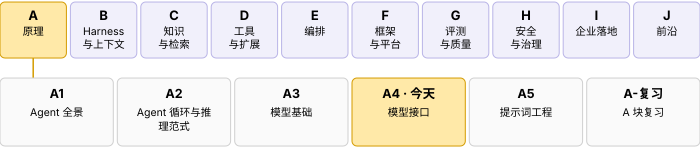
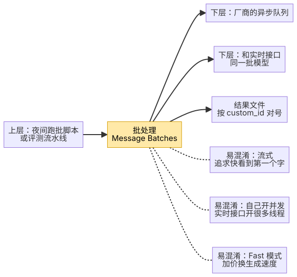
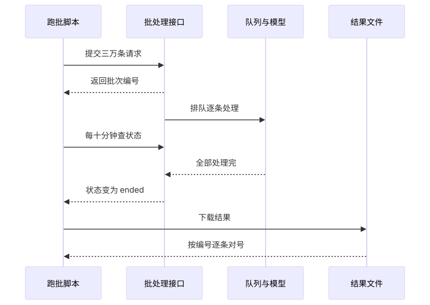
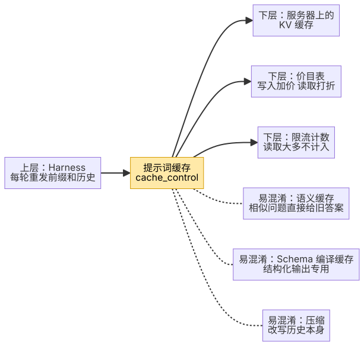
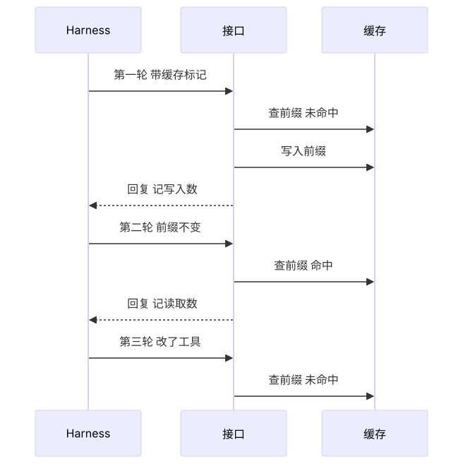
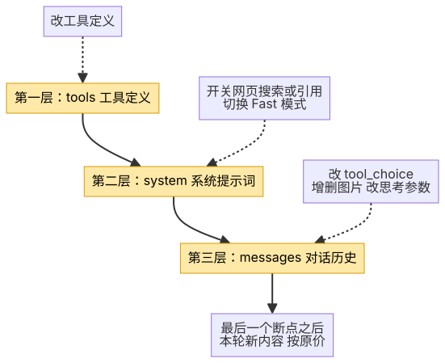
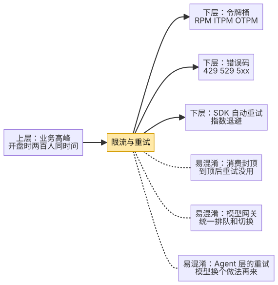
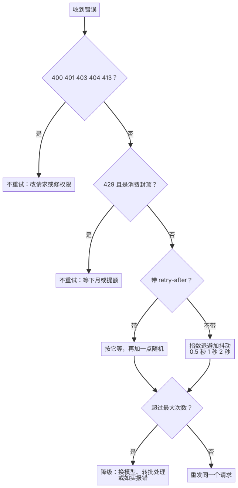
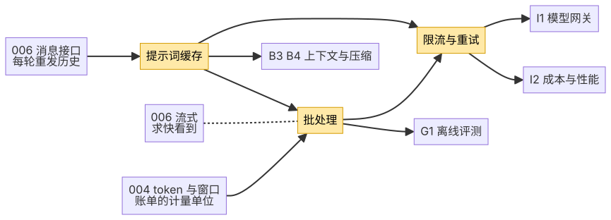

# 007 - Model API Part 2 · 模型接口（下）

> 第 007 讲 · A4 模型接口（下） · A 原理：Agent 是怎么转起来的 · 事实核实截至 2026-10-30
> [← 返回目录](../README.md) · 上一讲：[006 模型接口（上）](006-model-api-1.md) · 下一讲：[008 提示词工程（上）](008-prompt-engineering-1.md)

> 本篇多处拿 Claude 的接口和 OpenAI、Google 的接口对比。本文由 Anthropic 的模型撰写，存在利益相关；Claude 这边的短板在各概念的「其他家叫什么」里单独写出。

---

## 🧭 Bulletin 流程

> 请求从一条变成几万条 → **① 批处理** → **② 提示词缓存** → **③ 限流与重试** → 不着急的打包半价跑，重复的前缀只付零头，撞到上限时知道等多久、试几次、什么时候放弃

上篇讲"一次请求长什么样"，下篇讲"请求多了以后怎么办"。三个概念按"先省钱、再省重复、最后扛住高峰"的顺序排。

1. **批处理**：不着急要结果的请求，打包成一批交给厂商异步处理，24 小时内返回，输入和输出都按半价算。
2. **提示词缓存**：每轮都重发的那段前缀，比如系统提示词、工具清单、长文档，第一次存下来，之后再用只按很低的倍率计费，而且大多数模型上不占限流额度。
3. **限流与重试**：厂商按每分钟请求数和 token 数给你一个上限，超了返回 429，服务器太忙返回 529；程序要分清哪些错误能重试，按退避的节奏等，重试用尽就降级。

---

## 📍 定位图



怎么读这张图：上面一行是整张地图的 10 个块，下面一行是今天所在的块展开成的各簇，黄色是今天的位置。

A4 上面接的是 A3：A3 讲 token 怎么计数、窗口有多大，今天的三个概念全是在这本 token 账上做文章。A4 下面通向 A5 提示词工程：今天讲系统提示词放在缓存前缀的哪一层、改了会让什么失效，A5 讲里面该写什么。

---

## 本簇讲解

### 这一簇要解决什么问题

Charles 的研报助手上线一个月，用量从每天几百次涨到几万次，碰到三件事。

第一，研究所要求每天晚上给当天入库的 3 万篇研报打标签：行业、评级、有没有提到风险事件。他照搬白天的实时调用写法，一篇一篇发。按 Sonnet 5.5（Anthropic 的中档模型，截至 2026-10-18 输入每百万 token 2 美元、输出 10 美元）算，每篇输入 6000 token、输出 300 token，一晚是 1.8 亿输入 token 加 900 万输出 token，账单 450 美元。这些标签第二天早上才有人看，晚上多等几个小时没有任何损失，却付了全价。

第二，白天的助手每个问题都要带上 8000 token 的前缀：系统提示词、6 个工具的定义、一份评级口径说明。分析师一个上午追问十几轮，这 8000 token 每轮都按原价重新算一遍。上篇讲过，消息接口不记事，每轮都要重发；重发不可避免，但重发的部分每次都按原价付钱，就是浪费。

第三，早上 9:30 开盘，200 个分析师同时提问，接口开始成批返回 429。他的程序收到错误立刻重发，200 个客户端一起重发，把下一秒的额度也挤满，错误越来越多。有一个请求因为参数写错返回 400，程序也重试了 10 次，每次都是同样的 400。

这三件事对应今天的三个概念：不着急的请求怎么打包降价，重复的前缀怎么只付一次，撞到上限时怎么等、等多久、什么时候放弃。

---

### 概念一：批处理

**1. 定义**

批处理（batch processing，Claude 的接口叫 Message Batches API）是一种异步调用方式：调用方把大量独立的请求一次性提交成一个批次，厂商在后台排队处理，调用方隔一段时间查询状态，处理完后下载结果文件。代价是不能实时拿到结果，换来的是价格打折和独立的限流额度。

截至 2026-10-18 的官方细节：[1][3]

- **价格**：所有用量按标准价格的 50% 计费，输入和输出都打五折。
- **规模**：一个批次最多 10 万条请求或 256 MB，先到哪个算哪个；超过大小会返回 413 错误（HTTP 413：请求体太大）。
- **时间**：大多数批次 1 小时内完成；全部处理完、或者满 24 小时，两者先到就可以取结果；24 小时内没处理完的请求标为过期。结果从创建起保留 29 天。
- **结果类型**：每条请求有四种结局，`succeeded`（成功，带回复）、`errored`（请求不合法或服务器内部错误，不计费）、`canceled`（你取消了、还没送到模型，不计费）、`expired`（24 小时到期还没送到模型，不计费）。
- **顺序**：结果可能以任意顺序返回，必须用每条请求自带的 `custom_id`（调用方给每条请求起的编号，只能用字母、数字、下划线和连字符，最长 64 个字符）对号。
- **能批什么**：所有在役模型都支持；图片、工具调用（包括网页搜索、代码执行等服务端工具）、系统提示词、多轮对话、扩展思考都能放进批次，同一批里可以混不同类型的请求。
- **不能批什么**：`stream: true`（流式）、`speed`（Fast 模式：Opus 系列加价换更快生成速度的选项）、`max_tokens: 0`（缓存预热请求），传了会校验失败。
- **限流单独算**：批处理有自己的一套额度，按"排队中的请求数"计。截至 2026-10-18，Start 档（Claude 接口的入门用量档位）最多 20 万条请求同时在队列里，Build 档 30 万，Scale 档 50 万；三档每批上限都是 10 万条。[3]
- **一个测试版**：带请求头 `output-300k-2026-03-24` 时，批次里的单条请求输出上限可以从 12.8 万 token 提到 30 万 token，只在批处理接口上可用；2026-10-30 已在 Models overview 原文核实，适用 Opus 5.5、Sonnet 5.5、Haiku 5.5 等九个模型。[1]

**2. 场景**

接着开头那 3 万篇研报的夜间打标签。

- **改成批处理**：同样 1.8 亿输入加 900 万输出，账单从 450 美元降到 225 美元。晚上 11 点提交，脚本每 10 分钟查一次状态，凌晨 1 点左右全部结束，早上 8 点分析师上班前标签已经入库。
- **再叠加缓存**：6000 token 里有 2000 token 是所有研报共用的打标签指南。把这段指南标成 1 小时缓存，批处理和缓存的折扣可以叠加。[2][3] 文档说批处理里的缓存命中是"尽力而为"，命中率常见在 30% 到 98% 之间。按 80% 命中粗算：6000 万共享 token 里 4800 万按批处理价的缓存读取计费，约 2.4 美元；1200 万按批处理价的 1 小时写入计费，约 24 美元；剩下 1.2 亿非共享输入 120 美元；输出 45 美元。合计约 191 美元，比只用批处理再省 15%。
- **顺带解决了限流**：如果用实时接口在一小时内发完 1.8 亿输入 token，平均每分钟 300 万，超过 Start 档 Sonnet 5.5 每分钟 200 万输入 token 的上限，一定会撞 429。批处理用的是另一套额度，3 万条请求远低于 20 万条的队列上限。

这里的研报数量和 token 数是示意，价格和倍率是截至 2026-10-18 的官方价目表。

**3. 它解决什么问题**

因果链是这样的。厂商的算力在一天里忙闲不均，白天高峰时实时请求挤在一起，夜里机器有空。实时接口必须随时准备好接你的请求，厂商要为这个"随叫随到"预留容量，所以收全价。批处理把"什么时候算"的决定权交给厂商，它可以把你的请求塞进空闲时段，成本更低，于是让一半利给你。

对调用方来说，很多任务本来就不需要秒回：夜间跑批、给历史数据补标签、跑评测集、生成训练数据、批量翻译。这类任务用实时接口有三个问题：付全价；要自己写并发控制，否则撞限流；要自己处理几万个请求里零星失败的重试。批处理把这三件事一起解决了：五折、独立额度、每条请求的结局写在结果文件里，失败的单独挑出来重提就行。

它不解决的：要人等着看的场景。用户在聊天框里提问，不能让他等一个小时。

**4. 位置图**



怎么读这张图：左边是上层，触发批处理的通常是定时脚本或评测流水线，而不是一个等着回答的人。右边三个实线节点是下层：批处理用的是厂商的异步队列，跑的是和实时接口完全相同的模型，所以质量不会因为便宜而变差；结果写成一个 `.jsonl` 文件（JSON Lines：每行一个 JSON 对象的文本格式），靠 `custom_id` 对号。三条虚线是常混的概念：流式和批处理方向相反，一个追求快看到，一个追求便宜；自己用实时接口开很多线程并发调用，速度可能更快，但付全价、占实时额度；Fast 模式是加价换速度，和批处理降价换时间正好对称，而且两者不能同时用。[3]

**5. 运行流程图**



怎么读这张图：箭头上是发出的消息，不是完成的动作。第二步拿到的只是一个批次编号，此时一条都没处理。第四步的"查状态"会重复很多次，图里只画一次；状态从 `in_progress`（处理中）变成 `ended`（结束）才能下载。最后一步要按 `custom_id` 对号，因为结果顺序不保证和提交顺序一致；结局是 `errored` 或 `expired` 的条目不计费，挑出来重新提交一批即可。

**6. 实例（官方接口）**

批处理不是 Claude Code 日常会用到的功能，本机没有实物。下面是按当天文档写法整理的最小例子，不在本机运行：[1][2]

```python
import anthropic
client = anthropic.Anthropic()
GUIDE = "你是研报打标签助手。行业按申万一级……"      # 约 2000 token 的共用指南
reqs = [{"custom_id": f"rpt-{i}",
         "params": {"model": "claude-sonnet-5-5", "max_tokens": 300,
                    "system": [{"type": "text", "text": GUIDE,
                                "cache_control": {"type": "ephemeral", "ttl": "1h"}}],
                    "messages": [{"role": "user", "content": text}]}}
        for i, text in enumerate(reports)]
batch = client.messages.batches.create(requests=reqs)
print(batch.id)                                     # 记下批次编号，之后定时查询

b = client.messages.batches.retrieve(batch.id)
if b.processing_status == "ended":
    for r in client.messages.batches.results(batch.id):
        if r.result.type == "succeeded":
            save(r.custom_id, r.result.message.content[0].text)
        else:                                       # errored、canceled、expired 都不计费
            retry_later(r.custom_id, r.result.type)
```

两处说明。共用指南标的是 1 小时缓存，因为文档提示批次处理可能超过 5 分钟，默认的 5 分钟缓存会在中途过期。[1] `save` 和 `retry_later` 是你自己写的入库和重提函数。

运行位置三问：批次在厂商云端的异步队列里处理；由调用方的定时脚本提交触发；结果先以文件形式留在厂商那边 29 天，由脚本下载、对号、入库，人第二天在业务系统里看到。

**7. 常见误解与边界**

- **"批处理用的是便宜的小模型"**：不对。模型完全一样，便宜的是"什么时候算"的灵活性。
- **"批处理一定要等 24 小时"**：不对。24 小时是上限，文档说大多数批次 1 小时内完成。但产品设计必须按 24 小时的最坏情况来定，不能承诺用户"一小时出结果"。
- **"把实时请求攒几秒钟再一起发就是批处理"**：不是。那是客户端的请求合并，仍然走实时接口、付全价。批处理是厂商提供的一个独立接口，计价和限流都不同。
- **"批处理不能用工具"**：不对。工具调用、服务端工具都能放进批次。但每条请求只返回一轮回复，如果模型返回 `tool_use`，你要执行工具后再提交下一批，多轮工具循环在批处理里会很慢，所以批处理适合"一问一答就能完成"的任务。
- **常见复述偏差**："批处理就是一次处理很多条" → 对一半：对在它确实是一次提交很多条；错在漏掉了"异步"这个本质。一次提交很多条只是形式，真正换来五折的是你把完成时间放宽到 24 小时、让厂商自己安排什么时候算。
- **边界**：批处理不支持流式和 Fast 模式；批次可能"略微超过"工作区设定的花费上限，预算控制要留余量。[1]

**8. 其他家叫什么**

- **OpenAI**：也叫 Batch API，同样五折、完成窗口只能设 24 小时；一批最多 5 万条请求、输入文件最大 200 MB；每个输入文件只能对应一个模型；限流额度和实时接口分开。另有 Flex 档（一种价格等于批处理价、但仍然同步返回、可能更慢或更常被限流的服务档位），以及加价换速度的 Fast 档和 Ultrafast 档；原来的 Priority 档于 2026-07-30 改名为 Fast（截至 2026-10-18）。[10][13]
- **Google Gemini**：也叫 Batch API，同样按标准价的 50%，目标 24 小时内完成；小批次可以直接把请求写在调用里（总大小 20 MB 以内），大批次上传 JSONL 文件（最大 2 GB）；截至 2026-10-18 只支持 `generateContent` 接口。[14][16]

Claude 这边的短板：单批 10 万条是三家里最多的，但 256 MB 的单批大小比 Gemini 的 2 GB 文件小；Claude 没有 OpenAI Flex 那种"半价但同步返回"的中间档，要么全价实时，要么半价异步。

---

### 概念二：提示词缓存

**1. 定义**

提示词缓存（prompt caching）是厂商把一次请求里某个位置之前的内容（前缀）的计算结果在服务器上保存一段时间的功能。之后的请求只要前缀逐字相同，就直接复用这份结果，不再重新计算；对应的 token 按很低的倍率计费，第一次存入时则按略高于原价的倍率计费。

它背后的东西是 KV 缓存（Key-Value cache，键值缓存：模型读一段文字时算出的中间结果，存在显存里避免重算）。提示词缓存可以理解为"把 KV 缓存从一次请求内部延长到跨请求复用"，并且做成了按 token 计价的产品。这句是机制层面的解释，Claude 文档没有逐字这样写。

截至 2026-10-18 的官方细节：[2][3]

- **两种用法**：一是**自动缓存**，在请求顶层加一个 `cache_control` 字段，系统把断点（cache breakpoint：缓存到哪个位置为止的标记）放在最后一个可缓存的块上，对话变长时自动往后移；二是**显式断点**，在具体的内容块上加 `cache_control`。一次请求最多 4 个断点，自动缓存也占其中一个。
- **有效期**：默认 5 分钟，每次命中免费续期；可以设 `"ttl": "1h"` 改成 1 小时。有效期从写入或读取的那次请求**开始**算，不是从回复结束算。
- **价格倍率**（相对于该模型的输入单价）：5 分钟写入 1.25 倍，1 小时写入 2 倍；读取默认 0.1 倍，Opus 5.5 和 Sonnet 5.5 是 0.05 倍，Fable 5.1 和 Mythos 5.1 是 0.025 倍。这些倍率和批处理折扣、数据驻留加价（`inference_geo: "us"` 时所有 token 乘 1.1）可以叠加。
- **最短长度**：Fable 5.1、Opus 5.5、Sonnet 5.5、Haiku 5.5 等新模型最少 512 token 才能缓存；老模型是 1024 到 4096 不等。不够长不会报错，只是不缓存。
- **前缀的层级**：缓存前缀按 `tools`、`system`、`messages` 的顺序构成。某一层变了，这一层和它后面的所有层都失效。
- **什么会让缓存失效**：改工具定义，三层全部失效；开关网页搜索、开关引用功能、切换 Fast 和标准速度，system 和 messages 两层失效；改 `tool_choice`（工具选择方式）、在任何位置增删图片、丢掉思考块，messages 层失效；改思考参数和 `effort`（思考档位），messages 层失效，前两层视模型而定。
- **不会失效的新做法**：2026 年起，在新模型上会话中途追加一条 `role: "system"` 的消息、用 `tool_addition` 块在中途加工具（测试版），都不会让前面的缓存失效。上篇本机实例里 Claude Code 的 41 条 system 消息就是这个用法。[2][4]
- **回看 20 个位置**：每个断点最多往回检查 20 个位置找能命中的前缀；写入只发生在断点上。
- **用量字段**：回复的 `usage` 里有三个数，`cache_creation_input_tokens`（本次写入缓存的 token）、`cache_read_input_tokens`（本次从缓存读取的 token）、`input_tokens`（最后一个断点之后、按原价计的 token）。三者相加才是这次请求的全部输入。
- **隔离**：缓存按工作区隔离（Claude 接口、AWS 上的 Claude 平台、微软 Foundry）；Bedrock 和谷歌云按组织隔离。不同组织即使提示词一字不差也不共享缓存。
- **和并行请求的关系**：缓存条目要等第一次回复开始生成后才能被读到，同时发出的几个请求都会各自写一遍。
- **近期变化**：2026-10-07 起 Sonnet 5.5 的缓存读取从 0.1 倍降到 0.05 倍；2026-09-23 起缓存诊断功能（`diagnostics` 字段：告诉你这次为什么没命中）转为正式版。[4]

**2. 场景**

白天的研报助手，每个问题都带 8000 token 的前缀：工具定义 3500、系统提示词和评级口径 4500。分析师小王一个上午在 5 分钟之内连续追问 10 轮。按 Opus 5.5 的价格（截至 2026-10-18 输入每百万 token 4 美元）只算这段前缀：

- **不缓存**：10 轮 × 8000 = 8 万 token，按原价 0.32 美元。
- **开 5 分钟缓存**：第一轮写入 8000 token，按 1.25 倍约 0.04 美元；后 9 轮每轮读取 8000 token，按 0.05 倍合计约 0.014 美元。共约 0.054 美元，前缀成本降了约 83%。
- **一次失误**：第 6 轮时，后台给助手临时加了一个"查公告"工具。工具定义变了，按层级规则三层全部失效，第 6 轮重新写入整段前缀，又付了一次写入价。修法是把这个工具改成会话中途通过 system 消息追加，或者干脆一开始就放在工具清单里。
- **另一次失误**：小王午饭离开 40 分钟，回来接着问。5 分钟缓存早已过期，第一问重新写入。如果业务上用户经常隔半小时回来，就该改用 1 小时缓存：写入贵一些（2 倍），但只要一小时内回来两次以上就划算。

还有一笔看不见的账：缓存读取在大多数 Claude 模型上不计入每分钟输入 token 的限流额度。文档举的例子是，ITPM（Input Tokens Per Minute，每分钟输入 token 数上限）是 200 万、缓存命中率 80% 时，实际每分钟能处理 1000 万输入 token。[3] 缓存既省钱，也等于把限流额度放大了。

**3. 它解决什么问题**

因果链分三步。第一，消息接口无状态，Agent 每一轮都要把系统提示词、工具清单和全部历史重发一遍；一个 30 轮的任务，最前面那段前缀被发了 30 次。第二，模型每读一个 token 都要算一遍，读得越多，算力越贵、首字延迟（从发出请求到看到第一个字的时间）越长；而这 30 次里前缀一字未改，29 次的计算是重复劳动。第三，提示词缓存把第一次算出的中间结果存起来，后面的请求直接接着用，厂商省了算力，于是按很低的倍率收费。

对 Agent 来说这几乎是必选项。Agent 的请求天然是"前缀很长、每轮只在末尾加一点"的形状，命中率可以非常高，下面本机实例里是 93%。也因为这样，Agent 的成本结构变了：真正决定账单的不是模型单价，而是缓存命中率。[004 模型基础（上）](004-model-fundamentals-1.md) 讲的"窗口和账单一起涨"，缓存是第一道闸。

它不解决的：前缀以外的新内容仍按原价；模型读到的内容一个字都没少，所以不解决上下文太长、窗口装不下的问题，那是 B3 上下文工程和 B4 压缩的事。

**4. 位置图**



怎么读这张图：上层是 Harness（套在模型外面、负责循环、工具、权限和上下文的那层程序），它决定前缀怎么排、断点打在哪。下层有三样：真正存东西的是服务器显存里的 KV 缓存；价目表决定写入和读取各收多少；限流计数里，缓存读取在大多数模型上不算进 ITPM。三条虚线是最常混的三个"缓存"。语义缓存（semantic cache：在应用层把问题转成向量，遇到意思相近的问题直接返回以前的答案，根本不调用模型）是你自己搭的、会跳过模型，提示词缓存是厂商的、模型照样生成新回答。上篇讲的结构化输出 Schema 编译缓存只缓存语法规则，24 小时有效，和提示词缓存是两套东西。压缩（compaction：把旧对话改写成摘要替换原文）会改动历史，改完之后前缀变了，缓存反而要重写，B4 簇展开。

**5. 运行流程图**



怎么读这张图：箭头上是发出的消息，不是完成的动作。第一轮的回复里 `cache_creation_input_tokens` 是 8000，第二轮的回复里 `cache_read_input_tokens` 是 8000，程序靠这两个字段算命中率。第三轮改了工具定义，工具是前缀的第一层，后面全部失效，接口又要重新写入一次，图里省略了这次写入。如果两次请求之间隔了 5 分钟以上又没设 1 小时，第二轮也会未命中。

再看一张图，讲清"改哪里会让哪里失效"：



怎么读这张图：从上往下就是前缀的顺序。虚线指向哪一层，就表示那种改动会让这一层和它下面的所有层失效。所以最稳定的东西要放在最上面：工具清单一次定好不要动，系统提示词里不要放时间戳、用户名这类每次都变的内容，变化的内容尽量放到对话末尾。这三层画成上下排列是结构上的事实，不是为了好讲：接口确实按这个顺序拼前缀。

**6. 实例（本机）**

本机实物是 Claude Code 自己的会话记录。我只读、只统计，没有抄写任何内容。取笔记库目录下最近一次会话记录，把 124 次接口回复的 `usage` 字段加总：

```
按原价计的输入（断点之后）      246
写入缓存                  1,523,678   其中 1 小时缓存 1,523,678，5 分钟缓存 0
从缓存读取               19,310,193
输出                        235,189
缓存读取占全部输入的比例        92.7%
用到的模型    claude-opus-5-5 64 次   claude-sonnet-5-5 59 次
```

读法有三点。第一，按原价计的输入只有 246 个 token，两千万输入里几乎全部要么写入、要么读取缓存，说明 Claude Code 把断点放在了每次请求的最末尾，这和"自动缓存把断点放在最后一个可缓存块"的描述一致。第二，写入全部是 1 小时缓存，没有 5 分钟的，说明 Claude Code 默认用 1 小时有效期，这样你离开一会儿回来，缓存还在；这是从数据推断的，没有在 Claude Code 文档里找到逐字说明。第三，如果这些 token 全部按 Opus 5.5 的 API 价格算：不缓存约 83 美元，有缓存约 16 美元（写入 1.52M × 8 美元 ≈ 12.2 美元，读取 19.31M × 0.2 美元 ≈ 3.9 美元），省了约八成。这只是换算，你用的是订阅套餐时并不按 token 单独计费；而且这个会话里一半回复是 Sonnet 5.5，实际价格更低。

另一处实物：Claude Code 2.1.300 的更新日志写着，在 OpenTelemetry（一种开放的监控数据标准，用来把调用记录导出到监控系统）的 `api_request` 事件里新增了 `cache_creation_5m_tokens` 和 `cache_creation_1h_tokens`，按有效期拆分缓存写入；2.1.302 修了"中途加入的工具经过 ToolSearch 或压缩后再次加载造成的缓存未命中"。[7] 两条都说明缓存命中率是 Harness 开发者天天盯的指标。

官方接口的最小例子（Claude，按当天文档写法；不在本机运行）：[2]

```python
import anthropic
client = anthropic.Anthropic()
r = client.messages.create(
    model="claude-opus-5-5", max_tokens=1000,
    cache_control={"type": "ephemeral"},    # 自动缓存：断点放在最后一个可缓存块，随对话后移
    system=LONG_GUIDE, tools=tools, messages=msgs)
u = r.usage
total = u.cache_read_input_tokens + u.cache_creation_input_tokens + u.input_tokens
print("命中率", u.cache_read_input_tokens / total)
```

运行位置三问：缓存存在厂商云端的服务器上，按工作区隔离；由请求里的 `cache_control` 字段触发，前缀逐字相同才命中；结果体现在回复的 `usage` 字段和账单上，人看到的回答内容和不缓存时没有区别。

**7. 常见误解与边界**

- **"缓存了就会返回同样的答案"**：不对。缓存的是读前缀的计算，模型每次照样重新生成回答。返回旧答案的是语义缓存，那是应用层自己做的。
- **"开了缓存就一定省钱"**：不一定。写入比原价贵 25% 到 100%，如果前缀经常变、或者两次请求隔得比有效期长，就是只付写入价、从来不命中，比不开还贵。判断标准是命中率。
- **"前缀差不多就能命中"**：不对。必须 100% 逐字相同。系统提示词里放一个当前时间，每次都不同，缓存永远不命中。
- **"同时发 10 个一样前缀的请求，后 9 个会命中"**：不会。缓存要等第一个回复开始生成后才可读，同时发出去的都会各自写入。想让并行请求命中，先发一个请求预热，等它开始返回再发其余的。
- **常见复述偏差**："提示词缓存就是把提示词存起来，下次不用再发" → 对一半：对在"存起来、下次复用"；错在"不用再发"。每次请求仍然要把完整的前缀原样发过去，接口拿它逐字比对才知道能不能命中；省掉的是厂商那边的重复计算和你的钱，不是网络上要传的内容。
- **边界**：缓存隔离到工作区，同一组织不同工作区之间不共享；不能在思考块上直接打缓存标记；空的文字块不能缓存。[2]

**8. 其他家叫什么**

- **OpenAI**：也叫 prompt caching，默认自动开启，不用写任何标记。截至 2026-10-20 分两套规则：GPT-5.6 及以后的模型，默认有效期 30 分钟、写入 1.25 倍；2026-10-20 起在 Responses API 里可以用 `prompt_cache_options.ttl` 选 12 小时，写入 2.5 倍；两种有效期的读取价相同，多数是 0.1 倍、GPT-6.1 Sol 是 0.05 倍；最少 1024 个 token，也支持显式断点；更早的模型没有写入费，读取折扣因模型而异（比如 gpt-4o 是半价），有效期有内存模式和 24 小时延长保留两种。`prompt_cache_key` 参数在老模型上用来提高命中率，在新模型上主要用来按客户分开统计。用量看 `cached_tokens` 字段。[11][13]
- **Google Gemini**：Gemini 2.5 及以后默认开启隐式缓存，但"不保证省钱"，新模型最少 4096 token；显式缓存（context caching）要先建一个缓存对象，默认有效期 1 小时、可以随便设，按缓存的 token 数和保留时长收存储费，截至 2026-10-18 只在旧的 `generateContent` 接口测试版里可用，Gemini 4 Argon 及以后不支持，新的 Interactions API 只有隐式缓存。[15]

Claude 这边的短板：要自己在请求里写 `cache_control`（顶层一个字段即可，但仍要知道去写），OpenAI 默认全自动；默认有效期只有 5 分钟，1 小时要付 2 倍写入价，而 OpenAI 新模型默认 30 分钟、可选 12 小时（写入 2.5 倍，截至 2026-10-20），Gemini 显式缓存可以设任意时长；并行请求不能互相命中，要自己做预热。

---

### 概念三：限流与重试

**1. 定义**

限流（rate limiting）是厂商对每个组织在单位时间内能用多少请求和 token 设定的上限；超过上限的请求被拒绝，返回 HTTP 429。重试（retry）是调用方在收到可恢复的错误后，等待一段时间再把同一个请求发一次的策略。两者是一对：厂商用限流保护服务器，调用方用重试在不打垮服务器的前提下把请求最终送进去。

**限流这一侧**（Claude，截至 2026-10-18）：[3]

- **算法**：令牌桶（token bucket：桶里的额度按固定速度持续补充、最多补到上限，用一点扣一点）。所以每分钟 60 个请求的上限，实际上可能按每秒 1 个执行，短时间的突发也会触发 429。
- **三把尺子**：RPM（Requests Per Minute，每分钟请求数）、ITPM（每分钟输入 token 数）、OTPM（Output Tokens Per Minute，每分钟输出 token 数），按模型分别计。任何一把超了都返回 429，并写明超的是哪一个。
- **算什么、不算什么**：ITPM 只算没命中缓存的输入，即 `input_tokens` 加 `cache_creation_input_tokens`；`cache_read_input_tokens` 在大多数模型上不算。OTPM 按实际生成的 token 实时算，`max_tokens` 设多大不影响。
- **档位**：Start、Build、Scale、Custom 四档（新组织可能先在更低的 Evaluation 档），按用量历史和账户状况自动分配，不用充值升级。Opus 5.5、Sonnet 5.5、Haiku 5.5 在 Start 档是每分钟 1000 请求、200 万输入 token、40 万输出 token；Build 档 5000、500 万、100 万；Scale 档 1 万、1000 万、200 万。Fable 5.x 低得多，Start 档每分钟只有 50 万输入 token。
- **月度消费封顶**：Start 档每月 500 美元，Build 档 1000 美元，Scale 档 20 万美元。到顶后返回 429，错误码是 `enforced_spend_limit_reached`，**不带 `retry-after`**，下个月 1 日零点（UTC，协调世界时）才恢复，重试没用。你自己设的更低花费上限，到了返回的是 400。
- **加速度限制**：用量突然暴涨也会触发 429，文档建议平稳爬坡，没给具体数字。
- **响应头**：`retry-after`（还要等几秒才能重试，早于这个时间重试一定失败）；`anthropic-ratelimit-requests-remaining`、`-input-tokens-remaining`、`-output-tokens-remaining` 等（还剩多少额度）及对应的 `-reset`（什么时候补满）。

**错误这一侧**（Claude，截至 2026-10-18）：[5]

| 状态码 | 类型 | 意思 | 能不能重试 |
|---|---|---|---|
| 400 | `invalid_request_error` | 请求格式或内容有问题 | 不能，原样重发一定还是错 |
| 401 | `authentication_error` | 密钥无效或过期 | 不能，先修凭证 |
| 402 | `billing_error` | 账单或付款信息有问题 | 不能 |
| 403 | `permission_error` | 没有权限用这个资源 | 不能 |
| 404 | `not_found_error` | 资源不存在 | 不能 |
| 409 | `conflict_error` | 和资源当前状态冲突 | 解决冲突后可以 |
| 413 | `request_too_large` | 请求体太大，实时接口上限 128 MB（截至 2026-11-04，2026-10 下旬由 32 MB 提高） | 不能，要拆小 |
| 429 | `rate_limit_error` | 超限流或到了消费封顶 | 限流可以，封顶不行 |
| 500 | `api_error` | 服务器内部错误 | 可以，指数退避 |
| 504 | `timeout_error` | 处理超时 | 可以，长请求改用流式或批处理 |
| 529 | `overloaded_error` | 所有用户的流量太高，服务器过载 | 可以，指数退避 |

每个回复都带一个 `request-id` 响应头，错误体里也有 `request_id`，找客服排查时要报这个号。

**重试这一侧**：官方 Python SDK（Software Development Kit，软件开发工具包：厂商提供的现成调用代码）默认对连接错误、408、409、429 和 500 以上的错误自动重试 **2 次**，用短的指数退避（exponential backoff：每次重试的等待时间翻倍，比如 0.5 秒、1 秒、2 秒），有 `retry-after` 时按它等；默认超时 10 分钟，超时的请求也会重试 2 次。可以用 `max_retries` 调整。[6]

**2. 场景**

开头那次开盘高峰：200 个分析师在 9:30 到 9:31 之间同时提问，每个请求约 1.2 万输入 token（前缀 8000 加历史 4000），助手跑在 Build 档的 Opus 5.5 上，每分钟输入额度 500 万。

- **没开缓存时**：200 × 1.2 万 = 240 万，看起来没超 500 万。但令牌桶不是按整分钟结算的，200 个请求挤在前 10 秒发出，10 秒内只补充了约 83 万的额度，后面一大半请求拿到 429。
- **错误的重试**：程序收到 429 立刻重发，200 个客户端同时重发，下一秒又全部撞上，这就是重试风暴（retry storm：大量客户端同步重试，把刚恢复的容量再次挤满）。更糟的是，那个参数写错的请求返回 400，程序也照样重试了 10 次。
- **改法一，分清能不能重试**：400、401、403、413 直接报错，不重试；429 先看是不是消费封顶，是就停。
- **改法二，退避加抖动**：有 `retry-after` 就按它等；没有就按 0.5 秒、1 秒、2 秒翻倍，再各加 0 到 30% 的随机抖动（jitter：在等待时间上加一点随机数，让各个客户端错开），200 个客户端的重试就散开了。最多 5 次，还不行就降级：换到 Sonnet 5.5（它有自己独立的额度），或者告诉用户"高峰排队中"。
- **改法三，从源头减少用量**：开缓存。8000 token 前缀命中后不计入 ITPM，每个请求只算 4000，200 个请求只占 80 万，同样的额度能扛三倍的人。

改完之后，开盘那一分钟的 429 比例从三成多降到 2% 左右，全部请求在 20 秒内完成。这里的比例是示意，额度数字是截至 2026-10-18 的官方表格。

**3. 它解决什么问题**

因果链分两半。

厂商为什么要限流：模型推理靠 GPU（图形处理器，大模型推理用的主要芯片），一台机器同时能处理的请求有限。如果某个客户突然发来十倍流量，不加限制，其他所有客户的请求都会变慢甚至失败。限流把每个组织的用量框在一个范围内，按 token 而不只是按请求数来框，因为一个 10 万 token 的请求和一个 100 token 的请求，占用的算力差了上千倍。这也是 JavaGuide 题库问"大模型限流为什么不能只按 QPS 做"的原因。[8]

调用方为什么要会重试：大模型接口的错误里，有一大类是暂时的，比如瞬间超了令牌桶、服务器过载、网络抖了一下，过几秒再试就好了；另一类是永久的，比如参数错了、没有权限，重试多少次结果都一样。不重试，暂时的错误直接变成用户看到的失败；乱重试，永久的错误白白浪费时间，暂时的错误被重试风暴放大。正确的重试要回答三个问题：这个错能不能重试，等多久，最多几次、之后怎么办。

对 Agent 还有一层：一个 Agent 任务是几十次接口调用串起来的，任何一次失败都可能让整个任务中断。每次调用 99% 的成功率，串 30 次后整个任务只有约 74% 能跑完；把单次成功率靠重试提到 99.9%，30 次后约 97%。可靠的重试是长任务能跑完的前提。

**4. 位置图**



怎么读这张图：上层是触发问题的流量形状，高峰期的突发最容易撞限流。下层三样：厂商那边的令牌桶按三把尺子计数；错误码告诉你是哪一类问题，5xx 指 500 到 599 之间的服务器错误；SDK 已经内置了一层自动重试。三条虚线：消费封顶也返回 429，但它是按月的钱不是按分钟的量，重试没用；模型网关（model gateway：放在应用和多家模型厂商之间的一层服务，统一做鉴权、限流、排队、切换模型和记账）是把重试和降级集中做在一处，I1 簇讲；Agent 层的重试是工具失败后模型自己调整参数或换个工具，和今天讲的"把同一个请求原样重发"不是一回事，002 讲的终止条件管的是它。

**5. 运行流程图**



怎么读这张图：从上往下是程序收到一个错误后的判断顺序。第一个菱形先排除永久错误，这一步省掉的是最冤枉的时间。第二个菱形专门挑出消费封顶，它的状态码也是 429，不看错误码会被当成普通限流一直重试。第三个菱形决定等多久：厂商告诉你等几秒，就以它为下限再加一点随机；没说，就按指数翻倍再加抖动。最后一个菱形防止无限重试，用尽之后要有降级方案。重发前还要想一件事：如果这个请求会触发写操作，比如上篇的退款工具，重发前要确认它是幂等的（同一个操作执行一次和执行多次效果相同），否则可能重复执行。

**6. 实例（本机加官方接口）**

本机实物是 Claude Code 的会话记录里的错误条目。只读统计所有会话里 `api_error` 类型的记录，不抄写内容：

```
错误类型    连接错误 80   401 认证过期 15   503 4   502 1   未识别 5
每条记录的最大重试次数    10
第 1 次重试的等待    89 条，中位数约 0.57 秒，最长 60 秒
第 2 次重试的等待    14 条，中位数约 1.1 秒
第 3 次重试的等待     2 条，约 2.0 到 2.5 秒
```

读法有三点。第一，等待时间 0.5 秒、1 秒、2 秒逐次翻倍，每次又不是整数，这就是指数退避加抖动的样子。第二，那条 60 秒的等待对应一次 502 错误，错误内容里写着 `retry_after: 60`，说明 Claude Code 遵守了服务端给的等待时间。第三，Claude Code 的最大重试次数是 10，比 SDK 默认的 2 次多得多，因为它是一个长时间运行的交互工具，宁可多等也不要让任务中断。认证过期的 401 在记录里也带着重试字段，它是不是真的被原样重试了 10 次，我没逐条核对，📝 待补。

Claude Code 更新日志里还有两条相关的：2.1.301 新增 `CLAUDE_CODE_RETRY_WATCHDOG_MAX_USAGE_LIMIT_WAIT_MS`，让无人值守的重试模式在用量上限要很久才重置时直接结束请求、不再傻等。[7] 这正是"消费封顶时不要重试"在一个真实 Harness 里的落地。

官方接口的最小例子（自己接管重试的写法，Claude Python SDK；示意，不在本机运行）：[5][6]

```python
import random, time, anthropic
client = anthropic.Anthropic(max_retries=0)        # 关掉 SDK 自动重试，自己管
TRANSIENT = (anthropic.InternalServerError, anthropic.APIConnectionError)

def call(max_attempts=5, **kw):
    for attempt in range(max_attempts):
        try:
            return client.messages.create(**kw)
        except anthropic.RateLimitError as e:
            if "enforced_spend_limit_reached" in str(e.body):
                raise                                # 月度封顶，重试没用
            ra = e.response.headers.get("retry-after")
            wait = float(ra) if ra else 0.5 * 2 ** attempt
        except TRANSIENT:                            # 500、529、网络错误
            wait = 0.5 * 2 ** attempt
        time.sleep(wait + random.uniform(0, 0.3 * wait))   # 加抖动，错开重试
    raise RuntimeError("重试用尽，转降级")              # 400、401 等不在捕获范围，直接抛出
```

多数情况下用 SDK 自带的重试就够了；自己写的理由通常是要加降级、要记录每次重试、或者要识别消费封顶。

运行位置三问：限流计数在厂商云端按组织和工作区进行；重试逻辑跑在调用方程序里，由收到的错误码触发；用户看到的是"稍慢一点但成功了"，或者重试用尽后的降级提示。

**7. 常见误解与边界**

- **"遇到错误就重试，多试几次总能成"**：不对。400、401、403 这类永久错误重试多少次都一样；消费封顶的 429 要等到下个月。
- **"重试越快越好"**：不对。立刻重试会和其他客户端撞在一起，形成重试风暴；OpenAI 文档还特别提到，失败的请求也计入每分钟额度。[12]
- **"429 和 529 是一回事"**：不对。429 是你自己的额度用完了，和别人无关；529 是厂商整体过载，所有用户都可能遇到。前者可以靠缓存、批处理、提档位来缓解，后者只能等或者切换到别的模型、别的云平台。
- **"max_tokens 设大了会占 OTPM"**：在 Claude 上不会。OTPM 按实际生成的 token 实时算。
- **常见复述偏差**："限流就是每分钟只能发多少次请求" → 对一半：对在请求数确实是一把尺子；错在漏掉了另外两把 token 尺子，而大模型场景里最先撞到的往往是 token 那两把。而且计数是令牌桶式的持续补充，不是每分钟整点清零，前 10 秒挤满一样会被拒。
- **边界**：今天讲的是"把同一个请求重发"这一层的重试。重发会产生写操作的请求时，必须先解决幂等；流式请求中途断开的续传，上篇讲过；跨多家模型的排队和切换放在 I1 的模型网关。

**8. 其他家叫什么**

- **OpenAI**：尺子有 RPM、RPD（每天请求数）、TPM（每分钟 token 数）、TPD（每天 token 数）、IPM（每分钟图片数），按组织和项目计。2026-10-06 起付费档位从五档并成 Build、Launch、Grow 三档，累计付款 500 美元即可进最高档 Grow。[9][12] 响应头是 `x-ratelimit-remaining-requests`、`x-ratelimit-remaining-tokens` 等；官方 SDK 自动重试 429 和 503；文档建议有 `Retry-After` 就把它当下限再加一点随机，没有就用带抖动的指数退避；流量到每分钟 100 万输入 token 以后，每 15 分钟增长不超过 50%。过载时返回 503 而不是 529。
- **Google Gemini**：尺子有 RPM、TPM（只算输入）、RPD，按项目而不是按密钥计，每天的额度在太平洋时间午夜重置；档位有 Free、Tier 1、Tier 2、Tier 3，按绑定账单的累计消费升级；另有按 10 分钟滚动窗口的消费上限，超了返回 `429 RESOURCE_EXHAUSTED`；文档写明"列出的限额不保证"。[16]

Claude 这边的短板：Claude 用 529 表示整体过载，这是个非标准的状态码，一些通用的 HTTP 重试库默认不认它，要自己加进可重试列表；Fable 5.x 的额度明显低于其他主力模型；加速度限制没有公开具体数字，不好提前规划爬坡。

---

## 👔 三岗视角

### AI 应用 / Agent 开发

**场景**：研报助手要接入一个新的"晨会纪要"功能，每天 8 点前给全所 300 人各生成一份个性化纪要，8:30 之后还要支持大家边看边追问。上线前要做一份成本和稳定性方案。

**这个岗位具体做什么**：第一，拆流量。8 点前的 300 份纪要不需要实时，凌晨 5 点提交一个批次，按五折算；8:30 后的追问走实时接口。第二，排前缀。工具清单放最前面、一次定好不动；系统提示词里去掉"今天是几月几号"这类每天变的内容，改放到第一条 user 消息里；对话用顶层自动缓存，追问场景用 1 小时有效期，因为人看纪要经常隔十几分钟才问一句。第三，写重试。用 SDK 自带重试打底，外面再包一层：识别消费封顶、最多 5 次、用尽后切到 Sonnet 5.5。第四，上线后盯五个数：缓存命中率（`cache_read_input_tokens` 除以全部输入，目标 80% 以上）、每任务成本、429 比例（目标低于 1%）、P99 延迟（把所有请求按耗时排序，最慢的那 1% 的耗时）、批次按时完成率（8 点前结束的比例）。

**最容易踩的坑**：在系统提示词开头放了一个"当前用户：张三"。每个人的前缀从第一层就不同，300 人互相之间一次都命中不了，缓存命中率只有个位数，账单比预算高三倍。个性化内容要放在前缀的最后面。

### AI 产品 / 商业分析

**场景**：财务部发现 AI 助手的月账单三个月涨了 4 倍，用户数只涨了 1.5 倍，要产品经理解释并给出降本方案。

**这个岗位具体做什么**：第一，拆账单。按"实时输入原价、缓存写入、缓存读取、输出、批处理"五个科目拆开，再按功能拆。很可能发现：一个新上的"自动生成周报"功能占了四成费用，它跑在实时接口上，但用户第二天才看。第二，算账讲给财务：把周报改成批处理，这部分直接减半；把对话功能的缓存命中率从 40% 提到 85%，按 Opus 5.5 输入 4 美元、缓存读取 0.2 美元算，前缀部分成本可以再降一大截。第三，定产品规则：哪些功能允许"晚点给"，写进需求文档；任何改动系统提示词或工具清单的需求，评估时要算上缓存失效的成本。第四，定指标：单用户月成本、单任务成本、缓存命中率、批处理占比。

**最容易踩的坑**：只看模型单价。把模型从 Opus 换成 Sonnet 能省一半，但如果真正的问题是缓存命中率低和该批处理的没批处理，换模型既伤效果、又没省到点子上。Agent 的账单先看缓存命中率，再看模型单价。

### 金融科技 / 数据

**场景**：一家券商的合规部要求用大模型每晚复核当天全部投顾对话记录，标出疑似违规承诺收益的话术，第二天早上 7 点前交给合规专员。

**这个岗位具体做什么**：第一，选批处理。复核不需要实时，每晚 20 万段对话正好用批处理，五折，而且不占白天交易时段客服 Agent 的实时额度，两条业务互不挤占。第二，管时效。批处理最长 24 小时，合规要求 7 点前出结果，所以要在前一天晚上 7 点前提交，并准备一个兜底：凌晨 4 点检查还没结束的条目，改走实时接口补跑。第三，管留痕。结果文件在厂商那边保留 29 天，过期就下载不了，必须当天下载、按 `custom_id` 对号入库，并记录批次编号、模型版本、提示词版本，满足监管的留存年限；`errored` 和 `expired` 的条目要有补跑记录，不能悄悄漏掉。第四，管数据边界。缓存按工作区隔离，复核任务单独开一个工作区，和其他业务的缓存、额度、花费上限都分开。

**最容易踩的坑**：只盯成功的条目。20 万条里有 300 条 `expired`，脚本没处理，这 300 段对话当天就没被复核，合规报告里却写着"全量复核"。批处理的结果必须核对四种结局的数量加起来等于提交总数。

---

## 🔗 串联图



怎么读这张图：黄色是今天的三个概念。左边两个来源：004 讲的 token 是三个概念共同的计量单位；006 讲的"每轮重发历史"是提示词缓存存在的理由。流式和批处理之间的虚线表示两者方向相反、不能同时用。今天三个概念之间有两条线：缓存可以叠加在批处理上，折扣相乘；缓存读取不计入输入限流、批处理用独立额度，所以两者都在帮限流减压。右边是去向：I1 的模型网关把重试和降级集中起来做，I2 讲完整的成本和延迟优化，B3 和 B4 讲上下文装不下时怎么办（压缩会改写前缀，和缓存有冲突），G1 的离线评测是批处理最常见的用途之一。图里把 B3 和 B4 合成一个节点是为了省地方，它们是两簇。

相关卡片：[004 模型基础（上）](004-model-fundamentals-1.md) · [005 模型基础（下）](005-model-fundamentals-2.md) · [006 模型接口（上）](006-model-api-1.md) · [002 Agent 循环与推理范式（上）](002-agent-loop-and-reasoning-1.md)（终止条件管的是 Agent 层的重试）

---

## 🎙 复述板块

### 整簇两分钟版

> A4 的下篇讲请求多了以后怎么办。三个概念，先省钱，再省重复，最后扛住高峰。
>
> 第一，批处理。不着急要结果的请求，比如夜里给三万篇研报打标签，打包成一批交给厂商。厂商在空闲时段处理，最长二十四小时，大多数一小时内完成，输入和输出都打五折，而且用的是另一套限流额度。代价是不能实时看结果。结果顺序不保证，要靠每条请求自带的编号对号，失败和过期的不收钱，挑出来重提就行。
>
> 第二，提示词缓存。消息接口每轮都要重发系统提示词、工具清单和历史，这段前缀一个字没变，却每次都按原价算。开了缓存，第一次存下来，稍微贵一点；之后只要前缀逐字相同，就按原价的零点一倍甚至零点零五倍计费，大多数模型上还不占输入限流额度。前缀按工具、系统提示词、对话历史的顺序排，改了哪一层，这一层和后面的全部失效。所以稳定的放前面，变化的放后面。
>
> 第三，限流与重试。厂商用令牌桶给每个组织定上限，三把尺子，每分钟请求数、输入 token 数、输出 token 数。超了返回四二九，服务器整体过载返回五二九。程序先分清能不能重试，参数错、没权限、月度消费封顶，重试没用。能重试的，有 retry after 就按它等，没有就按零点五秒、一秒、两秒翻倍，再加一点随机，把大家错开。重试用尽就降级。
>
> 最后收一句。不着急的打包半价跑，重复的前缀只付零头，撞到上限时知道等多久、试几次、什么时候放弃。A4 到这里讲完，明天进入 A5 提示词工程，讲系统提示词里到底该写什么。

### 每个概念三十秒版

**批处理**

> 批处理是一种异步调用方式。把大量不着急的请求一次提交成一个批次，厂商在后台排队处理，最长二十四小时，大多数一小时内完成。输入和输出都打五折，限流额度也是单独的一套。结果顺序不保证，要靠自定义编号对号。失败、取消、过期的请求都不收费。它适合夜间跑批和跑评测，不适合有人在等着看的场景。

记忆钩子：批处理像寄平邮，不赶时间就半价，第二天一定送到，但别指望今晚。

**提示词缓存**

> 提示词缓存是把每轮重复的前缀在服务器上存一段时间。第一次写入比原价贵一点，之后前缀逐字相同就按很低的倍率计费，新模型是原价的百分之五。有效期默认五分钟，可以改成一小时。前缀按工具、系统提示词、对话历史排，改了哪一层，后面全部失效。最关键的指标是命中率，命中率低的时候开缓存反而更贵。

记忆钩子：提示词缓存像会员储值卡，第一次办卡多花一点，之后每次来都打一折，可前提是你得常来、而且每次点的套餐一样。

**限流与重试**

> 限流是厂商按每分钟请求数、输入 token、输出 token 三把尺子给的上限，用的是令牌桶，额度持续补充，突发也会被拒。超了返回四二九，整体过载返回五二九。重试先分清能不能试，参数错和没权限不试，消费封顶不试。能试的按 retry after 等，或者指数退避加随机抖动。设最大次数，用尽就降级。

记忆钩子：限流像地铁站限流栏杆，人多了在外面排队；重试要像错峰出行，大家同时往里挤，谁都进不去。

英文版口述：规范第 7 节的开关为"默认不写"，本篇不写。

---

## 💼 面试题板块

### 题 1 `[开发]` 哪些大模型 API 错误可以重试，哪些不能？为什么大模型调用必须做幂等？

来源：题库。JavaGuide《大模型基础面试题总结》"API 调用工程"一节原题"哪些大模型 API 错误可以重试？哪些错误不能重试？""为什么大模型调用必须做幂等？"两题合并（页面更新 2026-08-03，2026-10-18 访问）。[8]

**答题骨架**
- 结论：暂时性错误可以重试，永久性错误不能；重试意味着同一个请求可能执行多次，所以凡是会触发写操作的调用都必须幂等。
- 三点展开：怎么分类；怎么重试；幂等怎么做。
- 数字：退避按零点五秒、一秒、两秒翻倍加抖动，最多五次；单次成功率从百分之九十九提到九十九点九，三十步任务的完成率从约七成四提到约九成七。

**逐字范例**

> 我把错误分成两类，暂时的可以重试，永久的不能。分三点讲。
>
> 第一，怎么分。不能重试的是四开头的大部分错误，四百是参数格式错，四零一是密钥无效，四零三是没权限，四一三是请求太大，原样重发结果一定一样，要改请求。可以重试的是四二九限流、五百服务器内部错误、五二九过载，还有网络连接错误和超时。四二九里有一个特例，月度消费封顶也返回四二九，但要等到下个月才恢复，重试没用，要看错误码里的具体原因把它挑出来。
>
> 第二，怎么重试。服务端给了 retry after，就按它等，再加一点随机。没给就用指数退避，零点五秒、一秒、两秒这样翻倍，再加百分之三十以内的随机抖动，让很多客户端错开，避免重试风暴。最多五次，用尽就降级，比如换一个有独立额度的模型。
>
> 第三，幂等。重试的前提是同一个请求执行两次不会出事。纯生成文字的调用天然没问题，但 Agent 的工具调用里有写操作，比如退款、下单，如果第一次其实已经执行了、只是回复丢了，重试就会扣两次钱。所以写操作要带一个唯一的请求编号，业务系统按编号去重。
>
> 这件事对 Agent 特别重要。一个任务串三十次调用，单次成功率百分之九十九的话，整个任务只有七成四能跑完；靠重试提到九十九点九，就到了九成七。

**追问链**
1. 用过没有：SDK 默认怎么重试？要点：Claude Python SDK 默认对连接错误、四零八、四零九、四二九和五百以上自动重试两次，指数退避，有 retry after 按它等，默认超时十分钟。
2. 原理：为什么要加抖动？要点：没有抖动时所有客户端在同一时刻重试，刚补充的额度瞬间被挤满，又一起失败；加随机数让重试在时间上散开。
3. 边界：流式请求中途收到过载错误怎么办？要点：前面已经显示的半段内容要在产品上处理，重试是重新发完整请求，不能简单接着写；上篇讲过新模型不能用预填充续写。

**易错点**：说"所有错误都重试三次"，既没区分永久错误，也没提消费封顶和幂等。

### 题 2 `[开发]` 大模型限流为什么不能只按 QPS 做？上游触发 RPM 或 TPM 限制时，你的服务怎么排队、降级或切换？

来源：题库。JavaGuide《大模型基础面试题总结》"API 调用工程"一节原题"大模型限流为什么不能只按 QPS 做？"，以及综合场景题"上游模型触发 RPM 或 TPM 限制时，模型网关如何排队、降级或切换模型？"合并（页面更新 2026-08-03，2026-10-18 访问）。[8]

**答题骨架**
- 结论：大模型请求的成本差异主要在 token 数，一个请求可能是另一个的上千倍，所以厂商按请求数和 token 数一起限，我们这边也要按 token 预算来控。
- 三点展开：厂商怎么限；我方怎么排队和控流；触发后怎么降级。
- 数字：Build 档 Opus 5.5 每分钟五百万输入 token；缓存命中的输入不计入，命中率八成时等于额度放大五倍。

**逐字范例**

> 不能只按 QPS，也就是每秒请求数来限，因为大模型请求的大小差别太大了。分三点讲。
>
> 第一，厂商怎么限。以 Claude 为例，有三把尺子，每分钟请求数、每分钟输入 token、每分钟输出 token，用的是令牌桶，额度持续补充，不是整分钟清零。一个十万 token 的请求和一个一百 token 的请求，占的算力差一千倍，只数请求个数根本控不住。实际高峰时最先撞到的往往是输入 token。
>
> 第二，我方怎么控。在调用前先估算每个请求的 token 数，按 token 预算排队，而不是按请求个数放行。同时读响应头里剩余额度的字段，快见底时主动放慢。更根本的是减少计入额度的量，开提示词缓存，命中的输入在大多数模型上不算进输入限流，命中率八成时同样的额度能处理五倍的输入；不着急的任务挪到批处理，它有独立的额度。
>
> 第三，触发了怎么办。先按 retry after 或指数退避重试；超过次数就降级，按优先级切到另一个有独立额度的模型，或者切到另一家云平台上的同一个模型；实在不行就对低优先级请求返回排队中，保住高优先级的。
>
> 我们开盘高峰的四二九比例，用了缓存、令牌预算排队和降级之后，从三成多降到百分之二左右。

**追问链**
1. 原理：令牌桶和固定窗口有什么区别？要点：固定窗口每分钟整点清零，窗口边界处可能放进两倍流量；令牌桶持续补充，更平滑，但前几秒挤满一样被拒。
2. 边界：切换模型有什么风险？要点：不同模型的输出风格和工具调用习惯不同，切换前要用评测集验证；提示词和缓存也要分别准备，切过去的第一批请求缓存是冷的。
3. 取舍：网关做在哪一层？要点：多个业务共用时集中在模型网关做，统一记账和排队；I1 簇展开。

**易错点**：只说"加一个 QPS 限流器"，没提 token 维度，也没提缓存能放大额度。

### 题 3 `[开发]` KV Cache 是什么？Prompt Caching 的原理是什么？怎么衡量它有没有用好？

来源：题库。小林 coding AI 面试题目录"大模型工程专题"第 14 题"KV Cache 是什么？Prompt Caching 的原理是什么？"（目录页更新 2026-10-14，2026-10-18 访问，仅读到目录标题和专题简介）；"怎么衡量"为自拟追加。[17]

**答题骨架**
- 结论：KV Cache 是一次生成内部复用前文计算的机制；Prompt Caching 把它延长到跨请求复用，做成了按 token 计价的产品。
- 三点展开：KV Cache 是什么；Prompt Caching 怎么命中、怎么计价；怎么衡量和优化。
- 数字：本机 Claude Code 一个会话缓存读取占输入的百分之九十三，按 API 价换算省了约八成。

**逐字范例**

> 这两个是一上一下的关系，KV Cache 在模型内部，Prompt Caching 是厂商把它做成了产品。分三点讲。
>
> 第一，KV Cache。模型生成每个新字时都要回看前文，前文每个 token 算出来的中间结果，也就是键和值，存在显存里，就不用每生成一个字都把前文重算一遍。它是一次请求内部的优化，用显存换算力。
>
> 第二，Prompt Caching。Agent 每轮都要重发系统提示词、工具清单和历史，这段前缀没变，却每次都要重新算。Prompt Caching 把前缀的计算结果在服务器上保留一段时间，下一个请求前缀逐字相同就直接复用。以 Claude 为例，第一次写入是原价的一点二五倍，读取是零点一倍，新模型是零点零五倍；默认五分钟有效，可以设一小时。前缀按工具、系统提示词、对话历史的顺序构成，改了哪一层，那一层和后面的都失效。
>
> 第三，怎么衡量。核心指标是命中率，就是缓存读取的 token 除以全部输入 token。我看过本机 Claude Code 一个会话的记录，两千万输入里百分之九十三是缓存读取，按 API 价格换算，从八十多美元降到十六美元左右。命中率低时要查三件事：系统提示词里有没有时间戳这类每次都变的内容，工具清单是不是中途改了，两次请求的间隔是不是超过了有效期。

**追问链**
1. 用过没有：并行发十个相同前缀的请求，为什么都没命中？要点：缓存要等第一个回复开始生成后才可读，要先发一个预热，再发其余的。
2. 原理：为什么改工具定义会让全部缓存失效？要点：前缀从工具开始拼，第一层变了，后面所有层的计算都依赖它，只能重算。
3. 取舍：五分钟和一小时怎么选？要点：一小时写入是两倍价，只要有效期内能多命中一次以上就划算；用户隔十几分钟才回来、或者批处理超过五分钟，选一小时。

**易错点**：把 Prompt Caching 说成"缓存答案，相同问题直接返回"，那是应用层的语义缓存。

### 题 4 `[产品·商分]` 研究所每晚要给 3 万篇研报打标签，业务方问"用实时接口还是批处理"，你怎么判断、怎么算账？

来源：自拟。

**答题骨架**
- 结论：看结果要多快被用到；第二天早上才用，就用批处理，并叠加缓存。
- 三点展开：判断标准；算账；风险和兜底。
- 数字：实时约四百五十美元一晚，批处理二百二十五美元，再叠缓存约一百九十美元，一年差约九万美元。

**逐字范例**

> 我会先问一个问题，这些标签什么时候被人用到。答案是第二天早上，那就用批处理。分三点讲。
>
> 第一，判断标准。批处理是异步的，最长二十四小时出结果，大多数一小时内完成，价格打五折，模型和实时接口完全一样。所以判断标准不是质量，而是时效。有人在等着看的用实时，第二天才看的用批处理。
>
> 第二，算账。每篇输入六千 token，输出三百 token，一晚三万篇。用中档模型实时跑，大约四百五十美元；批处理减半，二百二十五美元；六千 token 里有两千是所有研报共用的打标签指南，再叠加提示词缓存，两种折扣可以相乘，大约一百九十美元。一年下来比实时省九万美元左右。还有一笔隐性收益，实时跑一小时会撞限流，要排队重试，批处理用的是独立额度，不影响白天的业务。
>
> 第三，风险和兜底。批处理最坏要二十四小时，所以要早提交，并在凌晨检查，没跑完的改走实时补跑。结果里失败和过期的条目不收费，但要挑出来重提，最后核对四种结局加起来等于提交总数。
>
> 一句话，能晚点给的就别付加急费。

**追问链**
1. 业务方说"万一哪天要临时加急"怎么办？要点：保留实时接口作为兜底通道，按单次需要切换，不影响日常走批处理。
2. 怎么证明批处理的结果质量没变？要点：模型相同；上线前抽一千篇两种方式各跑一遍，比较标签一致率。
3. 还能再省吗？要点：评估能不能换更便宜的模型做打标签这种分类任务，或者用 005 讲的判断型模型，用评测集验证。

**易错点**：担心"便宜的接口效果差"，把批处理误解成降级服务；或者只算五折，漏掉缓存叠加和限流收益。

### 题 5 `[金融科技·数据]` 券商用批处理每晚复核投顾对话、标出违规话术，从合规角度这条链路要怎么设计？

来源：自拟。

**答题骨架**
- 结论：批处理适合这个场景，但要管住三件事：时效、完整性、留痕和数据隔离。
- 三点展开：时效怎么保证；完整性怎么核对；留痕和隔离怎么做。
- 例子：二十万条里三百条过期没处理，报告却写着全量复核。

**逐字范例**

> 这个场景用批处理是合适的，不需要实时，量大，五折，还不占白天客服的额度。但从合规角度我会管住三件事。
>
> 第一，时效。批处理最长二十四小时，合规要求早上七点前出结果，那就要前一天晚上七点前提交。凌晨四点再检查一次，还没处理完的条目改走实时接口补跑，保证按时交付。
>
> 第二，完整性。批处理的每条请求有四种结局，成功、出错、取消、过期，后三种不收费，也很容易被脚本悄悄漏掉。所以每晚要核对四种结局的数量加起来等于提交总数，出错和过期的必须补跑并留下补跑记录。不然二十万条里漏了三百条，报告上却写着全量复核，这是合规事故。
>
> 第三，留痕和隔离。结果文件在厂商那边只保留二十九天，必须当天下载入库，按每条请求的自定义编号和原始对话对上号，同时记录批次编号、模型版本和提示词版本，满足监管的留存要求。复核任务单独开一个工作区，缓存、额度和花费上限都和其他业务分开，避免互相影响，也方便单独审计。
>
> 一句话，批处理省的是钱，完整性和留痕要靠我们自己补上。

**追问链**
1. 对话记录发给模型厂商，数据出域怎么处理？要点：按数据分级，必要时脱敏，也就是把客户姓名、账号等替换掉；涉及境内数据出境的，要评估用境内云平台或境内模型，H2 簇展开。
2. 模型漏判了谁负责？要点：模型只是初筛，最终判定由合规专员负责；要定期抽样人工复核，统计漏判率。
3. 能不能证明今天和三个月前用的是同一套标准？要点：固定模型版本和提示词版本并记录在每条结果上，换版本前用历史样本回归测试。

**易错点**：只讲"批处理便宜"，不讲过期条目、结果保留期和留痕。

---

## 📡 前沿快讯

取上一篇（2026-10-18 清晨写入）之后的发布，并补一条和今天主题直接相关、上一篇没有收录的消息。今天的 AI 效率简报写的是 ChatGPT Slides 和 GPT-6 Pro 多代理，上一篇已经提过，这里不重复。

1. **OpenAI 付费档位从五档并成三档（2026-10-06，补漏）**。OpenAI 开发者社区公告写明：付费档位由五档变为 Build、Launch、Grow 三档，累计付款 500 美元即可进入新的最高档 Grow，原来最高档要 1000 美元；已在付费档的组织自动迁移。[9] 落在今天的 **限流与重试**：面试里如果说"OpenAI 有 Tier 1 到 Tier 5"，截至 2026-10-18 已经过时。对已写卡片没有影响。
2. **Claude Code 2.1.303 发布**。更新日志只写了"错误修复和可靠性改进"；前一版 2.1.301 加入的"用量上限要很久才重置时，无人值守重试模式直接结束请求"，和今天讲的消费封顶不重试是同一件事。[7] 落在今天的 **限流与重试** 和 E3 长时任务。对已写卡片没有影响。
3. **Perplexity 的 Agent 沙箱 SPACE**。多家媒体报道 Perplexity 于 2026-10-15 以 Apache 2.0 许可（一种允许商用和修改的宽松开源协议）开源了 SPACE；但我读到的两篇 Perplexity 官方博客都是 2026-07-15 发的，讲的是 SPACE 用 Firecracker 微虚拟机（AWS 开源的一种轻量虚拟机，启动快、隔离强）为每个任务开一个隔离环境，创建延迟中位数从 185 毫秒降到 60 毫秒，文中没有提到开源、许可证和代码仓库。开源这一说法当天未核实；2026-10-30 已核实：GitHub 上有官方仓库 perplexityai/SPACE，许可证为 Apache 2.0，仓库创建于 2026-10-01。[18] 落在 D5 代码执行与电脑操作，对已写卡片没有影响。

待归类池里的 Personal Agent Protocol：截至 2026-10-18，媒体仍称 v0.1 规范计划在 10 月晚些时候发布，未见规范本身。[19] 它在池里已满一周，今天给出去向：并入 D6 概念清单，标注"规范未发布，写 D6 时再核实"。

---

## 🔁 昨日回顾与明日预告

**昨日回顾**（针对 [006 模型接口（上）](006-model-api-1.md)）

> [!question]- 1. 研报助手第二轮问"那它去年呢"，模型不知道"它"是谁，原因是什么、怎么修？
> 消息接口是无状态的，不记得上一轮。程序第二次只发了这一句，没带上第一轮的问答。修法是程序维护一个消息列表，每轮把模型的回复追加进去，连同新问题一起重发。代价是越聊越长、越聊越贵，这正是今天提示词缓存要解决的。

> [!question]- 2. 模型一次返回三个工具调用，程序该怎么把结果送回？
> 三个都执行完后，把三个 `tool_result` 块放进同一条 user 消息里一起送回，每个用 `tool_use_id` 对上号，结果块必须排在这条消息最前面。分成几条消息送回，等于教模型以后少用并行调用；在结果前面先写文字会返回 400。

> [!question]- 3. 用了结构化输出，为什么还会拿到不能用的结果？
> 三种情况：模型拒绝回答（`stop_reason: refusal`）、撞到输出上限被截断（`max_tokens`）、枚举值大小写不保证。更重要的是，格式对不等于内容对，比如目标价 245 写成 254 照样是合法 JSON，下游必须做业务校验。

**明日预告**：A5 提示词工程。今天讲了系统提示词放在缓存前缀的第二层、改一个字就会让后面全部失效；明天讲系统提示词里面到底该写什么：角色、规则、少样本例子、格式约束怎么组织，提示词模板和版本怎么管，以及提示词工程和上下文工程的分界在哪。A5 讲完后是 A 块复习。

---

## 📖 术语小词典

- **400 / 401 / 403 / 404 / 413**（HTTP 状态码）— 请求格式错、认证失败、无权限、资源不存在、请求体太大；都不该原样重试。
- **429**（HTTP 429 Too Many Requests）— 超过限流或到了消费封顶。
- **529**（overloaded_error）— Claude 接口整体过载的状态码，非 HTTP 标准码；OpenAI 对应 503。
- **5xx** — 500 到 599 之间的服务器错误。
- **Apache 2.0 许可** — 允许商用和修改的宽松开源协议。
- **Batch API / Message Batches API**（批处理）— 异步提交大量请求、24 小时内返回、五折计费的接口。
- **cache breakpoint**（缓存断点）— 标记缓存到哪个位置为止，Claude 一次最多 4 个。
- **cache_control** — Claude 请求里打缓存标记的字段，可以放在顶层或具体内容块上。
- **custom_id** — 批处理里调用方给每条请求起的编号，用来对号结果。
- **effort**（思考档位）— 决定模型想多深的参数，改了会让对话层缓存失效。
- **Fast 模式** — 加价换更快生成速度的选项，不能和批处理同时用；OpenAI 的 Priority 档已改名为 Fast。
- **Firecracker 微虚拟机** — AWS 开源的轻量虚拟机，启动快、隔离强。
- **Flex 档** — OpenAI 价格等于批处理价、同步返回但可能更慢的服务档位。
- **GPU**（Graphics Processing Unit，图形处理器）— 大模型推理用的主要芯片。
- **Harness** — 套在模型外面、负责循环、工具、权限和上下文的那层程序。
- **ITPM / OTPM / RPM**（Input Tokens / Output Tokens / Requests Per Minute）— 每分钟输入 token、输出 token、请求数上限。
- **JSONL**（JSON Lines）— 每行一个 JSON 对象的文本格式，批处理的输入输出文件用它。
- **jitter**（抖动）— 在重试等待时间上加随机数，让各客户端错开。
- **KV 缓存**（Key-Value cache，键值缓存）— 模型读前文时算出的中间结果，存在显存里避免重算。
- **OpenTelemetry** — 一种开放的监控数据标准，用来导出调用记录。
- **P99 延迟** — 所有请求按耗时排序后最慢那 1% 的耗时。
- **QPS**（Queries Per Second，每秒请求数）— 传统限流常用的指标。
- **request-id** — 每个接口回复自带的唯一编号，排查问题时报给客服。
- **retry-after** — 告诉调用方还要等几秒才能重试的响应头。
- **RPD / TPM / TPD / IPM** — OpenAI 和 Gemini 用的每天请求数、每分钟 token 数、每天 token 数、每分钟图片数。
- **SDK**（Software Development Kit，软件开发工具包）— 厂商提供的现成调用代码。
- **Sonnet 5.5 / Opus 5.5 / Fable 5.1** — Anthropic 的中档、高档、最高档模型。
- **TTL**（Time To Live，有效期）— 缓存条目保留多久，Claude 默认 5 分钟、可选 1 小时。
- **UTC**（协调世界时）— 国际标准时间，Claude 消费封顶在每月 1 日 UTC 零点重置。
- **压缩**（compaction）— 把旧对话改写成摘要替换原文。
- **语义缓存**（semantic cache）— 应用层把相似问题直接返回旧答案的缓存，不调用模型。
- **令牌桶**（token bucket）— 额度按固定速度持续补充、用一点扣一点的限流算法。
- **模型网关**（model gateway）— 放在应用和多家模型厂商之间，统一做鉴权、限流、排队、切换和记账的服务。
- **首字延迟** — 从发出请求到看到第一个字的时间。
- **幂等** — 同一操作执行一次和多次效果相同。
- **脱敏** — 把姓名、账号等敏感信息替换或去除。
- **消费封顶** — Claude 各档位的月度花费上限，到顶后 429 且不能靠重试恢复。
- **指数退避**（exponential backoff）— 每次重试的等待时间翻倍。
- **重试风暴**（retry storm）— 大量客户端同步重试，把刚恢复的容量再次挤满。
- **批处理**（batch processing）— 大量请求打包异步处理、换取折扣的调用方式。
- **提示词缓存**（prompt caching）— 跨请求复用相同前缀的计算结果、按低倍率计费的功能。
- **限流与重试**（rate limiting and retry）— 厂商的用量上限，以及调用方遇到可恢复错误后的再次请求策略。

---

## Sources

1. Claude 平台文档，*Batch processing*：https://platform.claude.com/docs/en/build-with-claude/batch-processing — 访问于 2026-10-18；前约 4 万字符逐字读到，FAQ 与 30 万输出测试版只见于页面摘要
2. Claude 平台文档，*Prompt caching*：https://platform.claude.com/docs/en/build-with-claude/prompt-caching — 访问于 2026-10-18；前约 12 万字符逐字读到，FAQ 只见于页面摘要
3. Claude 平台文档，*Pricing* 与 *Rate limits*：https://platform.claude.com/docs/en/about-claude/pricing ；https://platform.claude.com/docs/en/api/rate-limits — 访问于 2026-10-18
4. Claude 平台文档，*Release notes*（读到 2026-04-30 至 2026-10-15 的条目）：https://platform.claude.com/docs/en/release-notes/overview — 访问于 2026-10-18
5. Claude 平台文档，*Errors*：https://platform.claude.com/docs/en/api/errors — 访问于 2026-10-18
6. Claude 平台文档，*Python SDK*（Retries、Timeouts 两节）：https://platform.claude.com/docs/en/cli-sdks-libraries/sdks/python — 访问于 2026-10-18；GitHub 仓库 README 已不含这两节
7. Anthropic，Claude Code *CHANGELOG*（2.1.300 至 2.1.303 条目）：https://raw.githubusercontent.com/anthropics/claude-code/main/CHANGELOG.md — 访问于 2026-10-18
8. JavaGuide，《大模型基础面试题总结》（页面更新 2026-08-03）：https://javaguide.cn/ai/interview-questions/llm-interview-questions.html — 访问于 2026-10-18
9. OpenAI 开发者社区，*Update to OpenAI API Rate Limits*（2026-10-06）：https://community.openai.com/t/update-to-openai-api-rate-limits/1403852 — 访问于 2026-10-18
10. OpenAI 文档，*Batch API*：https://developers.openai.com/api/docs/guides/batch — 访问于 2026-10-18
11. OpenAI 文档，*Prompt caching*：https://developers.openai.com/api/docs/guides/prompt-caching — 访问于 2026-10-18；页面后半只见于摘要
12. OpenAI 文档，*Rate limits*：https://developers.openai.com/api/docs/guides/rate-limits — 访问于 2026-10-18
13. OpenAI 文档，*Pricing*（Standard、Batch、Flex、Fast、Ultrafast 各档）：https://developers.openai.com/api/docs/pricing — 访问于 2026-10-18；`service_tier` 写法 2026-10-30 按 *Flex processing* 指南核实：请求里设 `service_tier` 为 `flex`，被限流后可改 `auto` 重试，去掉该参数即走项目默认档 https://developers.openai.com/api/docs/guides/flex-processing
14. Google Gemini API 文档，*Batch API*：https://ai.google.dev/gemini-api/docs/batch-api — 访问于 2026-10-18；48 小时过期、结果保留 6 周只见于摘要，正文未采用
15. Google Gemini API 文档，*Caching* 与 *Context caching*：https://ai.google.dev/gemini-api/docs/caching ；https://ai.google.dev/gemini-api/docs/generate-content/caching — 访问于 2026-10-18；缓存折扣与存储单价未读到
16. Google Gemini API 文档，*Rate limits*：https://ai.google.dev/gemini-api/docs/rate-limits — 访问于 2026-10-18
17. 小林 coding，AI 面试题目录（更新 2026-10-14）：https://xiaolinnote.com/ai/ — 访问于 2026-10-18，仅读到目录标题与专题简介
18. Perplexity，*Secure sandboxes for agents* 与 *Making SPACE*（均为 2026-07-15）：https://www.perplexity.ai/hub/blog/secure-sandboxes-for-agents ；https://www.perplexity.ai/hub/blog/making-space-secure-and-efficient-runtimes-for-long-running-agents — 访问于 2026-10-18；开源报道见 Crypto Briefing https://cryptobriefing.com/perplexity-open-sources-space-agent-sandbox/ ，仅见于搜索摘要；GitHub 仓库 https://github.com/perplexityai/SPACE （2026-10-30 经 GitHub API 查询）
19. Personal Agent Protocol 报道：The Next Web https://thenextweb.com/news/personal-agent-protocol-sierra-meta ；eesel https://www.eesel.ai/blog/personal-agent-protocol — 仅见于搜索摘要，2026-10-18

---

## 更新日志

- 2026-10-18: 创建。A4 下篇，讲批处理、提示词缓存、限流与重试；A4 完结
- 2026-10-20: 概念二「其他家叫什么」与 Claude 短板两处：OpenAI 新模型缓存有效期由"固定 30 分钟"改为"默认 30 分钟、可选 12 小时（写入 2.5 倍）"，依据 OpenAI 2026-10-20 更新日志与 Prompt caching 文档（写第 009 讲时核实）
- 2026-10-30: 时效刷新——Claude 批处理队列与单批上限、三档限流与月度封顶、批处理 30 万输出测试版按官方 Rate limits 与 Models overview 原文复查无变化，去掉“未逐字核对”；OpenAI `service_tier` 写法按 Flex 指南核实；Perplexity SPACE 开源经 GitHub 官方仓库核实（Apache 2.0）
- 2026-11-04: 错误码表 413 一行：实时接口单次请求上限由 32 MB 改为 128 MB，依据 Claude PDF support 文档“第一方接口单次请求最大 128 MB”与平台发布说明 10-28 至 10-30 的调整（写第 022 讲时核实）
