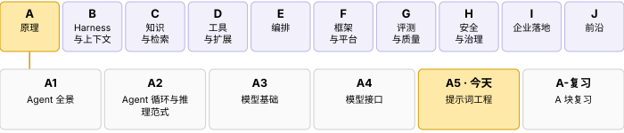
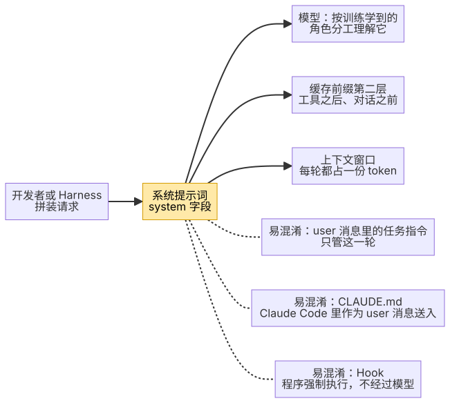
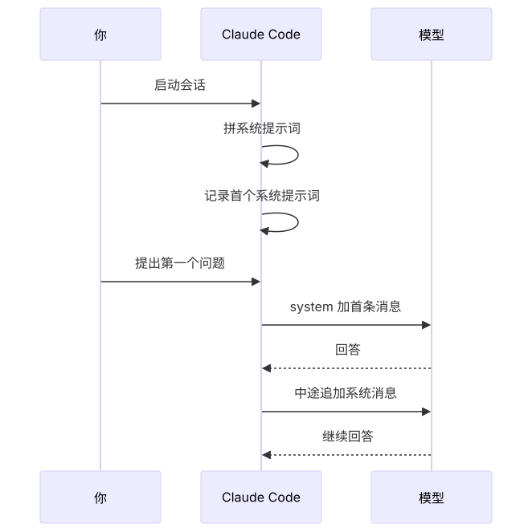
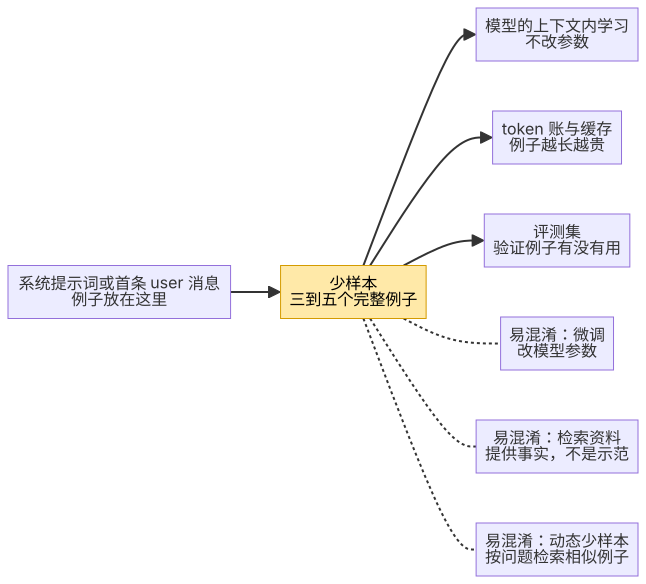
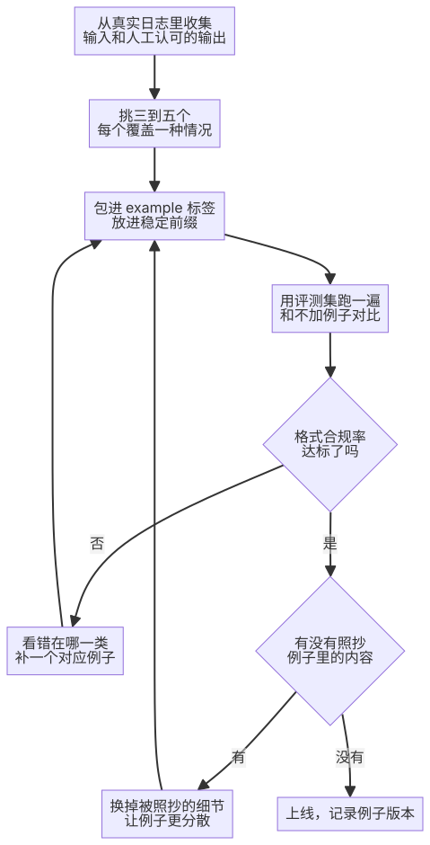
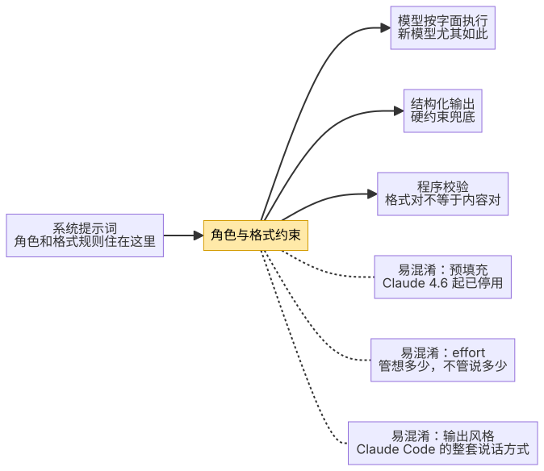
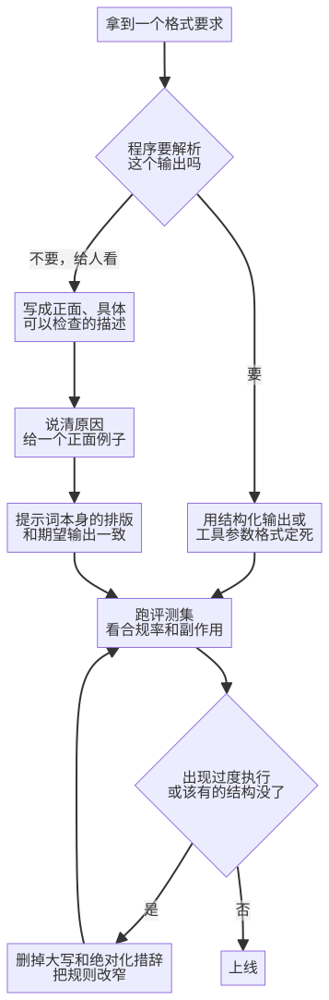
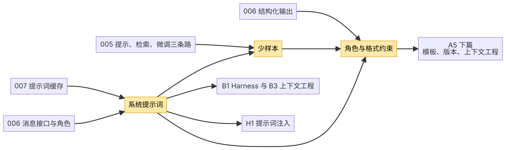

# 008 - Prompt Engineering Part 1 · 提示词工程（上）

> 第 008 讲 · A5 提示词工程（上） · A 原理：Agent 是怎么转起来的 · 事实核实截至 2026-10-30
> [← 返回目录](../README.md) · 上一讲：[007 模型接口（下）](007-model-api-2.md) · 下一讲：[009 提示词工程（下）](009-prompt-engineering-2.md)

> 本篇多处拿 Claude 的提示词写法和 OpenAI、Google 的写法对比，也用 Claude Code 当本机实物。本文由 Anthropic 的模型撰写，存在利益相关；Claude 这边的短板在各概念的「其他家叫什么」里单独写出。

> A5 的概念清单有六个：系统提示词、少样本、角色与格式约束、提示词模板、版本管理、提示词工程和上下文工程的分界。六个概念各写八块讲不透，所以拆成两篇：上篇讲"一份提示词里面写什么"，下篇讲"提示词怎么复用、怎么管、边界在哪"。

---

## 🧭 Bulletin 流程

> 同一个模型、同一个问题，回答时好时坏 → **① 系统提示词** → **② 少样本** → **③ 角色与格式约束** → 规则写在最稳的位置，做法用例子示范，身份和格式说成可以检查的要求

上篇讲一份提示词里面装什么。三个概念按"先定位置、再给示范、最后定口径"的顺序排。

1. **系统提示词**：整段对话都生效的那份规则，放在请求最前面的 system 字段，管身份、底线和背景；具体任务放在 user 消息里。
2. **少样本**：在提示词里放三到五个"输入长这样、输出就该长这样"的例子，让模型照着做法学，而不是只听描述。
3. **角色与格式约束**：用一句话告诉模型它是谁，再用正面、具体、能检查的话说清输出长什么样；程序要解析的格式，交给结构化输出去硬性保证。

---

## 📍 定位图



怎么读这张图：上面一行是整张地图的 10 个块，下面一行是今天所在的块展开成的各簇，黄色是今天的位置。

A5 上面接的是 A4：A4 讲 system 字段放在请求的哪个位置、改了会让哪一层缓存失效，今天讲这个字段里面该写什么。A5 下面通向 A 块复习，再往后是 B 块：B1 讲 Harness 怎么替你拼提示词，B3 上下文工程讲当提示词之外还有文件、记忆、工具结果一起挤进窗口时，怎么决定放什么。

---

## 本簇讲解

### 这一簇要解决什么问题

Charles 的研报助手接入公司内网第一周，分析师反馈了三类问题，用的模型、接口、工具都没变。

第一，规则时灵时不灵。他在每个问题前面加了一句"请只依据给定资料回答，数字保留一位小数"。分析师小王在同一个对话里问到第八轮时，助手开始引用资料里没有的数字。原因是这句规则跟着第一个问题写在了第一条 user 消息里，越往后，它离模型正在回答的位置越远，而且和后面七轮的提问、工具结果混在一起，不再像"整场都要遵守的规矩"。

第二，评级写法五花八门。同样是"增持"，助手有时写"增持"，有时写"Outperform"，有时写"建议增持（审慎）"。下游脚本按"买入、增持、中性、减持、卖出"五个词统计，一周有 18% 的回答对不上号。他在提示词里写了"评级请使用规范写法"，没用，因为模型不知道他心里的"规范"是哪五个词。

第三，语气和格式飘。有人问一句"宁德时代这季度毛利率多少"，助手回了一段带三级标题、加粗、六个要点的长文；风控部门的同事则抱怨它"像客服一样每句都先说'好的，很高兴为您解答'"。他在提示词里加了一行大写的"CRITICAL：绝对不要使用 Markdown"，结果助手连需要表格的地方也不用表格了。

这三类问题对应今天的三个概念：规则该放在哪才能整场生效，模型不知道你心里的标准时怎么用例子示范，身份和格式怎么说才既管用又不过头。

---

### 概念一：系统提示词

**1. 定义**

系统提示词（system prompt）是调用方放在请求最前面、在整段对话里持续生效的指令文本，用来规定模型的身份、行为规则、底线和背景知识。它和 user 消息的区别不在于"写的是什么"，而在于两件事：位置固定在最前面，每一轮都原样带上；模型在训练时学过"这个位置上的话来自开发者"，会把它当作整场对话的框架。

截至 2026-10-19 的官方细节（Claude）：[1][2][4]

- **放在哪**：请求顶层的 `system` 字段，不放进消息列表。官方的角色示例把一句身份写在 `system` 里，把具体问题写在 `user` 消息里。
- **一句也管用**：文档原话的意思是，在系统提示词里设定角色能让模型的行为和语气聚焦到你的用途上，"哪怕只有一句话也有差别"。
- **优先级没有明文**：今天读到的 Claude 提示词文档里，没有一句话规定"system 和 user 冲突时以谁为准"。实际表现是模型通常更尊重 system，但这是训练出来的倾向，不是接口层面的硬规则。这一点要和 OpenAI 区分开，OpenAI 写进了文档，见第 8 块。
- **长了要首尾呼应**：Opus 5 的提示词指南建议，在很长的系统提示词里，重要指令在末尾附近再放一句简短提醒。[2]
- **长资料放前面、问题放后面**：资料超过约 2 万 token（token：模型读写文字的最小计数单位）时，把长文档放在最上面，把问题、指令和例子放在后面；文档说测试里这样做回答质量最多能提升 30%。[1]
- **会话中途也能加**：上篇讲过，新模型可以在对话中途插入 `role: "system"` 的消息追加指令，不让前面的提示词缓存（把重复前缀的计算结果存起来、下次低价复用的功能）失效。2026-09-01 起又有一个测试版：带 `clear_at: "next_user_message"` 的系统消息只管当前这一轮，下一条 user 消息到来就自动失效；2026-09-22 起测试版支持在中途的系统消息里直接定义工具。[4]
- **改了有代价**：在 Fable 5.1（新账号）、Sonnet 5.5、Haiku 5.5 上，改了 `system` 之后还原样重放之前的思考块（thinking block：模型在回答前的内部推理内容），可能返回 400 错误（HTTP 400：请求格式或内容有问题）。[4] 这和 [007 模型接口（下）](007-model-api-2.md) 讲的"改了系统提示词，后面的缓存全部失效"是同一个道理：系统提示词是整段对话的地基，地基一动，上面依赖它的东西都要重来。

**2. 场景**

接着开头的研报助手。Charles 把那句"只依据给定资料回答，数字保留一位小数"从第一条 user 消息里搬进 `system` 字段，同时补了三样东西：

- **身份一句**：你是券商研究所的研报问答助手，服务对象是所内分析师。
- **底线三条**：只依据本轮提供的资料和工具结果回答；资料里没有的数字，回答"资料未提供"；不给个股买卖建议。
- **背景一段**：所内评级体系是五档，口径以研究所 2026 版评级说明为准。

具体的问题，比如"比较宁德时代和比亚迪的毛利率"，仍然放在 user 消息里。

效果怎么验：他从上周的日志里挑了 60 个"长对话里第 6 轮以后"的问题，用改之前和改之后的提示词各跑一遍，人工判"有没有引用资料外的数字"。改之前 60 题里有 9 题出现资料外数字，改之后 2 题。这组数字是示意，方法是真的：同一组问题、只改一处、人工或用模型当裁判打分。

还有一笔账：这段系统提示词约 1500 token，每轮都要带。按 [007 模型接口（下）](007-model-api-2.md) 的缓存规则，它只要一字不改，就一直命中缓存，每轮按原价的 0.05 倍计费（Opus 5.5、Sonnet 5.5，截至 2026-10-19）。所以系统提示词里不要放"今天是几月几号""当前用户：张三"这类每次都变的东西，把它们放到 user 消息里。

**3. 它解决什么问题**

因果链分三步。

第一，接口无状态，每一轮都要把全部内容重发（[006 模型接口（上）](006-model-api-1.md) 讲过）。如果规则写在某一条 user 消息里，它在对话里的位置就是固定在那一轮，随着对话变长，离模型当前要回答的位置越来越远，和后面几十条提问、工具结果挤在一起，模型越来越难判断"这句话是那一轮的临时要求，还是整场的规矩"。

第二，系统提示词把规则放在一个专门的位置。这个位置每轮都在最前面，内容不随对话变化；模型在训练时见过大量"system 写规则、user 提问题"的数据，学会了把这个位置上的话当作框架。所以同一句规则，放在 system 里比夹在某条 user 消息里更稳定。

第三，它还把"谁写的"分开了。系统提示词由开发者写，user 消息可能来自外部用户。把两者分开，才谈得上"用户说的话不能推翻开发者定的底线"。但这层分隔是靠模型的训练维持的，不是靠程序强制，所以提示词注入（在输入里夹带指令、让模型偏离原本规则的攻击）仍然可能得手，H1 簇展开。

它不解决的：模型不知道的知识，系统提示词写不出来，那是 C 块检索的事；必须百分之百执行的动作，比如"每次提交前跑测试"，写在系统提示词里也只是"尽量遵守"，要用 Hook（由 Harness 在固定时机自动执行的脚本，不经过模型）去强制，D4 簇展开。

**4. 位置图**



怎么读这张图：左边是上层，写系统提示词的是开发者，在 Claude Code 这类产品里是 Harness（套在模型外面、负责循环、工具、权限和上下文的那层程序）替你拼。右边三个实线节点是下层：模型靠训练出来的角色分工理解它；它在缓存前缀里排第二层，前面只有工具定义；它每轮都要占窗口里的 token。三条虚线是最常混的三样东西。user 消息里的任务指令只管当前这一轮。CLAUDE.md（Claude Code 的项目说明文件，写给模型看的长期规则）看起来像系统提示词，但官方文档写明它是"作为系统提示词之后的一条 user 消息送入的"，不在系统提示词里。[5] Hook 和系统提示词都能约束行为，区别是 Hook 由程序执行、模型绕不过去，系统提示词只是请模型遵守。

**5. 运行流程图**

以 Claude Code 为例，一次会话里系统提示词是怎么拼出来、怎么送进去的：



怎么读这张图：箭头上是发出的消息，不是完成的动作。第二步"拼系统提示词"包括三部分：Claude Code 自带的默认提示词、当前输出风格（output style：改变回答方式的一段指令，比如解释型、简洁型）的内容、启动时用 `--append-system-prompt` 追加的文字。第三步，CLI 文档写明默认在会话的第一个请求时把系统提示词定下来、记在会话里，之后每个请求都用这份记录，直到对话被压缩（compaction：把旧对话改写成摘要替换原文）；用 `--resume` 回到旧会话也是这样。[7] 第五步的"首条消息"里装的是 CLAUDE.md 等项目说明，排在你的问题前面。第七步是会话中途追加的系统消息，比如新加载了工具、刚切换了输出风格。

**6. 实例（本机）**

本机有三处实物，全部只读、只统计，没有抄写会话内容。

第一处，一次会话的接口记录。Claude Code 2.1.300 起会把每个请求的消息记在本机的会话记录里。[8] 我取笔记库外最近的一个会话，只看消息的类型和长度：

```
第一条 user 消息   4 个文字块
  块 1   5681 字符   以 <system-reminder> 开头，装的是全局和项目说明
  块 2    564 字符   <system-reminder>，附带的账户上下文
  块 3    580 字符   <system-reminder>，提交说明的署名规则
  块 4     98 字符   你真正提的问题（内容不抄）
会话中途的 system 消息   18 条
  新工具可用的通知   最长 39732 字符，带 tool_addition 块
  工具下线的通知     约 4300 字符，带 tool_removal 块
  输出风格           1198 字符，开头是 Output Style: Explanatory
  剩余额度提示       约 140 字符，出现十几次
```

读法有三点。第一，`~/.claude/CLAUDE.md` 里那段"全局说明"确实不在系统提示词里，而是被包在 `<system-reminder>` 标签里，放进了第一条 user 消息，排在问题前面。这和官方文档"CLAUDE.md 作为系统提示词之后的一条 user 消息送入"一致。[5] 所以 CLAUDE.md 写得再强硬，地位也是"开发者放在用户消息里的说明"，文档原话是模型"会尽量遵守，但不保证严格执行"。第二，输出风格是以会话中途 system 消息的形式进来的，这就是上篇讲的"中途追加系统消息不让缓存失效"的真实用法。第三，这份记录里我没找到顶层 `system` 字段的原文；CLI 文档说首个请求的系统提示词会记在会话里，具体存在哪条记录、要不要用别的命令导出，今天没查清，📝 待补。

第二处，`~/.claude/CLAUDE.md` 本身，只有 980 字节，分"本机使用"和"语言"两节，全是可以检查的具体规则，比如"我用中文问，就用中文回复"。官方建议每个 CLAUDE.md 控制在 200 行以内，太长会占上下文、降低遵守率。[5]

第三处，Claude Code 给了改系统提示词的开关，截至 2026-10-19 的 CLI 文档：[7]

- `--system-prompt`、`--system-prompt-file`：整个替换默认提示词。文档提醒，替换会丢掉默认的工具说明和安全指令，"缺什么你自己负责"。
- `--append-system-prompt`、`--append-system-prompt-file`：追加在默认提示词末尾，什么都不删。
- `--system-prompt-snapshot off`：每个请求都重新拼系统提示词，适合反复调追加文字时用。
- 在追加的文字里单独放一行 `__SYSTEM_PROMPT_DYNAMIC_BOUNDARY__`：这一行以上保持缓存，以下可以变化（需要 2.1.275 及以后）。

官方接口的最小例子（Claude，按当天文档写法整理；不在本机运行）：[1]

```python
import anthropic
client = anthropic.Anthropic()
SYSTEM = """你是券商研究所的研报问答助手，服务对象是所内分析师。
规则：
1. 只依据本轮提供的资料和工具结果回答。
2. 资料里没有的数字，回答"资料未提供"，不要估算。
3. 不给个股买卖建议；评级只引用研报原文。
背景：所内评级五档：买入、增持、中性、减持、卖出。"""
r = client.messages.create(
    model="claude-opus-5-5", max_tokens=800,
    system=SYSTEM,                                   # 整场生效的规则，内容不随轮次变化
    messages=[{"role": "user",
               "content": "<资料>……</资料>\n比较两家公司的毛利率。"}])  # 具体任务放这里
print(r.content[0].text)
```

运行位置三问：系统提示词由你的程序或 Claude Code 在本机拼好，随每个请求发到厂商云端；每次调用接口时触发，Claude Code 里是会话第一个请求时定下来；它本身不会回到人手里，人看到的是它影响之后的回答。

**7. 常见误解与边界**

- **"系统提示词的优先级是程序保证的"**：不是。在 Claude 上，system 优先于 user 是训练出来的倾向，接口不会替你拦截违反规则的回答。必须做到的事，用 Hook、权限或输出校验兜底。
- **"规则越多越稳"**：不对。规则多了会互相冲突、稀释注意力。Claude Code 文档写得很直接："两条指令互相矛盾时，Claude 可能任选一条"；文件越长遵守率越低。[5]
- **"系统提示词是保密的"**：不能这么假设。系统提示词会被模型读到，就有可能被诱导说出来。不要在里面放密钥、内部账号、客户数据。
- **"CLAUDE.md 就是 Claude Code 的系统提示词"**：不对。官方文档写明它作为系统提示词之后的 user 消息送入。想要系统提示词级别的指令，文档建议用 `--append-system-prompt`。[5]
- **常见复述偏差**："系统提示词就是给模型设定一个人设" → 对一半：对在设定身份确实是它最常见的用途；错在把它说窄了。系统提示词是"整场对话都生效的规则区"，身份只是其中一项，底线、背景知识、工具使用规范、输出口径都放在这里。只讲人设，面试官会追问"那业务规则放哪"。
- **边界**：系统提示词管的是"模型怎么想、怎么说"，管不了"程序允许它做什么"。工具权限在 Harness 里定，B2 簇展开；外部输入里的恶意指令，H1 簇展开。

**8. 其他家叫什么**

- **OpenAI**：接口里有两种写法，一是 Responses API（OpenAI 当前主推的调用接口）的 `instructions` 参数，二是 `developer` 角色的消息。文档写明了优先级：`developer` 消息"优先于 user 消息"，`instructions` 参数里的指令"优先于 input 里的提示词"，背后的依据是它公开的 Model Spec（OpenAI 写明模型行为准则的公开文档）里的"指挥链"一节。有一个和 Claude 不同的细节：`instructions` 只对当前这一次请求生效，用 `previous_response_id` 接着上一轮对话时，上一轮的 `instructions` 不会自动带过来，要每次重传。文档推荐的开发者消息结构是"身份、指令、例子、上下文"四段，上下文放最后。示例代码里用的模型是 `gpt-6-astra`（截至 2026-10-19）。[9][10]
- **Google Gemini**：叫系统指令（system instruction），用 `system_instruction` 参数传入；提示词指南建议把行为约束、角色和输出格式要求放在系统指令里，或者放在用户提示词的最开头。截至 2026-10-19，文档代码示例用的是新的 Interactions API（Google 新推的调用接口）和 `gemini-3.8-flash`。[12][13]

Claude 这边的短板：OpenAI 把"开发者优先于用户"写进了文档和公开的行为准则，Claude 的提示词文档没有给出同样明确的优先级说明，开发者只能靠测试去确认；Claude Code 的 CLAUDE.md 地位是 user 消息，新手容易误以为它是系统提示词，遵守不好时找错原因。

---

### 概念二：少样本

**1. 定义**

少样本提示（few-shot prompting，Claude 文档也叫 multishot prompting）是在提示词里放几个"输入加理想输出"的完整例子，让模型在本次请求里照着例子的做法、格式和口径完成新的输入。模型的参数一点没变，它是在读提示词的过程中现场学会的，这种能力叫上下文内学习（in-context learning：模型不改参数，只凭提示词里的例子学会一个新任务）。不放例子、只给指令叫零样本（zero-shot）。

这个说法是 2020 年 GPT-3 的论文推广开的，论文标题就是"语言模型是少样本学习者"。[14]

截至 2026-10-19 的官方建议（Claude）：[1][2]

- **作用**：文档说例子是"引导输出格式、语气和结构最可靠的方法之一"。
- **三个要求**：相关，贴近真实用途；多样，覆盖边界情况、彼此差异够大，避免模型学到你没打算教的规律；有结构，每个例子包在 `<example>` 标签里，多个例子再包一层 `<examples>`，让模型分得清哪些是例子、哪些是指令。
- **放几个**：建议 3 到 5 个效果最好。
- **可以让模型帮忙**：可以请 Claude 评估你给的例子够不够相关、够不够多样，或者照着已有的几个再生成一些。
- **和思考一起用**：例子会影响模型在思考块里怎么想同类问题；文档建议每个例子写成"问题、要用的方法、期望答案"三段。
- **正面例子优于反面禁令**：Opus 5 的指南说，给出你想要的沟通风格的正面例子，往往比写"不要做什么"更有效。[2]

**2. 场景**

接着开头那个评级写法五花八门的问题。Charles 不再写"请使用规范写法"，而是在系统提示词末尾放了 4 个例子：

- **例 1**：资料原文写"维持增持评级"，输出 `评级：增持`。
- **例 2**：资料原文是英文研报，写"Outperform"，输出 `评级：增持`。
- **例 3**：资料原文写"首次覆盖，给予买入评级"，输出 `评级：买入（首次覆盖）`。
- **例 4**：资料里没有提到评级，输出 `评级：资料未提供`。

例 2 教的是"英文写法要换成所内口径"，例 3 教的是"附加信息怎么写"，例 4 教的是"没有时怎么办"。四个例子各管一种情况，这就是"多样"。

效果：下游脚本对不上号的比例从 18% 降到 1.5%。剩下的 1.5% 里，有一类新问题：资料写"上调至买入"时，助手照着例 3 写成了 `评级：买入（首次覆盖）`。这是模型从例子里学到了一个他没打算教的规律："括号里写来源"。修法是再加一个"上调"的例子，或者在指令里说清括号里只写"首次覆盖"四个字。

成本：4 个例子约 600 token，每天 1 万次请求就是每天 600 万 token。按 Opus 5.5 输入每百万 token 4 美元算，不缓存每天 24 美元；放在系统提示词里、命中缓存后按 0.05 倍算，每天约 1.2 美元（截至 2026-10-19 的官方价格，请求量是示意）。例子放在稳定的前缀里，几乎不花钱；如果每次都换一组例子，就每次都按原价付。

**3. 它解决什么问题**

因果链是这样的。指令是用文字描述你要什么，但很多要求说不清楚，或者说清楚要写很长一段。"规范写法"是什么？"简洁"是多简洁？"专业的语气"是什么语气？你心里有标准，模型不知道。例子把标准直接摆出来：输入长这样，输出就长这样。模型擅长模仿模式，看到三五个例子，格式、长度、用词、遇到特殊情况怎么处理，一次全学到了。

对 Agent 还有一层意义：输出要被程序读取时，格式稍有偏差就会让下游出错。例子是除了结构化输出（让接口按你给的 JSON Schema 强制生成结果的功能，[006 模型接口（上）](006-model-api-1.md) 讲过）之外，最便宜的稳定格式的办法。

它和 [005 模型基础（下）](005-model-fundamentals-2.md) 讲的"提示、检索、微调三条路"的关系是：少样本是"提示"这条路里最强的一招。很多人以为要微调（用自己的数据继续训练模型、改变参数）才能让模型学会所内口径，其实先试几个例子，常常就够了；例子放不下或者成本太高时，才轮到微调。

它不解决的：例子只能示范做法，不能补知识。模型不知道某公司的最新财报，给多少个格式例子也没用，那要靠检索。

**4. 位置图**



怎么读这张图：左边是上层，例子总是住在某一段提示词里，通常是系统提示词末尾，也可以放在第一条 user 消息里。右边三个实线节点是下层：模型靠上下文内学习用它；它占 token，放在稳定前缀里就能吃到缓存折扣；它有没有效，要靠评测集（一组固定的测试问题和标准答案，改提示词前后各跑一遍对比）来证明。三条虚线：微调把例子"烧进"模型参数，少样本只是放在提示词里，换一次请求就没了；RAG（Retrieval-Augmented Generation，检索增强生成：先从资料库里找相关内容，再交给模型回答）检索来的资料是"事实"，少样本给的是"做法"，两者常放在同一份提示词里但作用不同；动态少样本是按当前问题从例子库里检索最相似的几个例子再放进去，它是少样本和检索的结合，C 块会碰到。

**5. 运行流程图**

少样本不是写一次就完事，它是一个"挑例子、测、改"的循环：



怎么读这张图：从上往下是一轮迭代。第一个菱形问"有没有用"，看的是格式合规率，也就是输出能被下游程序正确读取的比例。第二个菱形专门查少样本特有的副作用：模型把例子里的具体内容当成答案的一部分，比如例子里的公司名、数字、括号里的说明被搬进了新回答。最后一步"记录例子版本"，是下篇要讲的版本管理的入口：例子改了，提示词就改了，要能回溯哪一版例子对应哪一批输出。这张图里"补一个例子"和"换掉细节"画成两条回路，是为了分清两种失败；实际上一次修改常常两件事一起做。

**6. 实例（官方接口加本机）**

官方接口的最小例子（Claude，按当天文档"用 example 标签包住例子"的写法整理；不在本机运行）：[1]

```python
import anthropic
client = anthropic.Anthropic()
EXAMPLES = """<examples>
<example><资料>维持增持评级，目标价 280 元。</资料><输出>评级：增持</输出></example>
<example><资料>We maintain Outperform.</资料><输出>评级：增持</输出></example>
<example><资料>首次覆盖，给予买入评级。</资料><输出>评级：买入（首次覆盖）</输出></example>
<example><资料>本季度营收同比增长 12%。</资料><输出>评级：资料未提供</输出></example>
</examples>"""
SYSTEM = ("你从研报片段里提取评级，只能输出五档之一：买入、增持、中性、减持、卖出；"
          "原文没有评级时输出'资料未提供'。括号里只允许写'首次覆盖'。\n" + EXAMPLES)
r = client.messages.create(
    model="claude-sonnet-5-5", max_tokens=50, system=SYSTEM,
    messages=[{"role": "user", "content": "<资料>上调至买入评级。</资料>"}])
print(r.content[0].text)        # 期望：评级：买入
```

两处说明。第一，指令里那句"括号里只允许写'首次覆盖'"，就是场景里发现"照抄括号"之后补的规则，例子和指令是互相配合的。第二，如果这个结果要被程序读取，更稳的做法是用结构化输出加一个只有六个取值的枚举字段（enum：只能从固定几个值里选一个的字段），例子负责教口径，结构化输出负责保证格式，见概念三。

本机实物：`~/.claude/skills/agent-md-refactor/SKILL.md` 里有一节 `## Examples`，用"正确写法"和"不要这样写"两段代码并排示范，这是 skill（Claude Code 里按需加载的一套操作说明）作者在提示词里用例子教做法的真实样子。另外，Charles 的写作规范 9.1.1 节给随文括注的要求时，没有只写"请加括注"，而是直接给了一个他点名说好的例子"MIT 许可（一种宽松的开源协议，可以免费下载）"，这也是少样本，只有一个例子，所以叫单样本（one-shot）。

运行位置三问：例子写在提示词里，随请求发到厂商云端；每次调用时生效，不需要单独触发；它的效果体现在回答的格式和口径上，人看到的是更一致的输出。

**7. 常见误解与边界**

- **"例子越多越好"**：不对。Claude 文档建议 3 到 5 个；Gemini 文档提醒例子太多模型会开始过拟合（overfit：过度贴合例子的细节，遇到新情况反而不会变通）。[1][12] 例子多了还更贵、更占窗口。
- **"例子只影响格式"**：不对。例子里的语气、长度、甚至答案分布都会被学走。2021 年一篇论文发现，少样本的效果对例子怎么选、怎么排、什么格式非常敏感：例子里某个标签出现得多，模型就倾向于多猜这个标签；排在最后的例子影响更大。[15] 所以分类任务的例子要各类均衡，顺序也要打乱测试。
- **"推理模型不需要例子"**：说一半。OpenAI 一份较早的推理模型指南建议先不放例子试试，输出要求复杂时再加。[10] Claude 文档则说例子和思考可以一起用，而且会影响思考的方式。[1] 结论是：要不要放例子，看评测结果，不看模型类型。
- **"把真实客户案例直接当例子"**：危险。例子会随每个请求发给厂商，还可能被模型在回答里复述出来。金融场景的例子要脱敏（把姓名、账号等敏感信息替换掉），见三岗视角。
- **常见复述偏差**："少样本就是给模型几个例子让它模仿" → 对一半：对在"给例子、让它模仿"；错在漏了两件事。第一，例子要覆盖不同情况，而且要防止模型学到你没打算教的规律，所以挑例子是有方法的。第二，例子有没有用要拿评测集证明，不是放进去就算数。面试时只说"给几个例子"，听起来像没真正调过。
- **边界**：例子示范做法，不补知识；例子放不下、或者要几百个例子才能教会时，考虑微调；例子要随问题变化时，考虑动态少样本，也就是先检索相似例子再放进提示词。

**8. 其他家叫什么**

- **OpenAI**：也叫 few-shot learning。文档建议展示"多样的输入和对应的期望输出"，例子通常放在 `developer` 消息里，示例用 `<product_review id="example-1">` 这类带编号的 XML 标签区分；另一页提示词指南又建议把例子放在 user 消息里、合成一个紧凑的 YAML（一种用缩进表示层级的文本格式）或要点式的块，方便团队浏览和更新，两页说法略有出入。[9][10]
- **Google Gemini**：态度最积极，文档写"建议总是在提示词里放少样本例子，不放例子的提示词很可能效果更差"，例子足够清楚时甚至可以删掉指令；没有给具体个数，提醒太多会过拟合；特别强调所有例子的结构和格式要完全一致，连 XML 标签、空格、换行、分隔符都要统一。[12]

Claude 这边的短板：Claude 文档给了 3 到 5 个的具体建议，但没有像 Gemini 那样提醒"例子之间的格式必须完全一致"这类细节；Claude 新模型按字面执行指令的倾向更强，例子里不经意的细节，比如括号、句式，被照搬的可能性要靠评测去发现。

---

### 概念三：角色与格式约束

**1. 定义**

角色约束（role prompting）是用一两句话告诉模型它在这个任务里是谁、为谁服务、负责什么，从而收敛它的知识侧重、语气和判断标准。格式约束是用指令规定输出的结构、长度、语言、用词和标记方式。两者常常一起出现在系统提示词里，合起来回答"以什么身份、用什么样子交付"。

格式约束分软硬两种：写在提示词里的是软约束，模型尽量遵守但不保证；用结构化输出、工具的参数格式、程序校验实现的是硬约束，接口或程序保证。

截至 2026-10-19 的官方建议（Claude）：[1][2]

- **角色**：在系统提示词里设定角色，"哪怕一句话也有差别"。
- **说要什么，别只说不要什么**：文档的例子是，与其写"回答里不要用 Markdown（一种用井号、星号等符号表示标题和加粗的轻量排版语法）"，不如写"回答应该由连贯的段落组成"。
- **用 XML 标签指明格式**：比如"把正文写在 `<smoothly_flowing_prose_paragraphs>` 标签里"。XML（一种用尖括号标签包住内容的标记格式）标签名没有官方指定的"最佳"写法，取一个能说明内容的名字、全篇保持一致即可。
- **提示词长什么样，输出就倾向于长什么样**：提示词里少用 Markdown，输出里的 Markdown 也会变少。
- **说清原因**：文档举的例子是，"绝不要用省略号"不如"回答会被语音朗读，朗读引擎读不出省略号，所以不要用"有效，模型能从原因推广到类似情况。
- **别用吓人的语气**：文档写明，以前为了防止模型"该用工具不用"写的强硬措辞，在新模型上会造成过度触发；以前写"CRITICAL：你必须在……时使用这个工具"的地方，改成正常的"在……时使用这个工具"。这条是针对 Opus 4.5、4.6 以后的模型写的。
- **新模型更按字面执行**：Opus 5 的指南举例，审查类提示词里写"只报告高严重度问题"或"保守一点"，模型可能真的少报；建议让它全部报告，再在另一步里过滤。[2]
- **长度要单独说**：Opus 5 的回答默认比以前的 Opus 长，思考档位（effort：决定模型想多深的参数）管的是想多少，不管说多少，所以要简洁就在提示词里明说。[2]
- **预填充不能再用来定格式**：从 Claude 4.6 系列起，在最后一条 assistant 消息里替模型写好开头的预填充（prefill）返回 400 错误。以前靠预填充 `{` 逼模型输出 JSON（一种用花括号和键值对表示数据的文本格式）的做法，文档建议改用结构化输出，或者直接在指令里要求。[1]
- **对旧提示词要做减法**：Fable 5.1 本身排版就比以前的模型少，以前那段"少用 Markdown 和要点"的长指令在它身上可能把必要的结构也压掉了，文档建议删掉或换成更短的规则。[1]

**2. 场景**

接着开头的第三类问题：语气像客服，格式时而过度、时而全无。

Charles 做了四处修改：

- **角色写具体**：把"你是一个专业的金融助手"改成"你是券商研究所的研报问答助手，读者是所内分析师，他们要的是可以直接引用的数字和出处，不需要寒暄"。前一句没有服务对象、没有交付标准，等于没写；后一句告诉模型读者是谁、要什么、不要什么。
- **删掉大写禁令**：去掉"CRITICAL：绝对不要使用 Markdown"，改成正面描述："一般问题用两三句话直接回答；比较三个以上数字时用表格；不用加粗和多级标题。"
- **给原因**：加一句"分析师会把回答直接粘贴进研报草稿，所以不要写开场白和结束语"。
- **软硬分开**：评级、目标价这两个要被程序读取的字段，从提示词约束改成结构化输出，评级字段设成只有六个取值的枚举。

效果：在 80 个日常问题上人工打分，"有寒暄开场"从 31 次降到 2 次；"该用表格时用了表格"从 4 次升到 17 次（一共 19 题需要表格）；评级字段的格式错误变成 0，因为接口按枚举强制生成。数字是示意，比较方法和上面两个概念一样：同一组问题，只改一处，前后对比。

**3. 它解决什么问题**

因果链分两半。

角色解决的是"默认值太泛"。模型训练时见过各种身份的文本，不告诉它是谁，它就取一个平均值：礼貌、周全、什么都讲一点。一句具体的角色把它拉到某一类文本的风格和判断标准上，比如"研究所内部"意味着直接、带出处、不寒暄。但角色只是改变侧重，不会凭空增加知识。

格式约束解决的是"输出要被人或程序接着用"。人读的回答，格式影响效率；程序读的回答，格式错一点就会让下游出错。这里有三条因果要分清。第一，模型更擅长"照着做"而不是"别这么做"：只写"不要用 Markdown"，模型知道不能用什么，却不知道该用什么，于是要么继续用，要么连表格也不用了。第二，新模型更按字面执行，大写、"绝对"、"必须"这类强调会被当成"压倒其他一切的规则"，于是过度执行。第三，提示词里的格式约束终究是软的；程序要解析的字段，靠结构化输出这种硬约束才稳。

**4. 位置图**



怎么读这张图：左边是上层，角色和格式规则通常写在系统提示词里，所以它和概念一是"内容和容器"的关系。右边三个实线节点是下层：模型执行这些规则，新模型更按字面；程序要解析的部分交给结构化输出强制保证；就算格式对了，内容对不对还要业务校验，比如目标价 245 写成 254 照样是合法的 JSON。三条虚线：预填充以前常被用来定格式，在新模型上已经不能用；effort 常被误以为能控制回答长短，实际上它管的是思考深度；Claude Code 的输出风格是一整套写好的说话方式，可以理解为"打包好的角色加格式约束"，它会替换掉默认系统提示词里的软件工程那一节，除非设置 `keep-coding-instructions: true`。[6]

**5. 运行流程图**

拿到一个格式要求时，按下面的顺序决定怎么写：



怎么读这张图：第一个菱形是最重要的分叉，先分软硬：程序要读的，别指望提示词，直接上硬约束；给人看的，才在提示词里下功夫。右边那条路的三步是官方建议的三招：说要什么、说为什么、让提示词自己的样子和期望输出一致。第二个菱形查的是新模型上最常见的副作用：强硬措辞造成过度执行。两条路最后都汇到评测，这是为了说明"不管软硬都要测"，不表示硬约束和软约束出问题的方式一样：硬约束出的问题通常是内容错，软约束出的问题通常是格式飘。

**6. 实例（本机加官方接口）**

本机实物一：`~/.claude/CLAUDE.md` 的"语言"一节是一个很好的格式约束样本。它不写"不要乱用英文"，而是正面规定"我用中文问，就用中文回复"；规定术语第一次出现时写成"缩写（英文全称，中文名：一句话解释）"，给出了模板；还说明了边界：写进文件的内容可以是英文。三条都是能检查的具体规则。

本机实物二：这个定时任务自己的提示词 `~/.claude/scheduled-tasks/daily-agent-stack/SKILL.md`。第 6 行就是一句角色约束："你是 Charles 的「Agent 技术栈」讲师"。我统计了一下措辞：全文 78 行，"不"字出现 39 次，"绝不"2 次，"一律"4 次，"必须"1 次。否定句多，是因为里面大量规则是安全边界，比如"不读密钥文件""不修改任何配置"，这类边界本来就该用否定写，而且这些规则大部分有原因说明。按今天的官方建议，可以改进的是格式类规则：比如"不加'白话版''通俗讲'这类标签"，如果再配一句"场景段直接用行业外的人能懂的话写，标题保持'2. 场景'"，模型就同时知道了不要什么和要什么。这是一条建议，没有改动任务文件。

本机实物三：Claude Code 的输出风格本身就是"角色加格式约束"的产品化。文档写明，内置的默认风格之外还有 Proactive、Concise、Explanatory、Learning 四种，它们保留默认的工程指令、再加自己的说话方式；自定义风格会去掉默认提示词里的软件工程那一节。[6] 上面概念一的会话记录里那条 1198 字符的 `Output Style: Explanatory` 系统消息，就是它在请求里的样子。

官方接口的最小例子（Claude，角色加正面格式描述加结构化输出；按当天文档写法整理，结构化输出的字段写法沿用 [006 模型接口（上）](006-model-api-1.md) 核实过的 `output_config.format`，不在本机运行）：[1]

```python
import anthropic
client = anthropic.Anthropic()
SYSTEM = ("你是券商研究所的研报问答助手，读者是所内分析师。"
          "他们会把回答直接粘贴进研报草稿，所以不写开场白和结束语。"
          "summary 用两三句连贯的话写；只引用资料里出现的数字。")
schema = {"type": "object", "additionalProperties": False,
          "required": ["summary", "rating"],
          "properties": {
            "summary": {"type": "string"},
            "rating": {"type": "string",
                       "enum": ["买入", "增持", "中性", "减持", "卖出", "资料未提供"]}}}
r = client.messages.create(
    model="claude-sonnet-5-5", max_tokens=600, system=SYSTEM,
    output_config={"format": {"type": "json_schema", "schema": schema}},
    messages=[{"role": "user", "content": "<资料>……</资料>\n总结这篇研报的结论。"}])
print(r.content[0].text)
```

读法：角色和"为什么不要开场白"是软约束，写在 `system` 里；`rating` 的六个取值是硬约束，接口保证不会出现第七种写法。`summary` 怎么写仍然靠提示词。

运行位置三问：约束写在提示词和请求参数里，随请求发到厂商云端；每次调用时生效；人看到的是语气和格式更稳定的回答，程序拿到的是一定能解析的字段。

**7. 常见误解与边界**

- **"角色设得越厉害越好"**：不对。"你是全球顶尖的金融专家"没有服务对象、没有交付标准，等于没写。角色有用的部分是"为谁、要什么、不要什么"。另外，角色越锋利越容易带偏：要它穷举风险时设成"看多的研究员"，它会只找支持看多的证据。
- **"写上'你是专家'，模型就有了专家知识"**：不对。角色改变的是侧重和语气，不增加模型没有的知识。
- **"大写、加粗、写'必须'能让模型更听话"**：在新模型上常常适得其反。Claude 文档写明强硬措辞会造成过度触发，改成正常语气即可。[1]
- **"写了'只输出 JSON'就一定是 JSON"**：不一定。提示词里的格式要求是软约束，要保证能解析，用结构化输出；而且就算格式对了，内容也要业务校验。
- **"effort 调低回答就会变短"**：不对。Opus 5 的指南写明，effort 管的是想多少，不管说多少，要短就在提示词里说。[2]
- **常见复述偏差**："格式约束就是在提示词里规定输出格式" → 对一半：对在提示词里确实可以规定格式；错在漏掉了软硬之分。提示词里的规定是请模型遵守，程序要解析的字段必须用结构化输出这种硬约束；面试时只讲提示词写法，会被追问"那格式错了线上怎么办"。
- **边界**：角色和格式约束管"怎么说"，不管"说得对不对"；事实准确要靠检索和校验，安全底线要靠权限和 Hook。

**8. 其他家叫什么**

- **OpenAI**：角色写在开发者消息的"身份"段里，文档建议用 Markdown 标题和列表划分提示词的章节、表示层级，用 XML 标签标出一段内容从哪开始到哪结束，XML 属性还可以写这段内容的元数据。格式的硬约束同样叫 Structured Outputs。[9]
- **Google Gemini**：把角色叫 persona，和行为约束、输出格式一起建议放在系统指令里；针对 Gemini 3 的建议是 XML 风格的标签或 Markdown 标题都行，但选一种、全篇一致；长资料先放、指令放在最后。还有一条和格式相关的变化：截至 2026-10-19，Gemini 4 和 Gemini 3.6 以后的模型会忽略自定义的温度、top_p、top_k 采样参数（控制模型挑字时随机程度的参数，[004 模型基础（上）](004-model-fundamentals-1.md) 讲过），文档说未来会返回 400 错误，所以靠调温度来稳定格式的老办法在新模型上不成立了。[12][13]

Claude 这边的短板：Claude 停用了预填充，以前一行代码就能逼出 JSON 开头或去掉开场白的技巧没了，要改成结构化输出或更细的指令，迁移旧提示词有成本；新模型按字面执行、回答偏长，旧提示词里的强硬措辞和"保守一点"这类话要逐条重审，文档也承认在某个模型上测出的技巧要在别的模型上用自己的评测重新验证。[1]

---

## 👔 三岗视角

### AI 应用 / Agent 开发

**场景**：研报助手要从 Opus 5.5 切到 Sonnet 5.5 降成本，同时把系统提示词从一年前的 4200 token 精简一遍。上线前要证明"便宜了，效果没变差"。

**这个岗位具体做什么**：第一，拆提示词。把旧系统提示词按"身份、底线、背景、格式、例子"五段重排，删掉重复的规则；把"今天日期""当前用户"挪到 user 消息里，保证系统提示词能一直命中缓存。第二，审措辞。把"CRITICAL""务必""绝对"这类强调去掉，改成正面描述加原因；把"只报告重要问题"这类会被按字面少报的话改成"全部列出，按严重度排序"。第三，分软硬。评级、目标价、日期这类下游要读的字段改成结构化输出的枚举和格式。第四，建评测集。从日志里抽 200 题，覆盖短问答、长对话第 6 轮以后、需要表格、资料缺失四类，盯五个数：格式合规率（目标 99% 以上）、资料外数字出现率、需要表格时用了表格的比例、单次请求成本、缓存命中率（缓存读取的 token 除以全部输入 token，目标 80% 以上）。新旧两套提示词在两个模型上交叉跑，四组结果放在一张表里。

**最容易踩的坑**：一次改五处，效果变了却说不清是哪一处的功劳或锅。换模型和改提示词要分开测，先在旧模型上验证新提示词，再换模型。

### AI 产品 / 商业分析

**场景**：财富管理部的客服助手上线三个月，满意度调查里"回答太啰嗦、像机器人"的抱怨占了四成，业务方要求"把它调得像个真人顾问"。

**这个岗位具体做什么**：第一，把模糊的抱怨变成可以测量的问题。抽 100 条差评对话，归类：开场寒暄过长、一个简单问题答了五段、该给步骤时给了一堆免责声明。第二，判断该改哪里。语气和长度是提示词能解决的，改角色描述、加两三个"理想回答"的例子；如果是"答错了"，那是知识或检索的问题，改提示词没用。第三，设计对比实验。新旧提示词各分 10% 的流量跑两周，即 A/B 测试（把用户随机分成两组，分别用不同版本，比较指标），看满意度、平均回答长度、转人工率（用户放弃 AI、要求人工客服的比例）。第四，跟业务方讲清楚：提示词改语气见效快、几乎零成本；但每次改动都要过评测和合规审核，不能业务方提一句就当天上线。

**最容易踩的坑**：在提示词里写一句"请像真人一样亲切自然"就上线。这句话没有标准，模型的理解可能是"多用感叹号和表情"。要给出两三个业务方认可的理想回答当例子，把"亲切"变成看得见的样子。

### 金融科技 / 数据

**场景**：一家银行的理财客服助手，系统提示词里写着"不得承诺收益，不得推荐具体产品"，合规部问：这能不能算一项合规控制，写进内控文档？

**这个岗位具体做什么**：第一，定性。系统提示词是软约束，模型"尽量遵守"，不能单独作为合规控制；内控文档里要写成"第一道防线是提示词，第二道是输出检测，第三道是人工抽检"。第二，加硬控制。在回答发给客户之前，用规则加一个小模型检测"保本""稳赚""年化收益率达到"这类承诺收益的话术，命中就拦截并转人工。第三，管例子。系统提示词里的少样本例子不能用真实客户对话，要么改写、要么脱敏，因为例子会随每次请求发给模型厂商，也可能被模型复述给另一个客户。第四，管留痕。每次回答记录系统提示词的版本号、模型版本、是否被检测拦截；系统提示词每次修改都要走变更审批，和代码上线一样，能回答监管"三个月前这句话是按哪一版规则说的"。

**最容易踩的坑**：把系统提示词当成保密的内部文件，在里面写了"如果客户资产超过 500 万，优先推荐某某产品"这类内部营销规则。系统提示词可能被诱导说出来，一旦被客户截图，就是合规和声誉事件。不能公开的规则不要写进提示词，放在程序逻辑里。

---

## 🔗 串联图



怎么读这张图：黄色是今天的三个概念。系统提示词是容器，少样本和角色与格式约束是住在里面的两类内容，所以它连出两条线；少样本连向格式约束，是因为例子常常就是格式约束最有效的写法。左边四个来源：006 讲了 system 放在请求的哪个位置，也讲了结构化输出这个硬约束；007 讲了系统提示词在缓存前缀的第二层，所以它要稳定；005 讲了"先试提示、再试检索、最后微调"，少样本是提示这条路上最强的一招。右边三个去向：A5 下篇讲这份提示词怎么做成模板、怎么管版本、和上下文工程的分界在哪；B1 和 B3 讲 Harness 怎么替你拼提示词、窗口里除了提示词还装什么；H1 讲外部输入怎么冒充系统提示词的权威。图里把 006 拆成两个节点、把 B1 和 B3 合成一个节点，都是为了画得下，不代表结构关系。

相关卡片：[006 模型接口（上）](006-model-api-1.md) · [007 模型接口（下）](007-model-api-2.md) · [005 模型基础（下）](005-model-fundamentals-2.md) · [004 模型基础（上）](004-model-fundamentals-1.md)（采样参数和格式稳定性）· [003 Agent 循环与推理范式（下）](003-agent-loop-and-reasoning-2.md)（思维链：新模型上改用扩展思考，而不是在提示词里要求"一步步写出来"）

---

## 🎙 复述板块

### 整簇两分钟版

> A5 的上篇讲一份提示词里面写什么。三个概念，先定位置，再给示范，最后定口径。
>
> 第一，系统提示词。它是整段对话都生效的那份规则，放在请求最前面的 system 字段，每一轮都原样带上。身份、底线、背景知识放这里，具体的问题放在用户消息里。为什么要分开？因为规则如果夹在某一条用户消息里，对话一长，它就离模型越来越远，和后面的提问混在一起，模型分不清它是临时要求还是整场规矩。还有两个要点。它要稳定，不放日期和用户名，这样能一直吃到缓存折扣。它的优先级是训练出来的，不是程序保证的，必须做到的事要用程序兜底。
>
> 第二，少样本。很多要求说不清，比如规范写法、简洁、专业，你心里有标准，模型不知道。那就直接给三到五个例子，输入长这样，输出就长这样。例子要贴近真实场景，要各管一种情况，要用标签包起来和指令分开。最大的副作用是照抄，模型会把例子里的细节当成规律学走，所以要拿评测集去查。
>
> 第三，角色与格式约束。角色用一句话说清为谁服务、要什么、不要什么，你是一个专家这种话等于没写。格式要说要什么，而不是只说不要什么，再说清为什么。新模型按字面执行，大写的必须和绝对，反而会让它过度执行。最后分软硬，给人看的格式写在提示词里，程序要读的字段交给结构化输出去硬性保证。
>
> 最后收一句。规则写在最稳的位置，做法用例子示范，身份和格式说成可以检查的要求。明天讲下篇，这份提示词怎么做成模板、怎么管版本，以及提示词工程和上下文工程的分界在哪。

### 每个概念三十秒版

**系统提示词**

> 系统提示词是放在请求最前面、整段对话都生效的规则。它管身份、底线和背景，具体任务放在用户消息里。它每轮都原样重发，所以要稳定，不放日期和用户名，才能一直命中缓存。它比用户消息更受模型尊重，但这是训练出来的倾向，不是程序保证，必须做到的事要靠程序兜底。另外，它可能被诱导说出来，不能放密钥和内部规则。

记忆钩子：系统提示词像入职第一天发的员工手册，每天上班都带着，但手册写得再细，也替代不了门禁卡。

**少样本**

> 少样本是在提示词里放三到五个完整的例子，输入长这样，输出就长这样，让模型照着做。它解决的是说不清的标准，比如规范写法、简洁到什么程度。例子要贴近真实场景，各管一种情况，用标签和指令分开。它不改模型参数，只在这次请求里生效。最大的风险是模型把例子里的细节也学走，所以上线前要拿评测集查有没有照抄。

记忆钩子：少样本像带徒弟，说一百遍"要专业"，不如让他看三份写好的样稿；但样稿里有个错别字，徒弟也会照着抄。

**角色与格式约束**

> 角色约束是用一句话说清模型为谁服务、要交付什么、不要什么。格式约束是规定输出的结构、长度和用词。写法上有三条，说要什么而不是只说不要什么，说清原因，提示词本身的排版和期望的输出保持一致。新模型按字面执行，强硬的措辞会让它过度执行。给人看的格式写在提示词里，程序要读的字段用结构化输出硬性保证。

记忆钩子：角色像告诉厨师这桌客人是谁，格式约束像告诉他装盘的样子；但要保证每盘都是三百克，得靠秤，不靠叮嘱。

英文版口述：规范第 7 节的开关为"默认不写"，本篇不写。

---

## 💼 面试题板块

### 题 1 `[开发]` 如何写好 Prompt？分享一下你的 Prompt 工程实践经验，你怎么证明改过的提示词更好？

来源：题库。小林 coding「大模型工程面试题」第 16 题"如何写好 Prompt？分享下 Prompt 工程实践经验？"（页面最近更新 2026-10-12，2026-10-19 访问并通读）；牛客面经"蚂蚁集团 智能体与大模型应用工程 电话面试 30min"中有"怎么写好提示词？"（2026-04-29 发帖，2026-10-19 仅见搜索摘要）。"怎么证明更好"为自拟追加。[16][18]

**答题骨架**
- 结论：好的提示词是一份可以检查、可以测量的规格说明，而不是一段好听的文案。
- 三点展开：结构上分区，身份、规则、背景、例子、格式各就各位；写法上具体、正面、说原因；验证上用评测集做前后对比。
- 数字：评级格式对不上号的比例从百分之十八降到一点五；评测集两百题，只改一处、前后对比。

**逐字范例**

> 我的理解是，好的提示词是一份能检查、能测量的规格说明，不是一段好听的文案。分三点讲。
>
> 第一，结构。我会把提示词分成几块，身份、底线规则、背景知识、例子、输出格式。整场都生效的放在系统提示词里，具体任务放在用户消息里，资料用标签包起来，和指令分开。
>
> 第二，写法。每条规则要具体到能判断对错，比如"数字保留一位小数"，而不是"数字要规范"。说要什么，不只说不要什么，再说清原因。新模型按字面执行，我会把以前写的大写的必须、绝对这类话删掉，因为它们会造成过度执行。说不清的标准，就给三到五个例子。
>
> 第三，验证。我在做研报助手时，从日志里抽了两百个问题做评测集，覆盖短问答、长对话、资料缺失几类情况。每次只改一处，新旧两版各跑一遍，看格式合规率、资料外数字的出现率和单次成本。比如评级写法这一项，加了四个例子以后，下游对不上号的比例从百分之十八降到一点五。
>
> 一句话，提示词要像代码一样写，也要像代码一样测。

**追问链**
1. 用过没有：你的系统提示词有多长？怎么控制成本？要点：一千五百 token 左右，保持一字不改，靠提示词缓存命中，每轮按原价的零点零五倍计费；日期、用户名放到用户消息里。
2. 原理：为什么说要什么比说不要什么有效？要点：只说不要，模型知道不能做什么，但不知道该做什么，容易要么照旧、要么矫枉过正；官方文档的例子是把"不要用 Markdown"改成"用连贯的段落写"。
3. 取舍：提示词调到什么程度就该换别的办法？要点：格式问题调不稳就上结构化输出；是知识问题就上检索；例子要几百个才教得会，考虑微调。

**易错点**：只罗列技巧名词，比如角色、思维链、少样本，没有讲怎么验证。面试官最想听的是你怎么证明它变好了。

### 题 2 `[开发]` 系统提示词和用户提示词有什么区别？两者冲突时模型听谁的？你怎么设计才更稳？

来源：题库。DataCamp《Prompt Engineering Interview Questions and Answers for 2026》第 3 题"What is the difference between system and user instructions?"（2026-09-08 发布，2026-10-19 访问）；牛客"Agent面试题（自己总结版）"第 52 题"当前用户输入和历史记忆发生冲突时，以哪个为准？为什么？"（2026-10-14 发帖，个人整理题单，非单场面经，2026-10-19 访问）。两题合并改写。[17][18]

**答题骨架**
- 结论：区别在位置和来源，系统提示词由开发者写、整场生效；用户提示词来自用户、只管这一轮。冲突时模型通常更尊重系统提示词，但这是训练倾向，不是硬保证。
- 三点展开：两者各放什么；优先级在各家怎么定；怎么设计才稳。
- 例子：规则从第一条用户消息挪到系统提示词后，长对话里资料外数字从六十题九次降到两次。

**逐字范例**

> 区别在两点，位置和来源。分三点讲。
>
> 第一，各放什么。系统提示词放在请求最前面，由开发者写，整段对话每一轮都原样带上，放身份、底线和背景。用户提示词放在消息列表里，来自用户，只管这一轮的具体任务。我做过一个对比，把一句规则从第一条用户消息挪进系统提示词，长对话第六轮以后的六十个问题里，引用资料外数字的次数从九次降到两次。
>
> 第二，冲突听谁的。各家的说法不一样。OpenAI 在文档里写明开发者消息优先于用户消息，依据是它公开的行为准则。Claude 的提示词文档没有写明优先级，实际表现是模型更尊重系统提示词，但这是训练出来的倾向，接口不会替你拦截。
>
> 第三，怎么设计才稳。一是用户输入用标签包起来，告诉模型那是数据，不是指令。二是必须遵守的规则由程序兜底，比如权限控制和输出检测。三是系统提示词里不放怕泄露的东西。
>
> 一句话，系统提示词决定模型怎么想，程序决定它能做什么。

**追问链**
1. 用过没有：Claude Code 的 CLAUDE.md 算系统提示词吗？要点：不算，官方文档写明它作为系统提示词之后的一条用户消息送入；要系统提示词级别，用 append system prompt 参数。
2. 原理：模型为什么会更尊重系统提示词？要点：训练时用大量按角色排好的对话数据学过这种分工；所以它是统计上的倾向，换个模型、换种说法都可能变。
3. 边界：用户说"忽略之前的指令"怎么办？要点：这是提示词注入，靠提示词防不住全部，要配合输入隔离、工具最小权限和输出检测，H1 簇展开。

**易错点**：说"系统提示词优先级最高，用户改不了"，把训练倾向说成了硬规则。

### 题 3 `[开发]` Few-shot 是什么？什么时候用、放几个？怎么发现模型在照抄例子？用什么指标验收？

来源：前半为题库，DataCamp 同上第 4 题"What is few-shot prompting?"（2026-10-19 访问）；"放几个、怎么发现照抄、用什么指标"为自拟追加。[17]

**答题骨架**
- 结论：少样本是在提示词里放几个完整例子，让模型照着做法完成新输入；用在标准说不清、格式要统一的场景，一般三到五个。
- 三点展开：什么时候用；怎么挑；怎么验收和查照抄。
- 数字：四个例子约六百 token，每天一万次请求，不缓存每天约二十四美元，缓存后约一点二美元。

**逐字范例**

> 少样本就是在提示词里放几个"输入加理想输出"的完整例子，模型不改参数，在这次请求里照着学。分三点讲。
>
> 第一，什么时候用。当你的标准说不清的时候，比如所内评级的规范写法、回答的长度和语气。说一百句"要规范"，不如给三个例子。Claude 的文档建议三到五个。
>
> 第二，怎么挑。三条，贴近真实场景，各管一种情况，用标签和指令分开。我做评级提取时放了四个例子，分别管中文原文、英文原文、首次覆盖和没有评级。分类任务还要各类别均衡，因为例子里哪个标签多，模型就偏向猜哪个。
>
> 第三，怎么验收。看两个数。一是格式合规率，我的评级字段从百分之十八对不上号降到一点五。二是照抄率，专门挑例子里没出现过的情况去测，看模型有没有把例子里的细节搬进来。我就发现过它把例子里括号的写法套到了"上调评级"上。成本上，四个例子六百 token，放在稳定的系统提示词里命中缓存，每天一万次请求只要一美元多。
>
> 一句话，例子是最便宜的老师，但要盯着它别教歪。

**追问链**
1. 原理：少样本和微调的区别？要点：少样本不改参数、每次请求都要带、即改即生效；微调改参数、要准备数据和训练、换模型版本要重做。先试少样本，例子要几百个才教得会再考虑微调。
2. 边界：推理模型还需要例子吗？要点：OpenAI 较早的指南建议推理模型先零样本试；Claude 文档说例子和思考可以一起用，还会影响思考方式。结论看评测，不看模型类型。
3. 优化：例子要随问题变化怎么办？要点：动态少样本，先从例子库检索和当前问题最相似的几个再放进提示词；代价是例子变了，缓存就命中不了。

**易错点**：只说"给几个例子"，不讲怎么挑、怎么验收，也不知道例子多了会过拟合、会被照抄。

### 题 4 `[产品·商分]` 业务方抱怨 AI 客服"太啰嗦、像机器人"，要求调得像真人顾问。你怎么判断这是提示词能解决的问题，怎么衡量改好了？

来源：自拟。考点参考牛客"佰聆数据 助理AI应用开发工程师 实习 一面面经"第 7 题"对于提示词工程你有什么见解吗，提示词一般都要有什么内容？"（2026-07-15 发帖，2026-10-19 仅见搜索摘要）。[18]

**答题骨架**
- 结论：先把"像机器人"拆成能测量的问题，语气和长度是提示词能解决的，答错了不是。
- 三点展开：拆问题；改提示词；做实验验收。
- 数字：抽一百条差评归类；新旧版各分百分之十流量跑两周；看满意度、平均回答长度、转人工率。

**逐字范例**

> 我会先把"像机器人"拆开，因为它可能是三种完全不同的问题。分三点讲。
>
> 第一，拆问题。抽一百条差评对话归类，比如开场寒暄太长，简单问题答了五段，该给步骤时给了一堆免责声明，或者干脆答错了。前三种是语气和长度，提示词能解决；答错了是知识或检索的问题，改提示词没用，要另外排期。
>
> 第二，改提示词。角色写具体，说清客户是谁、要什么、不要什么，比如"客户多数在手机上看，先给结论，再给不超过三步的操作"。不写"请像真人一样亲切"，这句话没有标准，模型可能理解成多用感叹号。我会请业务方挑两三条他们心目中的理想回答，直接当例子放进去，把"亲切"变成看得见的样子。
>
> 第三，做实验。新旧两版各分百分之十的流量跑两周，看三个数：满意度，平均回答长度，转人工率。同时合规要审一遍新提示词，确认没有为了"亲切"而说出承诺性的话。
>
> 一句话，先把抱怨变成指标，再决定是改提示词还是改别的。

**追问链**
1. 业务方要求今天改、今天上线怎么办？要点：提示词改动和代码上线一样要过评测和合规；可以先在灰度，也就是一小部分流量上试。
2. 满意度没变但回答变短了，算成功吗？要点：看转人工率和问题解决率，短了但解决不了问题不算成功。
3. 要不要换一个"更会说话"的模型？要点：先在同一个模型上改提示词，确认问题不在提示词，再评估换模型；两件事不能一起改。

**易错点**：直接说"加一句让它亲切一点"，没有拆问题、没有指标，也没意识到答错和语气是两类问题。

### 题 5 `[金融科技·数据]` 银行理财客服助手的系统提示词里写了"不得承诺收益"，合规部问这能不能算一项合规控制。你怎么回答？

来源：自拟。

**答题骨架**
- 结论：不能单独算。系统提示词是软约束，只能当第一道防线，要配硬控制和留痕。
- 三点展开：为什么是软约束；要补哪些硬控制；提示词本身怎么管。
- 例子：在提示词里写内部营销规则，被诱导说出来就是声誉事件。

**逐字范例**

> 我的回答是不能单独算，它只能是第一道防线。分三点讲。
>
> 第一，为什么。系统提示词是请模型遵守，模型更尊重它，是训练出来的倾向，接口不会替你拦截违规回答。客户换个说法追问，或者在问题里夹带指令，模型仍然可能说出"这款产品基本稳赚"这类话。合规控制要求的是可验证、可执行，提示词做不到百分之百。
>
> 第二，补硬控制。回答发给客户之前，加一道输出检测，用规则加小模型识别保本、稳赚、年化收益达到多少这类话术，命中就拦截、转人工。再加定期人工抽检，统计漏检率。内控文档里写成三道防线，提示词、输出检测、人工抽检。
>
> 第三，管提示词本身。系统提示词每次修改都走变更审批，每次回答记下提示词版本和模型版本，监管问起能回放。例子不能用真实客户对话。不能公开的内部规则不要写进提示词，它可能被诱导说出来。
>
> 一句话，提示词告诉模型该怎么说，合规要靠程序和流程证明它确实没乱说。

**追问链**
1. 输出检测误拦太多，影响体验怎么办？要点：先按风险分级，高风险话术直接拦，中风险加免责提示，定期用标注数据调阈值，统计误拦率和漏拦率。
2. 提示词版本怎么和每次回答对上？要点：每次调用记录提示词版本号、模型版本、检测结果，按调用编号存档；下篇讲版本管理。
3. 用的是境外模型，系统提示词里的内部规则算不算数据出境？要点：要按数据分级评估，敏感规则不放进提示词，H2 簇展开。

**易错点**：回答"写进系统提示词模型就会遵守，可以算控制"，或者反过来说"提示词没用"，两种都没讲清软硬控制怎么配合。

---

## 📡 前沿快讯

取上一篇（2026-10-18 写入）之后的发布，补一条上一篇没收录、和今天主题直接相关的。今天的 AI 效率简报《研究代理先建证据地图再下结论》（2026-10-19）讲的是研究类 skill 先列主张再找证据的做法，属于 E 块工作流，和今天的提示词主题不重叠，这里不展开。

1. **Claude Code 2.1.304 发布（GitHub 发布页显示 10 月 19 日）**。和今天相关的三条：修正了 `--system-prompt-snapshot` 等参数的帮助文字，使之和实际行为一致；压缩之后会把 skill 列表重新发给模型一次，`/reload-skills` 只发新增或改过的 skill；`/fast` 去掉了"研究预览"标签。[8] 落在今天的 **系统提示词** 和 B4 压缩：压缩会改写前缀，系统提示词和 skill 列表要重新送一遍，说明"提示词里装了什么"在 Harness 里是动态维护的。对已写卡片没有影响。
2. **Claude 平台 2026-10-15 的两条更新（补漏）**。合规接口（Compliance API：给企业管理员导出使用记录、做审计的接口）测试版开始返回用户在 claude.ai 设置的"给 Claude 的指令"和 Cowork 的"全局指令"，面向企业版；Opus 5.5 的 Fast 模式结束研究预览，不再需要 `fast-mode-2026-02-01` 请求头，并上线微软 Foundry。[4] 前一条落在今天的 **系统提示词** 和 H2 合规：用户自己写的长期指令也成了企业要审计的对象；后一条落在 I2 服务档位。[007 模型接口（下）](007-model-api-2.md) 写的"Fast 模式：Opus 系列加价换更快生成速度的选项"仍然正确，不用改。
3. **OpenAI 2026-10-16 向全部 API 用户开放 prompt-to-voice，并为 GPT-Live 增加 9 种新音色**。[11] 落在 D7 多模态与实时。对已写卡片没有影响。今天没有读到这项功能的详细文档，具体能力未核实。（2026-10-30 回访：OpenAI API 更新日志 10-16 条目写明，prompt-to-voice 是用一段文字描述生成自定义音色、再在 GPT-Live 会话里复用；9 种新音色覆盖德、法、印地、日、韩语。https://developers.openai.com/api/docs/changelog ）

截至 2026-10-19，MCP（Model Context Protocol，模型上下文协议：让 Agent 统一接入外部工具和数据的开放协议）规范仓库和官方博客在 10 月没有新发布，最新稳定版仍是 2026-07-28。

---

## 🔁 昨日回顾与明日预告

**昨日回顾**（针对 [007 模型接口（下）](007-model-api-2.md)）

> [!question]- 1. 每晚 3 万篇研报打标签，为什么批处理能便宜一半？质量会不会变差？
> 便宜的是"什么时候算"的灵活性：批处理把完成时间放宽到 24 小时，厂商可以塞进空闲时段，于是让利五折。用的模型和实时接口完全一样，质量不变。代价是不能实时拿结果，结果顺序不保证，要靠 `custom_id` 对号；`errored` 和 `expired` 不计费，要挑出来重提。

> [!question]- 2. 开了提示词缓存，账单反而涨了，可能是什么原因？
> 写入比原价贵（5 分钟 1.25 倍、1 小时 2 倍），只写不读就更贵。常见原因三个：系统提示词里放了时间戳、用户名这类每次都变的内容；会话中途改了工具定义，三层缓存全部失效；两次请求间隔超过有效期。判断标准是命中率，即 `cache_read_input_tokens` 除以全部输入。

> [!question]- 3. 收到 429，什么情况下不该重试？
> 错误码是 `enforced_spend_limit_reached` 的月度消费封顶，它不带 `retry-after`，要等到下个月 1 日 UTC 零点才恢复，重试没用。另外 400、401、403、413 这类永久错误本来就不该重试。能重试的 429 按 `retry-after` 等，或者指数退避加抖动，设最大次数、用尽降级。

**明日预告**：A5 提示词工程（下）。今天讲了一份提示词里装什么，明天讲它怎么复用、怎么管：提示词模板（把固定部分和变量分开）、版本管理（改了哪一句、哪一版对应哪批输出、怎么回滚），以及提示词工程和上下文工程的分界在哪。有一条今天顺带查到的背景：OpenAI 截至 2026-10-19 正在停用 API 里的可复用提示词对象，`v1/prompts` 计划在 2026-11-30 关闭，官方建议把生产提示词放回自己的代码里、用 git 管版本；Claude 控制台旧版里保存提示词和变量的功能也已在 2026-08-17 随旧 Workbench 一起停掉。明天从这件事讲起。[4][9][10] A5 讲完后是 A 块复习。

---

## 📖 术语小词典

- **400**（HTTP 400）— 请求格式或内容有问题；新 Claude 模型上用预填充、改系统提示词后重放思考块都可能触发。
- **A/B 测试** — 把用户随机分成两组分别用不同版本，比较指标。
- **CLAUDE.md** — Claude Code 的项目说明文件，作为系统提示词之后的一条 user 消息送入模型。
- **Compliance API**（合规接口）— 给企业管理员导出使用记录、做审计的接口。
- **compaction**（压缩）— 把旧对话改写成摘要替换原文。
- **effort**（思考档位）— 决定模型想多深的参数，不控制回答长短。
- **enum**（枚举）— 只能从固定几个值里选一个的字段。
- **few-shot / one-shot / zero-shot**（少样本、单样本、零样本）— 提示词里放几个、一个、零个例子。
- **Harness** — 套在模型外面、负责循环、工具、权限和上下文的那层程序。
- **Hook** — 由 Harness 在固定时机自动执行的脚本，不经过模型。
- **in-context learning**（上下文内学习）— 模型不改参数，只凭提示词里的例子学会新任务。
- **Interactions API** — Google Gemini 新推的调用接口。
- **JSON**（JavaScript Object Notation）— 用花括号和键值对表示数据的文本格式。
- **Markdown** — 用井号、星号等符号表示标题和加粗的轻量排版语法。
- **MCP**（Model Context Protocol，模型上下文协议）— 让 Agent 统一接入外部工具和数据的开放协议。
- **Model Spec** — OpenAI 公开的模型行为准则，规定开发者和用户指令的优先级。
- **output style**（输出风格）— Claude Code 里改变回答方式的一段指令，以系统消息形式送入。
- **overfit**（过拟合）— 过度贴合例子细节，遇到新情况不会变通。
- **persona** — Gemini 文档对角色设定的叫法。
- **prefill**（预填充）— 替模型写好回复开头；Claude 4.6 系列起返回 400。
- **RAG**（Retrieval-Augmented Generation，检索增强生成）— 先从资料库找相关内容再交给模型回答。
- **Responses API** — OpenAI 当前主推的调用接口，用 `instructions` 参数传开发者指令。
- **role prompting**（角色约束）— 用一两句话告诉模型它是谁、为谁服务。
- **skill** — Claude Code 里按需加载的一套操作说明。
- **system instruction**（系统指令）— Gemini 对系统提示词的叫法。
- **thinking block**（思考块）— 模型在回答前的内部推理内容。
- **token** — 模型读写文字的最小计数单位。
- **XML** — 用尖括号标签包住内容的标记格式，用来给提示词分区。
- **YAML** — 用缩进表示层级的文本格式。
- **采样参数**（temperature、top_p、top_k）— 控制模型挑字时随机程度的参数；Gemini 4 起被忽略。
- **动态少样本** — 按当前问题从例子库检索最相似的例子再放进提示词。
- **格式合规率** — 输出能被下游程序正确读取的比例。
- **缓存命中率** — 缓存读取的 token 除以全部输入 token。
- **结构化输出**（Structured Outputs）— 让接口按给定 JSON Schema 强制生成结果的功能，属于硬约束。
- **评测集** — 一组固定的测试问题和标准答案，改提示词前后各跑一遍对比。
- **提示词缓存**（prompt caching）— 跨请求复用相同前缀的计算结果、按低倍率计费的功能。
- **提示词注入**（prompt injection）— 在输入里夹带指令、让模型偏离原本规则的攻击。
- **脱敏** — 把姓名、账号等敏感信息替换或去除。
- **微调**（fine-tuning）— 用自己的数据继续训练模型、改变参数。
- **系统提示词**（system prompt）— 放在请求最前面、整段对话都生效的指令文本。
- **少样本**（few-shot prompting）— 在提示词里放几个完整例子让模型照着做。
- **角色与格式约束** — 规定模型身份和输出样子的指令；分提示词里的软约束和结构化输出等硬约束。
- **转人工率** — 用户放弃 AI、要求人工客服的比例。

---

## Sources

1. Claude 平台文档，*Prompting best practices*：https://platform.claude.com/docs/en/build-with-claude/prompt-engineering/claude-prompting-best-practices — 访问于 2026-10-19，全文逐字读到；原 *system-prompts* 地址现在返回同一页面，不再单独成页
2. Claude 平台文档，*Prompting Claude Opus 5*：https://platform.claude.com/docs/en/build-with-claude/prompt-engineering/prompting-claude-opus-5 — 访问于 2026-10-19；Opus 5.5、Fable 5.1 各自的提示词页面今天未读
3. Claude 平台文档，*Prompt engineering overview*：https://platform.claude.com/docs/en/build-with-claude/prompt-engineering/overview — 访问于 2026-10-19
4. Claude 平台文档，*Release notes*（读到 2026-10-15 及之前的条目；2026-07 至 2026-08 的条目只见于摘要）：https://platform.claude.com/docs/en/release-notes/overview — 访问于 2026-10-19
5. Claude Code 文档，*Memory*：https://code.claude.com/docs/en/memory — 访问于 2026-10-19
6. Claude Code 文档，*Output styles*：https://code.claude.com/docs/en/output-styles — 访问于 2026-10-19
7. Claude Code 文档，*CLI reference*（System prompt flags 一节）：https://code.claude.com/docs/en/cli-reference — 访问于 2026-10-19
8. Anthropic，Claude Code 发布页与 *CHANGELOG*（2.1.300 至 2.1.304）：https://github.com/anthropics/claude-code/releases/tag/v2.1.304 ；https://raw.githubusercontent.com/anthropics/claude-code/main/CHANGELOG.md — 访问于 2026-10-19；发布页只显示月日，时区未注明
9. OpenAI 文档，*Prompt engineering*：https://developers.openai.com/api/docs/guides/prompt-engineering — 访问于 2026-10-19；页面链接的 Model Spec（2025-02-12 版"chain of command"一节）今天未打开
10. OpenAI 文档，*Prompting*：https://developers.openai.com/api/docs/guides/prompting — 访问于 2026-10-19；推理模型"先零样本"的说法出自较早的 *Reasoning best practices* 页面 https://platform.openai.com/docs/guides/reasoning-best-practices ，仅见于搜索摘要
11. OpenAI 文档，*Changelog*（2026 年 10 月条目）：https://developers.openai.com/api/docs/changelog — 访问于 2026-10-19
12. Google Gemini API 文档，*Prompt design strategies*（页面标注更新于 2026-10-13）：https://ai.google.dev/gemini-api/docs/prompting-strategies — 访问于 2026-10-19
13. Google Gemini API 文档，*Text generation*（System instructions 一节，页面标注更新于 2026-10-13）：https://ai.google.dev/gemini-api/docs/text-generation — 访问于 2026-10-19
14. Brown et al., *Language Models are Few-Shot Learners*, 2020：https://arxiv.org/abs/2005.14165 — 论文，引用其"少样本"概念的来历
15. Zhao et al., *Calibrate Before Use: Improving Few-Shot Performance of Language Models*, 2021：https://arxiv.org/abs/2102.09690 — 论文，引用其"例子的选择、顺序、格式影响结果，多数标签偏差与近因偏差"的结论
16. 小林 coding，《如何写好 Prompt？分享下 Prompt 工程实践经验？》（最近更新 2026-10-12）：https://xiaolinnote.com/ai/llm/prompt_engineering.html ；目录页 https://xiaolinnote.com/ai/ — 访问于 2026-10-19
17. DataCamp，*Prompt Engineering Interview Questions and Answers for 2026*（2026-09-08）：https://www.datacamp.com/blog/prompt-engineering-interview-questions — 访问于 2026-10-19
18. 牛客：搜索页 https://www.nowcoder.com/search?query=提示词工程%20面试 ；蚂蚁集团电话面 https://www.nowcoder.com/discuss/879021211244650496 （仅见摘要）；佰聆数据实习一面 https://www.nowcoder.com/discuss/906897383676538880 （仅见摘要）；《Agent面试题（自己总结版）》 https://www.nowcoder.com/feed/main/detail/122d1a985de74181b71126282b95c690 （通读）— 访问于 2026-10-19；JavaGuide 页面今天连接被重置，未能读取

---

## 更新日志

- 2026-10-19: 创建。A5 上篇，讲系统提示词、少样本、角色与格式约束；A5 拆成上下两篇
- 2026-10-30: 时效刷新——前沿快讯 prompt-to-voice 一条按 OpenAI API 更新日志核实具体能力；正文 Claude 系统提示词、会话中途 system 消息、缓存规则与 MCP 最新稳定版 2026-07-28 复查无变化
