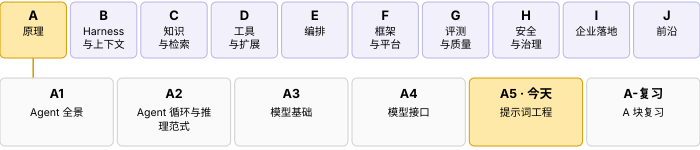
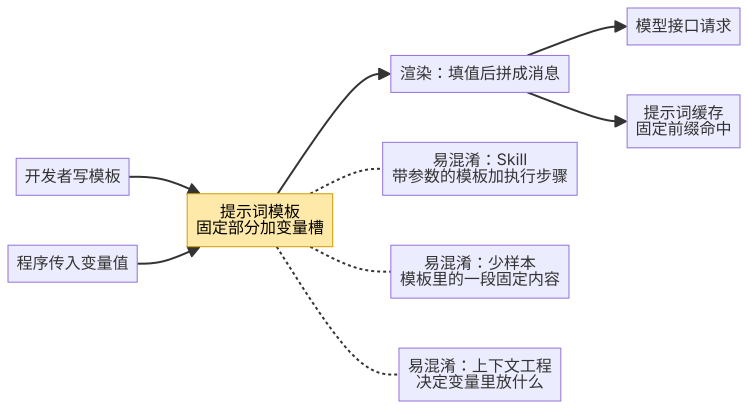
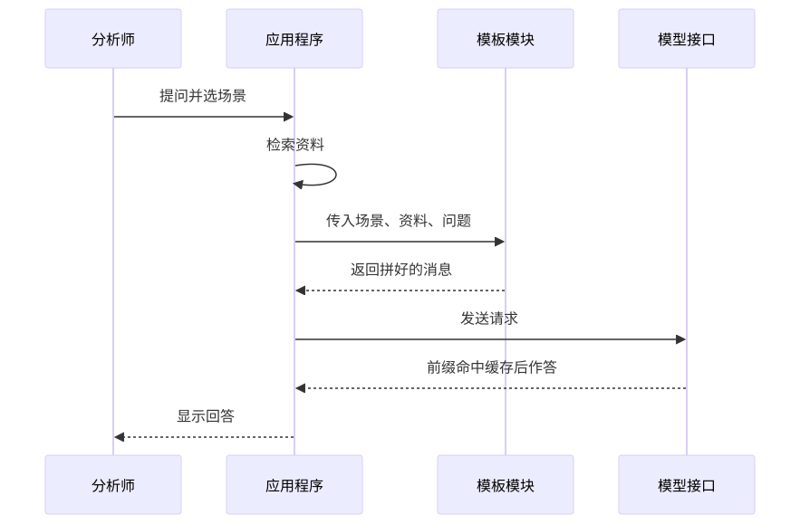
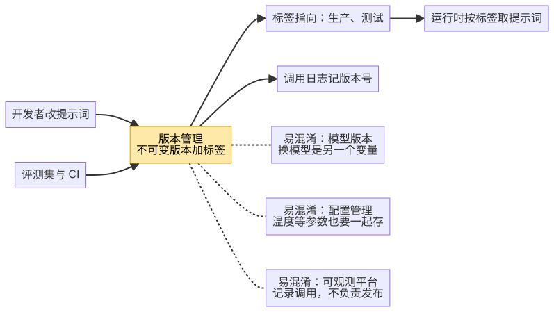
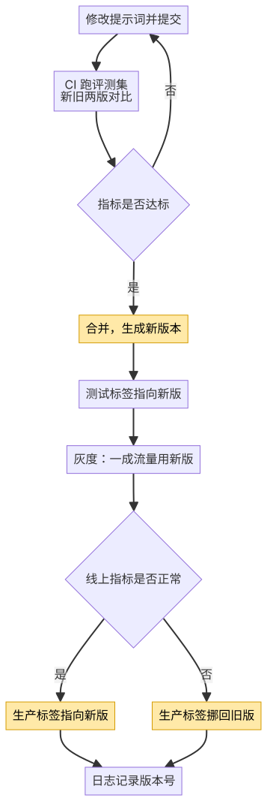
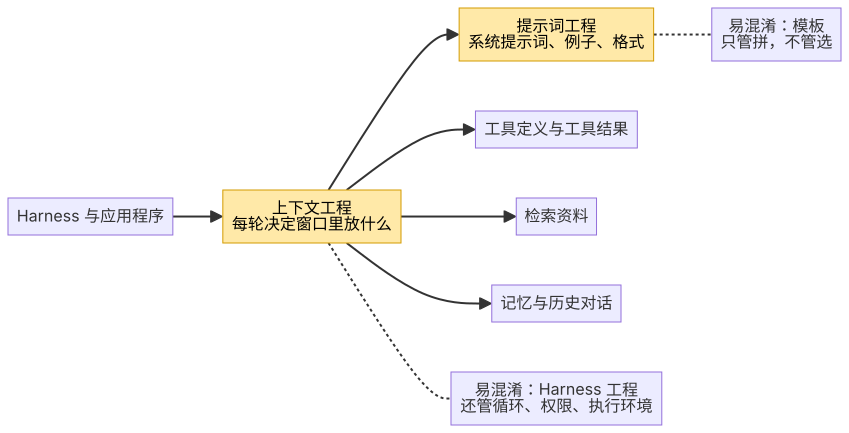
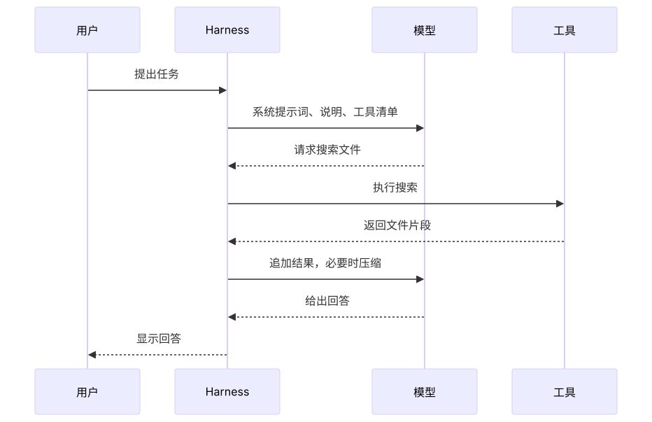
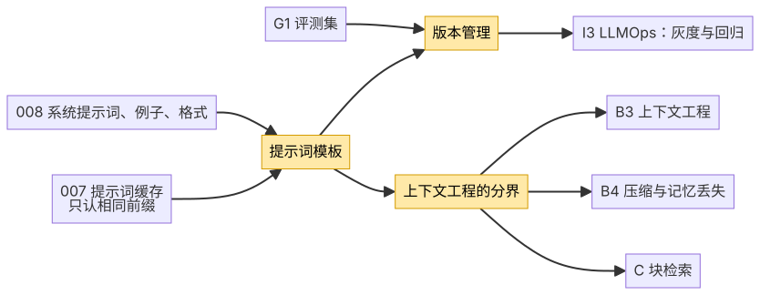

# 009 - Prompt Engineering Part 2 · 提示词工程（下）

> 第 009 讲 · A5 提示词工程（下） · A 原理：Agent 是怎么转起来的 · 事实核实截至 2026-10-30
> [← 返回目录](../README.md) · 上一讲：[008 提示词工程（上）](008-prompt-engineering-1.md) · 下一讲：[010 A 块复习](010-block-a-review.md)

> 本篇多处拿 Claude Code、Claude 平台和 OpenAI、Langfuse、LangSmith 的做法对比，也用 Claude Code 当本机实物。本文由 Anthropic 的模型撰写，存在利益相关；Claude 这边的短板在各概念的「其他家叫什么」里单独写出。

> 上篇讲"一份提示词里面写什么"：系统提示词、少样本、角色与格式约束。下篇讲"这份提示词怎么复用、怎么管、边界在哪"：提示词模板、版本管理、提示词工程和上下文工程的分界。三个概念讲完，A 块五簇全部结束，下一讲是 A 块复习。

---

## 🧭 Bulletin 流程

> 一份提示词调好了，要给一万次请求、十个人、半年时间用 → **① 提示词模板** → **② 版本管理** → **③ 提示词工程和上下文工程的分界** → 固定的部分写一次、变的部分填进去，每一版都能查、能比、能退回，提示词之外窗口里装什么交给上下文工程

三个概念按"先复用、再管理、最后看清边界"的顺序排。

1. **提示词模板**：把一份提示词拆成固定不变的部分和每次要填的变量，用代码或占位符把变量填进去再发给模型，固定部分放前面、变量放后面。
2. **版本管理**：提示词每改一次就存成一个不能再改的新版本，用"生产""测试"这样的标签指向其中一版；上线是挪标签，出事是把标签挪回去，每条回答都记下它用的是哪一版。
3. **提示词工程和上下文工程的分界**：提示词工程管"人事先写好的那几段指令怎么写"，上下文工程管"每一轮模型窗口里到底放进哪些东西"，包括工具、记忆、检索结果和历史对话；前者是后者的一部分。

---

## 📍 定位图



怎么读这张图：上面一行是整张地图的 10 个块，下面一行是今天所在的块展开成的各簇，黄色是今天的位置。

A5 上面接的是 A4 模型接口：A4 讲提示词缓存只认一字不差的前缀，今天的模板就要按"固定在前、变量在后"来排；也接 A5 上篇：上篇讲一份提示词里装什么，今天讲它怎么复用和管理。A5 下面通向 A 块复习，再往后是 B 块：B1 Harness 讲谁在替你拼提示词，B3 上下文工程把今天第三个概念讲完整。

---

## 本簇讲解

### 这一簇要解决什么问题

上篇结尾，Charles 的研报助手调好了一份 1500 token 的系统提示词。上线一个月后，三件事接连发生。

第一，复制粘贴出了岔子。研究所有三个场景要用这份提示词：研报问答、晨会纪要、评级提取。三个场景各复制了一份，各自又改了几句。月底合规部要求把"资料里没有的数字回答'资料未提供'"改成"回答'资料未提供，请联系对应分析师'"。他改了两份，漏了晨会纪要那份。漏掉的那份照旧跑了两周，没人发现。

第二，改坏了却说不清改了什么。同事小李为了修一个边界问题，在提示词里加了一句"如果用户问的是港股，换算成人民币"。第二天评级提取的格式合规率从 99% 掉到 91%。大家翻聊天记录、翻代码提交，花了一下午才确认是这一句的锅；想退回去，又发现没人存过改之前的原文。

第三，提示词写得再好，模型还是答错。分析师问"宁德时代上季度的毛利率比去年同期变了多少"，助手答错了。查下来，提示词一个字没问题，问题出在窗口里装的东西：检索只找到了今年的研报，没找到去年的；对话已经进行到第 30 轮，前面的工具结果占了 6 万 token，真正有用的那段资料被埋在中间。

这三件事对应今天三个概念：同一份提示词怎么复用而不靠复制粘贴；改了哪一句、哪一版对应哪批回答、怎么退回；以及什么时候问题已经不在"提示词怎么写"，而在"窗口里放了什么"。

还有一条今天的背景。OpenAI 在 2026-06-03 宣布停用 API 里托管的可复用提示词对象，`v1/prompts` 接口计划在 2026-11-30 关闭；官方迁移指南的建议是把提示词放回自己的代码里，变量改成函数参数，版本交给 git（一种记录文件每次修改、可以随时回到旧版本的版本控制工具）、代码评审和评测去管（截至 2026-10-20）。[1][2] 也就是说，"提示词放在哪、怎么管"这件事，连大厂商都在重新选。今天就从这里讲起。

---

### 概念一：提示词模板

**1. 定义**

提示词模板（prompt template）是一份带占位符的提示词：固定不变的部分直接写好，每次调用要变的部分留成变量，运行时由程序把变量的实际值填进去，生成最终发给模型的提示词。填值这一步叫渲染（render）。模板解决的是"同一份提示词结构要被反复使用，但每次的具体内容不同"。

模板有三种常见的实现方式（截至 2026-10-20）：

- **代码函数**：一个函数接收几个参数，返回拼好的消息列表。OpenAI 的迁移指南推荐的就是这种：把提示词放进一个小的 `prompts/` 模块，每个提示词一个有名字的构建函数，变量改成"明确的、有类型的"函数参数。[1]
- **占位符语法**：在文本里写 `{{customer_name}}` 这类双花括号占位符，再调用一个"编译"函数填值。Langfuse（一个开源的大模型应用观测与提示词管理平台）的所有提示词都用这种语法，Python 里用 `prompt.compile(...)` 填值。[5] Claude 官方提示词文档的例子里也用 `{{ANNUAL_REPORT}}` 这类占位符标出"这里放可变内容"，并建议把可变输入包在 XML 标签（用尖括号标签包住内容的标记格式）里，和指令分开。[7]
- **工具里的参数替换**：Claude Code 的 skill（Claude Code 里按需加载的一套操作说明）支持 `$ARGUMENTS`、`$0`、`$1` 这类占位符，用户输入 `/某个skill 参数` 时自动替换；还支持一种动态注入写法：一行以 `!` 开头、反引号包住的命令，会在模型看到之前先在本机执行，用命令输出替换这一行。[8]

**2. 场景**

接着开头的第一件事。Charles 把三份复制的提示词合并成一个模板，结构是：

- **固定部分 A，三个场景共用**：身份、底线三条、所内五档评级说明。约 1100 token。
- **固定部分 B，按场景选一段**：研报问答的格式要求、晨会纪要的格式要求、评级提取的四个例子。每段 200 到 600 token。
- **变量**：`{{task_type}}` 选用哪一段 B；`{{documents}}` 本轮检索到的资料；`{{question}}` 分析师的问题；`{{today}}` 今天的日期。

渲染时，A 永远在最前面，B 紧跟其后，变量放在最后的 user 消息里，资料包在 `<documents>` 标签里，问题包在 `<question>` 标签里。

合规部再要求改那句底线时，他只改 A 里的一处，三个场景同时生效。还有一笔账：A 加上 B 的前缀在同一场景里每次都一字不差，按 [007 模型接口（下）](007-model-api-2.md) 讲的缓存规则，这部分每次按原价的 0.05 倍计费（Opus 5.5、Sonnet 5.5，截至 2026-10-20）。如果他把 `{{today}}` 放在系统提示词的第一行，每天第一次请求之后的缓存就全部失效，因为缓存只认从头开始一字不差的前缀。

**3. 它解决什么问题**

因果链分三步。

第一，复制粘贴让同一条规则有了多个副本。副本一多，改规则就要记得改所有副本，漏一份就出事，而且漏掉的那份不会报错，它会安静地继续用旧规则回答。模板把"共用的部分"只存一份，从根上去掉了副本。

第二，模板把"不变的"和"变的"分开，带来两个直接好处。一是缓存：固定部分放前面，每次都能命中缓存；变的部分放后面，只影响后面那一小段。OpenAI 的迁移指南也写了同一条："静态内容在前，动态内容在后"，理由同样是缓存只认完全相同的前缀。[1] 二是可以测：固定部分是"提示词的版本"，变量是"测试用例的输入"，评测时换输入不换模板，结果才能比较。

第三，模板让用户输入有了固定的位置。用户输入、检索资料这类外部内容只能填进变量槽，并且包在标签里，模型更容易分清"这是数据，不是指令"。这降低了提示词注入（在输入里夹带指令、让模型偏离原本规则的攻击）的风险，但不能消除它，H1 簇展开。

它不解决的：模板只是"怎么拼"，不管"拼进去的东西对不对"。检索来的资料错了、少了，模板拼得再整齐也没用，那是第三个概念和 C 块的事。

**4. 位置图**



怎么读这张图：左边是上层，开发者写一次模板，程序每次调用时传入变量值。右边是下层：渲染这一步把两者合成真正的消息，再交给 [006 模型接口（上）](006-model-api-1.md) 讲的消息接口；固定前缀不变，就能吃到 [007 模型接口（下）](007-model-api-2.md) 讲的缓存折扣。三条虚线：Skill 也带参数占位符，但它不只是一段提示词，还包含要执行的步骤和脚本，D3 簇展开；少样本例子通常是模板里固定的一段，不是变量；上下文工程决定"变量槽里该放哪些资料、放多少"，模板只决定"放在哪"。图里把"开发者"和"程序"画成并列的两个上层，是为了好讲，实际上程序也是开发者写的。

**5. 运行流程图**

一次带模板的调用从触发到返回：



怎么读这张图：箭头上是发出的消息，不是完成的动作。第三步"传入"的是变量值，模板模块按 `task_type` 选固定段 B，把资料和问题包进标签，放在最后。第五步发出的请求里，固定部分 A 和 B 在前，所以第六步能命中缓存；如果某个变量被错放到最前面，这一步就会全价计费。图里"检索资料"画成应用程序自己做的一步，是为了简化；在 Agent 里，检索常常是模型主动调用的工具，那就进入了第三个概念讲的上下文工程。

**6. 实例（本机加官方文档）**

本机实物一：这个定时任务的提示词 `~/.claude/scheduled-tasks/daily-agent-stack/SKILL.md`（78 行，只读）就是一个模板。它的固定部分是讲师身份、写作步骤和安全边界；它的变量不是占位符，而是写成"运行时去取"的指令：第 0 步让模型运行 `TZ=America/New_York date` 拿到当天日期，再按规则算出"本篇日期"；第 2 步让模型去读 MOC 里的"下一簇"指针，决定今天讲什么。所以每天发给模型的提示词一字不变，变的是模型自己去取回来的值。这和"程序先填好变量再发"是两种做法：前者把填值交给模型和工具，省了写代码，代价是每次要多花几轮工具调用，而且取值出错时要看日志才知道。

本机实物二：Claude Code 的 skill 参数替换。截至 2026-10-20 的官方文档：[8]

- `$ARGUMENTS` 是用户输入的全部参数，`$ARGUMENTS[0]` 或 `$0` 是第一个，按 shell（命令行解释器）的引号规则切分。
- frontmatter（文件开头用 `---` 包住的元数据区）里写 `arguments: [component, from, to]`，正文就能用 `$component`、`$from`、`$to`。
- 如果用户传了参数、正文里却没有任何占位符接住，Claude Code 会把 `ARGUMENTS: 用户输入` 追加到 skill 内容末尾，不会丢。
- 一行写成 `` !`git diff HEAD` ``，Claude Code 会先执行这条命令，用输出替换这一行，模型看到的是结果而不是命令；命令仍受权限规则约束，失败会让整个 skill 调用中止。
- `.claude/commands/` 里的自定义斜杠命令已经并入 skill，两种写法都生成同一个 `/命令`，同名时 skill 优先。

我在本机 `~/.claude/skills/` 的 184 个目录里搜了一遍，没有找到用 `$ARGUMENTS` 的 skill，也没有 `~/.claude/commands/` 目录。所以 Charles 现在的 skill 都是"不带参数的固定说明"，参数靠对话里说出来，由模型自己理解。这是一个可以改进的地方，没有改动任何文件。

官方做法的最小例子（OpenAI 迁移指南推荐的"构建函数"写法，按当天文档改写成研报场景；不在本机运行）：[1]

```python
# prompts/research.py：一个提示词一个构建函数，版本跟着 git 走
BASE_RULES = """你是券商研究所的研报问答助手，读者是所内分析师。
1. 只依据本轮提供的资料回答。
2. 资料里没有的数字，回答"资料未提供，请联系对应分析师"。
评级五档：买入、增持、中性、减持、卖出。"""
TASK_RULES = {
    "qa": "用两三句话直接回答；比较三个以上数字时用表格。",
    "rating": "只输出一行：评级：五档之一，或'资料未提供'。",
}
def build_research_prompt(task_type: str, documents: str, question: str) -> list[dict]:
    system = BASE_RULES + "\n" + TASK_RULES[task_type]   # 固定部分在前，能命中缓存
    user = f"<documents>\n{documents}\n</documents>\n<question>{question}</question>"
    return [{"role": "system", "content": system},     # 变量全部放在后面
            {"role": "user", "content": user}]
```

读法：`task_type` 只能是字典里有的两个键，传错会直接报错，这就是"有类型的参数"比"自由文本占位符"稳的地方；资料和问题包在标签里，放在最后。

运行位置三问：模板在你的程序或 Claude Code 里、在本机渲染；每次调用或每次输入斜杠命令时触发；渲染结果随请求发到厂商云端，人看到的是回答，不是模板本身。

**7. 常见误解与边界**

- **"模板就是把提示词存成一个字符串常量"**：不够。没有变量槽的常量只是"一份提示词"，模板的关键是"固定和可变分开"，并且规定可变内容放在哪、怎么包。
- **"占位符随便放哪都行"**：不对。变量放在最前面会让每次请求的前缀都不同，缓存全部失效；用户输入不包标签直接拼进指令中间，更容易被注入。
- **"模板越通用越好，一份管所有场景"**：不对。一份模板里塞十个 if 分支，最后会变成没人看得懂的长提示词。Anthropic 的上下文工程文章把这叫"写死的、脆弱的 if-else 逻辑"，是系统提示词的一种典型失败。[4] 场景差异大时，拆成共用底座加分场景的段落。
- **常见复述偏差**："提示词模板就是用花括号把变量填进去" → 对一半：对在填变量是它的动作；错在漏了为什么这么拆。模板的价值在三处：共用规则只存一份，改一处全部生效；固定在前、变量在后，保住缓存；外部输入有固定的、包好标签的位置，降低注入风险。只讲花括号，面试官会追问"那变量放前面放后面有区别吗"。
- **边界**：模板管"怎么拼"，不管"拼什么"；它也不管"哪一版在线上"，那是第二个概念。

**8. 其他家叫什么**

- **OpenAI**：以前有托管的 Reusable Prompts，在控制台里存提示词和变量，调用时只传 `prompt: {id, version, variables}`；2026-06-03 起不再推荐新建，`v1/prompts` 计划 2026-11-30 关闭，官方建议改成代码里的构建函数。[1][2] 社区文章称托管提示词没有可以批量导出的接口，这一点是社区说法，官方文档里没写，未核实。[3] 2026-10-30 复查官方迁移指南：只说把提示词内容挪进自己的代码，没有给任何导出接口或导出步骤，关闭日期仍是 2026-11-30；"没有导出接口"官方没有明说，迁移时按逐条手工复制准备。[2]
- **LangChain**：叫 `PromptTemplate` 和 `ChatPromptTemplate`，用花括号占位符；LangSmith（LangChain 公司的观测与评测平台）的提示词中心可以存模板并按版本拉取。[6]
- **Langfuse**：提示词分 `text` 和 `chat` 两种类型，变量统一用 `{{variable}}`，还支持在一个提示词里引用另一个提示词、用消息占位符插入一整段对话历史。[5]

Claude 这边的短板：Claude 平台目前没有和 Langfuse 一样的托管模板功能；以前控制台 Workbench（Claude 控制台里调试提示词的网页工具）里保存提示词和变量的功能，已在 2026-08-17 随旧版 Workbench 停用（据 [008 提示词工程（上）](008-prompt-engineering-1.md) 当天核实的发布说明）。Claude 官方提示词文档里也没有单独讲模板的章节，今天打开以前的"提示词模板与变量"地址，返回的是通用的提示词最佳实践页面。[7] 想要托管、可视化的模板管理，要用 Langfuse、LangSmith 这类第三方工具，或者自己在代码里管。

---

### 概念二：版本管理

**1. 定义**

提示词版本管理（prompt versioning）是把提示词当成需要发布的软件产物来管：每次修改生成一个新的、不可再改的版本，用标签（label 或 tag）把"哪一版在生产环境、哪一版在测试环境"指向具体版本；上线、灰度、回滚都通过移动标签完成；每次模型调用都记录它用的提示词版本，出问题时能对上号。

截至 2026-10-20，业界有两种主流做法：

- **放在代码仓库里**：提示词就是代码文件，版本靠 git 提交，上线靠代码评审和发布流程，验收靠评测在持续集成里跑。OpenAI 迁移指南的原话是把版本管理"移到你的仓库里，用 git 提交、PR 评审和测试或评测"。PR（Pull Request，合并请求：把一组改动提交给别人审核后再并入主线）。[1]
- **放在提示词管理平台里**：Langfuse 的每次修改自动得到一个版本号，标签是指向某个版本的指针；`latest` 自动指向最新一版，`production` 是默认标签；代码里不写版本号、只写标签，不指定标签时取 `production` 那一版；回滚就是在界面上把 `production` 挪回旧版本，代码不用改。[5] LangSmith 的做法相同：每次修改是一个提交（commit），`staging` 和 `production` 是保留标签，通过"提升"（Promote）流程设置，每个环境都保留回滚历史；代码里写 `client.pull_prompt("名字:production")`。[6]

**2. 场景**

接着开头的第二件事：小李加了一句港股换算，评级提取的格式合规率从 99% 掉到 91%。

Charles 重建了流程。提示词模板放进代码仓库的 `prompts/` 目录，每次修改走一次合并请求。合并之前，持续集成（CI，Continuous Integration：每次提交代码都自动跑一遍测试的机制）自动用 200 题评测集跑新旧两版，输出一张对比表：格式合规率、资料外数字出现率、单次成本。规则写死：合规率下降超过 1 个百分点，合并请求不能通过。

小李那一句如果走这个流程，评测会在合并前就报出合规率掉了 8 个百分点，根本上不了线。

上线后再加两样。第一，灰度：新版先给 10% 的请求用，跑两天，看线上的格式合规率和分析师点"有用"的比例，没问题再放到 100%。第二，留痕：每次调用在日志里记下 `prompt_version=research@a1b2c3`（模板名加 git 提交号的前几位）、模型名、变量里资料的来源编号。哪天有分析师说"上周三那条回答不对"，按调用编号一查，就知道当时用的是哪一版提示词、哪一个模型、看到了哪些资料。

**3. 它解决什么问题**

因果链分四步。

第一，提示词是"会改变产品行为的代码"，但它看起来像文案。改一句话不会报编译错误，不会让程序崩溃，只会让一部分回答悄悄变差。如果没有版本，变差的那一刻就不知道是哪一句、谁、什么时候改的。

第二，不可变版本加标签，把"存了什么"和"线上用哪个"分开。版本一旦保存就不再修改，所以"第 7 版"永远指同一段文字；标签可以挪，所以上线和回滚只是改一个指针，几秒钟完成，不用重新部署程序。Langfuse 的 SDK（Software Development Kit，软件开发工具包：厂商给的调用库）默认在本地缓存提示词 60 秒，过期后先用旧的、后台再刷新，所以挪了标签后，线上一般在一分钟左右切换过去。[5]

第三，评测把"感觉变好了"变成"数字变好了"。没有评测，版本管理只能告诉你"改了什么"，不能告诉你"改得对不对"。[008 提示词工程（上）](008-prompt-engineering-1.md) 里那几组"同一组问题、只改一处、前后对比"的数字，就是评测；版本管理让这件事每次都自动发生。

第四，留痕让事后能追责、能复现。金融机构被问"三个月前那条回答依据的是哪一版规则"，只有每次调用都记了版本号，才答得上来。

**4. 位置图**



怎么读这张图：左边是上层，开发者的每次修改先过评测集和 CI（每次提交都自动跑测试的机制），通过了才生成可以上线的版本。右边是下层：标签决定线上用哪一版，运行时按标签去取；每次调用的日志里记下版本号。三条虚线：模型版本，比如从 Opus 5.5 换到 Sonnet 5.5，是和提示词版本独立的另一个变量，两者要分开记、分开测；配置管理，温度、最大输出长度、结构化输出的格式定义也会改变行为，Langfuse 允许把这些和提示词存在同一个版本的配置字段里；可观测平台（记录每次调用的输入输出和耗时的系统，G2 簇展开）负责"看"，版本管理负责"发"，很多产品把两者做在一起，但职责不同。

**5. 运行流程图**

一次提示词修改从提交到全量、或者回滚：



怎么读这张图：从上往下是一次发布。第一个菱形是线下关卡，用固定的评测集，标准是"不比旧版差"，比如格式合规率下降不超过 1 个百分点；第二个菱形是线上关卡，看真实流量里的指标，比如格式合规率、用户点"有用"的比例、转人工率（用户放弃 AI、要求人工处理的比例）。黄色的三步都是"动标签"：生成版本、上线、回滚。回滚那一步只挪指针，不删除新版本，所以事后还能拿它复盘。图里把灰度画成固定的一成流量，是为了简化；实际可以按用户分组、按场景分组，或者逐步放到 30%、50%、100%。

**6. 实例（本机加官方文档）**

本机实物一：这个系列的写作规范本身就是一份"被定时任务读取的提示词"，任务提示词里写明"写作规范是权威"。它的版本管理靠的是文件末尾的「更新日志」，截至今天有 10 行，每行写了日期、改了什么、谁批准的，比如 2026-10-17 那一行记的是加了三处、由 Charles 批准。这是"人工版本日志"，能回答"改了什么"，但回答不了"改之前原文是什么"。

本机实物二：我只读查看了笔记库的 git 状态。笔记库是一个 git 仓库，但最近一次提交是 2026-08-04；这个系列的文件夹在 git 里是"未跟踪"状态，也就是说，写作规范、MOC 和已写的卡片从来没有被 git 存过版本。后果是：如果哪天规范被改坏、或者被误删，能找回的只有回收站和 Obsidian（Charles 用来管理笔记的本地知识库软件）自带的文件恢复，没有逐字的历史版本。这是一条提醒，没有运行任何 git 命令去提交或修改。

本机实物三：Claude Code 自己的提示词也有版本。写卡当天（2026-10-20）的发布记录显示最新版本是 2.1.305（截至 2026-10-30 已到 2026-10-30 发布的 2.1.314），每个版本的更新日志都列出改了哪些行为，比如 2.1.304 改了 `--system-prompt-snapshot` 参数的帮助文字。[9] 本机安装的是 2.1.300（据今天的 AI 效率简报），也就是说，同样一句话发给本机的 Claude Code 和最新版，系统提示词可能不同、行为可能不同。这就是为什么调用日志里要记"用的是哪个版本的 Harness"。

官方做法的最小例子（Langfuse，按当天文档的接口写法整理；不在本机安装、不运行）：[5]

```python
from langfuse import get_client
langfuse = get_client()
# 1. 新建一版，先只打测试标签；版本号由平台自动生成，保存后不可修改
langfuse.create_prompt(
    name="research-qa", type="text",
    prompt="你是券商研究所的研报问答助手……\n<question>{{question}}</question>",
    labels=["staging"],
    config={"model": "claude-sonnet-5-5", "max_tokens": 600})  # 参数和提示词一起存
# 2. 线上代码只写标签，不写版本号；不传标签时默认取 production
prompt = langfuse.get_prompt("research-qa", cache_ttl_seconds=60)
text = prompt.compile(question="宁德时代毛利率同比变化多少？")
print(prompt.version)   # 写进调用日志，事后能对上号
# 3. 评测通过后上线：把 production 标签挪到某一版；回滚就是挪回旧版
langfuse.update_prompt(name="research-qa", version=7, new_labels=["production"])
```

读法：第 2 步代码里没有任何版本号，所以上线和回滚都不用改代码；`prompt.version` 记进日志，就是场景里说的留痕。Langfuse 文档还写明：指定了 `label="staging"` 而这个标签不存在时直接返回 404，不会自动退回到 `production` 或 `latest`，所以线上代码要配一个兜底提示词。[5]

运行位置三问：版本存在代码仓库或提示词管理平台里，平台可以是云端服务也可以自己部署；修改提交时触发评测，挪标签时触发上线或回滚；结果回到人手里的是评测对比表、发布记录和每条回答旁边的版本号。

**7. 常见误解与边界**

- **"提示词改动很小，不用走发布流程"**：不对。开头那一句"港股换算成人民币"只有十几个字，让合规率掉了 8 个百分点。提示词的改动量和影响面不成比例。
- **"有了版本号就能回滚"**：说一半。能回滚的前提是旧版本的原文还在、而且线上取的是标签不是写死的文字。只在更新日志里写"改了某某"，原文没存，回不去。
- **"版本管理只管提示词文字"**：不够。模型名、温度、最大长度、结构化输出的格式定义、少样本例子、甚至检索用的切块规则，都会改变回答。要么和提示词放在同一个版本里，要么分别记录，否则"同一版提示词效果变了"会查不出原因。
- **"放平台比放代码好"或者反过来**：没有绝对。放代码的好处是和程序一起评审、一起发布，不多一个外部依赖，OpenAI 现在就推荐这种；放平台的好处是不懂代码的产品和业务同事也能改，挪标签即可上线，不用等发版。代价是多一个外部服务，平台挂了要有兜底。
- **常见复述偏差**："提示词版本管理就是用 git 存提示词" → 对一半：对在 git 是一种可行的存法，OpenAI 也这么推荐；错在只说了"存"，漏了"发"和"查"。完整的版本管理还包括：改之前过评测、上线用标签和灰度、出事挪标签回滚、每次调用记下版本号。只讲 git，面试官会追问"那你怎么知道新版比旧版好"和"线上出事几分钟能退回去"。
- **边界**：版本管理保证"改得可控"，不保证"改得对"，对不对要靠评测集；它也不管"每一轮窗口里实时放进了什么"，那是第三个概念。

**8. 其他家叫什么**

- **OpenAI**：托管提示词对象自带 `version` 字段，计划 2026-11-30 随 `v1/prompts` 一起关闭；官方建议改用 git，灰度和实验用自己的配置或功能开关（feature flag：不改代码、靠配置开关切换功能的机制）。同一天宣布的还有：OpenAI 自家的 Evals 评测平台 2026-10-31 变成只读、2026-11-30 关闭，官方建议迁移到 Promptfoo（一个开源的提示词评测工具）；Agent Builder 也在 2026-11-30 关闭。[2]
- **LangSmith**：叫 commit 和 commit tag，`staging`、`production` 是保留的环境标签，每次提交可以触发一个网页回调（webhook：某件事发生时自动通知另一个系统的机制），方便接入自己的发布流程。[6]
- **Langfuse**：叫 version 和 label，`production` 标签可以设为受保护，只有管理员能挪；这个功能需要 Pro 加 Teams 附加包或企业版。[5]

Claude 这边的短板：Claude 平台本身不提供提示词版本管理和标签发布，旧版 Workbench 的保存功能已停用；Claude Code 的 CLAUDE.md、skill、输出风格都是本地文件，版本完全靠用户自己用 git 管，Claude Code 不会替你记"这个 skill 上周长什么样"。

---

### 概念三：提示词工程和上下文工程的分界

**1. 定义**

提示词工程（prompt engineering）是"为了得到好结果，怎么写和组织给大模型的指令"的方法；它的产物是人事先写好的几段文字，比如系统提示词、例子、格式要求，写一次、改的时候走版本管理。

上下文工程（context engineering）是"在模型每一次推理时，挑选并维护最合适的一组 token（模型读写文字的最小计数单位）"的方法；它管的是窗口里所有内容，除了提示词，还有工具定义、检索来的资料、记忆、历史对话、工具调用结果；它每一轮都在发生，是一个持续的取舍过程。

这两个定义出自 Anthropic 2025-09-29 发布的工程文章《Effective context engineering for AI agents》。文章把上下文工程称为"提示词工程的自然演进"，并强调两者的区别：写提示词是一次性的任务，上下文工程是"迭代的"，每一轮都要重新决定传给模型什么。[4]

一句话的分界：**提示词工程管"写什么"，上下文工程管"放什么"；前者是后者的一部分。**

**2. 场景**

接着开头的第三件事：分析师问"宁德时代上季度毛利率比去年同期变了多少"，助手答错了。

Charles 先按提示词工程的思路查：系统提示词里有"只依据资料回答""资料没有就说资料未提供"，例子、格式都没问题。提示词这边找不到错。

再按上下文工程的思路查，看这一轮窗口里到底装了什么：

- 系统提示词和例子：约 1800 token，正常。
- 工具定义：接了 14 个工具，约 9000 token，其中 9 个这个场景根本用不上。
- 历史对话：已经第 30 轮，前面每轮的检索结果都原样留着，约 6 万 token。
- 本轮检索结果：只找到今年的两篇研报，没有去年同期的数据。

问题有两个，都不在提示词。第一，检索只按"宁德时代 毛利率"找，没把"去年同期"改写成具体的季度，于是缺了一半资料；模型拿着今年的数字，又在 6 万 token 的旧结果里翻到一个看起来像去年的数，答错了。第二，窗口太满，有用的信息被埋在中间。

修法全是上下文工程：检索前把问题改写成"2026 年第三季度"和"2025 年第三季度"两次查询；旧的工具结果只保留摘要；这个场景只加载用得到的 5 个工具。改完后，同一组 50 个跨期对比问题，答对的从 31 题升到 44 题，平均每轮输入从约 7 万 token 降到约 1.6 万 token。数字是示意，方法是真的：先看窗口里有什么，再决定改哪里。

**3. 它解决什么问题**

因果链分三步。

第一，聊天机器人时代，一轮对话里窗口装的几乎只有"提示词加用户问题"，所以把提示词写好就是全部工作。Agent 不一样：它会连续调用工具几十轮，每一轮都往窗口里加东西，工具结果、检索资料、中间笔记越积越多。到第 30 轮时，人写的提示词可能只占窗口的 2%，剩下 98% 是程序在运行中塞进去的。

第二，窗口里的东西越多，模型越难用好。Anthropic 的文章把这叫上下文腐化（context rot：窗口里 token 越多，模型准确回忆其中信息的能力越差），原因是模型的注意力有一个"注意力预算"，每多一个 token 都要分走一点，表现为"逐渐变差，而不是突然断崖"。[4] 所以文章给的原则是：找到"能让期望结果最可能发生的、最小的一组高信号 token"。

第三，这件事没法靠"写得更好的提示词"解决，因为问题不在那 2%。要靠一组运行时的手段：按需检索而不是一次塞满，旧结果压缩成摘要，长期信息写进外部笔记，子任务交给另开窗口的子代理。这些就是上下文工程，B3、B4、B5 和 C 块会逐个展开。

它也反过来说明了提示词工程的边界：提示词写得再好，也补不上窗口里缺的资料，也挡不住窗口里多余的噪音。

**4. 位置图**



怎么读这张图：左边是上层，真正执行上下文工程的是 Harness（套在模型外面、负责循环、工具、权限和上下文的那层程序）或你自己写的应用程序。中间是上下文工程，右边四个实线节点是它要管的四类内容，提示词工程只是其中一类，所以画成上下文工程的下层。两条虚线：Harness 工程（设计 Harness 整体的方法，B1 簇展开）比上下文工程更大，还管循环怎么转、权限怎么给、在什么环境里执行；模板只解决"怎么拼"，"该选哪些东西进来"是上下文工程。图里把四类内容画成并列，是为了好讲，严格说工具结果和历史对话会随轮次变成"记忆与历史"的一部分，边界并不整齐。

**5. 运行流程图**

以 Claude Code 为例，一次会话里每一轮窗口是怎么组装出来的：



怎么读这张图：箭头上是发出的消息，不是完成的动作。第二步发出的是提示词工程的产物：系统提示词，加上作为第一条用户消息送进去的 CLAUDE.md（Claude Code 的项目说明文件，写给模型看的长期规则）。从第三步起全是上下文工程：模型不是一开始就拿到全部文件，而是按需去搜、去读，这叫即时检索（just-in-time retrieval：先只记文件路径这类轻量线索，需要时再用工具把内容取进来）。Anthropic 的文章正好拿 Claude Code 当例子：CLAUDE.md 一开始就放进窗口，文件内容则靠 glob、grep（按文件名模式、按文字内容搜索文件的命令）在需要时取。[4] 第六步的"必要时压缩"是 compaction（压缩：把旧对话改写成摘要替换原文），窗口快满时触发，B4 簇展开。

**6. 实例（本机）**

本机实物：上篇（[008 提示词工程（上）](008-prompt-engineering-1.md)）统计过一次 Claude Code 会话的接口记录，这里换个角度读同一组数字，只看"谁写的、什么时候进来的"：

```
提示词工程的产物（人事先写好，会话开始时进来）
  系统提示词                Claude Code 自带，本机记录里未找到原文
  第一条 user 消息 块 1     5681 字符  全局和项目 CLAUDE.md
上下文工程的产物（运行中由 Harness 决定，随时进来）
  第一条 user 消息 块 2、3  约 1100 字符  账户上下文、署名规则
  中途 system 消息 18 条
    新工具可用的通知        最长 39732 字符
    工具下线的通知          约 4300 字符
    输出风格                1198 字符
    剩余额度提示            约 140 字符，十几次
  每轮的工具调用结果        随任务变化
```

读法有两点。第一，Charles 亲手写的只有 CLAUDE.md 那 5681 字符，属于提示词工程；单是一条"新工具可用"的通知就有 39732 字符，是它的七倍，这是 Harness 在运行中做的上下文工程。第二，Claude Code 的做法是"工具按需加载"：截至 2026-10-20 的 2.1.305 发布记录里提到，如果某个云平台不支持工具搜索，Claude Code 会退回到不用工具搜索重试。[9] 工具搜索的意思是先只给模型一份简短的工具清单，用到时再加载完整定义，这就是在省窗口。

运行位置三问：上下文组装发生在本机的 Claude Code 里，每次请求发往云端前完成；每一轮模型调用前都会触发，用户提问、工具返回、窗口接近上限都会让它重新组装；人看不到组装过程本身，看到的是回答质量，以及偶尔出现的"正在压缩"提示。

**7. 常见误解与边界**

- **"上下文工程是提示词工程的新名字"**：不对。名字新，但范围变了：提示词工程只管人写的那几段，上下文工程管窗口里的全部内容，而且每一轮都在变。
- **"有了上下文工程，提示词工程就不重要了"**：不对。提示词仍然是窗口里最稳定、最高权重的那一段；Anthropic 的文章专门用一节讲系统提示词要写在"合适的高度"：太细会变成脆弱的 if-else，太虚会假设模型知道它其实不知道的背景。[4]
- **"窗口越大，上下文工程越不重要"**：不对。窗口大了能装更多，但上下文腐化说明装得越多越难用好；窗口大反而更需要挑选。[004 模型基础（上）](004-model-fundamentals-1.md) 讲过同一个结论。
- **"上下文工程就是 RAG"**：说窄了。RAG（Retrieval-Augmented Generation，检索增强生成：先从资料库找相关内容再交给模型回答）是上下文工程里"往窗口里放资料"的一种手段，上下文工程还包括选工具、压缩历史、管记忆、拆子代理。
- **常见复述偏差**："提示词工程是写提示词，上下文工程是给模型更多上下文" → 对一半：对在两者确实一个管写、一个管窗口里的内容；错在"更多"。上下文工程的目标是"最小的一组高信号 token"，很多时候是在删东西：删用不上的工具、把旧结果压成摘要。说成"给更多上下文"，正好说反了。
- **边界**：上下文工程管"模型看到什么"，不管"模型被允许做什么"；权限、沙箱、确定性控制属于 Harness 工程的其他部分，B2、D4、D5 簇展开。

**8. 其他家叫什么**

- **OpenAI**：文档里没有把上下文工程单列成一章（截至 2026-10-20 未见），相关做法散在提示词缓存、对话状态和 Agents SDK（OpenAI 的 Agent 开发工具包）的文档里；迁移指南里"静态在前、动态在后"就是一条上下文工程规则。[1]
- **LangChain**：在 LangGraph（LangChain 的状态图编排框架）文档和博客里把上下文工程分成写入、选择、压缩、隔离几类操作，F2 簇展开（今天未打开原文核实具体分法，📝 待补）。
- **中文面试题库**：小林 coding（一个整理大模型和后端面试题的中文网站）的 Agent 第 17 题把上下文工程定义为"每次调用模型前的运行时组装"，分指令、任务状态、近期对话与长期记忆、外部观察四层，并写明"提示词工程是怎么写指令，记忆是存信息，RAG 是找证据，上下文工程决定这一轮模型看到什么"（页面更新 2026-10-12）。[10]

Claude 这边的短板：Anthropic 把"上下文工程"这个说法推得最积极，但 Claude Code 的组装过程对用户几乎不可见：系统提示词原文在本机记录里找不到，中途注入了哪些系统消息要自己翻会话记录才能统计，压缩时丢了什么也只有在 2.1.305 之后才会在云端会话里告诉模型"最早的消息没进摘要"。[9] 想审计"这一轮窗口里到底有什么"，用 Claude Code 比用自己写的程序更难。

---

## 👔 三岗视角

### AI 应用 / Agent 开发

**场景**：研报助手有 3 个场景、每月改提示词 6 到 8 次，团队 4 个人都会改。上个月因为一次没测的修改，评级提取的格式合规率掉到 91%，线上跑了一天才发现。

**这个岗位具体做什么**：第一，模板化。把三份提示词合成"共用底座加分场景段落"，变量改成有类型的函数参数，资料和问题放在最后、包在标签里；上线后看缓存命中率（缓存读取的 token 除以全部输入 token），目标从 40% 提到 80% 以上。第二，接 CI。每次合并请求自动跑 200 题评测集，出一张新旧对比表，合规率下降超过 1 个百分点就不让合并；评测每次约 200 次调用，按 Sonnet 5.5 算成本在几美元以内，可以每次都跑。第三，记版本。每条调用日志带上提示词版本号、模型名、Harness 版本、检索结果的来源编号。第四，盯上下文。在追踪里加一个字段记录每轮输入 token 的构成：提示词多少、工具定义多少、历史多少、检索多少；平均输入超过 3 万 token 时报警。

**最容易踩的坑**：把模型升级和提示词修改放在同一次发布里。效果变了说不清是哪个的功劳或锅，也没法只回滚其中一个。两者分开发、分开记版本。

### AI 产品 / 商业分析

**场景**：公司的客服助手一直用 OpenAI 托管的可复用提示词，业务同事直接在 OpenAI 控制台里改话术、改完即生效。OpenAI 宣布 2026-11-30 关闭这项功能，你要在一个月内给出迁移方案。

**这个岗位具体做什么**：第一，盘点。列出代码里所有 `prompt: {id: ...}` 的调用点、每个提示词有几个版本、谁在改、多久改一次。第二，比三个方案。方案甲：按官方建议搬进代码，零外部依赖，但业务同事以后改话术要提需求等发版，从"当天生效"变成"一周一次"；方案乙：搬到 Langfuse 这类平台，业务同事仍能自己改、挪标签上线，代价是多一个外部服务和订阅费；方案丙：底座规则放代码、话术段落放平台，折中。第三，定验收。迁移前后用同一组 300 条历史对话跑一遍，回答一致率、满意度、转人工率不能变差。第四，跟业务方讲清楚：这次迁移顺便补上了以前没有的东西，每次改话术先过评测、能灰度、能一键回滚。

**最容易踩的坑**：只算迁移的工程量，没算"改话术的流程变慢"对业务的影响。业务同事习惯了当天改当天生效，换成代码管理后没人告诉他们新流程，上线后第一周就会有人绕过流程直接改代码。

### 金融科技 / 数据

**场景**：一家券商的投顾辅助 Agent 给客户经理生成沟通话术。监管检查时抽到三个月前的一条话术，问：这条话术是依据什么规则、看了哪些资料生成的？

**这个岗位具体做什么**：第一，定留痕清单。每次调用必须记录：提示词模板名和版本号、模型名和版本、Harness 或应用版本、本轮检索到的资料编号和版本、用户问题、模型输出、输出检测结果；保存期限按机构的档案管理要求定。第二，管变更。提示词修改和代码上线一样走变更审批，审批记录关联到版本号；涉及合规底线的段落设为受保护，只有指定人员能改。第三，管上下文。窗口里不只有提示词，检索资料和客户记忆也会影响输出，所以资料库本身也要有版本，否则只能证明"当时用的是第 7 版提示词"，证明不了"当时看到的是哪一版研报"。第四，能复现。抽查时用同一版提示词、同一批资料重跑一遍，确认输出大体一致；输出不完全相同时，能解释原因，比如模型的随机性。

**最容易踩的坑**：只给提示词做了版本管理，以为留痕就完整了。监管问的是"依据什么生成的"，窗口里的检索资料、客户画像、历史对话同样是依据；这些没有版本和留痕，提示词版本号记得再全也答不上来。

---

## 🔗 串联图



怎么读这张图：黄色是今天的三个概念。左边两个来源：[007 模型接口（下）](007-model-api-2.md) 的缓存规则决定了模板要"固定在前、变量在后"；[008 提示词工程（上）](008-prompt-engineering-1.md) 讲的系统提示词、少样本、格式约束，就是模板里的固定内容。模板往下分两条线：一条是版本管理，它要靠 G1 评测（用固定测试集衡量效果的方法）证明新版更好，往后通向 I3 LLMOps（大模型应用的运维与发布流程）里的灰度和回归评测；另一条是分界，模板只管怎么拼，窗口里放什么交给上下文工程，往后通向 B3 上下文工程、B4 压缩与记忆丢失、C 块检索。G1、I3 画在这里是为了说明"版本管理离不开评测和发布流程"，不代表它们排在 A5 之前讲。

相关卡片：[008 提示词工程（上）](008-prompt-engineering-1.md) · [007 模型接口（下）](007-model-api-2.md) · [006 模型接口（上）](006-model-api-1.md) · [004 模型基础（上）](004-model-fundamentals-1.md)（上下文窗口，窗口大不等于用得好）· [002 Agent 循环与推理范式（上）](002-agent-loop-and-reasoning-1.md)（Agent 循环每转一圈，窗口就多一层）· [T03 专题：Agent 为什么会忘](../topics/T03-memory-loss.md)（上下文工程管不好时的症状）· [T02 专题：RAG 为什么答不对](../topics/T02-rag-failures.md)（概念三场景里"检索缺一半资料"的排查方法）

---

## 🎙 复述板块

### 整簇两分钟版

> A5 的下篇讲一份提示词调好之后，怎么复用、怎么管、边界在哪。三个概念。
>
> 第一，提示词模板。把提示词拆成两部分，固定不变的写一次，每次要变的留成变量，运行时再填进去。为什么要拆？第一，共用的规则只存一份，改一处，所有场景同时生效，不会漏改。第二，固定部分放前面，变量放后面，前缀每次都一样，就能一直吃到缓存折扣。第三，用户输入和检索资料只能填进固定的变量槽，还要用标签包起来，模型更容易分清哪些是数据、哪些是指令。
>
> 第二，版本管理。提示词看起来像文案，其实是会改变产品行为的代码，改十几个字就可能让合规率掉八个百分点。所以要像管代码一样管它。每次修改存成一个不能再改的新版本。上线前跑评测集，新旧两版对比，不达标不让合并。线上用标签指向某一版，上线是挪标签，出事就把标签挪回旧版。每条回答都记下用的是哪一版。这样才答得上那句话，三个月前那条回答，依据的是哪一版规则。
>
> 第三，提示词工程和上下文工程的分界。提示词工程管写什么，就是人事先写好的那几段指令。上下文工程管放什么，就是每一轮模型窗口里到底装进哪些东西，工具定义、检索资料、记忆、历史对话都算。Agent 跑到第三十轮，人写的提示词可能只占窗口的百分之二。窗口越满，模型越难用好，这叫上下文腐化。所以上下文工程的目标不是给更多，而是挑出最小的一组有用信息。提示词工程是上下文工程的一部分。
>
> 最后收一句。固定的写一次、变的填进去，每一版都能查、能比、能退回，提示词之外窗口里装什么，交给上下文工程。A 块到这里就讲完了，明天是 A 块复习。

### 每个概念三十秒版

**提示词模板**

> 提示词模板是一份带变量槽的提示词。固定的部分写一次，每次要变的留成变量，运行时由程序填进去。它有三个好处。第一，共用规则只存一份，改一处全部生效。第二，固定在前、变量在后，前缀不变，缓存一直命中。第三，外部输入只进变量槽、用标签包好，降低被注入的风险。它只管怎么拼，不管拼进去的资料对不对。

记忆钩子：模板像银行的空白合同，条款印好了，每次只填姓名、金额和日期；没人会每签一份就重新手写一遍条款。

**版本管理**

> 版本管理是把提示词当成要发布的代码来管。每次修改存成一个不能再改的版本，上线前跑评测集和旧版对比，线上用标签指向某一版，上线挪标签，出事挪回去。每次调用记下版本号，事后能查到当时用的是哪一版。注意模型版本和提示词版本要分开记、分开测，否则效果变了说不清是谁的原因。

记忆钩子：版本管理像券商研报的版本号和发布日期，改了结论要发新版，旧版不能偷偷改，客户问起来能拿出当时那一版。

**提示词工程和上下文工程的分界**

> 提示词工程管写什么，是人事先写好的系统提示词、例子和格式要求。上下文工程管放什么，是每一轮窗口里装进哪些东西，包括工具、检索资料、记忆和历史对话，每一轮都在变。Agent 跑久了，提示词只占窗口一小部分，窗口越满模型越难用好。所以上下文工程常常是在删东西。提示词工程是上下文工程的一部分。

记忆钩子：提示词工程是写好会议议程，上下文工程是决定这次会议发哪些材料、请哪些人进会议室；议程写得再好，材料塞了一百页，谁也开不好这个会。

英文版口述：规范第 7 节的开关为"默认不写"，本篇不写。

---

## 💼 面试题板块

### 题 1 `[开发]` Prompt Engineering 和 Context Engineering 有什么区别？为什么 Agent 场景下只优化 Prompt 不够？

来源：题库。JavaGuide《Agent 面试题》「Prompt 与 Context Engineering」一节的两道原题"Prompt Engineering 和 Context Engineering 有什么区别？""为什么 Agent 场景下只优化 Prompt 不够？"（页面更新 2026-08-16，2026-10-20 访问）；同类题见小林 coding AI Agent 第 17 题"Agent 的上下文工程怎么设计？"（更新 2026-10-12，2026-10-20 访问）。两题合并。[10][11]

**答题骨架**
- 结论：提示词工程管写什么，上下文工程管每一轮窗口里放什么；前者是后者的一部分。
- 三点展开：定义和范围；为什么 Agent 只改提示词不够；上下文工程具体做哪些事。
- 数字：Agent 第三十轮时人写的提示词只占窗口约百分之二；跨期对比问题答对数从三十一升到四十四，平均输入从七万降到一万六千 token。

**逐字范例**

> 一句话，提示词工程管写什么，上下文工程管放什么，前者是后者的一部分。分三点讲。
>
> 第一，范围。提示词工程是人事先写好的那几段，系统提示词、例子、格式要求，写一次、改的时候走版本管理。上下文工程管的是每一轮模型窗口里的全部内容，除了提示词，还有工具定义、检索资料、记忆和历史对话，而且每一轮都在变。Anthropic 在二零二五年九月的工程文章里就是这么区分的。
>
> 第二，为什么只改提示词不够。Agent 会连续调工具几十轮，每轮都往窗口里加东西。我做研报助手时统计过，到第三十轮，人写的提示词只占窗口百分之二左右，剩下全是工具结果和历史。窗口越满模型越难用好，这叫上下文腐化。这时候答错，问题往往不在那百分之二。
>
> 第三，上下文工程做什么。四件事，按需检索而不是一次塞满，旧的工具结果压成摘要，只加载这个场景用得到的工具，长任务拆给子代理。我那个案例里，检索前先把去年同期改写成具体季度，再压缩旧结果、精简工具，五十个跨期对比问题答对的从三十一题升到四十四题，平均输入从七万 token 降到一万六千。
>
> 所以我的理解是，上下文工程的目标不是给更多，而是挑出最小的一组有用信息。

**追问链**
1. 用过没有：你怎么知道某一轮窗口里装了什么？要点：在追踪里记录每轮输入 token 的构成，提示词、工具定义、历史、检索各占多少；Claude Code 这类成品可以翻会话记录统计。
2. 原理：为什么窗口装得多反而变差？要点：注意力要分给每一个 token，token 越多每个分到的越少，表现为逐渐变差而不是断崖；有用信息埋在中间时更容易被忽略。
3. 取舍：压缩旧结果会不会丢信息？要点：会，所以先保召回再保精度，关键决定和未解决的问题要保留；更稳的办法是把关键状态写进外部笔记，B4 簇展开。

**易错点**：说"上下文工程就是给模型更多上下文"或者"就是 RAG"，把方向说反、把范围说窄。

### 题 2 `[开发]` 线上的 Prompt 怎么做版本管理、灰度和回滚？用什么指标决定放量还是回滚？

来源：自拟。考点参考 CSDN《企业级 AI Agent Harness Engineering CI/CD 流水线：Prompt 版本管理与模型灰度发布》（2026-10-20 仅见搜索摘要）；当天在牛客、小林 coding、JavaGuide 未找到这道题的原题。[12]

**答题骨架**
- 结论：把提示词当代码管，不可变版本加标签，上线前评测、上线时灰度、出事挪标签回滚、每次调用记版本号。
- 三点展开：存和发；线下和线上两道关；回滚和留痕。
- 数字：评测集两百题，合规率下降超过一个百分点不让合并；灰度一成流量跑两天；回滚只挪指针，一分钟左右生效。

**逐字范例**

> 我的做法是把提示词当代码管，分三点讲。
>
> 第一，存和发分开。每次修改存成一个不能再改的版本，线上代码不写版本号，只写标签，比如生产标签指向第七版。放代码仓库就用 git 提交加合并请求，放 Langfuse 这类平台就用它的版本和标签，两种都行。
>
> 第二，两道关。线下关，每个合并请求自动跑两百题评测集，新旧两版对比格式合规率、资料外数字出现率和单次成本，合规率下降超过一个百分点就不让合并。线上关，新版先给一成流量跑两天，看格式合规率、用户点有用的比例和转人工率，比旧版差就不放量。
>
> 第三，回滚和留痕。出事就把生产标签挪回旧版，只挪指针、不重新部署，平台的客户端缓存默认六十秒，一分钟左右全部切回。每次调用的日志都记提示词版本、模型版本和检索资料编号，事后能对上号。还有一条，模型升级和提示词修改分开发布，不然效果变了说不清是谁的原因。
>
> 一句话，提示词改十几个字就可能让合规率掉八个点，所以它的发布流程要和代码一样严。

**追问链**
1. 用过没有：放代码还是放平台？要点：放代码和程序一起评审、少一个依赖，OpenAI 现在推荐这种；放平台让业务同事也能改、挪标签即上线；看谁在改、多久改一次。
2. 边界：标签不存在或者平台挂了怎么办？要点：Langfuse 指定的标签不存在会直接返回 404，不会自动退回生产版，所以代码里要配兜底提示词，并且开客户端缓存。
3. 优化：评测每次都跑会不会太贵？要点：两百题按中档模型算几美元，可以每次跑；大评测集按夜间批处理跑，费用减半。

**易错点**：只说"用 git 存提示词"，没有评测、灰度、回滚和留痕；或者把提示词和模型版本混在一起发布。

### 题 3 `[开发]` 静态规则、动态信息、工具结果、记忆应该如何进入上下文？提示词模板怎么设计才不破坏缓存、不容易被注入？

来源：前半为题库，JavaGuide《Agent 面试题》原题"静态规则、动态信息、工具结果、记忆应该如何进入上下文？"（2026-10-20 访问）；后半"模板怎么设计"为自拟追加。[11]

**答题骨架**
- 结论：按稳定程度排序，越稳定越靠前；外部内容只进固定的变量槽并包标签。
- 三点展开：顺序；缓存；隔离。
- 数字：固定前缀命中缓存后按原价零点零五倍计费；日期放进系统提示词第一行，缓存就全部失效。

**逐字范例**

> 我的原则是按稳定程度排，越不变的越靠前，分三点讲。
>
> 第一，顺序。最前面是静态规则，身份、底线、格式要求、少样本例子；然后是本轮任务的目标和状态；再后面是工具结果和检索资料；最后是用户这一轮的问题。记忆是背景，不是事实，用户这一轮说的和旧记忆冲突时，以这一轮为准。
>
> 第二，缓存。提示词缓存只认从头开始一字不差的前缀。所以模板要固定部分在前、变量在后。日期、用户名这种每次都变的东西，绝对不能放在系统提示词第一行，否则整段缓存全部失效。放对了，固定前缀每次按原价的零点零五倍计费。
>
> 第三，隔离。用户输入、网页、文档、工具结果都只能填进固定的变量槽，用标签包起来，并且在规则里写明标签里的内容是数据、不是指令。变量最好写成有类型的函数参数，场景只能从几个固定值里选，传错直接报错。这能降低注入风险，但挡不住全部，权限要在程序里管。
>
> 一句话，稳定的在前，变化的在后，外部的进笼子。

**追问链**
1. 原理：为什么稳定的放前面？要点：一是缓存只认相同前缀；二是规则在固定位置，模型更容易当成整场的框架。
2. 边界：长资料放前面还是后面？要点：Claude 文档建议超过约两万 token 的长资料放在上面、问题放最后，测试里质量最多提升百分之三十；这和缓存顺序不冲突，资料本身是变量，放在固定规则之后、问题之前。
3. 优化：工具定义太多占窗口怎么办？要点：按场景只加载用得到的工具，或者用工具搜索，先给简短清单，用到再加载完整定义。

**易错点**：只讲"按重要性排"，没讲缓存只认前缀；或者把用户输入直接拼进指令中间、不包标签。

### 题 4 `[产品·商分]` 你负责的客服产品一直用 OpenAI 托管的可复用提示词，OpenAI 宣布 11 月 30 日关停，你怎么评估迁移方案？

来源：自拟。背景事实来自 OpenAI 弃用公告和迁移指南（2026-10-20 访问）。[1][2]

**答题骨架**
- 结论：先盘点依赖，再按"谁在改、多久改一次"选方案，用同一组历史对话验收。
- 三点展开：盘点；比方案；验收和沟通。
- 数字：三百条历史对话做迁移前后对比；业务同事改话术从当天生效变成每周一次发版的影响。

**逐字范例**

> 我会按三步走。
>
> 第一，盘点。列出代码里所有调用托管提示词的地方，每个提示词有几个版本、谁在改、多久改一次。这一步决定后面选什么方案。
>
> 第二，比三个方案。方案一，按官方建议搬进代码，零外部依赖，但业务同事以后改话术要提需求等发版，可能从当天生效变成一周一次。方案二，搬到 Langfuse 这类提示词管理平台，业务同事还能自己改、挪标签就上线，代价是多一个外部服务和订阅费。方案三，底座规则放代码，话术段落放平台。如果话术一周改好几次，我倾向方案二或三；如果一个月才改一次，方案一最省事。
>
> 第三，验收和沟通。迁移前后用同一组三百条历史对话各跑一遍，看回答一致率、满意度和转人工率，不能变差。跟业务方讲清楚，这次不只是搬家，还顺便补上了以前没有的东西，改话术先过评测、可以灰度、出事一键回滚。新流程要提前培训，不然第一周就会有人绕过流程直接改。
>
> 一句话，迁移的成本不只在工程量，还在改话术的流程变了。

**追问链**
1. 时间来不及怎么办？要点：先把在用的版本原文导出来存进代码，保证十一月三十日之后服务不断，平台化放到第二步。
2. 平台订阅费怎么算值不值？要点：对比业务同事每次改话术要等的工程排期和沟通成本，以及没有回滚能力时一次事故的损失。
3. 迁移后效果变差了谁负责？要点：验收标准迁移前就和业务方书面确认，不达标不切换。

**易错点**：只讲技术迁移步骤，没讲改话术的人和流程变了；或者没有用历史数据做前后对比就切换。

### 题 5 `[金融科技·数据]` 监管抽查三个月前 Agent 生成的一条投顾话术，问它依据什么规则、看了哪些资料。提示词和上下文要留哪些痕？

来源：自拟。

**答题骨架**
- 结论：只留提示词版本不够，窗口里所有影响输出的东西都要有版本、能关联。
- 三点展开：留痕清单；变更管理；复现能力。
- 例子：只证明了用的是第七版提示词，证明不了当时看到的是哪一版研报。

**逐字范例**

> 我的观点是，只给提示词做版本不够，监管问的是依据什么生成的，窗口里的所有东西都是依据。分三点讲。
>
> 第一，留痕清单。每次调用记七样东西，提示词模板名和版本号，模型名和版本，应用或者 Harness 的版本，这一轮检索到的资料编号和资料版本，用户问题，模型输出，以及输出合规检测的结果。保存期限按机构的档案要求定。
>
> 第二，变更管理。提示词修改和代码上线一样走审批，审批记录关联到版本号。涉及合规底线的段落设成受保护，只有指定的人能改。资料库也要有版本，不然只能证明当时用的是第七版提示词，证明不了当时看到的是哪一版研报。
>
> 第三，复现能力。抽查时用同一版提示词、同一批资料重跑一遍，确认输出大体一致。完全一样做不到，因为模型有随机性，但要能解释差异，而且合规检测的结论要一致。
>
> 一句话，留痕要覆盖整个窗口，不只是提示词那一段。

**追问链**
1. 客户画像和历史对话也要留吗？要点：要，它们进了窗口就是依据；但涉及个人信息，要按隐私规定脱敏或分级存储，H2 簇展开。
2. 用的是境外模型，日志能存在境外平台吗？要点：按数据出境规定评估，日志里有客户信息的要存在境内，H2 簇展开。
3. 日志太多存不下怎么办？要点：全量存元数据和版本号，正文按风险分级抽样保存，高风险业务全量存。

**易错点**：回答"把提示词存进 git 就行"，漏了模型版本、资料版本和每次调用的关联。

---

## 📡 前沿快讯

取上一篇（2026-10-19 写入）之后的发布。今天的 AI 效率简报《自动模式先学环境代码迁移只认行为等价》（2026-10-20）讲的是 Claude Code 2.1.304 的自动模式设置和 OpenAI 的低资源编程语言研究，2.1.304 上一篇已经收录，这里不重复。

1. **OpenAI 2026-10-20 开放 12 小时提示词缓存**。Responses API（OpenAI 当前主推的调用接口）里的 GPT-5.6 及以后的模型，可以用 `prompt_cache_options.ttl` 设成 `"12h"`，写入价是原价的 2.5 倍，默认仍是 30 分钟、写入 1.25 倍，读取价两种有效期一样；更早的模型仍用 `prompt_cache_retention` 参数，`24h` 档继续存在。[13][14] 落在 A4 提示词缓存，也直接关系到今天的 **提示词模板**：固定前缀越稳定，越值得买长有效期。**对已写卡片有影响**：[007 模型接口（下）](007-model-api-2.md) 写的"GPT-5.6 及以后的模型有效期固定 30 分钟"今天已过时，已回原文修订。
2. **Claude 推理钩子 2026-10-20 对企业版正式可用**。推理钩子（inference hooks）让 Claude 企业版组织把每一次受管的请求，在模型推理之前先发给组织自己或安全厂商运营的一台 AI 安全服务器，服务器只能回"放行"或"拒绝"，被拒的请求不会到达模型；它覆盖 claude.ai、Cowork、Claude Code 等产品，也可以检查工具调用；服务器拿到的是对话文字、工具调用和结果，拿不到系统提示词和工具定义；不能改写或脱敏请求。[15][16] 落在 H1 安全和 H3 运行时策略，也和今天的 **上下文工程** 相关：企业审查的对象是窗口里的对话内容，而不是开发者写的提示词。对已写卡片没有影响。
3. **Claude Code 2.1.305 发布**。和地图相关的是：修正了云端会话和团队成员在压缩时没告诉模型"最早的消息没进摘要"的问题；修正了在不支持工具搜索的平台上每个请求都失败的问题，现在会退回不用工具搜索重试。[9] 落在 B4 压缩与记忆丢失和 D1 按需加载工具，对应今天 **上下文工程** 的两种手段。对已写卡片没有影响。

截至 2026-10-20，MCP（Model Context Protocol，模型上下文协议：让 Agent 统一接入外部工具和数据的开放协议）规范仓库和官方博客在 10 月没有新发布，最新稳定版仍是 2026-07-28；Gemini API 发布说明最新一条是 2026-10-13。[17]

---

## 🔁 昨日回顾与明日预告

**昨日回顾**（针对 [008 提示词工程（上）](008-prompt-engineering-1.md)）

> [!question]- 1. 把一句规则从第一条 user 消息挪进系统提示词，为什么长对话里更稳？Claude 上 system 的优先级是程序保证的吗？
> 规则夹在某条 user 消息里，对话越长它离当前回答的位置越远，和后面的提问、工具结果混在一起，模型分不清是临时要求还是整场规矩；系统提示词每轮都在最前面、内容不变，模型训练时学过这个位置的话来自开发者。但在 Claude 上这是训练出来的倾向，文档没有写明优先级，接口不会替你拦截，必须做到的事要靠 Hook、权限或输出校验兜底。

> [!question]- 2. 少样本最典型的副作用是什么？怎么发现？
> 模型把例子里你没打算教的细节当成规律学走，比如把"首次覆盖"那个例子里括号的写法套到"上调评级"上。发现方法是专门挑例子里没出现过的情况去测，统计照抄率；分类任务还要让例子各类均衡、打乱顺序测试，因为多数标签和排在最后的例子影响更大。

> [!question]- 3. 为什么"CRITICAL：绝对不要使用 Markdown"会适得其反？应该怎么写？
> 新模型更按字面执行，强硬措辞会被当成压倒一切的规则，导致连需要表格的地方也不用表格；而且只说不要什么，模型不知道该用什么。应改成正面描述加原因，比如"一般问题用两三句话直接回答，比较三个以上数字时用表格，分析师会把回答直接粘贴进草稿"；程序要解析的字段交给结构化输出硬性保证。

**明日预告**：A 块复习。A1 到 A5 五簇、九张卡片讲完了 Agent 是怎么转起来的：Agent 是什么、循环怎么转、模型有哪些参数和档位、接口怎么调、提示词怎么写和管。明天不讲新概念，把五簇连成一张图，做易混淆对照、整块五分钟口述、跨簇模拟面试和事实回访；今天讲的"上下文工程的分界"是 A 块通往 B 块的那座桥，复习完就进入 B 块 Harness 与上下文。

---

## 📖 术语小词典

- **404 / 400**（HTTP 状态码）— 404 是请求的东西不存在；400 是请求格式或内容有问题。
- **A/B 测试、灰度** — 把一部分流量分给新版本、比较指标后再决定是否全量。
- **Agents SDK** — OpenAI 的 Agent 开发工具包。
- **CI**（Continuous Integration，持续集成）— 每次提交代码都自动跑一遍测试的机制。
- **CLAUDE.md** — Claude Code 的项目说明文件，作为系统提示词之后的一条 user 消息送入模型。
- **commit / commit tag**（提交、提交标签）— LangSmith 对提示词版本和指向版本的标签的叫法。
- **compaction**（压缩）— 把旧对话改写成摘要替换原文。
- **context rot**（上下文腐化）— 窗口里 token 越多，模型准确回忆其中信息的能力越差。
- **feature flag**（功能开关）— 不改代码、靠配置开关切换功能的机制。
- **frontmatter** — 文件开头用 `---` 包住的元数据区。
- **git** — 记录文件每次修改、可以随时回到旧版本的版本控制工具。
- **glob、grep** — 按文件名模式、按文字内容搜索文件的命令。
- **Harness** — 套在模型外面、负责循环、工具、权限和上下文的那层程序。
- **Harness 工程** — 设计 Harness 整体的方法，比上下文工程范围更大。
- **inference hooks**（推理钩子）— Claude 企业版在推理前把请求送给组织的安全服务器审查、只能放行或拒绝的机制。
- **just-in-time retrieval**（即时检索）— 先只记路径等轻量线索，需要时再用工具取内容。
- **label**（标签）— 指向某个提示词版本的可移动指针，如 production、staging、latest。
- **Langfuse** — 开源的大模型应用观测与提示词管理平台。
- **LangGraph** — LangChain 的状态图编排框架。
- **LangSmith** — LangChain 公司的观测、评测与提示词管理平台。
- **LLMOps** — 大模型应用的运维与发布流程。
- **MCP**（Model Context Protocol，模型上下文协议）— 让 Agent 统一接入外部工具和数据的开放协议。
- **Obsidian** — Charles 用来管理笔记的本地知识库软件。
- **PR**（Pull Request，合并请求）— 把一组改动提交给别人审核后再并入主线。
- **Promptfoo** — 开源的提示词评测工具，OpenAI 建议从 Evals 平台迁移过去。
- **RAG**（Retrieval-Augmented Generation，检索增强生成）— 先从资料库找相关内容再交给模型回答。
- **render**（渲染）— 把变量的实际值填进模板，生成最终提示词。
- **Responses API** — OpenAI 当前主推的调用接口。
- **SDK**（Software Development Kit，软件开发工具包）— 厂商给的调用库。
- **shell** — 命令行解释器。
- **skill** — Claude Code 里按需加载的一套操作说明，支持 `$ARGUMENTS` 等参数占位符。
- **token** — 模型读写文字的最小计数单位。
- **webhook**（网页回调）— 某件事发生时自动通知另一个系统的机制。
- **Workbench** — Claude 控制台里调试提示词的网页工具，旧版保存功能已于 2026-08-17 停用。
- **XML 标签** — 用尖括号标签包住内容的标记格式，用来区分指令和可变输入。
- **转人工率** — 用户放弃 AI、要求人工处理的比例。
- **缓存命中率** — 缓存读取的 token 除以全部输入 token。
- **可观测平台** — 记录每次调用输入输出和耗时的系统。
- **提示词注入**（prompt injection）— 在输入里夹带指令、让模型偏离原本规则的攻击。
- **提示词缓存**（prompt caching）— 跨请求复用相同前缀的计算结果、按低倍率计费的功能。
- **评测集** — 一组固定的测试问题和标准答案，改提示词前后各跑一遍对比。
- **提示词模板**（prompt template）— 固定部分加变量槽、运行时填值的提示词。
- **版本管理**（prompt versioning）— 不可变版本加标签、评测、灰度、回滚、留痕的一整套提示词发布方法。
- **提示词工程**（prompt engineering）— 写和组织给模型的指令的方法。
- **上下文工程**（context engineering）— 每次推理时挑选并维护窗口里最合适的一组 token 的方法。

---

## Sources

1. OpenAI 文档，*Migrate from prompt objects*：https://developers.openai.com/api/docs/guides/prompting/migrate-from-prompt-object.md — 访问于 2026-10-20；页面未标更新日期
2. OpenAI 文档，*Deprecations*（2026-06-03 Reusable prompts、Evals platform、Agent Builder 三条）：https://developers.openai.com/api/docs/deprecations — 访问于 2026-10-20；`/index.html` 地址返回 404
3. DEV Community，*OpenAI is deleting your stored prompts on November 30. There is no export API*：https://dev.to/booyaka101/openai-is-deleting-your-stored-prompts-on-november-30-there-is-no-export-api-189p — 2026-10-20 仅见搜索摘要，社区说法，未核实
4. Anthropic Engineering，*Effective context engineering for AI agents*（2025-09-29）：https://www.anthropic.com/engineering/effective-context-engineering-for-ai-agents — 访问于 2026-10-20
5. Langfuse 文档，*Prompt Version Control*、*Caching*、*Data model*、*Variables*：https://langfuse.com/docs/prompt-management/features/prompt-version-control ；https://langfuse.com/docs/prompt-management/features/caching ；https://langfuse.com/docs/prompt-management/data-model.md ；https://langfuse.com/docs/prompt-management/features/variables — 访问于 2026-10-20；受保护标签的套餐要求见 https://langfuse.com/resources/engineering/prompt-management-at-scale （仅见搜索摘要）
6. LangSmith 文档，*Manage prompts*：https://docs.langchain.com/langsmith/manage-prompts — 访问于 2026-10-20
7. Claude 平台文档，*Prompting best practices*：https://platform.claude.com/docs/en/build-with-claude/prompt-engineering/claude-prompting-best-practices — 访问于 2026-10-20；原 *prompt-templates-and-variables* 地址返回同一页面内容，页面后半只见于摘要
8. Claude Code 文档，*Skills*：https://code.claude.com/docs/en/skills — 访问于 2026-10-20；"命令已并入 skill"和 `!` 动态注入的示例为逐字读到，参数占位符细节来自页面后半的摘要
9. Anthropic，Claude Code *CHANGELOG*（2.1.304、2.1.305）：https://raw.githubusercontent.com/anthropics/claude-code/main/CHANGELOG.md — 访问于 2026-10-20；更新日志不带日期
10. 小林 coding，《Agent 的上下文工程怎么设计？》（更新 2026-10-12）：https://xiaolinnote.com/ai/agent/17_context_engineering.html ；目录页 https://xiaolinnote.com/ai/ — 访问于 2026-10-20
11. JavaGuide，《Agent 面试题》（更新 2026-08-16）：https://javaguide.cn/ai/interview-questions/agent-interview-questions.html — 访问于 2026-10-20
12. CSDN，《企业级 AI Agent Harness Engineering CI/CD 流水线：Prompt 版本管理与模型灰度发布》：https://gitcode.csdn.net/6a0f33ff10ee7a33f2743ab3.html — 2026-10-20 仅见搜索摘要
13. OpenAI 文档，*Changelog*（2026-10-20 条目）：https://developers.openai.com/api/docs/changelog — 访问于 2026-10-20
14. OpenAI 文档，*Prompt caching*：https://developers.openai.com/api/docs/guides/prompt-caching — 访问于 2026-10-20
15. Claude 平台文档，*Release notes*（2026-10-20、2026-10-15 条目）：https://platform.claude.com/docs/en/release-notes/overview — 访问于 2026-10-20
16. Claude 平台文档，*Inference hooks*：https://platform.claude.com/docs/en/manage-claude/inference-hooks — 访问于 2026-10-20
17. MCP 规范发布页与博客：https://github.com/modelcontextprotocol/modelcontextprotocol/releases ；https://blog.modelcontextprotocol.io/ ；Gemini API 发布说明 https://ai.google.dev/gemini-api/docs/changelog — 访问于 2026-10-20

---

## 更新日志

- 2026-10-20: 创建。A5 下篇，讲提示词模板、版本管理、提示词工程和上下文工程的分界；A5 完结
- 2026-10-30: 时效刷新——OpenAI `v1/prompts` 2026-11-30 关闭按官方迁移指南与弃用页复查无变化，补“官方没有给导出方法”；Claude Code 最新版本一句注明 10-30 已到 2.1.314
