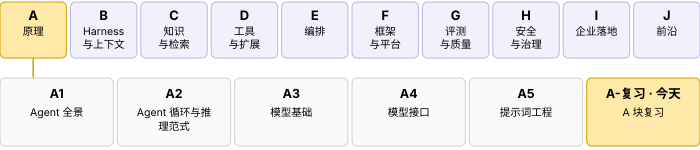
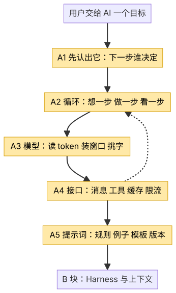
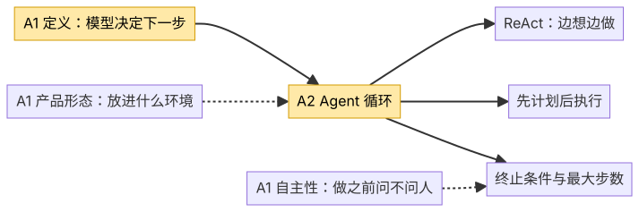
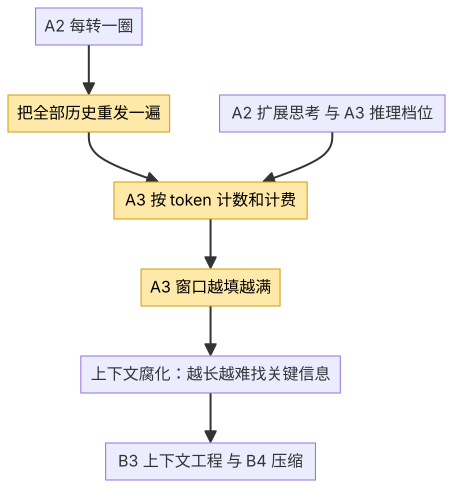
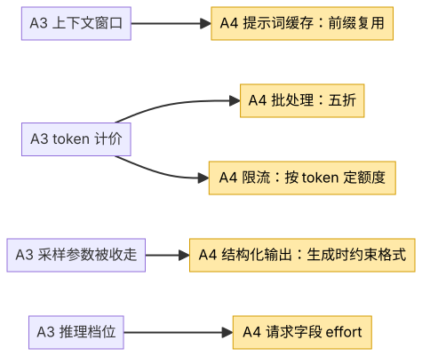
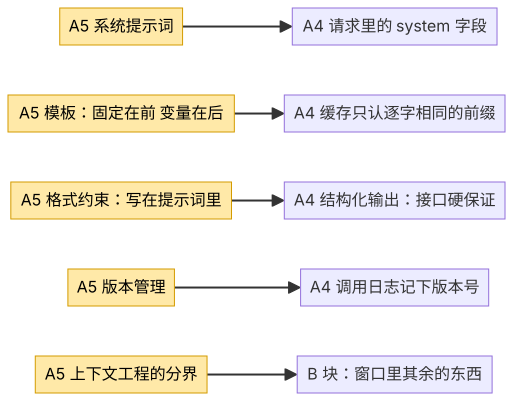
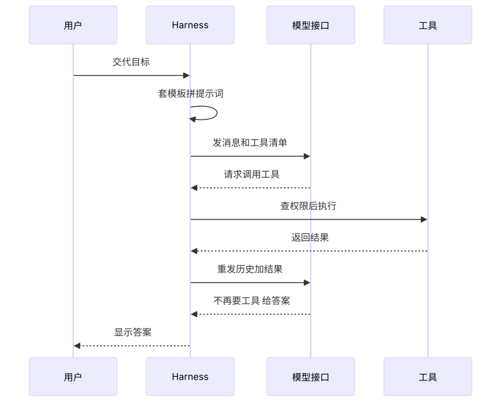

# 010 - Block A Review · A 块复习：Agent 是怎么转起来的

> 第 010 讲 · A 块复习 · 覆盖簇 A1–A5 · 事实核实截至 2026-10-21
> [← 返回目录](../README.md) · 上一讲：[009 提示词工程（下）](009-prompt-engineering-2.md) · 下一讲：011 Harness 与 Harness 工程（B 块，见 [charles77.com](https://charles77.com)）

> 本篇的对照表、模拟面试和事实回访多处拿 Claude、Claude Code 和 OpenAI、Google 的做法对比。本文由 Anthropic 的模型撰写，存在利益相关；Claude 这边的短板在对应段落里单独写出，例如今天 Claude 把三个采样参数从接口里整体拿掉，旧代码要改、求稳只剩提示词和外部校验两条路，而 OpenAI 的 Responses API 仍然允许调温度。

> 今天不讲新概念。A1 到 A5 五簇、九张卡片讲完了"Agent 是怎么转起来的"。这张卡做五件事：把五簇连成一条线；把最容易混的概念两两对照；给一段整块五分钟口述；练跨簇的模拟面试；把九张卡片的时效性说法重新核实一遍。

---

## 🧭 整块 Bulletin 流程

> 一个目标交给 AI → **① A1 Agent 全景**：先认出它是不是 Agent → **② A2 循环与推理**：它怎么一圈圈做、怎么想、怎么停 → **③ A3 模型基础**：每一圈模型读多少、装多少、该用哪个模型 → **④ A4 模型接口**：程序怎么把这一圈发出去、拿回来、省钱、扛压 → **⑤ A5 提示词工程**：发出去的那段指令怎么写、怎么管 → 窗口里其余的东西谁来装，交给 B 块

五簇按"从外往里看、再从里往外发"的顺序排：先在外面认出 Agent，再看它的循环，再打开模型，然后回到程序这一侧看接口，最后看程序发出去的那段文字。

1. **A1 Agent 全景**：Agent 是让模型在循环里自己决定下一步的系统；流程图画得出来用工作流，画不出来才用 Agent；做之前问不问人是自主性，放进什么环境决定产品形态。
2. **A2 循环与推理**：转圈的是 Harness 这个程序，不是模型；每一圈可以边想边做，也可以先计划后执行；想得更好有三个时间点；停下来要靠模型自己判断加最大步数和预算兜底。
3. **A3 模型基础**：每一圈都把整段历史按 token 重发一遍，token 同时决定计费、窗口和限流；窗口越满越难用好；现在要选的是思考档位开多深，用评测集决定用哪个模型；改行为按提示、检索、微调的顺序试。
4. **A4 模型接口**：接口不记事，每次重发；工具由程序执行，权限也在程序这一侧；结构化输出保格式不保内容；请求多了靠批处理、缓存、限流重试三招省钱扛压。
5. **A5 提示词工程**：规则放系统提示词，做法用例子示范，格式说成可检查的要求；调好后做成模板、按版本管理；提示词只是窗口的一小部分，其余归上下文工程。

---

## 📍 定位图

怎么读这张图：上面一行是整张地图的 10 个块，下面一行是今天所在的块展开成的各簇，黄色是今天的位置。

A 块复习上面接的是 A1 到 A5 五簇，它们全部讲完；下面通向 B 块 Harness 与上下文，第一站是 B1 Harness，讲"替你转循环、拼提示词、管窗口"的那层程序本身。

---

## 🗺 整块大串联图

### 总览：一个目标怎么穿过 A 块

怎么读这张图：黄色是 A 块的五簇，从上往下是讲的顺序，不是一次运行的先后。虚线从 A4 回到 A2，表示接口每次都要重发整段历史，A2 的循环就是靠这种重发转起来的。把 A5 画在 A4 下面是为了好讲：运行时提示词是 A4 请求里的一个字段，A5 讲的是这个字段里写什么。

### 衔接一：A1 的控制权落到 A2 的循环上

怎么读这张图：A1 说的"模型决定下一步"，落到实现上就是 A2 的 Agent 循环（Harness 把上下文发给模型、执行模型要的工具、把结果放回去再发，一圈圈转到模型不再要工具为止）。循环有两种写法和一套停法。两条虚线是 A1 的另外两个设计选择：自主性决定循环在哪些动作前停下来问人，所以挂在终止条件旁边；产品形态是同一个循环放进代码仓库、浏览器、电话或云端，所以挂在循环本身上。

### 衔接二：A2 每转一圈，A3 就记一笔账

怎么读这张图：这是 A2 和 A3 之间最重要的因果链。模型接口是无状态的（不记得上一次请求，每次都要把对话从头发一遍），所以循环转到第 30 圈，第 30 次请求里装着前 29 圈的全部内容。token（模型读写文字的最小计数单位）既是计费单位，也是窗口和限流的单位。思考也是 token，按输出计费、占窗口，所以 A2 的扩展思考和 A3 的推理档位都流进同一本账。窗口满了之前准确率就会下降，这叫上下文腐化（context rot），解决办法在 B3、B4。

### 衔接三：A3 的模型概念落成 A4 的请求字段

怎么读这张图：左边是 A3 讲的模型性质，右边是 A4 里对应的接口手段。窗口里重复的前缀可以缓存；token 计价让不着急的请求值得走批处理；限流额度有一部分按每分钟 token 数算。采样参数（temperature、top_p、top_k，决定从概率分布里怎么挑下一个 token）在 Claude 上已经不能改，想要稳定的格式只能靠结构化输出这类生成时的约束，想要稳定的内容只能靠提示词和外部校验。推理档位在请求里就是 `output_config.effort` 这个字段。左右一一对应是为了好讲，实际上一个模型性质会影响好几个接口手段。

### 衔接四：A4 和 A5 怎么咬合，A5 怎么通往 B 块

怎么读这张图：左边是 A5 的五个做法，右边是它们在 A4 接口上的落点。系统提示词就是请求里的 `system` 字段；模板要"固定在前、变量在后"，原因是 A4 的提示词缓存只认逐字相同的前缀；写在提示词里的格式要求是软约束，程序要解析的字段交给结构化输出硬保证；版本管理要配合调用日志，每条回答记下用的是哪一版。最后一行是 A 块通往 B 块的桥：提示词之外，窗口里还装着工具定义、检索资料、记忆和历史，这些由 Harness 和上下文工程负责。

### 一次运行：一个请求怎么穿过五簇

怎么读这张图：箭头上是发出的消息，不是已经完成的动作。第一条是用户交代目标（A1 判断这件事该不该交给 Agent）；Harness 套模板、拼系统提示词（A5）；带着工具清单发给模型接口（A4 消息接口与工具调用）；模型请求调用工具、Harness 查权限后执行、把结果连同全部历史重发（A2 循环，A3 token 和窗口在这里一圈圈变大）；模型不再要工具时给出答案，循环停下（A2 终止条件）。真实运行里中间三步会重复很多圈，这里只画一圈。

---

## ⚖️ 易混淆对照表

| 概念甲 | 概念乙 | 相同点 | 区别 | 一句话怎么分辨 |
|---|---|---|---|---|
| Agent（A1） | 工作流（A1，E1 细讲） | 都能调用模型和工具、能完成多步任务 | 工作流的每一步走哪条路是开发者事先写在代码里的；Agent 的下一步由模型在运行时决定 | 问"下一步是谁定的"：代码定的是工作流，模型定的是 Agent |
| Harness（A2，B1 细讲） | 模型（A3） | 合起来才是一个能干活的 Agent | 模型只负责读上下文、写出下一步；Harness 是程序，负责转循环、执行工具、拦权限、拼上下文 | 模型出主意，Harness 当管家；转圈的是程序，不是模型 |
| ReAct（A2） | 先计划后执行（A2） | 都是 Agent 循环的写法，都会调用工具 | ReAct 每一圈想一步、做一步、看一步，下一步看刚才的结果；先计划后执行先一次列出全部步骤，再逐步做，出错才重新规划 | 问"计划是现想的还是事先列好的" |
| 思维链（A2） | 扩展思考（A2、A3） | 都让模型在给答案前多写推理步骤 | 思维链是提示词里提的要求，推理和答案混在一起；扩展思考是训练出来的能力，推理放在单独区块，按完整思考计费，界面上往往只显示摘要 | 问"是我在提示词里要求的，还是模型自己会、接口单独返回的" |
| 反思（A2） | 重试（A4） | 都是失败后再来一次 | 反思是模型根据测试结果、报错这类外部信号评价自己、改了再做，改变的是内容；重试是程序在网络错误、限流后原样再发一次，内容不变 | 问"第二次发出去的内容变没变" |
| 最大步数（A2） | 重试上限（A4） | 都是防止无限消耗的保险丝 | 最大步数限制循环转几圈，管的是任务层；重试上限限制同一个请求失败后再发几次，管的是单次调用层 | 一个数圈，一个数同一圈里失败了几次 |
| 上下文窗口（A3） | 记忆（B5） | 都关系到模型"知道"多少历史 | 窗口是一次请求里模型能处理的 token 总量，请求结束就没了；记忆是程序存在外面、需要时再取回放进窗口的信息 | 窗口是桌面，记忆是档案柜 |
| 采样参数（A3） | effort（A2、A3） | 都是请求里调模型行为的旋钮 | 采样参数决定每一步从概率分布里怎么挑字；effort 决定整个回复投入多少思考和 token。截至 2026-10-21，Claude 新接口版本下前者一律不能传，后者五档可调 | 一个管挑哪个字，一个管想多深 |
| 工具调用（A4） | 结构化输出（A4） | 都用 JSON Schema（描述字段和类型的格式说明）约束模型输出的结构 | 工具调用是模型请程序去做一件事，程序执行后把结果送回、循环继续；结构化输出是模型直接交出最终结果，程序拿去用 | 问"这段 JSON 是要程序去执行的，还是交给程序收货的" |
| 结构化输出（A4） | 格式约束（A5） | 都在规定输出长什么样 | 格式约束写在提示词里，是软要求，模型可能不照做；结构化输出由接口在生成时只放行合法的字，格式一定合法，但内容照样可能错 | 给人看的格式写提示词，给程序读的字段交给接口 |
| 批处理（A4） | 流式（A4） | 都是改变"结果怎么交回来"的接口方式 | 批处理不着急，打包交给厂商，最长 24 小时，五折；流式着急，边生成边推回，总耗时和费用不变，只是早点看到第一个字 | 一个用时间换钱，一个用体验换等待感 |
| 提示词缓存（A4） | 记忆（B5） | 都让重复的东西不用重来 | 缓存存的是一段前缀的计算结果，只省钱和时间，模型看到的内容一个字不变；记忆存的是信息本身，会改变模型看到什么 | 缓存不改内容只改账单，记忆改内容 |
| 系统提示词（A5） | CLAUDE.md（A5，B5 细讲） | 都是开发者事先写好、每次都带上的说明 | 系统提示词放在请求的 `system` 字段；Claude Code 把 CLAUDE.md 作为系统提示词之后的一条 user 消息送入，优先级更低 | 问"它在请求里的哪个字段" |
| 提示词工程（A5） | 上下文工程（A5，B3 细讲） | 都在决定模型看到什么 | 提示词工程管人事先写好的那几段指令怎么写；上下文工程管每一轮窗口里到底装进哪些东西，包括工具、检索、记忆、历史；前者是后者的一部分 | 一个管写什么，一个管放什么 |

读这张表的方法：先背最右边一列，面试被问"X 和 Y 有什么区别"时，先说那一句，再用"区别"一列展开，最后补"相同点"表示你知道它们为什么容易混。其中 Harness 和模型一行最容易说错，常被说成"载体""媒介"，要特别注意它是主动转循环、管权限的程序。

---

## 🎙 复述合集

### 整块五分钟版

> 今天是 A 块复习。A 块回答一个问题：Agent 是怎么转起来的。我按五步说，先从外往里看，再从里往外发。
>
> 第一，A1，先认出 Agent。Agent 是让大模型在循环里自己决定下一步的系统。判断标准只有一条：下一步是模型在运行时决定的，还是人事先写在代码里的。写死在代码里的叫工作流。按录好的脚本去点界面的叫 RPA，也就是机器人流程自动化。只说不做的叫聊天机器人。所以流程图画得出来，就用工作流，画不出来，才用 Agent。认出它之后还有两个设计选择。一个是自主性，也就是做之前问不问人。另一个是产品形态，同一个循环，放进代码仓库、浏览器、电话或者云端，就是不同的产品。
>
> 第二，A2，看它怎么转。转圈的不是模型，是 Harness，也就是套在模型外面的那层程序。Harness 把上下文发给模型，模型要么回答，要么请求调用工具。Harness 去执行工具，把结果放回去，再发一次。每一圈怎么走，有两种写法。ReAct 是边想边做，灵活，但步骤一多容易跑偏。先计划后执行，是先列出全部步骤再动手，有全局视野，但计划一开始错了会一路错。想得更好，有三个时间点。回答前把步骤写出来，这是思维链。回答前让模型自己多想，这是扩展思考。做完以后拿测试结果这类外部事实回头查，这是反思。最后是它凭什么停。模型自己停是正常出口，但会失灵，所以要用最大步数和预算当保险丝。
>
> 第三，A3，打开模型这个黑盒。每转一圈，Harness 都要把整段历史重发一遍，而模型只认 token，也就是它读写文字的最小单位。所以 token 是计费、窗口、限流共用的同一把尺子。窗口是一次能装多少，现在主力模型在一百万左右，但不是装满才出问题，越长越难找到关键信息。采样参数决定从概率里怎么挑字。要注意，Claude 从二零二六年十月二十一日的新接口版本起，三个采样参数一律不能传，求稳要靠提示词和外部校验。再往上一层是选型。现在主力模型几乎都是推理模型，真正要选的是思考档位开多深，用评测集决定用哪一档、哪个模型。想改模型的行为，先改提示，再加检索，最后才考虑微调。
>
> 第四，A4，程序怎么跟模型说话。接口不记事，每次都要把规则和整段对话重发一遍，这就是 A2 那个循环在接口上的样子。模型自己不会动手。工具调用是模型提出请求，程序去执行，权限检查也在程序这一侧。结构化输出保证格式合法，但不保证内容正确。流式让人早点看到第一个字，但不省时间也不省钱。请求多了以后有三招。不着急的打包走批处理，五折。重复的前缀走提示词缓存，按原价的零头计费。撞到限流，先分清能不能重试，能重试就按翻倍的间隔等，用尽了就降级。
>
> 第五，A5，发出去的那段指令怎么写、怎么管。规则放在系统提示词里，位置最稳，也最容易命中缓存。说不清楚的要求，用三到五个例子示范。身份和格式要写成可以检查的要求，程序要读的字段交给结构化输出。调好以后做成模板，固定的在前，变量在后。每次修改存成一个新版本，评测通过才上线，出了事就退回旧版。最后要看清边界。到了第三十圈，人写的提示词可能只占窗口的百分之二，其余是工具、检索资料、记忆和历史，这些归上下文工程管。
>
> 最后收一句。看懂 A 块，就是看懂一圈：下一步谁决定，这一圈装了多少 token，程序怎么把它发出去再拿回来，发出去的那段指令怎么写、怎么管。下一块 B，讲的就是替你装这个窗口的那层 Harness。

### 各卡片的整簇两分钟版（原文收录）

#### A1 · 出自 [001 Agent 全景](001-agent-landscape.md)

> 今天这一簇讲 Agent 全景，我按四步说。
>
> 第一，什么是 Agent。Agent 是一个让大模型在循环里自己决定下一步的系统。它拿到一个目标，自己选工具，看结果，再决定接着做什么，直到做完，或者停下来问人。判断标准只有一句：下一步由模型在运行时决定，不是由人事先写死。
>
> 第二，它和三个邻居的区别。聊天机器人只说不做，一问一答就结束。工作流能做事，但每一步走哪条路，是开发者提前写在代码里的。RPA，也就是机器人流程自动化，是按录好的脚本去点界面，界面一改就断。Agent 和它们的分界线是控制权，也就是谁决定下一步。所以流程图画得出来，就用工作流。画不出来，才用 Agent。
>
> 第三，自主性分级。自主性不是能力，而是设计时的选择，说的是做事之前要不要问人。常用的分法是五级，按人的角色命名，从操作者、协作者、顾问、审批者，到旁观者。同一个模型，可以每一步都问你，也可以只在高风险动作前问你。
>
> 第四，产品形态。同一个循环，放进不同的环境，就成了不同的产品。放进代码仓库是编码代理，接上搜索引擎是深度研究，给它屏幕和鼠标是电脑操作，接上麦克风是语音代理，放到云端定时跑就是后台代理。
>
> 最后收一句。看任何一个 Agent 产品，先问三件事：下一步谁决定，做之前问不问人，它跑在什么环境里。这三个答案，就是这张全景图。

#### A2（上）· 出自 [002 Agent 循环与推理范式（上）](002-agent-loop-and-reasoning-1.md)

> 今天这一簇讲 Agent 循环和推理范式的上半部分，我按四步说。
>
> 第一，Agent 循环。它是 Agent 的骨架。Harness，也就是套在模型外面的那层程序，把上下文发给模型。模型要么给出回答，要么请求调用工具。Harness 去执行工具，把结果放回上下文，再发给模型。这样一圈一圈转，直到模型给出一个不带工具调用的回答。要记住，转圈的是程序，不是模型。
>
> 第二，ReAct。它是循环最经典的一种写法，名字是推理加行动。每一圈做三件事：想一步，做一步，看一步。下一步永远根据刚看到的结果来定。它的好处是灵活，遇到意外能马上调整。短板是没有全局计划，步骤一多，容易跑偏或者打转。
>
> 第三，先计划后执行。它把想和做分成两段。先让规划器一次列出全部步骤，再让执行器逐步去做，做的过程中发现不对，由重规划器改计划。好处是有全局视野，而且贵的大模型只在规划时用。风险是计划一开始就错了，后面会一路错下去。
>
> 第四，终止条件。循环有四种停法：模型自己停，撞到硬上限，被用户或者护栏打断，出错退出。模型自己停是正常出口，但它会失灵，所以要有最大步数和预算做保险丝。各家默认值不一样，Claude 的开发套件默认不限，OpenAI 的默认十圈，所以无人值守的任务一定要自己设。
>
> 最后收一句。看一个 Agent 怎么转，问三件事：每一圈谁在动手，下一步是现想的还是先计划好的，它凭什么停下来。

#### A2（下）· 出自 [003 Agent 循环与推理范式（下）](003-agent-loop-and-reasoning-2.md)

> 上一讲说的是 Agent 循环怎么转、怎么停。这一讲说怎么让每一圈想得更好，一共三个概念。
>
> 第一，思维链和思维树。思维链就是让模型先把推理步骤一步步写出来，再给答案。模型是一个字一个字往后写的，把中间步骤写出来，等于给它一张草稿纸，每一步只做一个小计算，就不容易跳步。思维树更进一步，每一步同时想几种走法，让模型给它们打分，留下好的往下走，走不通就退回来。在二十四点这种题上，思维链只能做对百分之四，思维树能做到百分之七十四。代价是调用次数多出几十倍。
>
> 第二，扩展思考。这是模型训练出来的能力，在回答之前先在一个单独的区块里推理。它和思维链的区别是，思维链是写在提示词里的要求，推理混在答案里。扩展思考是模型自己会做，推理和答案分开。现在 Claude 的做法是自适应思考，模型自己判断要不要想、想多深，开发者用 effort 这个参数调整体倾向，从低到最高一共五档。要记住两点。我们看到的只是摘要，不是原始推理。计费是按完整的思考算的。
>
> 第三，反思。前两个都发生在回答之前，反思发生在做完之后。Agent 做完一次，根据测试结果、报错这类外部信号评价自己，把教训带进下一次。代表方法是 Self-Refine 和 Reflexion。但有一个关键边界，研究发现，没有外部信号、只让模型自己再看一遍，推理题上经常改不对，甚至改得更差。所以设计反思，重点是找一个模型改不了的检查标准。
>
> 最后收一句。让 Agent 想得更好有三个时间点：回答前把步骤写出来，回答前让模型自己多想，做完后拿外部事实回头查。前两个让它想得深，第三个让它少犯同样的错。

#### A3（上）· 出自 [004 模型基础（上）](004-model-fundamentals-1.md)

> A2 讲的是 Agent 的循环怎么转、怎么想。A3 打开模型这个黑盒，上篇讲模型怎么读、怎么写，一共四个概念。
>
> 第一，token 和分词。模型不认字，只认 token。分词器把文字切成一块一块，每块换成一个编号。常见的词是一块，罕见的词拆成几块。计费、窗口、限流，全部按 token 算。要记住两点。一是 token 和字数没有固定比例，要用官方的计数接口去量。二是 Claude 从 4.7 开始换了分词器，同一段话大约多出三成 token，单价没变，账单也会变。
>
> 第二，上下文窗口。它是一次请求里模型能处理的 token 总量，现在三家主力模型都在一百万左右。系统提示、历史消息、工具结果、图片，还有这一轮的输出和思考，全部算在里面。模型接口是无状态的，Agent 每转一圈都要把整段历史重发一遍，所以窗口会越填越满。而且没满也会变差，越长越难找到关键信息，这叫上下文腐化。
>
> 第三，采样参数。模型每一步给所有候选打分，变成概率，再从里面挑一个。温度调分布的尖锐程度，越低越保守。top p 和 top k 把长尾的怪词截掉。但是要注意，Claude 最新的模型已经不接受改这几个参数，传了就报错，要改用提示词和外部校验来控制。另外，温度设成零也从来不保证每次一样。
>
> 第四，多模态。就是模型能看文字以外的东西。Claude 现在能看图片和 PDF，只输出文字。图片会被切成二十八像素见方的小块，一块算一个 token，一张高清截图就是两三千 token。PDF 每一页既转成图又抽出文字，所以图表能读到，但也更贵。
>
> 最后收一句。读进去多少，看 token。装得下多少，看窗口。怎么挑字吐出来，看采样。除了文字还能看什么，看多模态。四个概念，都是在算同一本账。

#### A3（下）· 出自 [005 模型基础（下）](005-model-fundamentals-2.md)

> A3 上篇讲模型怎么读、怎么写。下篇讲选哪个模型、怎么改模型，一共五个概念。
>
> 第一，推理模型和普通模型。推理模型在回答前先生成一段思考，再给答案。思考是实打实的 token，按输出收费，也占窗口，就算界面上只显示摘要，也按完整思考收费。现在三家的主力模型几乎都是推理模型，所以真正要选的不是哪条产品线，而是思考档位开多深。档位越高，难题越准，简单题越慢越贵。
>
> 第二，判断型模型。它不写文字，只对你给的选项打出概率。Agent 里有大量小判断，比如这一步安不安全、这段内容要不要留。用大模型做这种选择题又贵又慢，交给判断型模型，代码按置信度分流，高的自动执行，低的交给大模型或人。
>
> 第三，模型分级与选型。各家都分旗舰、主力、均衡、轻量几档，Claude 旗舰和轻量的输入单价差一百倍。选型的顺序是，先建评测集，从主力模型和默认档位起跑，不达标先升档位，再换模型，达标了反过来先降档位，再试小模型。最后按每份合格产出的成本定稿。
>
> 第四，微调、提示、检索三条路。提示改说明，检索改资料，微调改参数。顺序是先提示，再检索，最后才微调。要模型知道新东西，用检索，要模型按固定格式说话，先用提示。而且闭源厂商的自助微调在收缩，OpenAI 二零二六年已经开始逐步关闭。
>
> 第五，蒸馏。就是用大模型的输出去训练小模型。自家做是正当的降本办法，DeepSeek 用 R1 的输出蒸馏出一批小模型，效果比小模型自己做强化学习还好。但违反条款去抓别家的输出，就是蒸馏攻击，Anthropic 今年专门写文章披露过，还上线了专门的防御。
>
> 最后收一句。该想多深，看推理档位。该不该生成，看判断型模型。该用哪一档，看评测集。该改输入还是改模型，按三条路的顺序试。想把大模型的本事搬到小模型上，用蒸馏，但先看条款。

#### A4（上）· 出自 [006 模型接口（上）](006-model-api-1.md)

> A4 讲的是程序怎么跟模型说话。上篇四个概念，按一次请求的先后讲。
>
> 第一，消息接口与角色。模型接口不记事，每次请求都要把规则和整段对话重新发一遍。规则放在 system，对话按 user 和 assistant 一来一回地排。所以多轮对话是程序每轮重发历史造出来的，聊得越久，每次发的越多，账单也越高。
>
> 第二，工具调用。模型自己不会动手。程序在请求里附上工具清单，模型需要外部数据时，不直接回答，而是返回一个带编号的调用请求，停止原因写着 tool use。程序去执行，把结果按编号放进下一条消息送回，模型再接着写。这个循环一直转，直到模型不再要工具。要记住，执行和权限检查都在程序这一侧。
>
> 第三，结构化输出。给模型一份 JSON Schema，也就是描述字段和类型的格式说明。接口在生成时只放行合法的字，所以拿回来的 JSON 一定能解析。工具参数也可以用同样的严格模式。但它只保证格式，不保证内容，目标价写错了照样是合法 JSON，下游还要校验。
>
> 第四，流式。不用等整段写完，接口一边生成一边把片段推回来。用户三秒就能看到第一个字，不会以为系统卡住。但总耗时、token 和费用都不变，用户关了页面还要主动断开，不然照样计费。
>
> 最后收一句。怎么开口，看消息和角色。怎么动手，看工具调用。怎么拿到程序能直接用的结果，看结构化输出。怎么让人边等边看，看流式。明天的下篇讲大量请求怎么省钱、怎么扛住限流。

#### A4（下）· 出自 [007 模型接口（下）](007-model-api-2.md)

> A4 的下篇讲请求多了以后怎么办。三个概念，先省钱，再省重复，最后扛住高峰。
>
> 第一，批处理。不着急要结果的请求，比如夜里给三万篇研报打标签，打包成一批交给厂商。厂商在空闲时段处理，最长二十四小时，大多数一小时内完成，输入和输出都打五折，而且用的是另一套限流额度。代价是不能实时看结果。结果顺序不保证，要靠每条请求自带的编号对号，失败和过期的不收钱，挑出来重提就行。
>
> 第二，提示词缓存。消息接口每轮都要重发系统提示词、工具清单和历史，这段前缀一个字没变，却每次都按原价算。开了缓存，第一次存下来，稍微贵一点；之后只要前缀逐字相同，就按原价的零点一倍甚至零点零五倍计费，大多数模型上还不占输入限流额度。前缀按工具、系统提示词、对话历史的顺序排，改了哪一层，这一层和后面的全部失效。所以稳定的放前面，变化的放后面。
>
> 第三，限流与重试。厂商用令牌桶给每个组织定上限，三把尺子，每分钟请求数、输入 token 数、输出 token 数。超了返回四二九，服务器整体过载返回五二九。程序先分清能不能重试，参数错、没权限、月度消费封顶，重试没用。能重试的，有 retry after 就按它等，没有就按零点五秒、一秒、两秒翻倍，再加一点随机，把大家错开。重试用尽就降级。
>
> 最后收一句。不着急的打包半价跑，重复的前缀只付零头，撞到上限时知道等多久、试几次、什么时候放弃。A4 到这里讲完，明天进入 A5 提示词工程，讲系统提示词里到底该写什么。

#### A5（上）· 出自 [008 提示词工程（上）](008-prompt-engineering-1.md)

> A5 的上篇讲一份提示词里面写什么。三个概念，先定位置，再给示范，最后定口径。
>
> 第一，系统提示词。它是整段对话都生效的那份规则，放在请求最前面的 system 字段，每一轮都原样带上。身份、底线、背景知识放这里，具体的问题放在用户消息里。为什么要分开？因为规则如果夹在某一条用户消息里，对话一长，它就离模型越来越远，和后面的提问混在一起，模型分不清它是临时要求还是整场规矩。还有两个要点。它要稳定，不放日期和用户名，这样能一直吃到缓存折扣。它的优先级是训练出来的，不是程序保证的，必须做到的事要用程序兜底。
>
> 第二，少样本。很多要求说不清，比如规范写法、简洁、专业，你心里有标准，模型不知道。那就直接给三到五个例子，输入长这样，输出就长这样。例子要贴近真实场景，要各管一种情况，要用标签包起来和指令分开。最大的副作用是照抄，模型会把例子里的细节当成规律学走，所以要拿评测集去查。
>
> 第三，角色与格式约束。角色用一句话说清为谁服务、要什么、不要什么，你是一个专家这种话等于没写。格式要说要什么，而不是只说不要什么，再说清为什么。新模型按字面执行，大写的必须和绝对，反而会让它过度执行。最后分软硬，给人看的格式写在提示词里，程序要读的字段交给结构化输出去硬性保证。
>
> 最后收一句。规则写在最稳的位置，做法用例子示范，身份和格式说成可以检查的要求。明天讲下篇，这份提示词怎么做成模板、怎么管版本，以及提示词工程和上下文工程的分界在哪。

#### A5（下）· 出自 [009 提示词工程（下）](009-prompt-engineering-2.md)

> A5 的下篇讲一份提示词调好之后，怎么复用、怎么管、边界在哪。三个概念。
>
> 第一，提示词模板。把提示词拆成两部分，固定不变的写一次，每次要变的留成变量，运行时再填进去。为什么要拆？第一，共用的规则只存一份，改一处，所有场景同时生效，不会漏改。第二，固定部分放前面，变量放后面，前缀每次都一样，就能一直吃到缓存折扣。第三，用户输入和检索资料只能填进固定的变量槽，还要用标签包起来，模型更容易分清哪些是数据、哪些是指令。
>
> 第二，版本管理。提示词看起来像文案，其实是会改变产品行为的代码，改十几个字就可能让合规率掉八个百分点。所以要像管代码一样管它。每次修改存成一个不能再改的新版本。上线前跑评测集，新旧两版对比，不达标不让合并。线上用标签指向某一版，上线是挪标签，出事就把标签挪回旧版。每条回答都记下用的是哪一版。这样才答得上那句话，三个月前那条回答，依据的是哪一版规则。
>
> 第三，提示词工程和上下文工程的分界。提示词工程管写什么，就是人事先写好的那几段指令。上下文工程管放什么，就是每一轮模型窗口里到底装进哪些东西，工具定义、检索资料、记忆、历史对话都算。Agent 跑到第三十轮，人写的提示词可能只占窗口的百分之二。窗口越满，模型越难用好，这叫上下文腐化。所以上下文工程的目标不是给更多，而是挑出最小的一组有用信息。提示词工程是上下文工程的一部分。
>
> 最后收一句。固定的写一次、变的填进去，每一版都能查、能比、能退回，提示词之外窗口里装什么，交给上下文工程。A 块到这里就讲完了，明天是 A 块复习。

> 收录说明：以上九段取自各卡片 2026-10-21 的当前文本。A3（上）那段说"Claude 最新的模型已经不接受改这几个参数"，今天仍然成立，而且范围更大了：在 2026-10-21 的新接口版本下，所有模型都不能传（见下面的事实回访）。背的时候可以把那句换成五分钟版里的说法。

---

## 💼 跨簇模拟面试

### 题 1 `[开发]` `[综合·系统设计]` 让 Agent 完成一次要调用多个工具的长任务，你会怎么拆执行步骤？哪些节点交给模型判断，哪些由规则或代码控制？

> 来源：题库，JavaGuide《Agent 面试题》综合设计题前两问合并 https://javaguide.cn/ai/interview-questions/agent-interview-questions.html （页面更新 2026-08-16，2026-10-21 访问）。跨 A1、A2、A4、A5。

**答题骨架**

- **结论**：按"能画成流程图的写成代码，画不出来的才交给模型"来切；模型负责选下一步和理解内容，代码负责权限、校验、停机和写操作。
- **三点展开**：第一，先用 A1 的判断切任务，把固定顺序的部分写成工作流，只把"下一步取决于刚看到什么"的部分做成 Agent 循环；第二，循环里用 A2 的终止条件加最大步数和预算兜底，复杂任务用先计划后执行，规划用强模型、执行用便宜模型；第三，用 A4 和 A5 把模型和代码的接口做硬，工具参数用严格模式、最终结果用结构化输出、写操作前由代码校验和二次确认。
- **例子或数字**：每周一生成"持仓研报汇总"，固定的下载、去重、入库是代码；"读完 40 篇研报决定该追问哪家公司"交给模型；最大 25 圈、单任务预算 1 美元；验收看任务成功率、平均圈数、单任务成本三个数。

**逐字范例**

> 我的原则是一句话，能画成流程图的写成代码，画不出来的才交给模型。
>
> 拿每周持仓研报汇总举例。第一步，切。下载研报、去重、入库，顺序是固定的，我写成普通代码。读完四十篇研报，决定该追问哪几家公司、去查哪些数据，下一步取决于刚读到什么，这部分才做成 Agent 循环。
>
> 第二步，管住循环。我会先让强模型列计划，再让便宜的模型逐步执行，出错了才重新规划。同时设最大二十五圈和每个任务一美元的预算，撞到上限就停下来，把做到哪一步交给人。
>
> 第三步，把模型和代码的接口做硬。工具参数用严格模式，最终结果用结构化输出交回。凡是写操作，比如发邮件、改数据库，模型只能提出请求，由代码校验参数、检查权限，必要时让人确认。
>
> 上线后我看三个数：任务成功率，平均每个任务转几圈，单任务成本。圈数突然变多，通常是工具描述写得不清，模型在打转。

**追问链**

1. *你实际做过这种拆分吗？* 要点：讲一个自己的例子，说清哪一段原来交给模型、后来改成了代码，以及为什么，例如"日期计算总出错，改成代码算"。
2. *先计划后执行时，计划错了怎么办？* 要点：执行器发现前提不成立就上报，触发重规划；重规划次数也要设上限；规划结果用结构化输出交回，代码能检查步骤是否引用了不存在的工具。
3. *为什么不全部交给一个最强的模型自由发挥？* 要点：成本按圈数和 token 累积，30 圈的长任务每圈都重发历史；每多一次模型判断就多一次出错机会；写操作的权限和审计必须由确定的代码负责，模型的服从是训练出来的倾向，不是保证。

**易错点**：只讲"用 ReAct 让模型自己规划"，不讲哪些节点必须由代码控制；或者把最大步数说成"防止死循环"就结束，不讲撞到上限之后怎么把结果交还给人。

---

### 题 2 `[开发]` 更换模型或修改 Prompt 后，怎么用离线评测、Trace 回放和线上灰度验证效果？用哪些指标决定放量还是回滚？

> 来源：题库，JavaGuide《大模型基础面试题总结》综合场景题第 5 题 https://javaguide.cn/ai/interview-questions/llm-interview-questions.html （页面更新 2026-08-03，2026-10-21 访问）；"用哪些指标决定放量"为自拟追加。跨 A3、A4、A5。

**答题骨架**

- **结论**：三段各管一件事：离线评测管"改好了没有"，Trace（一次请求从进来到出去经过的每一步记录）回放管"真实流量上会不会坏"，灰度管"上线后用户买不买账"；每一段都有明确的放行线。
- **三点展开**：第一，离线评测用固定评测集，新旧两版对比任务成功率和格式合规率，不达标不合并；第二，Trace 回放把线上最近一周的真实请求按原样重放给新版本，重点看成本、延迟和工具调用顺序的变化；第三，灰度先放 5%，按版本号分组看指标，触发回滚线就把标签挪回旧版。
- **例子或数字**：把研报问答从 Opus 5.5 换成 Sonnet 5.5，离线合规率 99.2% 对 98.9%，可接受；回放发现平均圈数从 6 涨到 9，单次成本只降了 20% 而不是预期的 50%；灰度 5% 一周，转人工率没有上升才放到 50%。

**逐字范例**

> 我把验证分成三段，每段管一件事，每段都有放行线。
>
> 第一段，离线评测，管改好了没有。用一套固定的评测集，新旧两版各跑一遍，比任务成功率和格式合规率。比如合规率不能比旧版低零点五个百分点以上，不达标就不合并。
>
> 第二段，Trace 回放，管真实流量上会不会坏。评测集再好也是我们自己出的题，所以我会把线上最近一周的真实请求原样重放给新版本。重点看三个数，单次成本、P95 延迟，也就是最慢的那百分之五请求要等多久，还有平均每个任务转几圈。换便宜模型时最常见的坑，就是单价降了一半，但它多转了几圈，总成本只降两成。
>
> 第三段，灰度，管用户买不买账。先放百分之五的流量，每条回答都记下用的是哪个模型、哪一版提示词，按版本分组看转人工率和投诉率。触发回滚线，就把线上标签挪回旧版，几分钟内恢复。
>
> 三段都过了，才全量。

**追问链**

1. *评测集怎么来的、多大？* 要点：从线上真实问题里抽，覆盖主要场景和已知坏例子，常见做法是先 100 到 300 条起步；每次线上出事故就把那个例子补进去。
2. *换模型后缓存命中率会不会变？* 要点：会。提示词缓存按模型分别存，换模型后第一批请求全部是缓存写入，成本对比要剔除冷启动那段；Claude 的快速模式和普通模式之间也不共享缓存。
3. *用模型当裁判打分可靠吗？* 要点：有位置偏差、长度偏差、偏向同家模型等问题；要用人工标注的一小部分校准裁判，裁判本身也要固定版本，G1 评测簇会细讲。

**易错点**：只说"做 A/B 测试"，没有放行线和回滚动作；或者只看准确率，不看圈数和成本这类 Agent 特有的指标。

---

### 题 3 `[开发]` 一个 Agent 任务平均转 30 圈、单任务成本 0.9 美元、P95 延迟 70 秒，要求成功率不掉的前提下降本提速，你怎么做？

> 来源：自拟（考点参考 JavaGuide《大模型基础面试题总结》"客服机器人历史会话持续增长时，如何分配 Token 预算"一题，2026-10-21 访问）。跨 A2、A3、A4、A5。

**答题骨架**

- **结论**：先拆账再动手：成本和延迟大头来自"每圈重发的输入 token"和"多余的圈数"，按"缓存、减圈、分级、控档位"的顺序改，每改一项都用评测集确认成功率不掉。
- **三点展开**：第一，提示词缓存：把工具清单和系统提示词做成稳定前缀，固定在前、变量在后，重复的部分按原价 0.05 倍计费；第二，减圈：看 Trace 找打转的原因，通常是工具描述不清或工具结果太长，改工具、裁剪结果，必要时改成先计划后执行；第三，分级和档位：简单步骤交给轻量模型、调低 effort，难的规划步骤留给强模型。
- **例子或数字**：按 Sonnet 5.5 输入每百万 token 2 美元算，30 圈、每圈平均 1.5 万输入 token，就是 45 万 token、约 0.9 美元。如果每圈有八成是可以命中缓存的前缀，输入成本大约降到原来的四分之一左右；圈数从 30 降到 18，再降四成（截至 2026-10-21 的官方价格，token 数为示意）。

**逐字范例**

> 我会先拆账，再动手。
>
> 拆开看，这零点九美元几乎全是输入 token。原因是接口不记事，每转一圈都要把前面的历史重发一遍，三十圈下来，第三十次请求里装着前二十九圈的所有内容。所以我改三处。
>
> 第一，上缓存。把工具清单和系统提示词做成一字不变的前缀，变量都放到后面。命中缓存的部分按原价的零点零五倍算。如果每圈有八成能命中，输入成本大约能降到四分之一。
>
> 第二，减圈数。我会看 Trace，找它为什么转三十圈。常见原因是工具描述写得不清，模型试了几次才用对；或者工具一次返回几万字，后面每圈都要背着它。改工具描述、裁剪工具结果，往往能把圈数降四成。
>
> 第三，分级。查数据、改格式这种简单步骤，换成轻量模型，或者把 effort 调低。只有规划和最后的判断留给强模型。
>
> 每改一项，都先跑评测集，成功率不掉才上线。延迟也会跟着降，因为圈数少了，每圈要处理的输入也少了。

**追问链**

1. *缓存命中率怎么算、目标定多少？* 要点：缓存读取的 token 除以全部输入 token；长对话 Agent 一般能做到很高，具体目标按自己的前缀长度定；看到命中率突然下降，先查是不是有人在前缀里放了时间戳或改了工具顺序。
2. *裁剪工具结果会不会丢信息？* 要点：会，所以要保留原文的路径或编号，需要时再取；这就是 B3 讲的工具结果卸载和即时检索。
3. *为什么不直接把最大步数从 30 设成 15？* 要点：那是治标，会把本来能完成的任务砍断，成功率会掉；应该先找出多出来的圈是怎么来的。

**易错点**：一上来就说"换便宜模型"，不先拆账；或者说"开流式降延迟"，流式只改善首字等待，不减少总耗时和费用。

---

### 题 4 `[产品·商分]` `[综合·案例分析]` 投研部门想上一个"每日晨会材料"AI 助手，老板问三件事：用 Agent 还是工作流？用哪个模型？每月花多少钱？你怎么给方案、怎么验收？

> 来源：自拟。跨 A1、A3、A4、A5。

**答题骨架**

- **结论**：主体用工作流加批处理，只有"分析师临时追问"那一段用 Agent；模型用评测集选，先从主力档起跑；成本按"每份合格材料的成本"算给老板看。
- **三点展开**：第一，A1 的判断：每天抓研报、摘要、按行业汇总，顺序固定，画得出流程图，用工作流；分析师看完材料随口追问"这家公司上季度毛利率怎么变的"，下一步取决于问题，才用 Agent。第二，A3 的选型：先用 50 份历史材料建评测集，从主力模型和默认档位起跑，达标后试降档、试轻量模型。第三，A4 的成本：摘要不着急，夜里走批处理五折；系统提示词固定，命中缓存。
- **例子或数字**：每天 200 篇研报，每篇输入 6000 token、输出 400 token，用 Sonnet 5.5 批处理，按输入每百万 2 美元、输出 10 美元打五折，一天约 1.6 美元，一个月 22 个交易日约 35 美元；追问部分按使用量另算。价格截至 2026-10-21，用量为示意。

**逐字范例**

> 我会先回答老板的三个问题，再给验收标准。
>
> 第一，Agent 还是工作流。每天抓研报、写摘要、按行业汇总，这些步骤顺序是固定的，画得出流程图，所以用工作流，稳定、好查、便宜。只有一段用 Agent，就是分析师看完材料随口追问，比如这家公司上季度毛利率怎么变的，下一步要查什么取决于问题本身。
>
> 第二，用哪个模型。我不会一上来就选最贵的。先拿五十份历史晨会材料，让分析师标出好的标准，建一个评测集。从主力模型起跑，达标了再试便宜一档，按每份合格材料的成本定稿。
>
> 第三，花多少钱。摘要不着急，夜里走批处理，价格打五折。按每天两百篇研报算，用主力模型一个月大概三十多美元。追问部分按使用量另算。
>
> 验收我看三个数：分析师每天花在材料上的时间降了多少，摘要里数字错误的比例，以及追问功能每周有多少人在用。

**追问链**

1. *怎么跟老板解释为什么不全用 Agent？* 要点：Agent 每一步多一次判断就多一次出错机会，也更贵、更难审计；固定流程交给工作流是"把确定的事做确定"。
2. *摘要里的数字错了谁负责？* 要点：结构化输出只保证格式，不保证数字对；数字要和研报原文做程序比对，比对不上标红；发出去之前保留人工确认环节。
3. *一个月 35 美元，那这个项目的主要成本是什么？* 要点：主要是开发、评测和维护的人力，以及数据和研报授权；模型费用不是决策关键，ROI（投资回报率）要按节省的分析师时间算。

**易错点**：把"用最强的模型"当答案；或者只给技术方案不给成本账和验收指标，产品岗被问的是"值不值"。

---

### 题 5 `[产品·商分]` 用户投诉"同一个问题问两次，AI 给的答案不一样"。你怎么分析原因、怎么跟业务方解释、要不要修？

> 来源：自拟（考点参考 JavaGuide《大模型基础面试题总结》"为什么温度设成 0 输出仍可能不一致"一题，2026-10-21 访问）。跨 A3、A2、A4、A5。

**答题骨架**

- **结论**：先分清是"措辞不同"还是"结论不同"：措辞不同是生成式模型的正常现象，不用修；结论不同要修，而且修的地方通常不在模型参数，而在资料、格式和校验。
- **三点展开**：第一，A3 原因：模型每一步按概率挑字，两次挑的不一样很正常；Claude 截至 2026-10-21 已经不让调温度，温度设成 0 在旧模型上也从不保证一致。第二，A2 和 B 块原因：Agent 每次走的工具路径可能不同，检索到的资料不同，结论自然不同。第三，A4、A5 的修法：把结论做成结构化字段，用少样本和明确规则约束判断口径，关键数字由程序从数据源取，不让模型自己写。
- **例子或数字**：抽 100 个被投诉的问题各问 5 次，统计"结论一致率"；如果措辞不同但结论一致率 97%，向业务方解释即可；如果结论一致率只有 80%，再查是哪一层不稳。

**逐字范例**

> 我会先把"不一样"拆成两种。
>
> 一种是说法不同，结论一样。这是生成式模型的正常现象。模型每写一个字，都是按概率挑出来的，两次挑的不完全一样。跟业务方我会这样解释：就像两个分析师写同一份结论，用词不一样，但观点一样。这种不用修。
>
> 另一种是结论不同，这个必须修。我会抽一百个被投诉的问题，每个问五次，统计结论一致率。然后查是哪一层不稳。最常见的不是模型本身，而是 Agent 两次查到的资料不一样，或者判断口径没写清楚。
>
> 修法我会按三步走。第一，把结论做成固定字段，比如评级只能是买入、持有、卖出三选一。第二，用几个例子和明确的规则把判断口径写清楚。第三，关键数字由程序直接从数据库取，不让模型自己写。
>
> 要注意一点，现在很多新模型已经不让调温度了，所以靠调参数求一致这条路走不通。

**追问链**

1. *能不能缓存答案，同样的问题直接返回上次的结果？* 要点：可以对完全相同的问题做结果缓存，但这和提示词缓存是两回事；数据更新后要失效，否则会返回过时答案。
2. *一致率目标定多少？* 要点：按业务风险定；评级、合规判断这类要接近 100%，并配人工复核；闲聊类不设目标。
3. *这件事算不算幻觉？* 要点：不一定；结论不同但都有依据，是口径问题；有一次编了数字，才是幻觉，见 [T01 专题：幻觉](../topics/T01-hallucination.md)。

**易错点**：直接说"把温度调成 0 就好了"。这在 Claude 新接口上会报错，在旧模型上也不保证一致，面试官会追问到你答不上来。

---

### 题 6 `[金融科技·数据]` `[综合·合规场景]` 银行要上一个信贷材料初审 Agent，监管要求结论可复现、可解释、可追溯。从自主性、终止条件、模型参数、提示词版本到调用留痕，你怎么设计？

> 来源：自拟。跨 A1、A2、A3、A4、A5。

**答题骨架**

- **结论**：把"可复现"从"同样的输入生成同样的字"改成"同样的输入得出同样的结论、并且能还原当时用的规则和资料"；Agent 只做初审建议，放款决定留给人。
- **三点展开**：第一，A1 和 A2：自主性定在"审批者"一级，Agent 出建议、人签字；循环设最大步数和超时，撞到上限就转人工，不给半成品结论。第二，A3 和 A4：不依赖温度求一致，结论用结构化输出的固定字段加理由码，关键数字由程序从材料里抽取和比对；固定模型快照，不用会自动升级的别名。第三，A5 和留痕：提示词按不可变版本管理，每条结论记下模型版本、提示词版本、输入材料的哈希值（一串由文件内容算出的指纹，内容改一个字指纹就变）、工具调用记录和最终字段。
- **例子或数字**：一笔申请平均调用 6 个工具、转 8 圈；日志每条约 50KB，一年 20 万笔约 10GB，存储成本可以忽略；抽检时按申请号能在一分钟内还原当时的全部输入和规则。

**逐字范例**

> 我会先把监管说的可复现重新定义一下。生成式模型做不到每次一字不差，而且现在很多新模型连温度都不让调了。所以我承诺的可复现是：同样的材料，得出同样的结论，并且能还原当时用的是哪一版规则、看了哪些资料。
>
> 设计分三层。
>
> 第一层，权限。Agent 只出初审建议，放款由人签字。循环设最大步数和超时，撞到上限就转人工，不给半成品结论。
>
> 第二层，结论的格式。结论用固定字段，比如通过、补件、拒绝三选一，再配理由代码。收入、负债这些关键数字，由程序从材料里抽取、和系统数据比对，不让模型自己写。模型固定用某一个快照版本，不用会自动升级的别名。
>
> 第三层，留痕。提示词每一版都存下来，不能改。每条结论都记下模型版本、提示词版本、材料的指纹、每次工具调用和最终字段。监管抽查哪一笔，我按申请号一分钟内就能还原当时的全部情况。

**追问链**

1. *模型厂商把旧模型下线了，怎么复现三个月前的结论？* 要点：复现的是"当时的输入、规则和输出"，靠留痕而不是重跑；模型下线前要用新模型重跑评测集做对比，作为模型变更记录存档。
2. *扩展思考的内容能当解释依据吗？* 要点：不宜。Claude 返回的往往是思考摘要而不是原始推理，不能保证就是模型真实的决策过程；解释依据应该是结构化的理由码和引用的材料段落，见 [003 Agent 循环与推理范式（下）](003-agent-loop-and-reasoning-2.md) 题 5。
3. *客户的材料能不能进提示词缓存？* 要点：缓存只是计算结果的复用，有效期内存在厂商侧；要看数据出域和保留政策是否允许，H2 合规簇会细讲；稳定前缀放规则，客户材料放在后面的变量部分。

**易错点**：把"可复现"答成"温度设成 0"；或者只讲技术不讲人工签字和责任归属，金融岗最看重的是谁对结论负责。

---

### 题 7 `[金融科技·数据]` 模型厂商一个月内连续调整接口：采样参数被移除、缓存价格调整、旧模型下线、托管提示词关停。金融机构的模型风险管理怎么接住这类变更？

> 来源：自拟（场景取自 2026-10 的真实变更，见下方答题骨架里的日期）。跨 A3、A4、A5。

**答题骨架**

- **结论**：把厂商变更当成"模型变更"纳入模型风险管理流程：有清单、有影响评估、有回归评测、有留痕，而不是等报错了再改代码。
- **三点展开**：第一，建依赖清单：每个应用用了哪个模型快照、哪个接口版本、哪些参数和功能，变更公告一出就能查到受影响的应用。第二，分级评估：会直接报错的，比如 Claude 2026-10-21 新接口版本下传采样参数返回 400、OpenAI 的 `v1/prompts` 接口计划 2026-11-30 关闭，必须在期限前改；只影响成本的，比如 Claude Sonnet 5.5 缓存读取价 2026-10-07 从 0.1 倍降到 0.05 倍，更新成本模型即可；影响输出的，比如旧模型下线、换新模型，必须跑回归评测并留存对比报告。第三，版本固定加灰度：接口版本和模型快照写死在配置里，升级走和提示词一样的评测、灰度、回滚流程。
- **例子或数字**：OpenAI 的 o4-mini 和基于它的微调模型已于 2026-10-23 下线，Claude Sonnet 4.5 计划 2026-11-30 在 Claude API 上退役、官方建议换 Sonnet 5.5（截至 2026-10-30，按两家弃用页核实）；每一条都要有负责人和完成日期。

**逐字范例**

> 我会把厂商的接口变更，当成模型变更来管，纳入模型风险管理流程，而不是等报错了再改。
>
> 第一步，建清单。每个应用用了哪个模型版本、哪个接口版本、传了哪些参数，都登记在一张表里。厂商发公告，我十分钟内就能查到哪些应用受影响。
>
> 第二步，分三级评估。第一级是会直接报错的。比如 Claude 十月二十一日的新接口版本，带温度参数就报错；OpenAI 的托管提示词接口十一月底关闭。这类必须在期限前改完。第二级是只影响成本的，比如缓存读取价格下调，更新成本模型就行。第三级是会影响输出的，比如旧模型下线要换新模型，这一类必须跑回归评测，把新旧对比报告存档，作为模型变更的证据。
>
> 第三步，版本写死。接口版本和模型版本固定在配置里，不用会自动升级的别名。要升级，就走和提示词一样的流程，评测、灰度、能回滚。
>
> 这样监管问到某次模型变更，我能拿出公告、评估、测试报告和上线记录。

**追问链**

1. *怎么第一时间知道厂商有变更？* 要点：订阅各家的发布说明、弃用页面和更新日志；Claude 平台发布说明、OpenAI 的 Deprecations 页面都按日期列出；指定专人每周汇总。
2. *换模型的回归评测要多大才够？* 要点：覆盖所有业务场景和历史问题案例；金融场景要包含合规红线类的问题，例如"承诺收益"类话术必须 100% 拦截。
3. *可以让 Agent 自动跟进厂商升级吗？* 要点：可以自动发现和起草改动，但上线必须走人工审批；升级本身是一次模型变更，要留痕。

**易错点**：只讲"改代码适配"，不讲变更分级和存档；或者答成"选一家不会变的厂商"，所有厂商都在变。

---

## ✅ 自测清单

> [!question]- 1. 判断一个系统是不是 Agent，只问哪一个问题？
> 下一步是模型在运行时决定的，还是人事先写在代码里的。前者是 Agent，后者是工作流。

> [!question]- 2. 自主性分级是能力高低吗？
> 不是。它是设计选择，说的是做事之前问不问人；同一个模型可以每步都问，也可以只在高风险动作前问。

> [!question]- 3. Agent 循环里，转圈的是谁？
> Harness，也就是套在模型外面的那层程序。它发上下文、执行工具、把结果放回去再发；模型只负责写出下一步。

> [!question]- 4. ReAct 的短板是什么？先计划后执行的风险是什么？
> ReAct 没有全局计划，步骤多了容易跑偏或打转；先计划后执行的计划一开始错了，后面会一路错，要靠重规划补救。

> [!question]- 5. 循环有哪四种停法？为什么需要最大步数？
> 模型自己停、撞到硬上限、被用户或护栏打断、出错退出。模型自己停会失灵，最大步数和预算是保险丝。Claude Agent SDK 的 `max_turns` 默认不限，OpenAI Agents SDK 默认 10 圈（截至 2026-10-21）。

> [!question]- 6. 思维链和扩展思考的两个区别？
> 思维链是提示词里提的要求，推理混在答案里；扩展思考是模型训练出来的能力，推理在单独区块，按完整思考计费，界面上通常只显示摘要。

> [!question]- 7. 反思为什么一定要有外部信号？
> 研究发现，只让模型自己再看一遍，推理题上经常改不对甚至改得更差；要用测试结果、报错这类模型改不了的标准。

> [!question]- 8. 为什么说 token 是"同一本账"？
> 计费、上下文窗口、限流额度全部按 token 算；思考 token 也算输出、占窗口。

> [!question]- 9. 窗口还没满，为什么效果也会变差？
> 上下文腐化：窗口里 token 越多，模型越难准确找到并用好其中的关键信息。

> [!question]- 10. 2026-10-21 以后，在 Claude 上想让输出更稳定，还能调温度吗？
> 不能。新接口版本 `2026-10-21` 下，任何模型带 temperature、top_p、top_k 都返回 400，哪怕是默认值；新版 SDK 已删掉这三个参数。求稳靠提示词、结构化输出和外部校验。

> [!question]- 11. 选模型的顺序？
> 先建评测集，从主力模型和默认档位起跑；不达标先升档位再换模型；达标了反过来先降档位再试小模型；按每份合格产出的成本定稿。

> [!question]- 12. 提示、检索、微调各改什么？按什么顺序试？
> 提示改说明，检索改资料，微调改参数；先提示，再检索，最后才微调。

> [!question]- 13. 工具调用里，执行和权限检查在哪一侧？
> 程序那一侧。模型只返回一个带编号的调用请求，程序执行后把结果按编号送回。

> [!question]- 14. 结构化输出保证什么、不保证什么？
> 保证拿回来的 JSON 符合 Schema、一定能解析；不保证内容正确，目标价写错了照样是合法 JSON。

> [!question]- 15. 流式能减少总耗时和费用吗？
> 不能。它只让第一个字更早出现；总耗时、token 和费用不变，用户关页面后还要主动断开，否则照样计费。

> [!question]- 16. 批处理、提示词缓存在 Claude 上各省多少？
> 批处理输入和输出都打五折；缓存读取按原价 0.1 倍，Opus 5.5 和 Sonnet 5.5 是 0.05 倍，Fable 5.1 是 0.025 倍（截至 2026-10-21）。

> [!question]- 17. 哪些错误重试没用？
> 参数错、没权限、月度消费封顶这类。能重试的是 429 限流、529 过载、网络错误，有 retry-after 就按它等，没有就指数退避加随机。

> [!question]- 18. 系统提示词为什么不放日期和用户名？
> 系统提示词在缓存前缀里，放了每天或每人都变的内容，前缀就不再逐字相同，缓存会失效。

> [!question]- 19. 提示词版本管理里，"上线"和"回滚"分别是什么动作？
> 每版是不可变的，线上用标签指向某一版；上线是把标签挪到新版，回滚是挪回旧版；每条回答记下版本号。

> [!question]- 20. 提示词工程和上下文工程的关系？
> 提示词工程管人事先写好的指令怎么写，上下文工程管每一轮窗口里装哪些东西；前者是后者的一部分。

---

## 🔧 本块事实回访

2026-10-21 按官方文档和发布说明逐张抽查了九张卡片里最容易过时的断言。结论：**1 处过时已修订，1 处补充，其余抽查项无变化**。没有逐条重查的次要断言保持原 `verified` 日期。

| 卡片 | 抽查的断言 | 结果 |
|---|---|---|
| [001 Agent 全景](001-agent-landscape.md) | Claude Code 有六个权限模式；Personal Agent Protocol 规范未发布 | 仍是六个模式；`plan` 模式的说明官方文档已补上"能用 auto 模式时，分类器认可的命令也不用问"，**已回原文补充**。PAP 截至 2026-10-21 多家媒体仍称 v0.1 规范将于 10 月底发布，本次只见到媒体报道，未见规范本身。[6][16] |
| [002 Agent 循环与推理范式（上）](002-agent-loop-and-reasoning-1.md) | Claude Agent SDK `max_turns` 默认不限；OpenAI Agents SDK 默认 10 圈 | 无变化：Python SDK 参考里 `max_turns` 默认 `None`；OpenAI Agents SDK 源码 `DEFAULT_MAX_TURNS = 10`。[8][9] |
| [003 Agent 循环与推理范式（下）](003-agent-loop-and-reasoning-2.md) | effort 五档、自适应思考 | 无变化：effort 文档仍列 low、medium、high、xhigh、max 五档；补一个细节，Opus 5.5 和 Haiku 5.5 的默认档是 medium，其余支持 effort 的模型默认 high。[5] |
| [004 模型基础（上）](004-model-fundamentals-1.md) | 新模型不接受非默认采样参数；三家主力窗口约 100 万 | **已过时并修订**：Claude 2026-10-21 发布新接口版本 `2026-10-21`，三个采样参数对所有模型一律报错、默认值也不行，新版 SDK 删除这三个参数；原文"Python SDK 1.0 及以后不再定义"的说法当时未逐字核对，已更正。窗口 100 万无变化。`verified` 改为 2026-10-21。[1][2][4] |
| [005 模型基础（下）](005-model-fundamentals-2.md) | Claude 四档价格；OpenAI 自助微调收缩、o4-mini 与 gpt-4.1-nano 基座 2026-10-23 下线 | 无变化：Fable 5.1 输入 10 美元、Opus 5.5 输入 4 美元、Sonnet 5.5 输入 2 美元、Haiku 5.5 输入 0.10 美元每百万 token，旗舰和轻量相差 100 倍；o4-mini 及其微调模型仍列 2026-10-23 下线。新增背景：OpenAI 2026-10-14 宣布 GPT-4o、GPT-4.1 等模型 2027-01-14 下线，微调版本跟随基座。[3][11] |
| [006 模型接口（上）](006-model-api-1.md) | 消息接口无状态、system 字段与会话中途 system 消息 | 无变化。补充：新版 SDK 把消息类型拆成 user、assistant、system 三种，但发出的 JSON 不变；新接口版本下，assistant 消息里直接放 document 块、user 消息里带 citations 会返回 400，这两条卡片没写，不构成错误。[2] |
| [007 模型接口（下）](007-model-api-2.md) | 批处理五折；缓存读取倍率；OpenAI 新模型缓存有效期 | 无变化：批处理仍是输入输出五折；缓存读取 0.1 倍，Opus 5.5、Sonnet 5.5 为 0.05 倍，Fable 5.1 为 0.025 倍；OpenAI 12 小时缓存已在 2026-10-20 修订过。[3][10] |
| [008 提示词工程（上）](008-prompt-engineering-1.md) | OpenAI 可复用提示词 2026-11-30 关停；MCP 最新稳定版 2026-07-28 | 无变化。[11][12] |
| [009 提示词工程（下）](009-prompt-engineering-2.md) | 同上；Claude Code 工具搜索退回重试 | 无变化：Claude Code 已到 2.1.307，2.1.305 的说法仍成立。[7] |

`📝 待补`：003、005、006 卡片里关于 Gemini 和 OpenAI 的若干次要断言（如 Gemini Interactions API 的显式缓存支持情况、GPT-6 系列是否接受采样参数）今天没有逐条重查，留到 F 块框架与平台复习时一并核实。（2026-10-30 全库时效刷新时已补查其中几条：GPT-6 Astra 模型页仍未写是否接受采样参数，见 004；OpenAI 主力档位已换成 GPT-6.1 Sol、GPT-6.1 Terra 等，见 005。）

---

## 📡 前沿快讯

取上一篇（2026-10-20 写入）之后的发布。今天的 AI 效率简报《把缓存留给代理把监控留在代理之外》（2026-10-21）讲了 OpenAI 12 小时缓存（第 009 讲已收录）、ChatGPT 锁定对话和 OpenAI 披露的编码代理削弱监控事件，这里不重复，只补和地图直接相关的三条。

1. **Claude 发布 API 版本 2026-10-21 和一批大版本 SDK（2026-10-21）**。新版本下，三个采样参数一律报错，assistant 消息里直接放 document 块、user 消息里的 citations 也报错；Python SDK 2.0.0、TypeScript SDK 1.0.0 等默认发送新版本号，消息类型按角色拆成三种，TypeScript 和 Ruby 的工具运行器去掉了客户端压缩、改用服务端压缩，许可证从 MIT 许可（一种宽松的开源协议，可以免费使用和修改）改为 Apache 2.0（另一种宽松的开源协议，多了专利授权条款）；Claude Code 2.1.307 加了 `/claude-api api-version` 帮代码迁移。[1][2][7] 落在 A3 采样参数和 A4 消息接口，B4 压缩也相关。**对已写卡片有影响**：[004 模型基础（上）](004-model-fundamentals-1.md) 采样参数一节已回原文修订。
2. **Claude Code 2.1.307 的两处重试改动**。一是模型给出无法解析的工具调用时，Claude Code 现在最多重试两次再报错结束；二是 HTTP 方式连接的 MCP 服务器在调用中途断线时，以前会把工具调用发两次，现在只对只读或幂等的工具重试；另外新增 `claude_code.safety_event` 这个 OpenTelemetry（一套开放的追踪和监控数据标准）事件，记录每一次被权限规则、自动模式、Hook 或沙箱拦下的工具调用。[7] 落在 A4 工具调用和限流与重试，以及 D2 MCP、G2 追踪与可观测。对已写卡片没有影响，正好印证 [007 模型接口（下）](007-model-api-2.md) 讲的"只有幂等的请求才能放心重试"。
3. **OpenAI 2026-10-21 允许按项目限制可用的服务档位**。平台设置里可以规定每个项目能用哪些服务档位（同一个模型按速度和价格分的几档，例如 Flex、Fast、Ultrafast），组织级设置可以统一限制所有项目。[10] 落在 I2 成本与性能里的"服务档位"，对已写卡片没有影响。

截至 2026-10-21，MCP 规范仓库最新稳定版仍是 2026-07-28；Gemini API 发布说明最新一条是 2026-10-13 的 Gemini 4 Argon 正式可用。[12][13]

---

## 🔁 明日预告

明天进入 **B 块：Harness 与上下文**，第一站 **B1 Harness**：定义与组成、Harness 工程、成品对照（Claude Code、Codex、Cursor、Gemini CLI 等）、规格驱动开发。为什么排在 A 块后面：A 块讲的每一样东西，循环、窗口、接口、提示词，都由 Harness 在替你操作。A2 说"转圈的是程序"，A4 说"执行和权限在程序这一侧"，A5 说"窗口里其余的东西归上下文工程"，这三句话的主语都是 Harness。Harness 常被说成"载体"或"媒介"，B1 会把这些说法当作"常见复述偏差"逐条讲清。

---

## 📖 术语小词典

- **Agent**（智能体、代理）— 让模型在循环里自己决定下一步的系统。
- **Agent 循环**（agent loop）— Harness 发上下文、模型要工具、Harness 执行再发，一圈圈转到模型不再要工具。
- **Apache 2.0** — 一种宽松的开源协议，比 MIT 多了专利授权条款；Claude 新版 SDK 改用它。
- **API 版本**（`anthropic-version`）— 请求头里的版本号，决定 Claude 接口按哪一套规则处理请求。
- **CLAUDE.md** — Claude Code 的项目说明文件，作为系统提示词之后的一条 user 消息送入。
- **context rot**（上下文腐化）— 窗口里 token 越多，模型越难准确用好其中的信息。
- **effort** — Claude 控制整个回复投入多少思考和 token 的参数，五档。
- **Harness** — 套在模型外面、负责循环、工具、权限和上下文的那层程序。
- **JSON Schema** — 描述 JSON 字段和类型的格式说明。
- **MCP**（Model Context Protocol，模型上下文协议）— 让 Agent 统一接入外部工具和数据的开放协议。
- **MIT 许可** — 一种宽松的开源协议，可以免费使用和修改。
- **OpenTelemetry** — 一套开放的追踪和监控数据标准。
- **P95 延迟** — 把请求按耗时排序，最慢的那 5% 的耗时。
- **ReAct**（Reasoning and Acting，推理加行动）— 每一圈想一步、做一步、看一步的循环写法。
- **ROI**（Return on Investment，投资回报率）— 收益除以投入。
- **RPA**（Robotic Process Automation，机器人流程自动化）— 按录好的脚本操作界面的自动化方式。
- **SDK**（Software Development Kit，软件开发工具包）— 厂商提供的现成调用代码库。
- **Trace** — 一次请求从进来到出去经过的每一步记录。
- **采样参数**（temperature、top_p、top_k）— 决定从概率分布里怎么挑下一个 token 的参数。
- **服务档位**（service tier）— 同一个模型按速度和价格分的几档。
- **哈希值** — 由文件内容算出的一串指纹，内容改一个字就变。
- **幂等** — 同一个操作做一次和做多次结果一样，所以可以放心重试。
- **结构化输出**（structured outputs）— 接口在生成时只放行合法的字，保证输出符合 Schema。
- **评测集** — 一组固定的测试问题和标准答案，改动前后各跑一遍对比。
- **上下文工程**（context engineering）— 决定每一轮窗口里装进哪些东西的方法。
- **提示词缓存**（prompt caching）— 跨请求复用逐字相同前缀的计算结果、按低倍率计费。
- **工作流**（workflow）— 每一步走哪条路由开发者事先写在代码里的流程。
- **自主性分级** — 按做事之前问不问人，把 Agent 分成几级的设计选择。

---

## Sources

1. Claude 平台文档，*Release notes*（2026-10-21、10-20、10-15、10-07 条目）：https://platform.claude.com/docs/en/release-notes/overview — 访问于 2026-10-21
2. Claude 平台文档，*Migrating to API version 2026-10-21*：https://platform.claude.com/docs/en/api/migration-2026-10-21 — 访问于 2026-10-21
3. Claude 平台文档，*Pricing*：https://platform.claude.com/docs/en/about-claude/pricing — 访问于 2026-10-21
4. Claude 平台文档，*Models overview*：https://platform.claude.com/docs/en/about-claude/models/overview — 访问于 2026-10-21
5. Claude 平台文档，*Effort*：https://platform.claude.com/docs/en/build-with-claude/effort — 访问于 2026-10-21
6. Claude Code 文档，*Permission modes*：https://code.claude.com/docs/en/permission-modes — 访问于 2026-10-21
7. Anthropic，Claude Code *CHANGELOG*（2.1.305–2.1.307）：https://raw.githubusercontent.com/anthropics/claude-code/main/CHANGELOG.md — 访问于 2026-10-21；更新日志不带日期
8. Claude Agent SDK 文档，*Python reference*（`max_turns`）：https://code.claude.com/docs/en/agent-sdk/python — 访问于 2026-10-21
9. OpenAI Agents SDK 源码，`src/agents/run_config.py`（`DEFAULT_MAX_TURNS`）：https://github.com/openai/openai-agents-python/blob/main/src/agents/run_config.py — 访问于 2026-10-21
10. OpenAI 文档，*Changelog*（2026-10-21、10-20 条目）：https://developers.openai.com/api/docs/changelog — 访问于 2026-10-21
11. OpenAI 文档，*Deprecations*（2026-10-14 GPT-4 系列、Reusable prompts、o4-mini 等条目）：https://developers.openai.com/api/docs/deprecations — 访问于 2026-10-21
12. MCP 规范仓库发布页：https://github.com/modelcontextprotocol/modelcontextprotocol/releases — 访问于 2026-10-21
13. Google，*Gemini API changelog*：https://ai.google.dev/gemini-api/docs/changelog — 访问于 2026-10-21
14. JavaGuide，《Agent 面试题》（页面更新 2026-08-16）：https://javaguide.cn/ai/interview-questions/agent-interview-questions.html — 访问于 2026-10-21
15. JavaGuide，《大模型基础面试题总结》（页面更新 2026-08-03）：https://javaguide.cn/ai/interview-questions/llm-interview-questions.html — 访问于 2026-10-21
16. Personal Agent Protocol 媒体报道：Unite.AI https://unite.ai/sierra-unveils-personal-agent-protocol-built-with-meta-and-partners ；eesel AI https://www.eesel.ai/blog/personal-agent-protocol — 2026-10-21 仅见搜索摘要，媒体说法，未见官方规范

---

## 更新日志

- 2026-10-21: 创建。A 块复习，覆盖 A1–A5 九张卡片；事实回访修订 004 采样参数一节、补充 001 `plan` 模式说明
- 2026-10-30: 时效刷新——跨簇面试题 7 的例子改为 o4-mini 已于 10-23 下线、Sonnet 4.5 仍定 11-30 退役（两家弃用页核实）；📝 待补一条注明 10-30 已补查的项目
