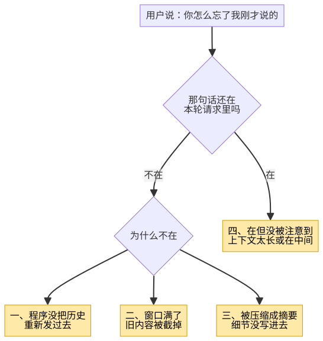
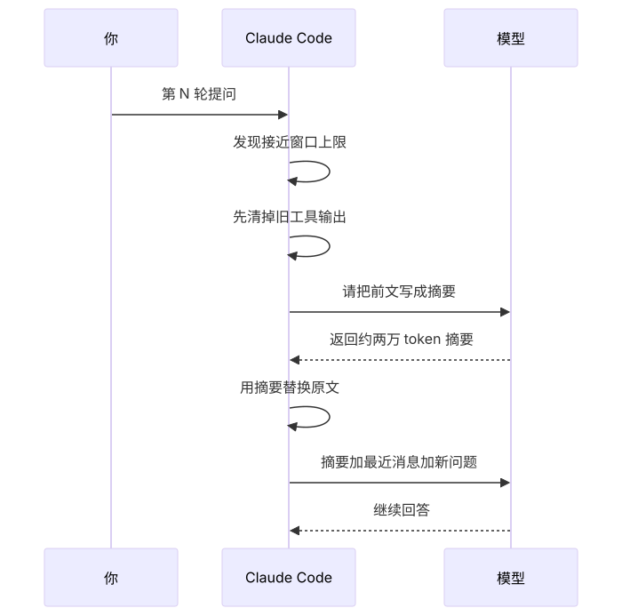
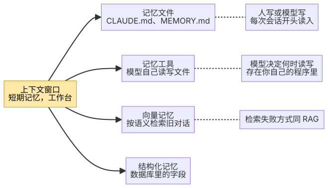
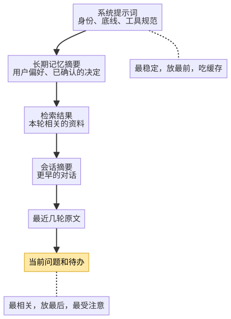
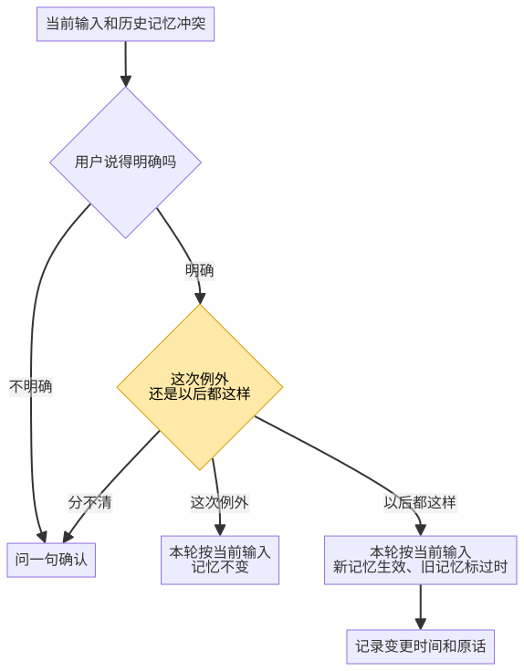

# T03 - Memory Loss · 专题：Agent 为什么会忘

> 专题 T03 · 面试高频专题「答错与遗忘」第 3 篇（共 3 篇：[T01 专题：幻觉](T01-hallucination.md) · [T02 专题：RAG 为什么答不对](T02-rag-failures.md) · T03 记忆） · 覆盖地图上的 B3 上下文工程、B4 压缩与记忆丢失、B5 记忆体系 · 事实核实截至 2026-10-20
> 专题卡不占每日流水号；以后讲到 B3、B4、B5 时会展开完整原理，本篇只讲"为什么会忘、怎么防、面试怎么答"。
> [← 返回目录](../README.md)

> 本篇大量用 Claude Code 和 Claude 接口当例子。本文由 Anthropic 的模型撰写，存在利益相关；Claude 这边的短板在相关小节写出。

---

## 🧭 一句话总览

模型本身不记事。Agent 能"记住"，全靠程序每一轮把该记的东西重新放进上下文窗口（模型一次能读进去的全部内容）。所以"它忘了"只有两种情况：**该放的没放进去**，或者**放进去了但它没看见**。还有一种比忘了更糟：**放进去的是错的、过时的**。

回到 [T01 专题：幻觉](T01-hallucination.md) 的主线：没放进去是"没看到"，放进去没看见是"看到了没用上"，记错了是"看到了错的"。

**本篇提纲**

1. **"它忘了"的四个来源**：接口不记事、窗口满了被截断、压缩时摘要漏了细节、对话越长注意力越差。
2. **压缩到底丢了什么**：用本机 Claude Code 的真实压缩记录讲。
3. **短期记忆和长期记忆**：上下文是工作台，记忆是仓库；记错比忘了更危险。
4. **怎么防丢**：关键状态写到外部、按需取回、压缩前先抽取、分给子代理。
5. **上下文怎么组装**：系统提示词、用户偏好、会话摘要、最近对话、检索结果，按什么顺序、各给多少预算。
6. **用户中途改口**：当前输入和历史记忆冲突时听谁的。
7. **金融场景**：客户偏好记错了、过期了、该删没删。

---

## 一、"它忘了"的四个来源

**一句话结论**：四个来源从底层到上层依次是：接口本身不记事；窗口装满后，旧内容被截掉；为了腾地方，旧内容被压缩成摘要，细节丢了；就算内容都在，对话越长，模型对其中每一部分的注意力越弱。



怎么读这张图：排查时第一个问题永远是"那句话还在不在这一轮的请求里"。不在，再分三种原因；在，就是注意力的问题。四个来源画成四个出口是为了好讲；实际情况常常是叠加的，比如压缩时摘要写了一句"用户偏好简洁"，原话里的具体要求"不超过三段、不用表格"丢了，剩下的这一句又在很长的上下文中间，被忽略了。

**逐个讲因果**

**第一，接口不记事。** [006 模型接口（上）](../lessons/006-model-api-1.md) 讲过：模型接口是无状态的，每次请求都要把整段历史重新发一遍。所谓"多轮对话"，是程序每轮把历史拼起来重发造出来的。程序只发了最后一句，模型就真的不知道前面说过什么。

**第二，窗口满了被截断。** 窗口有上限。最简单的做法叫滑动窗口：只保留最近 N 轮，更早的直接丢掉。小林 coding 的题页把它的本质缺陷概括为"硬截断"：不管内容重不重要，只看时间先后，三天前确认的关键决策和一句寒暄一样会被丢掉。[9]

**第三，压缩时摘要漏了细节。** 压缩（compaction）是让模型把前面的对话写成一段摘要，再用摘要替换原文。Anthropic 的工程博客对它的定义是：对话接近窗口上限时，把内容总结一下，用摘要重新开一个上下文窗口。[1] 摘要里没写到的东西，模型之后就看不到了。Claude Code 的文档直接提醒：会自动压缩，但对话早期给的指令可能会丢，长期要遵守的规则要写进 CLAUDE.md（Claude Code 的项目说明文件，每次会话都会读入）。[3]

**第四，对话越长注意力越差。** Anthropic 的博客把这叫上下文腐化（context rot）：窗口里的 token 越多，模型准确回忆其中信息的能力越差，所有模型都有这个特点。[1] 原因是模型的注意力像一笔预算，每个新 token 都要分走一点；n 个 token 之间有 n 的平方对关系要处理，越长越摊薄。博客的说法是"性能是渐变的，不是悬崖"。[1] Chroma（一家向量数据库公司）测了 18 个模型，结论一致；[2] 关键信息落在上下文中间时最容易被漏掉，这个现象叫"迷失在中间"。[T02 专题：RAG 为什么答不对](T02-rag-failures.md) 第六节有详细数字。

**易混淆**："上下文窗口就是 Agent 的记忆"。不对。窗口是一次请求里模型能读的全部内容，请求结束就清空；记忆是存在窗口之外、需要时再放进来的东西。两者的关系是工作台和仓库。

---

## 二、压缩到底丢了什么：一次真实记录

**一句话结论**：压缩是一次非常剧烈的有损操作：本机 Claude Code 的几次自动压缩，都是把接近 100 万 token 的对话压到 2 万 token 左右，只留下约 2%。

**本机实物**：我只读统计了本机 Claude Code 会话记录里的压缩边界记录，没有读对话内容：[14]

```
日期         触发方式   压缩前 token   压缩后 token   保留比例   耗时
2026-06-03   手动         176,434          6,326         3.6%     85 秒
2026-08-01   自动       1,002,923         23,850         2.4%    226 秒
2026-08-02   自动         999,021         17,775         1.8%    255 秒
2026-09-27   自动         965,228         21,966         2.3%     56 秒
```

读法有三点。第一，三次自动压缩都发生在接近 100 万 token 的时候，和 Claude Code 文档"原生 100 万窗口的模型默认在约 96.7 万 token 时压缩"的说法吻合（这一条文档原文我只读到了摘要，数字靠本机记录佐证）。[4] 第二，压缩后只剩 2% 左右，意味着 98% 的原文变成了一段摘要；哪怕摘要写得再好，具体的数字、文件路径、用户说过的原话，大部分都只能以"概括"的形式存在。第三，压缩本身很慢、也要花钱，最长的一次用了 4 分多钟，因为它要让模型把将近 100 万 token 读一遍再写摘要；Claude Code 的费用文档也写明 `/compact` 本身就是一次很大的请求，而 `/clear`（清空对话）不花钱。[5]

**Claude Code 压缩时保留什么**：文档写的是，上下文快满时，先清掉较早的工具输出，必要时再总结对话；用户的请求和关键代码片段会被保留。[3] 你可以在 CLAUDE.md 里加一节"Compact Instructions"告诉它压缩时重点保留什么，也可以手动执行 `/compact 重点保留接口改动`。用 `/context` 可以看到窗口里各部分各占了多少。[3] 项目根目录的 CLAUDE.md 和自动记忆在压缩后会从磁盘重新注入，只在对话里口头说过的指令、带 `paths:` 的规则和子目录 CLAUDE.md 会随对话一起被摘要（2026-10-28 按 Claude Code 上下文窗口文档「What survives compaction」表原文核实，详见第 015 讲《压缩与记忆丢失》（B 块））。[6]



怎么读这张图：箭头上是发出的消息，不是完成的动作。第三步"先清掉旧工具输出"是最轻的一种处理：工具返回的长结果，比如读过的大文件，最占地方也最容易重新取回，所以先清它。第四、五步才是真正的压缩，是一次额外的模型调用。从第六步开始，模型看到的不再是原文，而是摘要，摘要里没写到的细节从此不存在。Anthropic 博客对 Claude Code 压缩的早期描述是"摘要加上最近访问的五个文件"，现在的文档写法是"先清工具输出再总结"，两者不矛盾，但细节可能已经变化，以当前文档为准。[1][3]

**接口层面的同类功能**（截至 2026-10-30，都还是测试版，按 Claude 上下文窗口与上下文编辑文档复查）：

- **上下文编辑**（context editing）：在请求到达模型之前，由服务器自动清掉最旧的工具结果，换成一段占位文字，你本地的完整历史不变；也能清掉旧的思考块（thinking block：模型回答前的内部推理内容）。请求头是 `context-management-2025-06-27`。[7]
- **服务端压缩**：由服务器替你把旧对话换成 Claude 写的摘要。按阈值触发的版本默认在输入达到 15 万 token 时触发，最低可以设到 5 万；文档更推荐用按需触发的版本。[8]

这两者都会让提示词缓存（把重复前缀的计算结果存起来、下次低价复用）失效，因为前缀变了，[007 模型接口（下）](../lessons/007-model-api-2.md) 讲过。

**易混淆**："压缩和提示词缓存都是在省上下文"。不对。缓存不改变模型读到的内容，一个字都没少，省的是钱和时间；压缩改了内容，省的是窗口空间，代价是丢细节，而且会让缓存失效。

---

## 三、短期记忆和长期记忆

**一句话结论**：短期记忆就是当前上下文窗口里的内容，会话结束就没了；长期记忆存在窗口之外，比如文件、数据库、向量库，需要时再取回来放进窗口。长期记忆最难的不是"怎么存、怎么取"，而是"该记什么"，以及"记错了怎么办"。

**因果链**：为什么"记错比忘了更危险"？忘了，用户会发现，会重说一遍；记错了，比如把客户的风险偏好记成了"激进"，系统会在之后每一次对话里都按错的信息行事，而且语气笃定，用户未必发现。Charles 的旧笔记《向量数据库与记忆层》第 5 节把这一点说得很清楚：RAG 检索失败是"查不到、查错"，Agent 记忆失败是"记住了错的东西，并且一直用"，污染会累积。

**长期记忆的几种形态**



怎么读这张图：左边是窗口，右边四种是窗口之外的仓库，箭头表示"需要时把内容搬上工作台"。四种画成并列是为了好讲；实际系统常常混用，比如偏好存在结构化字段里，聊天历史存在向量库里。B5 记忆体系簇会讲情景、语义、程序性记忆这类更细的分法，以及 Mem0、Letta 这些专门做记忆层的框架。

**Claude 这边的实物**

- **CLAUDE.md**：人写的长期规则，每次会话开头读入。官方建议每个文件控制在 200 行以内，太长会占上下文、降低遵守率。[6]
- **自动记忆**：Claude Code 根据你的纠正和偏好自己写笔记，存在本机 `~/.claude/projects/<项目>/memory/` 下，分 user、feedback、project、reference 四类；每次会话开头读入 `MEMORY.md` 的前 200 行或 25 KB，哪个先到算哪个。[6] 本机一共有 15 个 `MEMORY.md`，加起来 54 行。这个会话所在的记忆目录里就有一条"给 Charles 写长文时，术语和缩写后面都跟一句括号解释"，这就是你在每张卡片里看到随文括注的来源之一。
- **记忆工具**（memory tool）：Claude 接口提供的一个工具，模型可以在 `/memories` 目录下查看、创建、修改、删除文件；文档强调它"完全在你的应用程序里运行"，模型只是发出读写请求，存在哪里由你决定。接口会自动加一句系统提示，要求模型在做任何事之前先看一下记忆目录。文档还特别提醒要防止路径穿越（用 `../` 跳出记忆目录读别的文件）。[10]

**易混淆**：RAG 和长期记忆用的检索技术可能一样，但数据性质不同。RAG 的资料库相对静态，批量导入；记忆是在对话中不断生长的，由 Agent 自己决定写什么，写入策略才是难点。

---

## 四、怎么防丢

**一句话结论**：核心思路是"不要把重要的东西只放在对话里"。关键状态写到窗口外面去，需要时再按需取回；压缩前先把重要信息抽成结构化的记录；把大块的探索工作交给子代理，只拿回结论。

Anthropic 的工程博客总结了长任务里管理上下文的三类做法：压缩、结构化笔记、多代理架构；再加上"即时检索"。[1]

| 做法 | 怎么做 | 防的是哪一种丢 |
|---|---|---|
| 结构化笔记 | Agent 定期把进度、决定、待办写进窗口外的文件，比如 NOTES.md 或待办清单 | 压缩时摘要漏细节 |
| 即时检索 | 窗口里只放文件路径、查询语句这类"指针"，需要时再用工具读出来 | 窗口被大块内容塞满 |
| 子代理 | 让子代理在自己的干净窗口里做探索，只返回一段精炼摘要，博客说通常是 1000 到 2000 token | 主窗口被中间过程塞满 |
| 压缩前抽取 | 压缩前先把关键决定、用户偏好、未完成事项抽成结构化记录，单独保存 | 关键决定被概括掉 |
| 重要的放显眼处 | 关键约束放在系统提示词或上下文末尾，不放在长对话中间 | 迷失在中间 |
| 写进 CLAUDE.md | 长期规则写进文件，不只在对话里说 | 压缩后口头指令丢失 |

**因果链**：为什么"压缩前抽取"比"写一个更好的摘要"更可靠？摘要是自由文本，模型会按自己的判断取舍，"用户三天前否决了方案 A"可能被概括成"讨论了几个方案"。结构化抽取是预先规定好要保留哪几类信息，比如"已确认的决定""已否决的方案""用户偏好""未完成事项"，每一类单独存一条，不经过概括。小林 coding 的题页里，面试官就追问过这个场景：用户三天前确认的关键决策被压缩丢了，Agent 回头又提那个已经被否决的方案，怎么办？[9]

**例子**：Charles 让 Agent 花两小时重构研报助手的检索模块。中途他否决了"换嵌入模型"的方案，确认了"加重排"。好的做法是：Agent 每完成一步就在 `NOTES.md` 里更新三栏，"已完成""已否决：换嵌入模型，原因是专有名词问题靠关键词检索解决""下一步"；压缩发生后，它读回这份笔记，不会再提换嵌入模型。

**Claude 这边的短板**：Claude Code 的自动压缩阈值默认贴近窗口上限，压缩发生时窗口已经非常满，这时上下文腐化最严重，压缩本身也最慢、最贵；可以用 `/autocompact`、`--autocompact` 启动参数或 `autoCompactWindow` 设置把阈值调低（2026-10-30 已按 Claude Code 模型配置文档原文核实；原生 100 万窗口的模型默认约在 96.7 万 token 时压缩）。[4] 接口层面的上下文编辑和服务端压缩截至 2026-10-30 都还是测试版。

---

## 五、上下文怎么组装

**一句话结论**：每一轮送给模型的上下文，是程序从好几个来源挑出来、按顺序拼起来的。先分预算，再挑内容，再排顺序；不是全塞进去，超长了再截。

**因果链**：为什么要先分预算？如果先把所有东西拼好再截断，被截掉的往往是排在后面的检索结果或者最近的对话，恰恰是最相关的。小林 coding 的题页有一节标题就是"Token 预算要在装配前分，不是超长后才截断"。[9] 为什么顺序重要？模型对开头和结尾注意得最多；不变的部分放在前面还能吃到提示词缓存的折扣。



怎么读这张图：从上往下是拼装顺序，越往上越稳定、越往下越贴近当前任务。左侧两条虚线说明了排序的两个理由：上面稳定的部分能命中缓存，下面相关的部分离模型要回答的位置最近。这个顺序是一种常见的推荐做法，不是唯一正确的标准；检索结果放在会话摘要前面还是后面，不同系统有不同选择，要用评测去比。

**预算怎么分**：先按优先级给每一块定上限，比如系统提示词 2000、长期记忆 1000、检索结果 8000、会话摘要 2000、最近几轮 6000、留给回答 4000；某一块用不完，余量给下一块。JavaGuide 有一道综合题正好问这个："客服机器人历史会话持续增长时，如何分配 Token 预算并保留关键业务状态？"[11]

**例子**：研报助手的一次请求：系统提示词 1500 token；长期记忆里 300 token，写着"小王关注新能源板块，偏好表格"；检索到 3 份研报片段 6000 token；更早的对话摘要 800 token；最近 4 轮原文 3000 token；最后是当前问题。总共约 1.2 万 token，比把全部历史和全部研报塞进去少得多，也更准。

---

## 六、用户中途改口：当前输入和历史记忆冲突时听谁的

**一句话结论**：默认以用户当前明确说的为准，因为用户的意图变了；但要分清"这次例外"和"以后都这样"，必要时确认一句；然后更新记忆，并把旧记忆标成过时，而不是让两条矛盾的记忆同时存在。

**因果链**：为什么默认听当前的？记忆是对过去意图的记录，当前输入是最新的意图。为什么不能简单覆盖？因为用户可能只是这一次例外，比如平时偏好简洁，这次说"详细讲讲"，不代表以后都要详细。为什么要标"过时"而不是删除？金融这类场景要能回溯"当时为什么那样回答"。牛客题单里有一道题问长期记忆的四种状态：生效、过时、冲突、已删除，指的就是这套管理。[12] 同一份题单还有一道很细的题：用户问"你知道我偏好什么吗"，为什么可能被误当成一条要写入的记忆？[12] 这说明写入前要判断"这是一个陈述还是一个提问"。



怎么读这张图：黄色那个菱形是最容易被忽略的一步：大部分系统要么永远听记忆，要么永远覆盖记忆，没有区分"一次性"和"长期"。分不清时宁可问一句，代价是一轮对话，比记错的代价小得多。最下面"记录变更时间和原话"是为了以后能回溯；在高风险场景，比如客户的风险承受能力，改动还要走正式流程，不能只凭一句聊天。

**例子**：小王的长期记忆里写着"偏好表格"。今天他说"这次别用表格，我要直接粘到邮件里"。正确做法是这一轮不用表格，记忆不改，因为他说的是"这次"。如果他说"以后都别用表格了"，就把旧记忆标成过时，写入新偏好，并记下日期和原话。

---

## 七、金融场景：记错了、过期了、该删没删

**一句话结论**：金融场景里，Agent 记住的客户信息往往就是合规要求里的关键信息，比如风险偏好、投资期限、联系方式。记错了会导致不适当的推荐；过期了会按旧情况服务；该删没删会违反个人信息保护的要求。

**怎么做**

1. **关键信息不靠模型自由记忆**：风险测评结果、产品适当性等级这类信息，从正式系统里读，不从聊天中"记"。Agent 的记忆只放偏好类的软信息。
2. **每条记忆带时间和来源**：记的是什么、什么时候记的、出自哪次对话的哪句话；超过有效期的自动降权或要求重新确认。
3. **能查、能改、能删**：客户要求删除时，记忆层要能找到并删除与他有关的所有条目，包括向量库里的；删除要留记录。
4. **写入要审核**：模型自己决定写入的记忆，涉及身份、财务状况、健康这类敏感信息时，要么禁止写入，要么需要人工确认。
5. **留痕**：每次回答时用到了哪几条记忆，要能回放，出了问题能说清"当时它为什么这么说"。

**例子**：一位客户两年前在聊天中说过"我能接受较大的波动"，被写进了记忆。今年他退休了，风险测评改成了"保守"，但聊天助手仍然按记忆里的"能接受较大波动"给他介绍高波动产品。正确的设计是：适当性等级只从风险测评系统读取，聊天里的说法只作为参考，而且两年前的记忆早该过期、要求重新确认。

---

## 💼 面试题

### 题 1 `[开发]` 请你介绍一下 AI Agent 的记忆机制，在实际开发中应该如何设计记忆模块？长短期记忆怎么存、怎么用？

来源：题库。小林 coding「AI Agent」第 8 题"请你介绍一下 AI Agent 的记忆机制，并说明在实际开发中应该如何设计记忆模块？"与第 9 题"Agent 的长短期记忆系统怎么做的？记忆是怎么存的？粒度是多少？怎么用的？"合并（目录页最近更新 2026-10-14，2026-10-20 访问）。[9]

**答题骨架**
- 结论：短期记忆是当前上下文，长期记忆存在窗口外按需取回；设计的难点是写入策略和纠错，不是存储。
- 三点展开：短期怎么管；长期怎么存怎么取；怎么防记错。
- 数字：Claude Code 每次会话读入记忆索引的前两百行或二十五 KB；本机一次自动压缩把约一百万 token 压到约两万。

**逐字范例**

> 我把记忆分成两层，短期和长期，再讲最难的一点。
>
> 第一，短期记忆，就是当前的上下文窗口。模型接口本身不记事，每轮都要把历史重发。窗口有上限，快满时要么截掉旧的，要么压缩成摘要。我看过本机 Claude Code 的压缩记录，约一百万 token 压到两万左右，只留下百分之二，所以细节一定会丢。
>
> 第二，长期记忆，存在窗口外面，需要时取回来。我会按信息类型分开存。用户偏好、已确认的决定这类，存成结构化字段，每次都读；历史对话存进向量库，按语义检索；长期规则写成文件，比如 Claude Code 的 CLAUDE.md，每次会话开头读入。粒度上，偏好是一条一条的，对话按轮或按段切。
>
> 第三，最难的不是存和取，而是该记什么、记错了怎么办。忘了用户会重说，记错了系统会一直按错的做。所以每条记忆要带时间和来源，有生效、过时、冲突这几种状态，用户改口时把旧的标成过时，而不是两条矛盾的同时存在。
>
> 一句话，上下文是工作台，记忆是仓库，难点在仓库的进货和清理。

**追问链**
1. 用过没有：记忆什么时候写入？要点：可以每轮结束时抽取，也可以在压缩前集中抽取；要区分陈述和提问，用户问你知道我偏好什么，不是一条新偏好。
2. 原理：为什么不把全部历史都放进窗口？要点：贵、慢，而且越长越不准，叫上下文腐化。
3. 边界：记忆和 RAG 有什么区别？要点：技术可能一样，但 RAG 的资料相对静态、批量导入，记忆在对话中生长、由 Agent 决定写入，失败方式是记错并持续使用。

**易错点**：只讲"用向量库存聊天记录"，没讲写入策略、过期和纠错。

### 题 2 `[开发]` Agent 对话历史越来越长，上下文快撑满了怎么办？记忆压缩有哪些方法？压缩阈值怎么定？

来源：题库。小林 coding「AI Agent」第 12 题"Agent 记忆压缩通常有哪些方法？"与第 29 题"Agent 的上下文压缩阈值应该如何确定？"（目录页最近更新 2026-10-14）；牛客转转 FDE 线下面试"Agent记忆怎么管理 超长对话怎么解决"（2026-08-26，仅见搜索摘要）。均于 2026-10-20 访问。[9][13]

**答题骨架**
- 结论：从轻到重四种，清工具结果、滑动窗口、摘要压缩、结构化抽取；阈值要在质量下降之前触发，而不是等窗口快满。
- 三点展开：四种方法和各自丢什么；阈值怎么定；怎么验证没丢关键信息。
- 数字：Claude 接口服务端压缩默认十五万 token 触发、最低可设五万；本机一次压缩保留约百分之二。

**逐字范例**

> 我会从轻到重用四种方法，再讲阈值。
>
> 第一，清掉旧的工具结果。读过的大文件、长的搜索结果最占地方，也最容易重新取回，先清它们，换成一句占位说明。这是最安全的一步。
>
> 第二，滑动窗口，只保留最近几轮。简单，但它是硬截断，不管重不重要，三天前确认的决定也会被丢掉。
>
> 第三，摘要压缩，让模型把前文写成摘要替换原文。我看过本机 Claude Code 的记录，约一百万 token 压到两万左右，所以摘要里没写的细节就没了。
>
> 第四，结构化抽取。压缩之前，先把已确认的决定、已否决的方案、用户偏好、未完成事项抽成固定格式的记录，单独保存，不经过概括。这样压缩后 Agent 不会又去提已经否决的方案。
>
> 阈值怎么定，我的原则是在质量开始下降之前触发，而不是等窗口快满。因为上下文越长模型越不准，窗口很满时压缩，摘要本身质量也差、还慢。Claude 接口的服务端压缩默认在十五万 token 触发。具体数值我会用评测定，把长对话按不同长度截出来，测关键信息的召回率，找到开始明显下降的位置。
>
> 一句话，能清的先清，能抽的先抽，最后才概括。

**追问链**
1. 原理：压缩和提示词缓存冲突吗？要点：冲突，压缩改了前缀，缓存要重写；所以不要频繁压缩，阈值也要考虑缓存成本。
2. 边界：怎么验证压缩没丢关键信息？要点：准备一组关于早期对话细节的问题，压缩前后各问一遍，比较答对率。
3. 优化：还有别的办法吗？要点：把大块探索交给子代理，只拿回一两千 token 的结论；窗口里只放文件路径，需要时再读。

**易错点**：只说"做摘要"，不知道摘要会丢细节，也说不出阈值的依据。

### 题 3 `[开发]` 当前用户输入和历史记忆发生冲突时，以哪个为准？为什么？

来源：题库。牛客《Agent面试题（自己总结版）》第 52 题"当前用户输入和历史记忆发生冲突时，以哪个为准？为什么？"（2026-10-14，个人整理题单）；小林 coding《Agent 的上下文工程怎么设计》题页中面试官追问"旧 Memory 和用户刚说的话冲突时听谁的？"（最近更新 2026-10-12）。均于 2026-10-20 访问。[9][12]

**答题骨架**
- 结论：默认以当前明确的输入为准，但要区分这次例外和长期改变，分不清就确认，然后更新记忆状态。
- 三点展开：为什么听当前的；怎么区分一次和长期；记忆怎么更新。
- 例子：平时偏好表格，这次说别用表格，本轮不用，记忆不改。

**逐字范例**

> 默认以当前明确的输入为准，但不是简单覆盖。分三点讲。
>
> 第一，为什么听当前的。记忆记录的是过去的意图，当前输入是最新的意图，用户就在眼前，他说的话最能代表他现在想要什么。
>
> 第二，要区分这次例外和以后都这样。比如记忆里写着偏好表格，今天他说这次别用表格，我要粘到邮件里。这是一次性的，本轮不用表格，记忆不改。如果他说以后都别用表格了，才更新记忆。分不清的时候问一句，代价是一轮对话，比记错便宜得多。
>
> 第三，记忆怎么更新。不是删掉旧的写新的，而是把旧记忆标成过时，新记忆生效，记下变更的时间和原话。这样不会出现两条矛盾的记忆同时被检索出来，也能回溯当时为什么那样回答。有一种例外：涉及风险承受能力这类合规信息，不能凭一句聊天就改，要走正式流程。
>
> 一句话，当前意图优先，但要分清一次和长期，改记忆要留痕。

**追问链**
1. 原理：模型自己会优先听最近的话吗？要点：不一定，长上下文里两条矛盾信息都在时，它可能随便选一条；所以要在程序层面处理，而不是指望模型。
2. 边界：用户说的话和系统记录的事实冲突呢？要点：比如用户说我已经付款了，系统显示未付款，这时以系统记录为准，并告诉用户查到的情况。
3. 优化：怎么减少需要确认的次数？要点：用历史数据统计哪些改动通常是一次性的，比如格式偏好，默认按一次性处理。

**易错点**：回答"永远以记忆为准"或"永远覆盖"，没有区分一次和长期，也没讲记忆状态。

### 题 4 `[开发]` 系统提示词、用户偏好、会话摘要、最近对话和检索结果，怎么组装成上下文？Token 预算怎么分？

来源：题库。牛客《Agent面试题（自己总结版）》第 50 题"系统提示词、用户偏好、会话摘要、最近对话和检索结果，怎么组装成上下文？"（2026-10-14）；JavaGuide 综合场景题"客服机器人历史会话持续增长时，如何分配 Token 预算并保留关键业务状态？"（最近更新 2026-08-03）。均于 2026-10-20 访问。[11][12]

**答题骨架**
- 结论：先分预算，再挑内容，再排顺序；稳定的放前面吃缓存，相关的放后面最受注意。
- 三点展开：顺序；预算；关键业务状态单独保留。
- 数字：示例一次请求约一万二千 token，系统提示词一千五、长期记忆三百、检索结果六千、会话摘要八百、最近几轮三千。

**逐字范例**

> 我的原则是先分预算，再挑内容，再排顺序，而不是全拼好了超长再截。分三点讲。
>
> 第一，顺序。从上往下，系统提示词、长期记忆里的用户偏好和已确认的决定、本轮检索结果、更早对话的摘要、最近几轮原文，最后是当前问题。上面最稳定，放前面能命中提示词缓存；下面最相关，放最后离模型要回答的位置最近，最受注意。
>
> 第二，预算。每一块先定上限，比如系统提示词两千、长期记忆一千、检索结果八千、会话摘要两千、最近几轮六千，还要给回答留四千。某一块用不完，余量给下一块。如果先拼后截，被截掉的往往是排在后面的检索结果和最近对话，恰恰是最有用的。
>
> 第三，关键业务状态单独保留。比如客服场景里的订单号、用户已经确认的退款方案，这些不能进摘要被概括掉，而是作为结构化字段放在长期记忆那一块，每轮都带。
>
> 我们研报助手一次请求大约一万二千 token，比把全部历史和全部研报塞进去少得多，答得也更准。
>
> 一句话，上下文是一次有预算的选择，不是一次全量的拼接。

**追问链**
1. 原理：为什么检索结果不放最后？要点：当前问题和待办离回答最近最重要；检索结果放在问题前面，模型读完资料再看问题，这也是长资料在前、问题在后的建议。
2. 边界：预算不够怎么办？要点：先压会话摘要和最近对话的轮数，最后才动检索结果；系统提示词和关键业务状态不动。
3. 优化：怎么知道顺序和预算合不合理？要点：用评测集比较不同组装方式的答对率和成本。

**易错点**：只说"按时间顺序拼起来"，没讲预算、缓存和关键状态。

### 题 5 `[产品·商分]` 用户反馈两类问题：一类说"助手总是忘记我说过的偏好"，另一类说"它记住了我不想让它记的事"。你怎么设计记忆功能？怎么衡量？

来源：自拟。

**答题骨架**
- 结论：记忆要做成用户看得见、改得了的功能，而不是后台的黑箱；同时用两个指标分别衡量"该记的记住了没有"和"不该记的有没有记"。
- 三点展开：该记什么；用户控制；怎么衡量。
- 数字：偏好遵守率、误记率、用户主动删除率。

**逐字范例**

> 这两类抱怨其实是同一个问题的两面，写入策略没设计好。分三点讲。
>
> 第一，该记什么。我会把可以记的东西限定成几类，比如格式偏好、关注的板块、常用的称呼；身份信息、财务状况、健康这类敏感内容默认不记，除非用户明确要求。还要区分用户是在陈述一个偏好，还是只是这一次的要求，或者只是在提问。
>
> 第二，让用户看得见、改得了。做一个记忆页面，列出助手记住了什么、什么时候记的、出自哪次对话。用户可以改、可以删、可以一键关掉。助手用到某条记忆时，在回答里轻轻提一句，比如按你之前说的偏好用了表格，用户发现不对就能马上纠正。
>
> 第三，怎么衡量。三个数。偏好遵守率，用户设过的偏好，后续对话里被遵守的比例，衡量第一类抱怨。误记率，抽样看写入的记忆里有多少是用户不想记或者记错的，衡量第二类抱怨。用户主动删除率，如果很高，说明我们记了太多不该记的。
>
> 一句话，记忆不是越多越好，而是要让用户觉得它记住的都是对的、都是自己愿意的。

**追问链**
1. 用户关掉记忆，体验变差怎么办？要点：尊重用户选择；可以只在当前会话里记，会话结束就清掉。
2. 怎么和业务方讲投入产出？要点：看开启记忆的用户留存率和满意度，对比没开启的。
3. 记忆功能上线要过哪些审核？要点：隐私和合规审核，说明存在哪里、保存多久、怎么删除。

**易错点**：只讲"记得更多"，没意识到误记和隐私是同等重要的问题。

### 题 6 `[金融科技·数据]` 理财顾问 Agent 的长期记忆里存了客户的风险偏好和家庭情况。从合规角度要注意什么？

来源：自拟。

**答题骨架**
- 结论：合规相关的信息不靠聊天记忆，从正式系统读；聊天记忆要带时间和来源、能查能删、敏感信息限制写入、用到时能回放。
- 三点展开：哪些信息不能靠记忆；记忆本身怎么管；出了问题怎么回溯。
- 例子：客户两年前说能接受波动，退休后测评改为保守，助手仍按旧记忆推荐高波动产品。

**逐字范例**

> 我会分三点讲，哪些信息不能靠记忆，记忆本身怎么管，出了问题怎么回溯。
>
> 第一，合规相关的关键信息不能靠聊天记忆。风险测评等级、产品适当性这类，要从正式的测评系统读取。比如一位客户两年前聊天时说能接受较大波动，被记了下来，今年退休后测评改成了保守，助手如果还按旧记忆推荐高波动产品，就是适当性问题。聊天里的说法只能当参考。
>
> 第二，记忆本身怎么管。每条记忆带上时间和来源，超过有效期自动降权或要求重新确认。家庭情况、健康、收入这类敏感信息，默认不让模型自己写入，需要客户明确同意或人工确认。客户要求删除时，要能找到并删除和他有关的所有记忆，包括向量库里的，删除本身也要留记录。
>
> 第三，回溯。每次回答记下用到了哪几条记忆、各自的版本和时间。出了投诉，能说清楚当时它为什么这么说，是测评系统的数据错了，还是记忆过期了，还是模型理解错了。
>
> 一句话，合规信息从系统读，聊天记忆要可追溯、可过期、可删除。

**追问链**
1. 记忆存在境外模型厂商那里吗？要点：以 Claude 的记忆工具为例，存储在调用方自己的程序里，存在哪由机构决定；但每次用到时内容会随请求发给模型，仍要按数据出境要求评估。
2. 监管检查时要提供什么？要点：记忆的写入规则、保存期限、删除记录，以及抽样的回答和对应的记忆版本。
3. 客户说的和测评结果冲突怎么办？要点：以测评为准，同时提示客户可以重新测评，不能由聊天直接改适当性等级。

**易错点**：只讲技术上怎么存，没讲适当性、敏感信息、删除权和回溯。

---

## 🎙 两分钟口述：Agent 为什么会忘，怎么防

> 我先说一句底层事实，模型本身不记事，Agent 能记住，全靠程序每一轮把该记的东西重新放进上下文窗口。
>
> 所以它会忘有四个来源。第一，程序没把历史重新发过去。第二，窗口满了，旧内容被截掉。第三，被压缩成摘要，细节没写进去。我看过本机 Claude Code 的压缩记录，约一百万 token 压到两万左右，只留百分之二。第四，内容都在，但上下文太长，模型注意不到，尤其是在中间的部分。
>
> 比忘了更糟的是记错。忘了用户会重说，记错了系统会一直按错的做。
>
> 怎么防，核心是不要把重要的东西只放在对话里。关键决定和进度写进外部的笔记；窗口里只放文件路径，需要时再读；大块探索交给子代理，只拿回结论；压缩之前先把已确认的决定、已否决的方案抽成固定格式单独保存。
>
> 组装上下文时，先分预算再拼，稳定的放前面吃缓存，相关的放后面最受注意。
>
> 用户中途改口时，默认听当前的，但要分清这次例外还是以后都这样，分不清就问一句，然后把旧记忆标成过时并留痕。
>
> 一句话，上下文是工作台，记忆是仓库，忘和记错都要靠程序管，不能指望模型自己记住。

---

## 🔗 和其他卡片的关系

- [006 模型接口（上）](../lessons/006-model-api-1.md)：接口无状态，是"忘"的第一个来源。
- [007 模型接口（下）](../lessons/007-model-api-2.md)：提示词缓存，压缩和上下文编辑都会让它失效。
- [008 提示词工程（上）](../lessons/008-prompt-engineering-1.md)：CLAUDE.md 作为 user 消息送入、系统提示词要稳定，和本篇第三、五节相关。
- [T01 专题：幻觉](T01-hallucination.md)：记错的记忆会让模型稳定地说错话。
- [T02 专题：RAG 为什么答不对](T02-rag-failures.md)：向量记忆的检索失败方式和 RAG 相同；上下文腐化的详细数字在 T02 第六节。

---

## 📖 术语小词典

- **CLAUDE.md** — Claude Code 的项目说明文件，每次会话开头读入，作为系统提示词之后的 user 消息送入。
- **MEMORY.md** — Claude Code 自动记忆的索引文件，每次会话读入前 200 行或 25 KB。
- **上下文窗口** — 模型一次能读进去的全部内容，请求结束就清空。
- **上下文腐化**（context rot）— 窗口里的 token 越多，模型准确使用其中信息的能力越差。
- **上下文编辑**（context editing）— Claude 接口在请求到达模型前自动清掉旧工具结果或思考块的功能，测试版。
- **压缩**（compaction）— 把旧对话写成摘要替换原文。
- **滑动窗口** — 只保留最近 N 轮对话，更早的直接丢掉。
- **结构化抽取** — 按固定类别把关键信息抽成记录单独保存。
- **结构化笔记** — Agent 定期把进度和决定写进窗口外的文件。
- **即时检索** — 窗口里只放指针，需要时再用工具取回内容。
- **子代理** — 在独立上下文窗口里完成子任务、只返回摘要的代理。
- **记忆工具**（memory tool）— Claude 接口提供的读写记忆文件的工具，存储在调用方程序里。
- **路径穿越** — 用 `../` 跳出允许的目录访问其他文件的攻击。
- **思考块**（thinking block）— 模型回答前的内部推理内容。
- **提示词缓存**（prompt caching）— 跨请求复用相同前缀的计算结果、按低倍率计费。
- **迷失在中间**（lost in the middle）— 关键信息在长上下文中间时最容易被模型漏掉。
- **适当性** — 金融产品要与客户的风险承受能力匹配的监管要求。

---

## Sources

1. Anthropic，*Effective context engineering for AI agents*（2025-09-29）：https://www.anthropic.com/engineering/effective-context-engineering-for-ai-agents — 访问于 2026-10-20，全文逐字读到
2. Chroma，*Context Rot*（2025-07-14）：https://www.trychroma.com/research/context-rot — 访问于 2026-10-20
3. Claude Code 文档，*How Claude Code works*：https://code.claude.com/docs/en/how-claude-code-works — 访问于 2026-10-20，全文读到
4. Claude Code 文档，*Model configuration*（自动压缩窗口一节）：https://code.claude.com/docs/en/model-config — 访问于 2026-10-20；约 96.7 万 token 的默认触发点和 `/autocompact` 设置只见于摘要，未逐字核实
5. Claude Code 文档，*Costs*：https://code.claude.com/docs/en/costs — 访问于 2026-10-20
6. Claude Code 文档，*Memory*：https://code.claude.com/docs/en/memory — 访问于 2026-10-20；"CLAUDE.md 压缩后重新读入"一条只见于摘要
7. Claude 平台文档，*Context editing*：https://platform.claude.com/docs/en/build-with-claude/context-editing — 访问于 2026-10-20；默认参数只见于摘要
8. Claude 平台文档，*Compaction* 与 *Compaction threshold*：https://platform.claude.com/docs/en/build-with-claude/compaction ；https://platform.claude.com/docs/en/build-with-claude/compaction-threshold — 访问于 2026-10-20
9. 小林 coding，AI 面试题目录（最近更新 2026-10-14）、《Agent 的上下文工程怎么设计》与《Agent 记忆压缩通常有哪些方法》（最近更新 2026-10-12）：https://xiaolinnote.com/ai/ ；https://xiaolinnote.com/ai/agent/17_context_engineering.html ；https://xiaolinnote.com/ai/agent/12_memcompress.html — 访问于 2026-10-20
10. Claude 平台文档，*Memory tool*：https://platform.claude.com/docs/en/agents-and-tools/tool-use/memory-tool — 访问于 2026-10-20，全文读到
11. JavaGuide，《大模型基础面试题总结》（最近更新 2026-08-03）：https://javaguide.cn/ai/interview-questions/llm-interview-questions.html — 访问于 2026-10-20
12. 牛客，《Agent面试题（自己总结版）》（2026-10-14，个人整理题单）：https://www.nowcoder.com/feed/main/detail/122d1a985de74181b71126282b95c690 — 访问于 2026-10-20
13. 牛客，转转 FDE 线下面试（2026-08-26）：https://www.nowcoder.com/feed/main/detail/6204344a50a04c46a6220b2d73c426bc — 仅见搜索摘要，2026-10-20
14. 本机 Claude Code 会话记录中的 `compact_boundary` 记录（只读统计，未读对话内容），2026-10-20

---

## 更新日志

- 2026-10-20: 创建。面试高频专题第 3 篇
- 2026-10-28: 第二节一处修订：压缩后从磁盘重新注入的内容按官方文档原文核实，补上随对话被摘要的三类；写第 015 讲 B4 时核实
- 2026-10-30: 时效刷新——`/autocompact` 调阈值一句按 Claude Code 模型配置文档原文核实并补默认约 96.7 万；上下文编辑与服务端压缩仍是测试版，日期更新为 10-30
